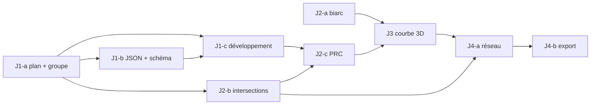
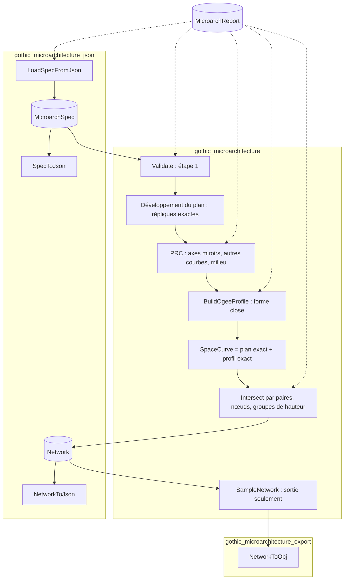

# Plan d'exécution — microarchitecture gothique 3D, jalons J1 à J4

Document d'exécution du plan `gothic_microarchitecture_plan.md` (décisions M1 à M6 du 2026-10-22,
non rediscutées ici). Base : arbre de travail du 2026-10-22, HEAD `5f210c2`, parent stable `078afc7`.
Les commits sont faits par l'utilisateur.

Marquage des affirmations :

- **[V]** : lu dans l'article (page, section, équation) ou dans le code (chemin:ligne) ;
- **[D]** : déduit, avec sa démonstration dans ce document. C'est une inférence, mais elle est vérifiable ;
- **[H]** : hypothèse ou interprétation, avec ce qui la confirmerait ou l'infirmerait ;
- **[M]** : mesuré, avec l'instrument nommé.

Instrument de contrôle des valeurs numériques de ce plan : un script Python indépendant du futur code
C++ (biarc, groupe, intersections, classement des croisements), exécuté le 2026-10-22 dans le
répertoire scratchpad de la session ; il n'est pas versionné. Biais connu, révélé par le cas « étoile » (§9.3) : son
intersection segment/segment ignore les segments colinéaires qui se touchent par une extrémité. Il
sous-compte donc les incidences aux sommets partagés colinéaires, et c'est un minorant à cet endroit.

---

## 1. Ce que dit l'article : règles retenues

Source : `C:\home\Doc\papers\Architecture\Gothic\2025_Computational Modeling of Gothic Microarchitecture.pdf`. Le
texte a été extrait page par page avec pypdf 6.10.1, sur les 15 pages, supplément compris (pp. 12-15).
Les figures n'ont pas pu être rendues : aucun moteur de rendu PDF n'est installé (pas de pdftoppm, de
mutool, de PyMuPDF ni de Ghostscript). Ce qui ne se lit que sur une figure reste donc non vérifié
(réserve R2).

| # | Règle | Source |
|---|---|---|
| A1 | Une vue de dessus est `D_t = {L_t, C_n(p), σ_d}`. Les courbes de base de `L_t` sont deux à deux non déductibles par symétrie. Le dessin complet est engendré par `{R^k Q^r, k = 1..n, r = 0,1}`, où R est la rotation de 360°/n autour de p et Q la réflexion d'axe d | [V] p.5 §4.2 |
| A2 | Un reverse curve (ogive) est fait de deux arcs circulaires raccordés G1, de courbures opposées. Leur point commun est le PRC | [V] p.5 Déf. 4.1 |
| A3 | Pour deux extrémités et deux tangentes données, le reverse curve a **un** degré de liberté. Le lieu des PRC est un arc de cercle (Sandel) | [V] p.5 §4.1 ; p.12 Remarque 2 |
| A4 | Si les tangentes sont parallèles, le PRC est sur le segment AB (Remarque 1) | [V] p.5 ; démonstration p.13 (limite α → 0) |
| A5 | Les sommets marqués (cercles, losanges) sont au sol, à hauteur 0 | [V] p.5-6 §4.3 obs. (1) |
| A6 | Les tangentes aux extrémités sont verticales dans la vue latérale | [V] p.6 §4.3 obs. (2) ; p.4 §3.2 |
| A7 | Le PRC de la vue latérale correspond à une intersection de la vue de dessus | [V] p.6 §4.3 obs. (3) ; p.4 §3.2 |
| A8 | Une intersection entre une courbe de base ℓ(t) et sa réplique ℓ'(t') est vraie **si et seulement si** t = t'. Justification : la hauteur d'une courbe de base est monotone croissante et ses répliques partagent cette fonction de hauteur | [V] p.6 §4.3.1 |
| A9 | Une intersection entre deux courbes de base distinctes « peut toujours » être vraie, car leurs fonctions de hauteur sont indépendantes | [V] p.6 §4.3.1 |
| A10 | Chaque courbe de base a un seul PRC. S'il y a plusieurs intersections vraies, on prend la plus proche du milieu | [V] p.6 §4.3.1 |
| A11 | Algorithme 1, en trois paliers : (1) intersections de ℓ avec ses répliques, la plus proche du milieu ; à défaut (2) intersections avec les autres courbes de base et leurs répliques, la plus proche du milieu ; à défaut (3) le milieu de ℓ | [V] p.14 Algo. 1 |
| A12 | Avec des tangentes verticales aux extrémités, la hauteur de B fixe celle de C : C est l'intersection de `A_sB_s` avec la verticale de `C_t`. Réciproquement, la hauteur de C fixe celle de B | [V] p.6 §4.3.2 |
| A13 | Courbe 3D : `ℓ(u) = (x(u), y(u), h(g⁻¹(p(u))))`, avec `p(u) = g(v)` | [V] p.6 éq. (1) ; p.8 |
| A14 | `p(u)` peut être une projection orthographique `x cos θ + y sin θ`, la longueur d'arc du plan (indépendante de la vue), ou simplement u | [V] p.8 ; p.13-14 éq. (B.4), (B.5) |
| A15 | Construction numérique (cas de tangentes non parallèles) : `O_A = A + r_A n_A`, `O_B = B + r_B n_B`, `C = r_B/(r_A+r_B) O_A + r_A/(r_A+r_B) O_B` | [V] p.13 §A.2 |
| A16 | Courbes à extrémité libre : biarc sur le premier arc, puis le second descend jusqu'à un point libre. Décorations : un arc se scinde en deux arcs de même rayon | [V] p.14 §C ; p.15 Fig. C.8 |
| A17 | Limites : pas de pinacles ni d'ornements de second ordre, un seul objet (éventuellement multicouche), hauteur découplée des proportions historiques | [V] p.10 §6 |

---

## 2. Ambiguïtés de l'article, contradictions et résolutions

### 2.1 Contradictions techniques avec le plan

Aucune contradiction avec M1 à M6. Il y a trois écarts de cohérence, que je signale et résous
sans rediscuter les décisions :

- **C1 — L'étape 2 du plan est incomplète par rapport à l'Algorithme 1.** Le plan ne décrit que le
  palier 1 (intersections avec les répliques). L'Algo. 1 [V p.14] a aussi un palier 2 (autres courbes
  de base) et un palier 3 (milieu). Sans ces paliers, une courbe sans intersection vraie avec ses
  répliques n'aurait pas de PRC. C'est le cas, par exemple, de toute symétrie de rotation pure (§2.2
  A-1). *Résolution* : implémenter les trois paliers. M5 (« le plus proche du milieu ») s'applique **à
  l'intérieur** de chaque palier.
- **C2 — Export de J5 et périmètre M4.** La table des jalons met l'export du réseau en J5, alors que M3
  fait de l'export de courbes le premier consommateur et que M4 limite le périmètre à J1-J4. *Résolution* :
  l'export JSON et OBJ des courbes passe en J4-b ; J5 ne garde que la visualisation tubulaire.
- **C3 — « Exact » (M1).** La représentation est analytique (segments et arcs en paramètres fermés), mais
  l'arithmétique reste en double précision. Les intersections sont calculées en forme close, avec des
  tolérances (§6.6), et non en arithmétique exacte. Le plan ne dit pas autre chose : je le précise ici
  pour éviter qu'on attende des prédicats robustes.

### 2.2 Ambiguïtés et résolutions

| # | Ambiguïté | Résolution retenue | Statut |
|---|---|---|---|
| A-1 | Le palier 1 de l'Algo. 1 dit « intersections entre ℓ et ses répliques » sans dire s'il filtre t = t'. Le §4.3.1 dit que le PRC est choisi parmi les intersections **vraies** | Filtrer par t = t'. Conséquence démontrée en §6.2 : le palier 1 n'est fait que des points où ℓ croise un **axe miroir** du groupe, ou passe par le centre. Une rotation pure ne donne donc jamais de candidat au palier 1. Le cas « moulinet » (§9.2) sépare les deux lectures : filtrer donne s = 2,5 (milieu), ne pas filtrer donne s = 2 | [D] + [H] sur l'intention des auteurs. Ce qui trancherait : le code des auteurs (github llorz/SIG25_goldschmiedrisse), non consulté |
| A-2 | « Le plus proche du milieu » : distance euclidienne au point milieu ou écart de paramètre ? | Les deux donnent le même ordre pour un segment ou un arc (`2R sin(|Δs|/2R)` est croissante en `|Δs|` tant que `|Δs| ≤ L/2 < πR`). On utilise `|s − L/2|`. En cas d'égalité, on prend le plus petit s et on émet l'avertissement `prc_tie` | [D] |
| A-3 | Une extrémité de ℓ peut-elle être un PRC ? (Les répliques se rejoignent souvent au centre, qui est point fixe de tout le groupe) | Non : seuls les candidats avec `s ∈ (tol, L − tol)` sont retenus. Un PRC à une extrémité annule l'un des deux arcs | [H] ; la géométrie (un arc de longueur nulle) le confirme |
| A-4 | Monotonie de la hauteur. A8 la suppose [V p.6]. Or le biarc à tangentes verticales n'est monotone que si `|z_B − z_A| ≥ L` (démontré en §6.3) | Un profil non monotone reste un reverse curve G1 valide, qui satisfait toutes les contraintes de §4.3. On le **construit** et on émet l'avertissement `profile_not_monotonic`, pas une erreur. Raisons : (a) le choix du PRC (points fixes) ne dépend pas de la monotonie, puisque t = t' entraîne l'égalité des hauteurs dans tous les cas ; (b) la validation des jonctions se fait par la hauteur (§6.5), pas par t = t' | [D] pour (a) et (b). [H] sur ce que montre la Fig. 6 (β = 30° et 60°), non rendue : réserve R2 |
| A-5 | La hauteur de contrôle est-elle celle de B ou celle du PRC C ? [V p.6 §4.3.2 : les deux] | En v1, les hauteurs sont portées par les **sommets** : un sommet est au sol ou a une hauteur. Le profil d'une courbe est entièrement déterminé par `(z_début, z_fin, s_PRC)`. Le contrôle par la hauteur du PRC est reporté (Q3) : il rend la hauteur d'un sommet dépendante d'une courbe, et donc conflictuelle si le sommet est partagé | [H] |
| A-6 | « Marked vertices » : au sol en §4.3, mais la Fig. C.5 [V p.14] parle d'« assigner des hauteurs aux sommets marqués (A et C) » | Deux notions séparées dans le schéma : `ground: true` donne une hauteur nulle (§4.3) ; `height: h` est une hauteur utilisateur (Fig. C.5) | [H] |
| A-7 | Le plan de vue latérale : orthographique d'angle θ, ou longueur d'arc ? | Longueur d'arc (M2). Pour un segment, c'est la vue orthographique avec q aligné sur le segment [V p.14 §B]. Pour un arc, c'est la projection sur la surface réglée verticale qui porte l'arc [V p.14 Fig. B.4] | décidé (M2) |
| A-8 | Sens de parcours : quel bout est « A » ? | C'est l'ordre d'entrée `start → end`. Le profil peut monter ou descendre ; seule l'égalité `z_début = z_fin` est refusée | [H] |
| A-9 | Courbes à extrémité libre et décorations (A16) | Hors périmètre J1-J4 : une courbe dont les deux extrémités ont la même hauteur est refusée (`profile_flat`) | décision de périmètre |
| A-10 | Multicouche : l'article n'en donne aucune formule (p.4 §3.1, p.8 Fig. 11, p.14 §C) | Le schéma v1 porte `levels` et `level` (M6). La génération exige **un seul** niveau déclaré, sinon erreur `unsupported_multi_level`. Ignorer silencieusement les autres niveaux serait pire | [H] ; révisable (M6 est révisable) |
| A-11 | Intersection entre deux courbes de base distinctes : l'article dit seulement qu'elle « peut » être vraie (A9) | Aucun solveur n'ajuste les hauteurs. La jonction est validée par la hauteur. Sinon c'est un croisement visuel, et son `dz` est rapporté pour que l'utilisateur ajuste les hauteurs | décision de périmètre |
| A-12 | Contact tangent entre deux courbes | C'est une intersection, marquée `tangential`, avec l'avertissement `tangential_contact` (topologie fragile) | [H] |
| A-13 | Position de l'axe de réflexion par rapport au centre | Le groupe n'est fini que si l'axe passe par p. Le schéma ne donne que l'**angle** de l'axe, qui passe par le centre par construction : l'état invalide n'est pas représentable | [D] : la composée d'une rotation d'angle non nul et d'une réflexion d'axe hors du centre engendre des translations, donc un groupe infini |
| A-14 | Courbe envoyée sur elle-même par une symétrie, en sens inverse (par exemple un arc centré sur le centre et symétrique par rapport à un axe) | Erreur `self_reversed_replica` : la hauteur devrait vérifier h(s) = h(L − s), ce qui est incompatible avec z_début ≠ z_fin | [D] |
| A-15 | Deux courbes de base images l'une de l'autre | Erreur `redundant_basic_curve` : A1 l'interdit [V p.5] | [V] |

---

## 3. Existant réutilisable

| Élément | Verdict | Raison | Preuve |
|---|---|---|---|
| `Vector2d` (`TVector2<double>`) | **Réutiliser**, avec deux précautions | Type de base du dépôt, aussi utilisé par `architecture_gothic_2d.h`. Précautions : `operator*` (scalaire) et `operator==` ne sont **pas const**. Comparer deux `const Vector2d` avec `==` devrait compiler quand même, en passant par la conversion implicite `operator const TValue*()`, et comparer des **adresses** ([H] : déduit des règles de résolution des opérateurs prédéfinis ; aucun compilateur n'est sur le PATH de cette session, à confirmer par une sonde de compilation en J1-a). Interdit dans ce module : comparer avec une tolérance, par une fonction dédiée | [V] `src/cgmath/TVector2.h:43-57`, `:92-95`, `:116-126` |
| `Vector3d` (`TVector3<double>`) | **Réutiliser** | Existe ; opérateurs const et constexpr ; produit vectoriel `^` | [V] `src/cgmath/TVector3.h:31-53`, `:201`, `:348` |
| `Circle`, `Arc` (cgmath) | **Ne pas** en faire la représentation canonique | `Arc` est paramétré par t ∈ [0,1] avec `angleStart/angleEnd/ccw`. Le balayage nul y vaut 0, et un tour complet y est implicite par normalisation [V `geometry.cpp:417-430`]. Un balayage **signé** explicite rend la réflexion triviale (on change le signe). Les deux types sont dans le namespace **global** [V `geometry.h:113`, `:232`] : un `Arc` maison dans `cgarchi` serait ambigu, d'où le namespace imbriqué (§4.1) | — |
| `Circle::intersection`, `Circle::segmentIntersection` | **Ne pas réutiliser** | (1) Cercles concentriques ou **confondus** : 0 point, donc un recouvrement d'arcs co-circulaires (cas fréquent, voir les arcs centrés sur le centre de symétrie) passe inaperçu [V `geometry.cpp:139-141`]. (2) La tangence est testée à tolérance nulle (`d > rsum` strict, `h2 <= 0`) [V `:147`, `:154`]. (3) Les seuils sont absolus (1e-12, 1e-24), pas relatifs à l'échelle [V `:203-225`]. À inscrire dans `debt_cgmath.md` ; ce document ne le modifie pas | — |
| `architecture_gothic_2d.{h,cpp}` | Pas de réemploi | Ce sont des constructions Havemann (arc brisé, foils, remplage) : aucune n'est une primitive d'intersection ou de symétrie générique. Elles signalent leurs erreurs par exceptions [V `architecture_gothic_2d.h:66-78`] | — |
| Lecteur JSON v2 (`parameterized_gothic_json.cpp`) | **Aligner les conventions**, sans partager le code | Champ `schema` versionné, `additionalProperties false` contrôlé par `Known`, chemins par `join` avec un point, catégories `json_parse/schema/type/value/missing`, chargement **transactionnel** [V `:27`, `:49-52`, `:114-160`, `:971-995`, `:997-1056`]. La classe `Reader` est dans un namespace anonyme : elle n'est pas réutilisable sans la déplacer. Déplacement à **ne pas** faire en J1 (voir Q6) | — |
| `GothicBuildReport` | Même **forme**, type distinct | Compteurs, entrées plafonnées à 64, champ `parameter`, et export `{"errors","warnings","entries":[{"severity","code","parameter","message"}]}` [V `architecture_gothic.h:200-235`]. Les enums `GothicBuildWarning/Error` sont propres à la fenêtre et déclarées « stables, ajout en fin » [V `:149-151`]. Y ajouter les codes de la microarchitecture couplerait deux sous-systèmes que le plan veut séparés. Le type `MicroarchReport` reprend la même forme et le **même JSON**, pour que Maker les consomme pareil. Duplication de forme à noter en dette (Q6) | — |
| Schémas `src/cgarchi/schemas/` | **Créer** `gothic-microarchitecture-v1.schema` | Les schémas sont copiés en POST_BUILD sous le même chemin relatif [V `test/CMakeLists.txt:91-101`]. Un test du dépôt **lit** les bornes du schéma et vérifie que le lecteur les applique [V `test/tu_cgarchi_gothic_json.cpp:597-660`] : le schéma est donc la source des bornes, pas une documentation passive | — |
| Export OBJ de cgmesh | **Ne pas réutiliser** | Il passe par `Mesh` (sommets `float`), écrit `v %f` (6 décimales fixes) [V `mesh_io_obj.cpp:601`], et des lignes à **deux** indices [V `:701-702`]. On y perdrait l'identité des courbes (pas de `o` par courbe), la précision double, et la séparation réseau/maillage voulue par le plan | — |
| `CreateTubes` | Hors périmètre (J5) | — | [V] `src/cgmesh/surface_basic.h:27` |
| Build | Aucun changement CMake | Sources et tests sont globés avec `CONFIGURE_DEPENDS` [V `src/cgarchi/CMakeLists.txt:9-10`, `test/CMakeLists.txt:11-12`] ; `test/data` est copié en POST_BUILD [V `test/CMakeLists.txt:82-89`]. Sous Emscripten, les exceptions sont actives sur toute la cible WASM [V `CMakeLists.txt:76-82`] | — |
| Emscripten en CI | **Absent** | Les deux workflows (`build.yml`, `sq.yml`) ne mentionnent ni `emcmake`, ni `emsdk`, ni `emscripten` (recherche textuelle : minorant si un script l'appelle indirectement). Le build WASM passe par le preset manuel `maker-wasm` [V `maker/CMakeLists.txt:15-17`] : réserve R4 | [M] grep |
| Compilateur dans cette session | Aucun sur le PATH (`g++`, `clang++` absents ; `cmake` hors PATH d'après la note de build du projet) | Aucune affirmation de ce plan ne repose sur une compilation | — |

---

## 4. Modèle de données

### 4.1 Fichiers et namespace

| Fichier | Contenu | Jalon |
|---|---|---|
| `src/cgarchi/gothic_microarchitecture.h/.cpp` | Types, géométrie du plan, groupe, intersections, PRC, profil, courbe 3D, réseau, diagnostics, échantillonnage | J1-J4 |
| `src/cgarchi/gothic_microarchitecture_json.h/.cpp` | Lecture et écriture de la spécification v1 ; écriture du réseau ; rapport en JSON | J1-b, J4-b |
| `src/cgarchi/gothic_microarchitecture_export.h/.cpp` | Écriture OBJ des polylignes | J4-b |
| `src/cgarchi/schemas/gothic-microarchitecture-v1.schema` | Schéma d'entrée (JSON Schema 2020-12) | J1-b |

Le troisième fichier s'ajoute à la liste du plan : un écrivain OBJ n'a rien à faire dans un fichier
nommé `_json`.

Namespace : **`cgarchi::microarch`**, une imbrication C++17 dans `cgarchi`. Elle évite la collision avec
`::Arc` et `::Circle` (namespace global, §3) et avec des noms génériques (`Segment`, `Profile`,
`Junction`) qui pourraient arriver plus tard dans `cgarchi`.

Stratégie d'erreur : aucune exception ne sort de l'API publique. Les fonctions élémentaires rendent un
statut (`enum class`) ou un `std::optional`. Le pipeline remplit un `MicroarchReport`. Les exceptions de
nlohmann sont attrapées dans le lecteur, comme dans l'existant [V `parameterized_gothic_json.cpp:1036-1043`].

### 4.2 Signatures (pseudo-C++, à traduire par le developer)

```cpp
// gothic_microarchitecture.h
#pragma once
#include <optional>
#include <string>
#include <variant>
#include <vector>
#include <cgmath/TVector2.h>
#include <cgmath/TVector3.h>

namespace cgarchi::microarch
{

// ---------------------------------------------------------------- tolérances
// Valeurs RELATIVES : multipliées par l'échelle D du dessin (§4.3), sauf prc_snap.
struct Tolerances
{
    double point     = 1e-9;   // coïncidence en plan, extrémités d'arc, tangence, dédoublonnage
    double parameter = 1e-7;   // égalité s = s' (oracle des tests), séparation des candidats PRC
    double height    = 1e-7;   // coïncidence en z d'une jonction ; profil plat
    double prc_snap  = 1e-3;   // sélection explicite : |u - u_candidat|, sans dimension
};
struct ResolvedTolerances { double scale, point, parameter, height, prc_snap; };
ResolvedTolerances Resolve (const Tolerances &, double scale);

// ---------------------------------------------------------------- courbes du plan (M1, M2)
struct PlanSegment { Vector2d start, end; };
struct PlanArc                       // 0 < |sweep| < 2π ; sweep > 0 : sens trigonométrique
{
    Vector2d center;
    double   radius      = 0.0;
    double   start_angle = 0.0;      // radians
    double   sweep       = 0.0;      // radians, signé
};
using PlanCurve = std::variant<PlanSegment, PlanArc>;

double   Length     (const PlanCurve &);
Vector2d PointAt    (const PlanCurve &, double s);     // s : longueur d'arc dans [0, Length]
Vector2d TangentAt  (const PlanCurve &, double s);     // unitaire, dans le sens de parcours
Vector2d StartPoint (const PlanCurve &);
Vector2d EndPoint   (const PlanCurve &);
// s du point p s'il est sur la courbe à tol près (rabattu dans [0, L]), sinon vide.
std::optional<double> ParameterOf (const PlanCurve &, Vector2d p, double tol);

// ---------------------------------------------------------------- symétries
struct SymmetrySpec
{
    Vector2d              center;
    int                   rotation_order = 1;   // n dans [1, 64]
    std::optional<double> reflection_axis_deg;  // angle de l'axe passant par center, DEGRÉS, [0, 180) (M11)
};                                              // converti en radians au calcul
struct SymmetryElement { int k = 0; bool reflected = false; };     // g = R^k Q^r
std::vector<SymmetryElement> Elements (const SymmetrySpec &);      // identité en tête ; n ou 2n éléments
Vector2d  Apply (const SymmetrySpec &, SymmetryElement, Vector2d);
PlanCurve Apply (const SymmetrySpec &, SymmetryElement, const PlanCurve &);  // conserve le sens : g(ℓ)(s) = g(ℓ(s))
struct Axis { Vector2d origin, direction; };                       // direction unitaire
std::vector<Axis> MirrorAxes (const SymmetrySpec &);               // n axes si réflexion, sinon vide

// ---------------------------------------------------------------- spécification d'entrée
struct LevelSpec { int id = 0; double base = 0.0; };
struct PointSpec
{
    std::string           id;
    Vector2d              xy;
    bool                  ground = false;
    std::optional<double> height;            // au-dessus de la base du niveau ; exclusif de ground
    double Z () const { return ground ? 0.0 : height.value_or(0.0); }
};
struct PrcSelection { std::optional<double> u; };                  // vide : Algorithme 1
struct BasicCurveSpec
{
    std::string  id;
    PlanCurve    plan;           // construit depuis les points : les extrémités sont exactement les points
    int          start_point = -1;
    int          end_point   = -1;
    int          level       = 0;
    PrcSelection prc;
};
struct MicroarchSpec
{
    std::vector<LevelSpec>      levels {{0, 0.0}};
    SymmetrySpec                symmetry;
    std::vector<PointSpec>      points;
    std::vector<BasicCurveSpec> curves;
    Tolerances                  tolerances;
};
double Scale (const MicroarchSpec &);    // §4.3

// ---------------------------------------------------------------- intersections (exposées pour les tests)
struct CurveHit     { Vector2d xy; double s1 = 0, s2 = 0; bool tangential = false; };
struct CurveOverlap { double s1_begin, s1_end, s2_begin, s2_end; };
struct Intersection { std::vector<CurveHit> hits; std::optional<CurveOverlap> overlap; };
Intersection          Intersect     (const PlanCurve &, const PlanCurve &, double tol_point);
std::vector<CurveHit> IntersectAxis (const PlanCurve &, const Axis &, double tol_point); // s2 : abscisse sur l'axe

// ---------------------------------------------------------------- PRC (étape 2)
enum class PrcRule { ReplicaFixedPoint, OtherBasicCurve, Midpoint, Explicit };
struct PrcCandidate { double s; Vector2d xy; PrcRule tier; bool tangential; };
struct PrcResult
{
    double                    s = 0.0;
    PrcRule                   rule = PrcRule::Midpoint;
    std::vector<PrcCandidate> candidates;    // tous les candidats vus, pour diagnostic et sélection
};

// ---------------------------------------------------------------- profil latéral (étape 3)
// Plan latéral (s, z), avec s la longueur d'arc du plan. Arc 1 de centre (r_start, z_start),
// arc 2 de centre (length - r_end, z_end).
struct OgeeProfile
{
    double length = 0, z_start = 0, z_end = 0;
    double s_prc = 0, z_prc = 0;
    double r_start = 0, r_end = 0;
    bool   monotonic = true;
};
enum class ProfileStatus { Ok, NonFiniteInput, NonPositiveLength, PrcOutOfRange, Flat };
struct ProfileResult { ProfileStatus status = ProfileStatus::Ok; OgeeProfile profile; };
ProfileResult BuildOgeeProfile (double length, double z_start, double z_end, double s_prc, double tol_height);
double        HeightAt         (const OgeeProfile &, double s);    // forme close, §6.3
Vector2d      SideTangentAt    (const OgeeProfile &, double s);    // unitaire dans (s, z)

// ---------------------------------------------------------------- courbe 3D (étape 4)
struct SpaceCurve
{
    int             basic = -1;          // indice dans MicroarchSpec::curves
    SymmetryElement element;
    int             level = 0;
    PlanCurve       plan;                // réplique exacte : Apply(symmetry, element, basic.plan)
    OgeeProfile     profile;             // copie de celui de la courbe de base (partagé par valeur)
};
Vector3d PointAt (const SpaceCurve &, double s);                  // (PointAt(plan, s), HeightAt(profile, s))

// ---------------------------------------------------------------- réseau (étape 5)
struct Incidence { int curve = -1; double s = 0.0; };
struct Junction
{
    Vector3d               position;    // évaluation exacte de la première incidence
    std::vector<Incidence> incidences;  // >= 2 courbes distinctes, triées (curve, s)
    double                 max_gap = 0; // écart 3D maximal entre incidences (mesure de tolérance)
    bool                   prc = false; // une incidence au moins est le PRC de sa courbe
    bool                   ground = false;
};
struct HeightGroup { double z; std::vector<Incidence> incidences; };
struct VisualCrossing
{
    Vector2d                 xy;
    std::vector<HeightGroup> groups;    // >= 2 groupes de hauteurs distinctes
    double                   min_dz = 0;
};
struct BasicCurveResult { PrcResult prc; OgeeProfile profile; };
struct Network
{
    ResolvedTolerances            tol;
    std::vector<LevelSpec>        levels;
    std::vector<BasicCurveResult> basics;     // parallèle à spec.curves
    std::vector<SpaceCurve>       curves;     // répliques dédoublonnées, ordre (basic, élément)
    std::vector<Junction>         junctions;
    std::vector<VisualCrossing>   crossings;
    std::vector<Incidence>        free_ends;  // extrémités sans jonction
};

// ---------------------------------------------------------------- diagnostics
enum class MicroarchError
{
    JsonParse, JsonSchema, JsonType, JsonValue, JsonMissing,
    DuplicateId, UnknownReference, DegenerateCurve, ArcEndpointMismatch, DegenerateScale,
    UnsupportedMultiLevel, SelfReversedReplica, RedundantBasicCurve, PlanOverlap,
    ProfileFlat, ProfileInvalid, PrcSelectionNoCandidate,
    SegmentEndpointMismatch,   // ajouté en revue de J1 (L4)
};
enum class MicroarchWarning
{
    FieldIgnored, PrcMidpointFallback, PrcFromOtherBasicCurve, PrcTie, PrcOnFalseIntersection,
    ProfileNotMonotonic, TangentialContact, EndpointHeightConflict,
};
const char *MicroarchErrorName   (MicroarchError);     // snake_case stable
const char *MicroarchWarningName (MicroarchWarning);
struct MicroarchDiagnostic { bool error = false; int code = 0; std::string path; std::string message; };
struct MicroarchReport     // même sémantique que GothicBuildReport : compteurs complets, 64 entrées au plus
{
    // Record (MicroarchError|MicroarchWarning, path, message), Count, HasErrors, HasWarnings, Merge
};

// ---------------------------------------------------------------- pipeline
bool                   Validate     (const MicroarchSpec &, MicroarchReport &);  // étape 1 (structure et géométrie du plan)
std::optional<Network> BuildNetwork (const MicroarchSpec &, MicroarchReport &);  // étapes 1 à 5 ; vide si erreur

// ---------------------------------------------------------------- échantillonnage (sortie seulement, M1)
struct SamplingParams { double max_angle = 0.087266462599716; };   // 5°, en radians
std::vector<double>                SampleParameters (const SpaceCurve &, const SamplingParams &);
std::vector<std::vector<Vector3d>> SampleNetwork    (const Network &, const SamplingParams &);

} // namespace cgarchi::microarch
```

```cpp
// gothic_microarchitecture_json.h
namespace cgarchi::microarch
{
// Transactionnel : `out` n'est écrit que si le document est accepté (aucune erreur).
bool        LoadSpecFromJson (const std::string &text, MicroarchSpec &out, MicroarchReport &report);
bool        LoadSpecFromFile (const std::string &path, MicroarchSpec &out, MicroarchReport &report);
std::string SpecToJson       (const MicroarchSpec &);
std::string NetworkToJson    (const Network &, const MicroarchSpec &, const MicroarchReport &);
std::string ReportToJson     (const MicroarchReport &);  // même format que GothicBuildReportToJson
}
// gothic_microarchitecture_export.h
namespace cgarchi::microarch
{
std::string NetworkToObj    (const Network &, const MicroarchSpec &, const SamplingParams &);
bool        WriteNetworkObj (const Network &, const MicroarchSpec &, const SamplingParams &, const std::string &path);
}
```

Les chemins des diagnostics se **dérivent des indices** (`curves[2].prc.u`, `points[0].xy`) : une
spécification construite en C++ produit les mêmes chemins qu'un document JSON, sans stocker de chemin
dans les types.

### 4.3 Tolérances

| Tolérance | Défaut (relatif à D) | Rôle | Configurable |
|---|---|---|---|
| `point` | 1e-9 | Coïncidence de deux points du plan ; équidistance des extrémités d'arc au centre ; classement tangent ; dédoublonnage des répliques ; exclusion des extrémités comme PRC ; regroupement des incidences | oui, `tolerances.point` |
| `parameter` | 1e-7 | Oracle t = t' des tests ; fusion de candidats PRC de même s | oui |
| `height` | 1e-7 | Deux incidences voisines en z (triées) d'un même nœud sont dans le même groupe si leur écart est ≤ height (groupes **chaînés**, §6.5) ; une jonction dont l'étendue dépasse height est signalée (`junction_height_spread`, M19) ; profil plat si `|z_fin − z_début| ≤ height` | oui |
| `prc_snap` | 1e-3, sans dimension (en u) | Sélection explicite : le candidat le plus proche de u doit être à moins de `prc_snap` | oui |

L'échelle **D** est la diagonale de la boîte englobante des points déclarés et du centre de symétrie.
Les centres d'arc en sont exclus, parce qu'un arc presque plat a un centre lointain qui gonflerait D. Si
D = 0 : erreur `degenerate_scale`. La boîte des répliques est au plus environ 3 fois plus grande :
l'ordre de grandeur est le même.

Pourquoi `parameter` et `height` sont plus lâches que `point` : près d'une tangence, l'intersection de
deux cercles a une erreur de position en `√(ε·r)`, pas en ε. Les défauts sont des estimations : réserve
R1, levée par les mesures `max_gap` et `min_dz` de J4-a.

### 4.4 Représentation d'une courbe 3D sans échantillonnage (M1)

Une `SpaceCurve` est le couple **(courbe de plan exacte, profil biarc exact)**, plus son origine (courbe
de base, élément de symétrie). Elle ne contient aucun point échantillonné. L'évaluation en s est en forme
close : `PointAt(plan, s)` en O(1), et `HeightAt` par une racine carrée (§6.3). Le profil est copié par
valeur dans chaque réplique (7 doubles) : les répliques « partagent » la fonction de hauteur [V A8] par
égalité de valeur, ce qui garde la `SpaceCurve` autonome. La `SpaceCurve` n'est pas un arc de cercle 3D en
général : c'en est un (deux arcs dans le plan vertical du segment) seulement quand la courbe du plan est
un segment.

---

## 5. Schéma JSON v1

### 5.1 Exemple commenté (les `//` sont des annotations, absentes des vrais fichiers)

```jsonc
{
  "schema": "gothic-microarchitecture/v1",       // obligatoire, valeur exacte
  "meta": { "id": "d4-segment", "label": "D4, un segment", "source": "test" },  // optionnel, libre
  "symmetry": {
    "center": [0, 0],                             // p de C_n(p)
    "rotation_order": 4,                          // n, entier dans [1, 64]
    "reflection_axis_deg": 90                     // optionnel, [0, 180) : axe passant par center (A-13)
  },
  "levels": [ { "id": 0, "base": 0 } ],           // optionnel ; défaut [{id 0, base 0}] ; v1 : 1 seul (A-10, M6)
  "points": [                                     // tableau, pas un objet : les id dupliqués doivent être détectables
    { "id": "A", "xy": [4, 1], "ground": true },  // au sol (A5)
    { "id": "B", "xy": [1, 5], "height": 10 },    // hauteur au-dessus de la base du niveau (A-6)
    { "id": "C", "xy": [1, 3], "ground": true },
    { "id": "E", "xy": [8, 4], "height": 15.707963267948966 }
  ],
  "curves": [                                     // courbes de BASE seulement ; les répliques ne sont pas écrites
    {
      "id": "l1",
      "type": "segment",                          // "segment" | "arc"
      "start": "A", "end": "B",                   // sens de parcours = sens de la longueur d'arc (A-8)
      "level": 0,                                 // optionnel, défaut 0 (M6)
      "prc": { "u": 0.428571 }                    // optionnel (M5) : u = s/L, accroché au candidat le plus proche
    },
    {
      "id": "l2", "type": "arc",
      "start": "C", "end": "E",
      "center": [5, 0],                           // |start - center| et |end - center| égaux à tol.point près
      "ccw": false                                // sens de parcours de start vers end
    }
  ],
  "tolerances": { "point": 1e-9, "parameter": 1e-7, "height": 1e-7, "prc_snap": 1e-3 }  // optionnel
}
```

### 5.2 Règles de validation

Le lecteur relève **toutes** les erreurs en une passe, comme l'existant. Il ne s'arrête pas à la première.

| Règle | Chemin | Code |
|---|---|---|
| JSON mal formé | `` (racine) | `json_parse` |
| Racine qui n'est pas un objet | `` | `json_type` |
| `schema` absent / différent de `gothic-microarchitecture/v1` | `schema` | `json_missing` / `json_schema` |
| Champ inconnu, à tout niveau (`additionalProperties: false`) | chemin du champ | `json_schema` |
| `symmetry` absent | `symmetry` | `json_missing` |
| `rotation_order` non entier / hors [1, 64] | `symmetry.rotation_order` | `json_type` / `json_value` |
| `reflection_axis_deg` hors [0, 180) | `symmetry.reflection_axis_deg` | `json_value` |
| `center`, `xy` : pas un tableau de 2 nombres finis | `…center`, `points[i].xy` | `json_type` / `json_value` |
| `points` vide ou absent | `points` | `json_value` / `json_missing` |
| `id` répété | `points[i].id`, `curves[i].id` | `duplicate_id` |
| `ground: true` et `height` ensemble | `points[i].height` | `json_value` |
| Ni `ground: true` ni `height` | `points[i].height` | `json_missing` |
| `start` ou `end` inconnu | `curves[i].start` | `unknown_reference` |
| `start == end`, ou points confondus à tol.point | `curves[i].end` | `degenerate_curve` |
| `type` inconnu | `curves[i].type` | `json_value` |
| Arc sans `center` ou sans `ccw` | `curves[i].center` / `.ccw` | `json_missing` |
| Arc : `||start−c| − |end−c|| > tol.point`, ou rayon ≤ tol.point | `curves[i].center` | `arc_endpoint_mismatch` / `degenerate_curve` |
| Arc presque plat : rayon > `SpecLimits::max_arc_radius_ratio`·D = 1e6·D (M12). Contrôlé avant les extrémités : seul diagnostic de l'arc. Le schéma ne peut pas l'exprimer (rayon et D sont dérivés) : la constante C++ fait foi | `curves[i]` | `nearly_flat_arc` |
| `level` non déclaré | `curves[i].level` | `unknown_reference` |
| Plus d'un niveau dans `levels` | `levels` | `unsupported_multi_level` |
| `prc.u` hors (0, 1) | `curves[i].prc.u` | `json_value` |
| `tolerances.*` ≤ 0 ou au-dessus de la borne du schéma (point ≤ 1e-3, parameter ≤ 1e-2, height ≤ 1e-2, prc_snap ≤ 0,5) | `tolerances.x` | `json_value` |
| `curves` vide ou absent | `curves` | `json_value` / `json_missing` |
| Point déclaré mais non référencé | `points[i]` | avertissement `field_ignored` |
| D = 0 | `points` | `degenerate_scale` |
| Courbes de base × éléments du groupe > `SpecLimits::max_replicas` = 16 384 (M16), dédoublonnages compris. Chemin `curves` : c'est le chemin du plafond de taille existant, le message donne les deux facteurs, et pour une symétrie donnée c'est l'ajout d'une courbe qui franchit la borne | `curves` | `too_many_replicas` |

Diagnostics hors de la spécification, sur des pseudo-chemins stables : `sample_limit_exceeded` (M15) sur `sampling.max_angle`, le paramètre que l'appelant peut changer ; `too_many_contacts` (M16) sur `curves` ; `export_write_failed` (`WriteNetworkObj`) sur `export.path`, le message citant le chemin du fichier.

Règles géométriques de l'étape 1 (`Validate`, après le chargement) :

| Règle | Chemin | Code |
|---|---|---|
| Une symétrie envoie ℓ sur elle-même en sens inverse | `curves[i]` | `self_reversed_replica` |
| Une réplique de ℓ_i coïncide avec ℓ_j, j ≠ i (dans un sens ou dans l'autre) | `curves[j]` | `redundant_basic_curve` |
| Recouvrement de deux courbes du plan développé (segments colinéaires, arcs co-circulaires) | `curves[i]` (le plus petit indice de base) | `plan_overlap` (vérifié en J4-a, il faut les intersections) |
| L'image d'une extrémité tombe, en plan, sur une extrémité de hauteur différente | `points[i]` | avertissement `endpoint_height_conflict` |

### 5.3 Fichier de schéma : oui

Décision : créer `src/cgarchi/schemas/gothic-microarchitecture-v1.schema`. Justification [V] :
(1) le dépôt teste déjà que le lecteur applique les bornes **lues** dans le schéma
(`tu_cgarchi_gothic_json.cpp:597-660`). On reprend ce test, et le schéma devient alors une spécification
vérifiée, pas une documentation qui dérive ; (2) la copie POST_BUILD existe déjà
(`test/CMakeLists.txt:91-101`) ; (3) Maker (J6) en aura besoin pour son import. Le schéma du **réseau**
de sortie est reporté à J6 (Q5) : son seul consommateur en J1-J4, ce sont les tests.

---

## 6. Algorithmes

### 6.1 Étape 1 — Valider et développer le plan

1. Contrôles de structure (§5.2), puis calcul de D et des tolérances résolues.
2. Construction exacte de chaque courbe de base depuis ses points. Segment : `(xy[start], xy[end])`. Arc :
   `radius = |start − c|`, `start_angle = atan2(start − c)`, `end_angle = atan2(end − c)`,
   `sweep = wrap(end_angle − start_angle)` dans `(0, 2π)` si `ccw`, dans `(−2π, 0)` sinon. Un balayage nul
   (`start == end`) est refusé avant d'arriver ici.
3. Groupe : `Elements` rend `(k, r)` pour k = 0..n−1 et r ∈ {0, 1 si réflexion}. Pour r = 1,
   `g(x) = p + R_k Q (x − p)`, avec `Q(v) = (cos2ψ·v.x + sin2ψ·v.y, sin2ψ·v.x − cos2ψ·v.y)`.
   `R_k Q` est la réflexion d'axe d'angle `ψ + kπ/n` [D]. Image d'un arc : centre transformé ;
   `start_angle' = start_angle + 2πk/n` pour r = 0, `2(ψ + kπ/n) − start_angle` pour r = 1 ; `sweep' = sweep·(r ? −1 : 1)`.
   Le sens de parcours est conservé : `g(ℓ)(s) = g(ℓ(s))`.
4. Développement : pour chaque courbe de base et chaque élément, on calcule l'image. Si l'image coïncide
   avec une image déjà retenue (même type, extrémités dans le même ordre, et même centre et même rayon
   pour un arc, à tol.point près), on la saute : c'est le stabilisateur. Si elle coïncide **en sens
   inverse** avec ℓ, c'est l'erreur `self_reversed_replica`. Si elle coïncide avec une autre courbe de
   base, c'est `redundant_basic_curve`.

Charge : |G| ≤ 2n ≤ 128 ; nombre de courbes N = B·|G|. Pour les dessins de Bâle, B ≲ 4 [V p.8 : « four
unique basic curves »] et n ≤ 8 [V p.7 Fig. 10], soit N ≲ 64 (estimé). Le dédoublonnage naïf en O(N²)
coûte au plus environ 4·10³ comparaisons : négligeable.

### 6.2 Étape 2 — PRC

**Palier 1 (intersections vraies avec les répliques).** Proposition [D] : pour g ≠ id, ℓ et g(ℓ) se
coupent au même paramètre s si et seulement si ℓ(s) est un point fixe de g.
*Preuve* : `g(ℓ)(s') = g(ℓ(s'))`. Avec s = s', l'égalité `ℓ(s) = g(ℓ)(s)` s'écrit `ℓ(s) = g(ℓ(s))`.
Réciproquement, si `ℓ(s) ∈ Fix(g)`, alors `g(ℓ)(s) = ℓ(s)`. ∎

Les points fixes sont : {p} pour une rotation non triviale ; l'axe `ψ + kπ/n` pour la réflexion `R_k Q`.
Le palier 1 se calcule donc par **intersection de ℓ avec les n axes miroirs** (`IntersectAxis`) et par le
test `p ∈ ℓ`, sans former les répliques. L'article l'illustre : « the intersection lies on the blue
reflectional axis » [V p.6, Fig. 7]. Calcul :

- Segment AB et axe (o, e) : `c_A = cross(e, A − o)`, `c_B = cross(e, B − o)`. Si `|c_A|, |c_B| ≤ tol`, le
  segment est **sur** l'axe (stabilisateur) : on passe cet axe. Si les signes sont opposés,
  `t = c_A/(c_A − c_B)` et `s = t·L`.
- Arc (c, r) et axe : `δ = cross(e, c − o)`. Si `|δ| > r + tol`, rien. Si `||δ| − r| ≤ tol`, un point
  tangent au pied de c sur l'axe. Sinon deux points `pied ± √(r² − δ²)·e`, filtrés par `ParameterOf`.
- On ne garde que `s ∈ (tol.point, L − tol.point)` (A-3). Les candidats de même s à tol.parameter près
  sont fusionnés (un point du centre est fixe pour plusieurs éléments).
- **Tolérance des axes : τ/2 (fixé en J2-c).** Un point est à τ de son reflet si et seulement s'il est à τ/2
  de l'axe. `IntersectAxis` est donc appelé avec `tol.point / 2`, ce qui lui donne la même bande de tangence
  que l'oracle `Intersect(ℓ, Q(ℓ), τ)`. Avec τ, les deux instruments divergeaient pour une flèche entre τ/2
  et τ : arc presque tangent à un axe en son extrémité, cas Q4a de la contre-revue, ξ = 5e-5 et
  τ = 1,4e-9. Conséquence assumée : un arc qui descend sous l'axe de plus de τ/2 et le recoupe donne un
  vrai point fixe, éventuellement près d'un bout (« aiguille » de profil, à surveiller en J3). Le centre de
  rotation reste testé à τ (`ParameterOf`).

L'oracle des tests est **indépendant** : il calcule `Intersect(ℓ, g(ℓ))` pour tous les g et retient
`|s − s'| ≤ tol.parameter`. Les deux instruments doivent donner le même ensemble sur chaque cas de
référence (§8, J2-c). Complément (J2-c) : quand g(ℓ) a le même support que ℓ (segment perpendiculaire à un
axe, arc centré sur un axe), `Intersect` rend un **recouvrement** et non un point. En sens opposé, s − s' y
est affine et s'annule en un point : c'est le point fixe. En même sens, l'écart est constant : c'est le
stabilisateur, qui est sauté comme l'axe qui porte un segment.

**Palier 2.** On calcule `Intersect(ℓ, m)` pour toute courbe m du plan développé issue d'une **autre**
courbe de base. Pas de filtre t = t' (A9). Même exclusion des extrémités de ℓ. Avertissement
`prc_from_other_basic_curve`.

**Palier 3.** `s = L/2`, avec l'avertissement `prc_midpoint_fallback`.

**Choix (M5).** Dans le premier palier non vide, on prend le candidat qui minimise `|s − L/2|` (A-2). À
égalité à tol.parameter près, on prend le plus petit s et on émet `prc_tie`.

**Sélection explicite (M5).** L'ensemble des candidats sélectionnables est celui des paliers 1 et 2, plus
**toutes** les autres intersections intérieures de ℓ avec ses répliques (s ≠ s'), plus le milieu. Cela
reprend l'interface des auteurs, où l'on clique sur n'importe quelle intersection [V p.14 §C]. On prend
le candidat qui minimise `|u_c − u|` ; s'il dépasse `prc_snap`, c'est l'erreur
`prc_selection_no_candidate` au chemin `curves[i].prc.u`, avec la liste des u disponibles dans le message.
Un candidat qui n'est pas une intersection vraie donne l'avertissement `prc_on_false_intersection`.
Précisions de J2-c : ces candidats ont le palier `PrcRule::ReplicaCrossing`, ajouté en fin d'énumération.
Le milieu choisi explicitement donne `prc_midpoint_fallback` (ce n'est pas une intersection), et un
candidat du palier 2 donne `prc_from_other_basic_curve`. Les avertissements de la sélection explicite sont
sur `curves[i].prc.u`, ceux de l'Algorithme 1 sur `curves[i]`.

Charge : le palier 1 coûte n intersections droite/courbe par courbe de base. Les paliers 2 et 3, et la
sélection explicite, coûtent N intersections par courbe de base, soit O(B·N), négligeable.

### 6.3 Étape 3 — Profil biarc

Plan latéral (s, z) : `A_s = (0, z_A)`, `B_s = (L, z_B)` ; tangentes verticales aux deux bouts ;
`s_C ∈ (0, L)` vient de l'étape 2.

**Comptage des degrés de liberté [D].** Inconnues du biarc : `O_A`, `O_B`, `C` (6 coordonnées), plus
`r_A`, `r_B`, soit 8. Équations : `|A − O_A| = r_A` ; `O_A` sur l'horizontale de A (tangente
verticale) ; idem pour B (2 équations) ; `|C − O_A| = r_A` ; `|C − O_B| = r_B` ; `O_A, C, O_B` alignés
(G1). Cela fait 7 équations : il reste **1** degré de liberté, comme le dit l'article [V p.5 §4.1]. Côté
3D, `z_A` est fixé par le sol et `z_B` est libre (+1 inconnue). L'abscisse `s_C` est imposée par le plan
(+1 équation). Il reste 1 degré de liberté : c'est la hauteur de contrôle [V p.6 §4.3.2]. Avec `z_B`
donné par le sommet, le problème est **bien posé**.

**Forme close [D].** Avec Δ = z_B − z_A ≠ 0 et σ = signe(Δ) :

- PRC sur la corde (Remarque 1 [V]) : `z_C = z_A + Δ·s_C/L`.
- `O_A = (r_A, z_A)` avec `|C − O_A| = r_A` ⇒ **`r_A = (s_C² + (z_C − z_A)²) / (2 s_C)`**.
- Par symétrie : `O_B = (L − r_B, z_B)` avec **`r_B = ((L − s_C)² + (z_B − z_C)²) / (2 (L − s_C))`**.
- En posant `k = |Δ|/L` : `r_A = s_C (1 + k²)/2` et `r_B = (L − s_C)(1 + k²)/2`.
- Alignement : `C = (r_B O_A + r_A O_B)/(r_A + r_B)`. C'est la formule de l'article [V p.13 §A.2] : elle
  sert d'**oracle** dans les tests, et non à la construction.
- Hauteur, avec `t = L − s` :
  `h(s) = z_A + σ·√(s (2 r_A − s))` sur `[0, s_C]` ; `h(s) = z_B − σ·√(t (2 r_B − t))` sur `[s_C, L]`.
  On écrit `s(2r − s)` plutôt que `r² − (s − r)²` pour éviter l'annulation près des bouts. On borne le
  radicande à 0.
- `g` est inversible, donc `g⁻¹` existe : sur l'arc 1, s ∈ [0, s_C] ⊂ [0, 2 r_A] (car `r_A ≥ s_C/2`), et
  ce morceau est la demi-circonférence haute (σ = +1), graphe d'une fonction de s. Même raisonnement pour
  l'arc 2. L'éq. (1) se réduit alors à `z = h(s)` avec `s = p(u) = u·L` [D].

**Monotonie [D].** Sur l'arc 1, z est monotone si et seulement si le sommet du cercle (en `s = r_A`)
n'est pas avant C, c'est-à-dire `r_A ≥ s_C`, soit `(1 + k²)/2 ≥ 1`, soit **`k ≥ 1`**. Le résultat est le
même pour l'arc 2, et il ne dépend pas de s_C. Pour k = 1, la tangente en C est horizontale. Vérifié [M]
par le script, sur une grille k ∈ {0,5 ; 0,9 ; 0,99 ; 1 ; 1,01 ; 2} × s_C/L ∈ {0,2 ; 0,5 ; 0,8} : non
monotone exactement pour k < 1.

**Cas d'impossibilité ou de dégénérescence.**

| Cas | Statut | Diagnostic pipeline |
|---|---|---|
| Entrée non finie | `NonFiniteInput` | `profile_invalid` |
| L ≤ tol.point | `NonPositiveLength` | `profile_invalid` (normalement déjà refusé en `degenerate_curve`) |
| `s_C ∉ (tol, L − tol)` | `PrcOutOfRange` | `profile_invalid` (normalement impossible, voir A-3) |
| `|Δ| ≤ tol.height` | `Flat` | erreur `profile_flat` |
| k < 1 | `Ok`, `monotonic = false` | avertissement `profile_not_monotonic` (A-4) |

Hors ces cas, une solution existe toujours, avec des rayons finis et strictement positifs : `s_C > 0` et
`L − s_C > 0` [D]. Il n'y a pas de branche « aucune solution » à prévoir pour des tangentes parallèles.
On ne remplace jamais un profil refusé par une autre courbe (exigence du plan).

### 6.4 Étape 4 — Courbe 3D et correspondance p(u)

`p(u) = u·L` (longueur d'arc, M2). La vue latérale a pour abscisse `g(v) = s` : la composition
`h(g⁻¹(p(u)))` est donc `HeightAt(profile, u·L)`. L'API travaille directement en s ; u n'apparaît qu'en
JSON (`prc.u`, export). `PointAt(SpaceCurve, s) = (x(s), y(s), h(s))`.

Garanties, et comment les **mesurer sans tautologie** (comparer `PointAt` à lui-même ne prouve rien) :

- Projection XY = courbe d'entrée : on mesure la distance des échantillons au cercle porteur ou à la
  droite porteuse, avec des données géométriques saisies **à la main**, et la longueur de la polyligne XY,
  qui doit tendre vers L ;
- Projection latérale = profil : les couples (s, z) doivent vérifier `(s − r_A)² + (z − z_A)² = r_A²` sur
  l'arc 1, et l'équation de l'arc 2, avec des centres saisis à la main ;
- Tangente verticale aux bouts : le rapport déplacement horizontal / déplacement vertical, entre s = 0 et
  s = ε (ε = 1e-8·L), vaut `ε/√(2 r_A ε)` → 0 ;
- G1 au PRC : les tangentes analytiques à gauche et à droite font un angle nul, et les courbures latérales
  sont de signes opposés.

Contrôle du détecteur (validation sur cas négatif) : une `SpaceCurve` volontairement faussée doit faire
échouer le contrôle. Deux fautes : l'arc 2 évalué sur la branche haute (+σ), et un arc de plan réfléchi
sans inverser `sweep`.

### 6.5 Étape 5 — Réseau, jonctions et croisements visuels

1. **Répliques 3D** : pour chaque courbe du plan développé, `SpaceCurve{basic, element, plan', profile}`.
   Pas de recalcul du profil : les symétries conservent les hauteurs par construction. Le test vérifie
   cette conservation par la transformation **inverse** (§8, J4-a).
2. **Intersections** : `Intersect` sur chaque paire (i < j) du même niveau. Un recouvrement donne l'erreur
   `plan_overlap`. Les contacts aux extrémités sont inclus, car les intervalles sont fermés. Il y a donc
   un piège : deux segments **colinéaires qui se touchent par un bout** doivent rendre un point. C'est la
   branche « parallèle » de l'intersection segment/segment, que le script de contrôle a ratée (cas étoile,
   §9.3).
3. **Nœuds en plan** : toutes les incidences `(courbe, s, z)` sont triées par x puis regroupées à tol.point
   d'un représentant, sans chaînage, ce qui rend le résultat déterministe. Coût O(P log P), P étant le
   nombre de points d'intersection. Le regroupement naïf en O(P²) est écarté : P peut aller jusqu'à
   environ 2·N²/2 ≈ 4·10³ pour N = 64 (estimé), ce qui ferait de l'ordre de 10⁷ comparaisons.
   Puis les nœuds qui partagent une incidence sont **fusionnés**. **Identité de deux incidences** d'une même
   courbe (même règle pour dédoublonner les incidences d'un nœud) : |Δs| ≤ tol.parameter **et**
   |Δz| ≤ tol.height. Les deux critères sont nécessaires. Le premier absorbe les écarts d'abscisse d'un même
   point vu par plusieurs paires : à l'intérieur d'une courbe, ils atteignent environ 2τ (contacts à τ de part
   et d'autre), et davantage près d'une tangence, où le point calculé par paire glisse le long des courbes.
   Le second sépare deux points proches en s mais pas en z : près d'une tangente latérale verticale,
   Δz ≈ √(2rΔs) dépasse tol.height bien avant que Δs atteigne tol.parameter. Ces nœuds sont
   (union-find, racine = premier nœud dans l'ordre des x) : sans cela, trois courbes réunies « à τ près »
   dont deux sont à 1,8τ l'une de l'autre donnaient deux jonctions au même point (revue de J4-a).
   **Règle de la première abscisse et chaînage.** La déduplication de `ClassifyNode` trie par (courbe, s) et
   écarte une incidence identique à la **dernière gardée** de sa courbe : elle garde la plus petite abscisse,
   et la jonction perd l'autre contact. L'union-find compare, elle, les incidences **voisines** dans l'ordre
   trié : ses liens se **chaînent** (a@0, a@0,9·tp et a@1,8·tp, tp = tol.parameter, font un seul nœud),
   alors que la déduplication ne chaîne pas (elle garde a@0 et a@1,8·tp). Conséquence : une jonction peut
   garder deux incidences d'une même courbe séparées de plus de tol.parameter, et `Junction.incidences` ne
   compte pas les passages d'une courbe. Caractérisé par `network.chained_incidences_of_one_curve_in_one_junction`.
4. **Séparation en hauteur** : dans un nœud, les incidences (une seule par couple courbe/s) sont triées
   par z et coupées là où l'écart dépasse tol.height (groupes chaînés : l'étendue d'un groupe peut dépasser
   tol.height, et c'est alors l'avertissement `junction_height_spread`, M19). Un groupe d'au moins 2 courbes
   distinctes forme une `Junction`. Un nœud qui a au moins 2 groupes forme un `VisualCrossing`, avec
   `min_dz`. Un nœud mixte (deux courbes à z₁, une à z₂) donne donc **une** jonction et **un** croisement.
5. `Junction.prc` vaut vrai si une incidence vérifie `|s − s_PRC| ≤ tol.parameter`. `Junction.ground` vaut
   vrai si `|z − base| ≤ tol.height`. `free_ends` reçoit les extrémités absentes de toute jonction.
6. Mesures rapportées (instrument de la réserve R1) : `max_gap` maximal sur toutes les jonctions et
   `min_dz` minimal sur tous les croisements. Le rapport `min_dz / tol.height` est la marge du critère.

Cohérence avec l'article [D] : entre répliques d'une même courbe de base et pour un profil strictement
monotone, « jonction » (même z) équivaut à « s = s' » (A8). On a choisi le test par hauteur parce qu'il
est le seul qui s'applique aussi aux courbes de base distinctes (A9) et aux profils non monotones (A-4).

**Charge** : l'opération dominante est `Intersect` sur une paire, en O(1). Il y a N(N−1)/2 paires, soit
environ 2·10³ pour N = 64 et environ 8·10³ pour N = 128 (estimé). C'est négligeable, y compris en WASM.
Pas d'index spatial en J1-J4.

### 6.6 Intersections exactes et tolérances

Notation : τ = tol.point résolue.

- **Segment/segment.** `r = B − A`, `w = D − C`, `den = cross(r, w)`. Si `|den| ≤ τ·max(|r|,|w|)`, les
  segments sont parallèles. S'ils sont colinéaires (`|cross(r, C − A)|/|r| ≤ τ`), on projette sur r : un
  recouvrement de longueur > τ est un `overlap` ; un contact réduit à une extrémité est un hit ; sinon
  rien. Dans le cas général, `t = cross(C − A, w)/den` et `v = cross(C − A, r)/den`. On accepte t et v dans
  `[−τ/|r|, 1 + τ/|r|]` (resp. `|w|`), on les borne à [0, 1], et `s₁ = t|r|`, `s₂ = v|w|`.
- **Segment/arc.** On travaille sur le pied H de c sur la droite, avec `d = dist(c, droite)`. Si
  `d > r + τ`, rien. Si `|d − r| ≤ τ`, un seul point H, marqué `tangential`. Sinon `H ± √(r² − d²)·û`. On
  filtre ensuite par l'intervalle du segment et par `ParameterOf(arc)`. Cette forme évite l'annulation de
  la formule quadratique en t.
- **Arc/arc.** `d = |c₂ − c₁|`. Si `d ≤ τ` et `|r₁ − r₂| ≤ τ`, les arcs sont **co-circulaires** :
  l'intersection des intervalles angulaires donne un `overlap` (longueur > τ) ou des hits aux bouts. Si
  `d ≤ τ` seulement (cercles concentriques de rayons distincts), rien. Si `d > r₁ + r₂ + τ` ou
  `d < |r₁ − r₂| − τ`, rien. Si `|d − (r₁+r₂)| ≤ τ` ou `|d − |r₁−r₂|| ≤ τ`, un point tangent. Sinon
  `a = (d² + r₁² − r₂²)/(2d)`, `h = √(r₁² − a²)`, deux points, filtrés sur les deux arcs.
- **`ParameterOf(arc, P)`** : `δ = wrap_[0,2π)(signe(sweep)·(atan2(P − c) − start_angle))`. Si
  `δ > |sweep| + τ/r` et `2π − δ ≤ τ/r`, alors δ = 0 (point au départ). On accepte si `δ ≤ |sweep| + τ/r`
  et `||P − c| − r| ≤ τ`, puis `s = r·min(δ, |sweep|)`.
- **Arcs presque co-circulaires (M18).** Si `d ≤ 2τ` et `|r₁ − r₂| ≤ 2τ`, les deux cercles sont à 4τ l'un
  de l'autre en tout point : ils sont traités comme confondus, et **toute portion angulaire commune plus longue
  que τ est un recouvrement**, sans contrôle d'écart par portion. Si d ≤ τ, les contacts bout à bout sur le
  cercle commun sont aussi rendus. Hors de cette pré-condition, la règle de tangence ou de sécance s'applique.
- **Zone tangente (M17, dans `BuildNetwork`).** Près d'une tangence, les deux courbes restent à τ l'une de
  l'autre sur une demi-longueur √(2τ/κ_rel), κ_rel étant la courbure relative des supports (1/R pour
  droite/cercle, 1/r₁ + 1/r₂ en tangence extérieure, |1/r₁ − 1/r₂| en tangence intérieure). D'un côté du
  contact, la portion commune est le minimum de cette demi-longueur et de ce qui reste de chaque courbe de ce
  côté : un raccord bout à bout G1 donne 0, un rebroussement la zone de son côté commun. Si l'un des deux côtés
  dépasse `NetworkLimits::tangent_zone_ratio`·D = 1e-3·D, le contact est un **recouvrement** (`plan_overlap`).
  Conséquence voulue : les **moulures quasi concentriques**, deux arcs tangents intérieurement de rayons voisins
  (≈ D et 1,001·D : zone ≈ 1,2e-3·D), sont refusées ; avec un rayon de 1,003·D (zone ≈ 7e-4·D), le contact
  reste un contact tangent.
- **`IntersectAxis` sur un arc** : même règle que segment/arc. Les extrémités de l'arc à τ de l'axe sont des
  points communs. Dans la bande tangente, elles remplacent le pied.
- **Contacts d'extrémités (ajouté en revue de J2-b).** Pour segment/arc et arc/arc (cercles non confondus),
  on ajoute toujours les extrémités de chaque courbe situées à τ de l'autre (`ParameterOf`). Si les supports
  sont classés tangents et qu'un tel contact existe, il **remplace** le point de tangence calculé (pied H ou
  milieu des points de contact). Raison : deux courbes qui partagent une extrémité P avec des supports à δ ≤ τ
  de la tangence ont leur point de tangence calculé à ~√(2rδ) de P, donc hors d'une des courbes (raccord G1)
  ou en double de P (rebroussement). Sans cette règle, un raccord presque tangent donnait 0 point
  (mesure du relecteur : η de 1e-6 à 1,5e-4, τ = 4e-9). Segment/segment sécants : le contact d'extrémité
  n'est pris que si l'intersection des droites tombe hors des marges (angle rasant).
- **`tangential` est géométrique** : supports tangents, parallèles ou confondus au point, à τ près (donc vrai
  pour un contact bout à bout de deux colinéaires ou de deux co-circulaires). `at_end1` / `at_end2` disent si
  le point est à τ d'une extrémité de chaque courbe (en abscisse).
- `IntersectAxis` sur un segment : si les signes de `c_A` et `c_B` sont strictement opposés, la traversée
  `t = c_A/(c_A − c_B)`, même si une extrémité est à τ de l'axe ; sinon le contact d'extrémité.
- Une intersection tangente déclenche l'avertissement `tangential_contact` sur la courbe de base concernée,
  **sauf** un contact bout à bout (`at_end1 && at_end2`), quel que soit le support : la jonction d'extrémités
  partagées est la topologie voulue, pas une tangence fragile (règle pour J4-a).

---

## 7. Export (M3)

- **Où vit l'échantillonnage** : dans le cœur (`SampleParameters`, `SampleNetwork`), **seulement** pour la
  sortie (M1). Aucun calcul de topologie ne passe par des échantillons. Règle : sur chaque arc du
  **profil**, on échantillonne uniformément en angle, `s = r_A(1 + cos φ)` sur l'arc 1 avec φ allant de π
  à l'angle de C, et de même sur l'arc 2. Le nombre de pas est
  `n = ⌈max(Δφ_profil, Δθ_plan sur le morceau)/max_angle⌉`. Raison : la tangente est verticale aux bouts,
  et un pas uniforme en s y sous-échantillonne (dz/ds → ∞). s = 0, s_C et L sont toujours des
  échantillons, exacts.
- **JSON du réseau** (`NetworkToJson`), format **`gothic-microarchitecture-network/v1`**
  (`kMicroarchNetworkSchemaV1`). Format implémenté en J4-b :

  ```jsonc
  {
    "schema": "gothic-microarchitecture-network/v1",
    "scale": 6.4031,                                  // D
    "tolerances": { "point": …, "parameter": …, "height": …, "prc_snap": … },   // résolues (× D, sauf prc_snap)
    "levels": [ { "id": 0, "base": 0 } ],
    "basic_curves": [ {                               // parallèle à spec.curves
      "id": "l1", "level": 0, "length": 5,
      "prc": { "s": 2.142857, "u": 0.428571, "rule": "replica_fixed_point",   // ou other_basic_curve, midpoint, explicit
               "xy": [2.714286, 2.714286],
               "candidates": [ { "s": …, "u": …, "tier": "replica_crossing", "xy": [x, y], "tangential": false } ] },
      "profile": { "length": 5, "z_start": 0, "z_end": 10, "s_prc": …, "z_prc": …, "r_start": …, "r_end": …,
                   "center_start": [s, z], "center_end": [s, z], "monotonic": true } } ],
    "curves": [ {                                     // répliques, indices utilisés par les incidences
      "basic": 0, "basic_id": "l1", "element": { "k": 3, "reflected": true }, "level": 0, "length": 5,
      "plan": { "type": "segment", "start": [x, y], "end": [x, y] } } ],          // ou arc : center, radius, start_angle_rad, sweep_rad
    "junctions": [ { "position": [x, y, z], "incidences": [ { "curve": 0, "s": … } ],
                     "max_gap": …, "prc": true, "ground": false } ],
    "crossings": [ { "xy": [x, y], "groups": [ { "z": …, "incidences": [ … ] } ], "min_dz": … } ],
    "free_ends": [ { "curve": 0, "s": 0 } ],
    "report": { "errors": { … }, "warnings": { … }, "entries": [ … ] }           // même objet que ReportToJson
  }
  ```

  Les doubles sont écrits par nlohmann, qui garantit l'aller-retour exact. Le format est **analytique** : il ne
  contient aucun point échantillonné. Un consommateur reconstruit une courbe 3D par `(plan, profile de
  basic_curves[basic])`, et les points de l'OBJ par la même règle d'échantillonnage. Un schéma de sortie
  (JSON Schema) est proposé, non obligatoire, en §10.9.
- **OBJ** (`NetworkToObj`) : **écrivain dédié**, pas l'export de cgmesh (§3). Il écrit, pour chaque
  `SpaceCurve`, `o <basic_id>_k<k>[_r]`, puis ses `v x y z` en `max_digits10` (17 chiffres), puis **une**
  ligne `l i₁ … i_m`. OBJ accepte une polyligne de m sommets, ce qui garde la courbe d'un seul tenant. Le
  flux est `std::ostringstream` avec `imbue(std::locale::classic())`, pour qu'aucune locale globale ne
  remplace le point décimal par une virgule. Les sommets ne sont **pas** fusionnés aux jonctions : la
  topologie est dans le JSON, pas dans l'OBJ. Le nom d'objet est `o <id>_k<k>[_r]_<i>`, i étant l'indice de
  la courbe dans le réseau (noms uniques) ; espaces, caractères de contrôle et `#` de l'id sont remplacés
  par `_`. Schéma de sortie du JSON : `src/cgarchi/schemas/gothic-microarchitecture-network-v1.schema`. `NetworkToObj` et `WriteNetworkObj` prennent un `MicroarchReport &` : le
  plafond M15 de `SampleNetwork` peut refuser l'échantillonnage (chaîne vide, `false`).

---

## 8. Découpage incrémental

Convention des tests : un fichier par sous-système (`test/tu_cgarchi_gothic_micro_*.cpp`) et une suite
`TEST_cgarchi_gothic_micro_<partie>`. Les sorties vont dans `tmp/` (relatif, créé par le test), les
entrées dans `./test/data/…`, le schéma dans `./src/cgarchi/schemas/…` [V `test/CMakeLists.txt:44-101`].
Tolérances des tests : **1e-12·D** pour une valeur analytique transversale, **1e-9·D** pour une valeur
composée (3D, après sqrt), **√(τ·D)** près d'une tangence.

### J1-a — Géométrie du plan et groupe de symétrie

- **Fichiers** : créer `gothic_microarchitecture.h/.cpp` (tolérances, `PlanSegment/PlanArc/PlanCurve`,
  `Length/PointAt/TangentAt/ParameterOf`, `SymmetrySpec/Elements/Apply/MirrorAxes`, `MicroarchReport` et
  les noms des codes) ; `test/tu_cgarchi_gothic_micro_geometry.cpp`.
- **Tests** :
  - (+, analytique) Arc de centre (5,0), r = 5, de (1,3) à (8,4), sens horaire : L = 5π/2 ;
    `PointAt(5·acos 0,6)` = (5,5) ; `ParameterOf((5,5))` = 4,636476090008… ; `TangentAt(0)` est
    perpendiculaire à (1,3) − (5,0).
  - (+) Segment (4,1)→(1,5) : L = 5 ; `PointAt(1)` = (3,4 ; 1,8).
  - (+) Groupe : n = 4 avec réflexion à 90° donne 8 éléments, l'identité en tête ; les axes miroirs sont à
    {90°, 135°, 180°, 225°} modulo 180° ; n = 1 sans réflexion donne 1 élément ; `Apply` de `R^n` est
    l'identité à 1e-12.
  - (+) Le sens est conservé : `PointAt(Apply(g, arc), s)` = `Apply(g, PointAt(arc, s))` pour
    s ∈ {0, L/3, L} et pour les 8 éléments. Ce test **échoue** si la réflexion n'inverse pas `sweep` :
    c'est le cas négatif du détecteur, à exécuter une fois en inversant le signe avant de livrer.
  - (−) `ParameterOf` d'un point hors de l'arc (sur le cercle, hors de l'intervalle) rend vide ; d'un
    point hors du cercle, vide aussi.
  - (+) `ParameterOf` au point de départ, perturbé de −1e-14 en angle, rend s = 0 (repli de 2π).
  - (sonde) Comparer deux `const Vector2d` égaux avec `==` : si cela compile et rend faux, l'hypothèse de
    §3 est confirmée. Noter le résultat au journal, puis retirer la sonde.
- **Critère d'acceptation** : tous les tests passent à 1e-12·D sous MSVC (Debug et Release) ; un cas
  négatif délibéré (signe de `sweep`) fait échouer le test de conservation du sens.
- **Risque** : le repli d'angle au voisinage de ±π et de 2π (`atan2`). Défaut typique : un s de 2πr au
  lieu de 0.

### J1-b — Spécification, lecteur JSON v1, schéma, données de référence

- **Fichiers** : compléter `gothic_microarchitecture.h/.cpp` (`MicroarchSpec`, `Scale`, partie
  structurelle de `Validate`) ; créer `gothic_microarchitecture_json.h/.cpp` (`LoadSpecFromJson/File`,
  `SpecToJson`, `ReportToJson`), `schemas/gothic-microarchitecture-v1.schema`,
  `test/data/gothic_micro_d4_segment.json`, `test/data/gothic_micro_c4_pinwheel.json` (§9),
  `test/tu_cgarchi_gothic_micro_json.cpp`.
- **Tests** :
  - (+) Les deux fichiers de référence se chargent : 0 erreur, 0 avertissement ; D = √41 et D = 5.
  - (+) Aller-retour `SpecToJson` → `LoadSpecFromJson` : spécification égale, doubles **exactement**
    égaux.
  - (−) Une ligne par règle de §5.2 : **exactement un** diagnostic, avec le code et le chemin attendus.
    Plus un document avec trois erreurs indépendantes, qui doit rendre les trois (pas d'arrêt à la
    première).
  - (−) Transaction : un document refusé laisse `out` inchangé.
  - (+/−) Bornes lues dans le schéma (reprise du motif de `tu_cgarchi_gothic_json.cpp:600`) : chaque champ
    numérique borné est accepté à sa borne incluse et refusé juste au-delà.
  - (+) Arc à extrémités pythagoriciennes, (1,3) et (8,4) autour de (5,0) : accepté. (−) Même arc avec
    (8, 4,001) : `arc_endpoint_mismatch` sur `curves[0].center`.
- **Critère d'acceptation** : chaque règle de §5.2 est couverte par au moins un test négatif qui vérifie
  **code et chemin** ; le test des bornes énumère un nombre de champs bornés égal à celui du schéma, sans
  liste écrite à la main.
- **Risque** : les clés dupliquées d'un objet sont écrasées en silence par nlohmann. C'est pourquoi
  `points` et `curves` sont des tableaux à `id`. Un second risque : le format des chemins de tableau
  (`curves[2].prc.u`) est nouveau dans `cgarchi` (l'existant n'utilise que `join` avec un point).

### J1-c — Développement du plan (fin de l'étape 1)

- **Fichiers** : `gothic_microarchitecture.cpp` (développement, stabilisateur, validation géométrique de
  §5.2) ; `test/tu_cgarchi_gothic_micro_geometry.cpp`.
- **Tests** :
  - (+) Référence D4 segment : 8 courbes. Étoile, segment (4,0)→(0,0) sous D4 : 4 courbes (la réflexion
    d'axe x laisse le segment invariant dans le même sens). Moulinet C4 : 4 courbes.
  - (−) Arc de centre (0,0), r = 5, de 10° à 80°, sous D4 : `self_reversed_replica` sur `curves[0]`
    (l'axe y = x l'envoie sur lui-même en sens inverse).
  - (−) Deux courbes de base dont la seconde est la rotation de 90° de la première :
    `redundant_basic_curve` sur `curves[1]`.
  - (−, avertissement) « Losange » : A = (4,0) au sol, B = (0,4) à hauteur 6, sous D4. La rotation de 90°
    envoie A sur B : `endpoint_height_conflict`.
- **Critère d'acceptation** : les nombres de répliques sont exacts sur les trois cas ; chaque cas négatif
  produit exactement son code.
- **Risque** : un dédoublonnage trop lâche peut fusionner deux répliques distinctes mais proches. Il est
  borné par tol.point = 1e-9·D.

### J2-a — Profil biarc (fonction pure)

- **Fichiers** : `gothic_microarchitecture.h/.cpp` (`OgeeProfile`, `BuildOgeeProfile`, `HeightAt`,
  `SideTangentAt`) ; `test/tu_cgarchi_gothic_micro_profile.cpp`.
- **Tests (valeurs calculées à la main, §6.3)** :

  | (L, z_A, z_B, s_C) | r_A | r_B | centres (s, z) | z_C | Autre |
  |---|---|---|---|---|---|
  | (4, 0, 8, 2) | 5 | 5 | (5,0), (−1,8) | 4 | h(1) = 3, h(3) = 5 |
  | (4, 0, 8, 1) | 5/2 | 15/2 | (2,5 ; 0), (−3,5 ; 8) | 2 | `|O_A O_B|` = 10 = r_A + r_B |
  | (5, 0, 10, 15/7) | 75/14 | 50/7 | (75/14, 0), (−15/7, 10) | 30/7 | h(1) = √(68/7), h(4) = 10 − √(93/7) |
  | (4, 8, 0, 2) descendant | 5 | 5 | (5,8), (−1,0) | 4 | h(1) = 5 (miroir de h = 3) |
  | (4, 0, 4, 2) k = 1 | 2 | 2 | (2, 0), (2, 4) | 2 | `monotonic` vrai ; tangente en C horizontale (r_A = s_C : sommet du cercle 1 en C). Valeur corrigée en J2-a, voir §10 |
  | (4, 0, 2, 2) k = 0,5 | 1,25 | 1,25 | — | 1 | `Ok`, `monotonic` faux |

  Oracles indépendants : la formule A.2 de l'article, `C = (r_B O_A + r_A O_B)/(r_A + r_B)` ;
  l'alignement `|cross| ≤ 1e-12` ; `h(0) = z_A` et `h(L) = z_B` **exactement** ; la continuité en s_C
  (`|h(s_C⁻) − h(s_C⁺)| ≤ 1e-12`) ; des courbures latérales de signes opposés.
  (−) `(4, 0, 0, 2)` : `Flat`. (−) s_C = 0 ou s_C = L : `PrcOutOfRange`. (−) NaN : `NonFiniteInput`.
  (−) L = 0 : `NonPositiveLength`.
- **Critère d'acceptation** : rayons et centres à 1e-12 en relatif ; hauteurs à 1e-12·L ; le seuil de
  monotonie bascule entre k = 1 − 1e-9 (faux) et k = 1 (vrai).
- **Risque** : annulation près des bouts si l'on écrit `r² − (s − r)²`. Prescrire `s(2r − s)`. Le
  drapeau `monotonic` se calcule sur les **entrées** (`|z_end − z_start| >= length`), pas sur les rayons
  dérivés (`r_A >= s_C`), dont l'arrondi ferait basculer le cas limite k = 1 d'un côté ou de l'autre.

### J2-b — Intersections exactes

- **Fichiers** : `gothic_microarchitecture.h/.cpp` (`Intersect`, `IntersectAxis`) ;
  `test/tu_cgarchi_gothic_micro_intersect.cpp`.
- **Tests** :
  - (+, analytique) Moulinet : ℓ = (3,−1)→(−1,2) et sa rotation de 90°, (1,3)→(−2,−1), se coupent en
    (−0,2 ; 1,4), avec s₁ = 4 et s₂ = 2.
  - (+) L'arc (5,0) r 5 de (1,3) à (8,4) horaire, et l'arc (0,5) r 5 de (3,1) à (4,8) direct, se coupent
    en un seul point, (5,5). Le second point des cercles, (0,0), est hors des deux arcs.
  - (+, tangence) Le segment (0,5)→(10,5) et l'arc de centre (5,0), r 5 : un point (5,5) `tangential`.
    Perturbation de +1e-6 en y : rien. De −1e-6 : deux points, à ±√(2·5·1e-6) ≈ ±3,16e-3 de (5,5).
  - (−) Disjoints : aucun résultat. Cercles concentriques de rayons distincts : aucun résultat.
  - (+, piège) Segments colinéaires (4,0)→(0,0) et (−4,0)→(0,0) : **un** hit en (0,0) (s₁ = 4, s₂ = 4),
    pas zéro.
  - (−, recouvrement) (0,0)→(4,0) et (2,0)→(6,0) : `overlap` [2,4] × [0,2]. Arcs co-circulaires de 0° à
    120° et de 90° à 210° : `overlap`.
  - (+) Invariance d'échelle : la même configuration multipliée par 1e3 et par 1e-3 (tolérances
    résolues) donne les mêmes s/L à 1e-9.
  - (+) `IntersectAxis` : le segment de référence et l'axe y = x se coupent en (19/7, 19/7), s = 15/7 ; un
    segment porté par l'axe ne donne aucun hit.
- **Critère d'acceptation** : les cas transversaux sont exacts à 1e-12·D ; le cas de tangence est
  classé `tangential` sans dédoublement ; aucune liste de résultats ne dépend de l'ordre des arguments, à
  l'échange s₁/s₂ près.
- **Risque** : la frontière tangent/sécant dépend de τ. Un dessin réel mal saisi (une tangence
  « presque » exacte) changera de topologie selon la tolérance : c'est le rôle de l'avertissement
  `tangential_contact`.

### J2-c — PRC (étape 2)

- **Fichiers** : `gothic_microarchitecture.cpp` (paliers 1 à 3, sélection explicite) ;
  `test/tu_cgarchi_gothic_micro_prc.cpp`.
- **Tests** :
  - (+) Référence D4 segment : palier `ReplicaFixedPoint`, s = 15/7, u = 3/7, xy = (19/7, 19/7). C'est la
    réflexion d'axe y = x, l'élément (k = 3, réfléchi) avec ψ = 90°.
  - (+) D4 arc (§9.3) : s = 5·acos(0,6) ≈ 4,636476, xy = (5,5).
  - (+) C4 arc (le même arc, sans réflexion) : palier `Midpoint`, s = 5π/4, avertissement
    `prc_midpoint_fallback`.
  - (+, discriminant A-1) Moulinet : palier `Midpoint`, s = 2,5, **pas** 2. Le test porte un commentaire
    qui cite A-1, la règle en vigueur.
  - (+) Moulinet avec `prc.u = 0,4` : s = 2, règle `Explicit`, avertissement `prc_on_false_intersection`.
    (−) Avec `prc.u = 0,7` : `prc_selection_no_candidate` sur `curves[0].prc.u`. Le message liste
    0,4 ; 0,5 ; 0,8.
  - (+) Étoile : palier `Midpoint`. Le centre est une extrémité, donc exclu ; l'axe x porte le segment,
    donc il est sauté.
  - (+, égalité) Segment (−2,4)→(6,4) sous D4 : candidats en s = 2 (axe x = 0) et s = 6 (axe y = x),
    L = 8. Égalité autour du milieu : on retient s = 2, avec l'avertissement `prc_tie`.
  - (+, palier 2) Deux courbes de base sans symétrie (n = 1), (0,0)→(4,0) et (2,−1)→(2,3) : PRC de la
    première en s = 2, avertissement `prc_from_other_basic_curve`.
  - (oracle) Sur chaque cas ci-dessus, l'ensemble du palier 1 calculé par les points fixes **égale**
    celui de l'oracle générique (`Intersect(ℓ, g(ℓ))`, `|s − s'| ≤ tol.parameter`).
- **Critère d'acceptation** : s à 1e-12·D sur tous les cas analytiques ; les deux instruments du palier 1
  coïncident sur tous les cas, cardinal compris.
- **Risque** : l'interprétation A-1. Si le code des auteurs montre l'absence de filtre, le test du
  moulinet change d'attendu (2 au lieu de 2,5), et c'est le seul test concerné.

### J3 — Courbe 3D et échantillonnage (étape 4)

- **Fichiers** : `gothic_microarchitecture.h/.cpp` (`SpaceCurve`, `PointAt` 3D, construction par courbe
  de base : PRC puis profil, `SampleParameters`) ; `test/tu_cgarchi_gothic_micro_curve.cpp`.
- **Tests** :
  - (+, analytique) Étoile : `PointAt(1)` = (3, 0, 3) ; `PointAt(3)` = (1, 0, 5) ; PRC = (2, 0, 4). Les
    points de l'arc 1 vérifient `(4 − x − 5)² + z² = 25`, ce qui montre que la courbe est un arc de cercle
    dans le plan vertical y = 0.
  - (+) Référence D4 segment : s = 1 donne (3,4 ; 1,8 ; √(68/7) ≈ 3,116775) ; s = 4 donne
    (1,6 ; 4,2 ; 10 − √(93/7) ≈ 6,355043) ; PRC = (19/7, 19/7, 30/7).
  - (+) D4 arc : s = 1 donne xy ≈ (1,675742 ; 3,734877), z ≈ 4,709817.
  - (+) Projections, sur les échantillons (§6.4) : distance au cercle porteur ≤ 1e-12·D ; équations
    latérales vérifiées à 1e-9·D ; longueur de la polyligne XY dans [L(1 − 1e-3), L] pour un pas de 5°.
  - (+) Verticalité aux bouts : rapport ≤ 1e-3 à ε = 1e-8·L. G1 au PRC : angle ≤ 1e-9 rad.
  - (−, détecteur) Les deux fautes de §6.4 font échouer les contrôles de projection.
  - (+) Échantillonnage : s strictement croissant, premier et dernier égaux à 0 et L **exactement**, s_C
    présent, angle maximal respecté sur chaque arc du profil.
- **Critère d'acceptation** : tous les points analytiques à 1e-9·D ; les deux corruptions détectées.
- **Risque** : le sous-échantillonnage aux bouts (traité en §7), et une confusion de sens sur l'arc 2
  (branche −σ).

### J4-a — Réseau : répliques 3D, jonctions, croisements (étape 5)

- **Fichiers** : `gothic_microarchitecture.cpp` (`BuildNetwork`, regroupement, classement,
  `plan_overlap`) ; `test/tu_cgarchi_gothic_micro_network.cpp`.
- **Tests** :
  - (+) Référence D4 segment : 8 courbes ; **4** jonctions en (±19/7, ±19/7, 30/7), chacune avec 2
    incidences à s = 15/7 et `prc` vrai ; **0** croisement ; 16 extrémités libres (8 au sol, 8 à
    z = 10).
  - (+) Référence moulinet : 4 courbes ; **0** jonction ; **4** croisements, en (−0,2 ; 1,4),
    (−1,4 ; −0,2), (0,2 ; −1,4), (1,4 ; 0,2), avec à chaque fois z ∈ {√21 ≈ 4,582576 ;
    10 − √11,5 ≈ 6,608835} et min_dz ≈ 2,026259.
  - (+) D4 arc : 4 jonctions en (±5, ±5, 9,272952), 0 croisement.
  - (+) Étoile : **1** jonction en (0, 0, 8), 4 incidences à s = 4 (extrémités) ; 4 extrémités libres au
    sol.
  - (+) Conservation des hauteurs : pour chaque réplique et s ∈ {0, L/4, s_C, L}, appliquer g⁻¹ au xy de
    la réplique redonne le xy de la courbe de base au même s, avec le même z.
  - (+) Nœud mixte : test unitaire du classement, sur des incidences synthétiques (deux à z = 1, une à
    z = 2) : 1 jonction, 1 croisement.
  - (−) Arc de centre (0,0), r = 3, de 0° à 120°, sous C4 (balayage > 90°) : `plan_overlap`.
  - Mesures à reporter au journal : `max_gap` maximal et `min_dz` minimal sur les quatre références.
- **Critère d'acceptation** : les nombres de jonctions et de croisements sont **exacts** ; les positions
  sont à 1e-9·D ; sur les références, `max_gap ≤ 1e-12·D` et `min_dz ≥ 1e3·tol.height`. Si l'un de ces
  deux critères échoue, la réserve R1 est levée **contre** les défauts : on les révise avant J4-b.
- **Risque** : le regroupement par tolérance (le chaînage est évité par le représentant fixe), et les
  incidences dupliquées d'une même courbe dans un nœud (dédoublonner par couple courbe/s).

### J4-b — Export JSON du réseau et OBJ

- **Fichiers** : `gothic_microarchitecture_json.cpp` (`NetworkToJson`) ; créer
  `gothic_microarchitecture_export.h/.cpp` (`NetworkToObj`, `WriteNetworkObj`) ;
  `test/tu_cgarchi_gothic_micro_export.cpp`.
- **Tests** :
  - (+) JSON du réseau relu : les nombres de courbes, jonctions et croisements sont égaux ; chaque double
    relu est **égal** à la valeur du `Network`.
  - (+) OBJ de la référence D4 segment, écrit dans `tmp/gothic_micro_d4_segment.obj` puis relu : 8 lignes
    `o`, 8 lignes `l` ; les indices sont dans [1, nombre de v] ; les valeurs relues sont à 1e-15 en
    relatif des échantillons.
  - (+) La sortie ne contient pas de virgule décimale (`std::locale::classic`).
  - (−) `WriteNetworkObj` vers un chemin impossible (un répertoire inexistant sous un fichier) rend
    `false`, sans exception.
- **Critère d'acceptation** : l'aller-retour JSON est exact ; l'OBJ se relit et ses sommets restent à
  1e-15 en relatif ; aucun fichier n'est écrit hors de `tmp/`.
- **Risque** : la locale, et l'export dans le répertoire courant du lanceur. La règle de
  `test/CMakeLists.txt:44-69` le couvre si le chemin reste relatif.

### Ordre et dépendances



J2-a ne dépend de rien : on peut le faire en premier, pour valider la forme close au plus tôt.

### Schéma de structure



Ordres de grandeur (estimés, sans instrument) : cœur, entre 1 000 et 2 000 lignes ; JSON, entre 400 et
800 ; export, environ 100 ; tests, de 60 à 100 cas sur 7 fichiers.

---

## 9. Données de référence (`test/data/`)

### 9.1 `gothic_micro_d4_segment.json`

```json
{
  "schema": "gothic-microarchitecture/v1",
  "meta": { "id": "d4-segment", "label": "D4, un segment coupant l'axe y = x" },
  "symmetry": { "center": [0, 0], "rotation_order": 4, "reflection_axis_deg": 90 },
  "levels": [ { "id": 0, "base": 0 } ],
  "points": [
    { "id": "A", "xy": [4, 1], "ground": true },
    { "id": "B", "xy": [1, 5], "height": 10 }
  ],
  "curves": [ { "id": "l1", "type": "segment", "start": "A", "end": "B", "level": 0 } ]
}
```

Calcul à la main (vérifié [M] par le script) :

- Direction (−3, 4)/5, L = 5 ; D = diagonale de [0,4]×[0,5] = √41 ≈ 6,4031.
- Axes miroirs : x = 0, y = 0, y = x, y = −x (ψ = 90°, n = 4). L'axe y = x est coupé en t = 3/7 :
  (19/7, 19/7), s = 15/7, u = 3/7. Les autres axes ne sont pas coupés à l'intérieur. Aucune direction
  d'axe n'est orthogonale à (−3, 4), donc il n'y a pas d'auto-inversion. Les orbites
  {(±4,±1),(±1,±4)} et {(±1,±5),(±5,±1)} sont disjointes.
- Profil : k = 2, z_C = 30/7, r_A = 2,5·s_C = 75/14, r_B = 2,5·(L − s_C) = 50/7. Contrôle d'alignement :
  `C − O_A` = (−45, 60)/14 et `O_B − C` = (−60, 80)/14, parallèles ; normes 75/14 et 50/7.
- Réseau : 8 courbes, 4 jonctions (PRC), 0 croisement, 16 extrémités libres.

### 9.2 `gothic_micro_c4_pinwheel.json`

```json
{
  "schema": "gothic-microarchitecture/v1",
  "meta": { "id": "c4-pinwheel", "label": "C4 sans reflexion, croisements faux" },
  "symmetry": { "center": [0, 0], "rotation_order": 4 },
  "points": [
    { "id": "A", "xy": [3, -1], "ground": true },
    { "id": "B", "xy": [-1, 2], "height": 10 }
  ],
  "curves": [ { "id": "l1", "type": "segment", "start": "A", "end": "B" } ]
}
```

Calcul à la main (vérifié [M]) :

- L = 5 ; distance du centre à la droite AB = |cross((3,−1), (−4,3))|/5 = 1. Le segment ne passe donc pas
  par le centre. Pas d'axe miroir. D = 5.
- Palier 1 vide, palier 2 vide, donc le milieu : s_C = 2,5. Profil : k = 2, r_A = r_B = 6,25, z_C = 5.
- ℓ ∩ R₉₀(ℓ) en (−0,2 ; 1,4) : s = 4 sur ℓ (`(3 − 3,2 ; −1 + 2,4)`) et s' = 2 sur R₉₀(ℓ) = (1,3)→(−2,−1).
  h(2) = √(2·2·6,25 − 4) = √21 ≈ 4,582576 ; h(4) = 10 − √(2·6,25·1 − 1) = 10 − √11,5 ≈ 6,608835 ;
  dz ≈ 2,026259 : c'est un **croisement visuel**.
- Réseau : 4 courbes, 0 jonction, 4 croisements, 8 extrémités libres.

### 9.3 Cas en ligne dans les tests, sans fichier

- **D4 arc** : arc de centre (5,0), r = 5, de (1,3) à (8,4), horaire, `start_angle = atan2(0,6 ; −0,8)`,
  `sweep = −π/2` ; B à hauteur 5π (k = 2). On a L = 5π/2, s_C = 5·acos(0,6) ≈ 4,636476, z_C ≈ 9,272952,
  r_A = 12,5·acos(0,6) ≈ 11,591190 et r_B = 12,5·asin(0,6) ≈ 8,043764. Réseau : 4 jonctions en
  (±5, ±5, 9,272952).
- **Étoile** : segment (4,0)→(0,0) sous D4, B à hauteur 8. 4 courbes ; PRC au milieu ; r = 5 et 5 ; une
  jonction en (0,0,8) avec 4 incidences. Le script de contrôle n'y trouve que 4 paires sur 6, parce qu'il
  ignore les segments colinéaires qui se touchent : c'est le biais d'instrument déclaré en tête. Le C++
  doit trouver **6** paires, qui se regroupent en **1** nœud de 4 incidences.

---

## 10. Journal de prédictions (à remplir par le developer)

Colonne **Cause**, liste fermée : 1 affirmation sur l'existant non vérifiée · 2 instrument de mesure
biaisé · 3 hypothèse d'environnement ou d'outillage non vérifiée · 4 structure de données conçue sans
charge · 5 critère d'acceptation non falsifiable · 6 excès de pessimisme · 7 mécanisme de vérification
neutralisé par le code lui-même.

| Étape | Prédiction | Instrument | Résultat | Écart | Cause |
|---|---|---|---|---|---|
| J1-a | Tous les cas analytiques passent à 1e-12·D ; inverser le signe de `sweep` dans la réflexion fait échouer le test de conservation du sens | ctest `-R gothic_micro_geometry` ; mutation manuelle | [M] 10 tests verts, MSVC Release. Mutation `sweep` non inversé : seul `apply_preserves_the_direction` échoue. Mutation supplémentaire, repli de 2π retiré de `ParameterOf` : seul `parameter_of_wraps_at_the_start` échoue. Code restauré, 10/10 | Aucun en Release. Debug non exécuté | — |
| J1-a | La sonde `const Vector2d == const Vector2d` compile et rend faux (§3) | Compilation MSVC de la sonde | [M] MSVC 18 (Release, C++17) : compile sans avertissement, rend 0 ; la même comparaison sur deux objets non const rend 1. em++ (clang, `-Wall -Wextra`) : compile aussi sans avertissement. Sonde retirée. R6 levée : hypothèse confirmée | Aucun | — |
| J1-b | Les deux références se chargent sans diagnostic ; chaque règle de §5.2 produit un seul diagnostic (code + chemin) ; le nombre de champs bornés égale celui du schéma | ctest `-R gothic_micro_json` | [M] 13 tests verts. Références : 0 erreur, 0 avertissement, D = √41 et D = 5. Règles : un diagnostic par règle. Bornes : 9 champs lus dans le schéma, 9 appliqués. Mutations : borne `rotation_order` 64 → 63 (échoue `reader_bounds_are_the_schema_bounds`), recherche d'ulp retirée (échoue `round_trip_is_exact`), écriture de `out` sur refus (échoue `rejected_document_leaves_the_output_unchanged`) | (1) L'aller-retour exact n'est pas acquis : `deg·π/180 → ·180/π → ·π/180` ne redonne pas le radian pour 150° (3,3 % de 10⁵ valeurs tirées, mesure Python). `SpecToJson` cherche le degré à ±4 ulp qui redonne le radian ; ±1 ulp suffit sur 3·10⁵ valeurs (Python). (2) Un nombre non fini n'atteint jamais le lecteur : nlohmann refuse `1e999` par `out_of_range.406`, qui n'est pas une `parse_error`. Classé `json_parse`. Voir §10.1 | (1) 1 ; (2) 3 |
| J1-c | 8 / 4 / 4 répliques (D4 segment / étoile / moulinet) ; les trois cas négatifs donnent leur code | ctest | [M] 8 / 4 / 4. Les trois codes sont produits. Mutations : stabilisateur non dédoublonné (échoue `replica_counts_of_the_references`) ; inversion jamais détectée (3 tests échouent) ; conflit de hauteur jamais testé (2 tests échouent). Code restauré, 28/28 | Le losange **sous D4** produit aussi `self_reversed_replica` : la réflexion d'axe y = x échange A = (4,0) et B = (0,4). Le cas « un seul code » se teste sous C4 ; le cas D4 est gardé, avec ses deux diagnostics. L'arc auto-inversé s'accompagne de `endpoint_height_conflict` **si et seulement si** z_début ≠ z_fin, puisque ses extrémités s'échangent. Le test exige alors une seule erreur, plus cet avertissement. Avec deux extrémités au sol, `self_reversed_replica` est seul (test ajouté en revue) | Hors liste. Le plus proche : 2 (cas dérivé à la main sans parcourir tout le groupe) |
| J2-a | Rayons et centres exacts à 1e-12 ; la monotonie bascule à k = 1 | ctest `-R gothic_micro_profile` | [M] 10 tests verts, MSVC 18 Release. Les 6 lignes du tableau de §8 passent à 1e-12 en relatif (rayons, centres) et à 1e-12·L (hauteurs, z_C) ; `h(0)` et `h(L)` sont **exactement** z_A et z_B ; oracle A.2, alignement et continuité en s_C à 1e-12 ; courbures de signes opposés. Bascule : k = 1 − 1e-9 faux, k = 1 vrai. 10 mutations, toutes détectées (pilote `mutate_j2.py`, scratchpad) : `r² − (s − r)²` (seul `height_near_the_ends_has_no_cancellation` échoue), drapeau calculé sur les rayons de la forme `(s² + dz²)/(2s)`, `>=` → `>` dans le drapeau, arc 2 sur la branche +σ, facteur `(1 + k)/2`, z_C au milieu, tangente non signée, `Flat` retiré, `PrcOutOfRange` fermé en L, contrôle de débordement retiré | (1) La ligne k = 1 du tableau donnait r_A = r_B = 2,5 : faux, les deux formules de §6.3 donnent 2 (`s_C(1 + k²)/2 = 2`). Le tableau est corrigé. (2) Le premier cas du test « drapeau sur les entrées », (0,2 ; 0 ; 0,2 ; 0,1), a laissé **survivre** la mutation « drapeau sur les rayons » : il avait été trouvé par un script Python qui évaluait `z_A + Δ·s_C/L`, alors que le C++ évalue `z_A + Δ·(s_C/L)`. Avec l'ordre du C++, (0,2 ; 0,2 ; 0,4 ; 0,1) fait basculer la forme explicite (r_B = 0,09999999999999998 < 0,1) : le test le prend, et la mutation est détectée | (1) hors liste ; le plus proche : 2 (valeur à la main non repassée par le script). (2) 2 : l'instrument ne reproduisait pas l'ordre des opérations du code mesuré |
| J2-b | Cas transversaux à 1e-12·D ; colinéaires qui se touchent : 1 hit ; tangence : 1 hit `tangential` | ctest `-R gothic_micro_intersect` | [M] 14 tests verts, MSVC 18 Release. Tous les cas de §8 passent : moulinet (−0,2 ; 1,4), s = 4 et 2 ; arcs → (5,5) seul ; tangence segment/arc → 1 point `tangential`, +1e-6 → rien, −1e-6 → 2 points à ±3,162e-3 ; disjoints et concentriques → rien ; colinéaires (4,0)→(0,0) et (−4,0)→(0,0) → **1** point, s₁ = s₂ = 4 exactement ; recouvrements [2,4]×[0,2] et arcs 0-120°/90-210° ; invariance d'échelle (×1e3, ×1e-3) à 1e-9 en s/L ; axe y = x → (19/7, 19/7), s = 15/7, segment porté par l'axe → rien. Échange des arguments : résultat **identique au bit près**, s₁/s₂ échangés, sur 19 paires. 16 mutations, toutes détectées, dont 2 seulement après ajout de cas (voir Écart) | (1) **Deux mutations survivaient** au premier jeu de tests : « tangence cercle/cercle non classée » (une tangence exacte donne une demi-corde nulle, donc le même point unique) et « signe de `(r₁ − r₂)` dans le pied de la corde » (tous les arcs sécants avaient le même rayon). Ajouts : sécants à ±0,5·tol de la tangence (1 point tangent attendu), et deux cercles de rayons 5 et 3. (2) Une troisième, « ordre canonique retiré », n'aurait pas été détectée par une comparaison à 1e-12·D : la symétrie est vérifiée au bit près. (3) API : `std::optional<CurveOverlap>` ne représente pas deux arcs co-circulaires qui se recouvrent en **deux** portions (0-270° et 180-450°) : vecteur `overlaps` (§10.4). (4) L2 : non traitée en J2-b, décision et mesure en §10.3 | (1) 5 : cas de test qui ne pouvaient pas échouer sur ces deux branches. (2) 5, évité avant livraison. (3) hors liste : structure sous-dimensionnée par rapport à la géométrie, relevée en écrivant le cas. (4) — |
| J2-b (revue) | Les corrections de revue passent sans régression ; chaque nouveau test est détecteur | ctest ; pilote `mutate_review.py` | [M] 68 tests `gothic_micro` verts, suite complète 2391/2391 (12 désactivés). 18 mutations, toutes détectées (§10.5) | Le HIGH (raccord presque tangent à une extrémité partagée → 0 point) est un trou de §6.6 que ni les tests de J2-b ni leurs 16 mutations ne couvraient : aucun cas n'avait de tangence dont le point est une extrémité commune. 8 mutations d'abord « sautées » par le pilote (motifs LF sur fichiers CRLF) | HIGH : 5 (aucun cas ne pouvait révéler la branche absente). Pilote : 3 (fins de ligne supposées) |
| J2-c | Les deux instruments du palier 1 coïncident sur tous les cas ; moulinet : s = 2,5 | ctest `-R gothic_micro_prc` | [M] 12 tests verts, MSVC 18 Release. Tous les cas de §8 : D4 segment s = 15/7 (palier 1, point fixe de (k = 3, réfléchi)) ; D4 arc s = 5·acos 0,6, xy = (5,5) ; C4 arc milieu 5π/4 + `prc_midpoint_fallback` ; moulinet milieu **2,5** (A-1, M7) ; `prc.u` = 0,4 → s = 2, `Explicit`, `prc_on_false_intersection` ; `prc.u` = 0,7 → `prc_selection_no_candidate` sur `curves[0].prc.u`, message « 0.4, 0.5, 0.8 » ; étoile → milieu ; égalité → s = 2 + `prc_tie` ; palier 2 → s = 2 + `prc_from_other_basic_curve`. Ajouts : centre de rotation, palier 1 contre palier 2, Q4a. Oracle générique = points fixes, cardinal compris, sur les 12 tests (Q4a inclus). 16 mutations J2-c, toutes détectées (§10.6) | (1) **Les deux instruments divergeaient sur Q4a** (ξ = 5e-5, τ = 1,4e-9) : `IntersectAxis` à τ classait tangent ce que `Intersect(ℓ, Q(ℓ))` classe sécant, parce qu'un point est à τ de son reflet si et seulement s'il est à τ/2 de l'axe. Le palier 1 appelle désormais `IntersectAxis` à τ/2 (§6.2). (2) **L'oracle de §6.2 était incomplet** : quand g(ℓ) a le même support que ℓ (segment (−2,4)→(6,4) et l'axe x = 0), `Intersect` rend un recouvrement, et l'oracle manquait le point fixe (mesuré : 1 contre 2 sur le cas d'égalité). Il lit maintenant le point s = s' d'un recouvrement en sens opposé. (3) API : palier `ReplicaCrossing`, fonction `ComputePrcs` (§10.6) | (1) 1 : la tolérance d'`IntersectAxis` avait été posée sans être rapportée à l'oracle. (2) 5 : l'oracle, tel qu'il était défini, ne pouvait pas voir les points fixes sur un support commun |
| J3 | Points analytiques à 1e-9·D ; les deux corruptions détectées | ctest `-R gothic_micro_curve` | [M] 9 tests verts, MSVC 18 Release. Étoile (3,0,3), (1,0,5), PRC (2,0,4), arc 1 sur `(4 − x − 5)² + z² = 25` ; D4 segment (3,4 ; 1,8 ; √(68/7)), (1,6 ; 4,2 ; 10 − √(93/7)), PRC (19/7, 19/7, 30/7) ; D4 arc (1,675742 ; 3,734877 ; 4,709817) et PRC (5, 5, 10·acos 0,6), tous à 1e-9·D. Projections sur 3 répliques : cercle porteur et bouts saisis à la main à 1e-12·D, équations latérales à 1e-9·D, longueur XY dans [L(1 − 1e-3), L]. Verticalité ≤ 1e-3 à ε = 1e-8·L aux deux bouts, G1 au PRC ≤ 1e-9 rad. Les deux fautes de §6.4, injectées comme évaluations faussées puis comme mutations du code (`HeightAt` en +σ : 10 tests échouent ; `applyMap` sans inverser le balayage : 6), sont détectées. Échantillonnage : bornes exactes, s_C présent, stricte croissance, pas angulaire ≤ max_angle sur le profil et en plan, pour 3 valeurs de max_angle ; profil aiguille (ξ = 1e-4) compris. 11 mutations J3, toutes détectées (§10.7) | (1) **Le contrôle latéral de §6.4 ne détectait pas la faute « arc 2 sur la branche +σ »** : `z_B + √(…)` est sur le même cercle, et l'équation du cercle ne distingue pas ses deux moitiés. Le contrôle exige maintenant la bonne moitié de chaque arc. (2) La règle d'échantillonnage de §7 (Δθ_plan du morceau) ne borne pas l'angle en plan par pas : un pas uniforme en angle de profil déplace s d'au plus r·Δφ, donc on prend `max(Δφ, r·Δφ/R_plan)` (§10.7). (3) API : `BuildBasicCurves`, `BuildSpaceCurves`, `SamplingLimits` (§10.7) | (1) 5 : le critère de §6.4, tel qu'écrit, ne pouvait pas échouer sur la faute qu'il visait ; c'est sa validation sur le cas négatif qui l'a montré. (2) hors liste : règle de §7 sous-dimensionnée, relevée en écrivant le test d'angle en plan |
| J4-a | Jonctions/croisements : D4 segment 4/0, moulinet 0/4, D4 arc 4/0, étoile 1/0 ; `max_gap ≤ 1e-12·D`, `min_dz ≥ 1e3·tol.height` | ctest + `max_gap` et `min_dz` relevés (`RecordProperty`, sortie XML de gtest) | [M] 12 tests verts, MSVC 18 Release. Comptes **exacts** : D4 segment 4/0 avec 16 extrémités libres (8 à z = 0, 8 à z = 10), jonctions en (±19/7, ±19/7, 30/7), `prc` vrai ; moulinet 0/4 en (−0,2 ; 1,4)… avec z ∈ {√21 ; 10 − √11,5} et min_dz = 2,026259 ; D4 arc 4/0 en (±5, ±5, 9,272952) ; étoile 1/0 en (0,0,8), 4 incidences à s = 4, 4 extrémités libres au sol, aucun `tangential_contact`. Conservation des hauteurs par g⁻¹ (z identiques au bit près), nœud mixte synthétique 1/1, `plan_overlap` sur `curves[0]`. **Mesures R1** : max_gap/D = 2,5e-16 (D4 segment), 0 (moulinet), 2,8e-16 (D4 arc), **0 (étoile, après M14 ; 1,67e-8 avant)** ; min_dz/tol.height = 4,05e6 (moulinet, seul cas avec des croisements). Critères tenus sur les quatre références : R1 levée. 21 mutations, toutes détectées (§10.8) | **Avant M14, le critère `max_gap ≤ 1e-12·D` échouait sur l'étoile** (1,67e-8·D) : une abscisse à 1 ulp du bout (s = 4 − 4,4e-16), là où la tangente latérale est verticale, donne en z √(2·r·ulp) ≈ 6,7e-8. Ce n'était pas une tolérance par défaut. Décision M14 (utilisateur) : recalage exact aux extrémités ; écart mesuré ensuite : 0 | 5 : le critère supposait une erreur sur z de l'ordre de ε·D, alors qu'au voisinage d'une tangente verticale elle est en √(ε·r·D) |
| J4-b | Aller-retour JSON exact ; OBJ relu à 1e-15 en relatif | ctest `-R gothic_micro_export` | [M] 6 tests verts, MSVC 18 Release. JSON du réseau (D4 segment, moulinet, D4 arc) relu par nlohmann : chaque double **égal** à la valeur du `Network` (échelle, tolérances, PRC et candidats, profils et centres, plans, jonctions, croisements, extrémités libres), nombres d'éléments égaux. OBJ de la référence D4 segment écrit dans `tmp/gothic_micro_d4_segment.obj` puis relu : 8 `o`, 8 `l`, indices dans [1, nombre de v], sommets à 1e-15 en relatif. Locale globale à virgule décimale : aucune `,` dans l'OBJ. Chemin impossible : `false`, sans exception. Plafond M15 respecté par l'OBJ. 8 mutations J4-b, toutes détectées (§10.9) | (1) API : `NetworkToObj` et `WriteNetworkObj` prennent un `MicroarchReport &` (le plafond M15 peut refuser l'échantillonnage). (2) Noms d'objet OBJ assainis : un id peut contenir des espaces. (3) Champs ajoutés au JSON de §7 : `levels`, `basic_curves[].level`, `curves[].basic_id`, `curves[].length`, `profile.length`, `tier` des candidats | (1) hors liste : conséquence de M15, postérieur au plan. (2) 1 : contenu des id non examiné au plan |
| Global | Le module compile sous MSVC et GCC sans avertissement nouveau ; sous Emscripten (`maker-wasm`), la compilation passe | build complet MSVC ; CI Linux ; build manuel `maker-wasm` | [M] **MSVC** : la configuration ne passe aucun drapeau `/W` (CMakeCache : `/DWIN32 /D_WINDOWS /GR /EHsc`), donc niveau par défaut. Reconstruction complète de `cgarchi` (`--clean-first`) : 16 avertissements, **0** dans `gothic_microarchitecture*`. Mesure à `/W4` hors build (`cl /W4 /external:W0`) sur les 3 sources du module : **0 diagnostic** ; le détecteur a été validé sur un cas négatif (C4101 rendu sur une sonde). Fichiers de test gothic_micro recompilés : 0 avertissement. **Emscripten** : cible `cgarchi` de `build/maker-wasm` (NMake + em++ 6.0.8) construite, sortie 0, aucun diagnostic sur les 3 objets du module. **Non fait** : le lien de `maker` (il réécrit `maker/web/maker.{js,wasm}`, suivis par git, ce qui demande l'accord explicite de l'utilisateur) ; GCC (CI Linux) | Le critère « sans avertissement » mesuré au niveau par défaut était faible : mesure faite aussi à `/W4` | 3 : niveau d'avertissement de la configuration supposé |
| Global | Taille : cœur entre 1 000 et 2 000 lignes, de 60 à 100 cas de test | `wc -l` ; `TU --gtest_list_tests` | [M] Cœur 2 371 (`.cpp`) + 619 (`.h`) + 25 (`_detail.h`) ; JSON 855 + 48 ; export 79 + 29 : **4 026** lignes de module. Tests : 4 773 lignes sur 9 fichiers, **115 cas** (22 `geometry`, 19 `json`, 1 `oracle`, 11 `profile`, 18 `intersect`, 13 `prc`, 9 `curve`, 16 `network`, 6 `export`) | Cœur +19 % au-dessus de la borne haute (2 371 contre 2 000), cas de test +15 % (115 contre 100). Les décisions M11 à M19 et les corrections de revue ont ajouté des règles et leurs tests | Hors liste : estimation sans instrument (R5), puis périmètre étendu par les décisions |
| J5 (prédiction, 2026-11-02) | D4 segment, K = 6, 5° : V = 1 104, F = 2 176 exactement ; sommets à r ± 1e-5·D de la polyligne ; chaque composante est fermée et orientée (χ = 2) ; refus à max_angle = 1e-5 (F = 12 582 976 > 2²³) sans allocation ; seuil d'avertissement du moulinet à B = 6 entre 0,0878 et 0,0879 ; pic mémoire au plafond ≈ 440 Mo (R-T1) | ctest `-R gothic_micro_tubes` ; mutations de §12.4 ; sonde mémoire de type `probe11` (natif et WASM) | [M] 9 tests `tubes` verts (MSVC 18 Release). Toutes les valeurs à la main sont exactes : V = 1 104, F = 2 176 (K = 6) et V = 552, F = 1 072 (K = 3), plages de 138 sommets ; `CountTubeTriangles` = F ; refus à 12 582 976 ; seuil du moulinet entre 0,0878 et 0,0879. Écart maximal mesuré : distance au rayon **4,43e-6·D**, centroïdes 7,0e-8·D (tolérance 1e-5·D). **R-T1** au plafond (F = 8 388 544) : **485 Mo** natif, **517 Mo** WASM. 17 mutations sur 18 détectées (§12.6) | (1) Pic au plafond 10 à 17 % au-dessus de l'estimation de 440 Mo. (2) Deux tests du plan ne pouvaient pas échouer sur leur mutation : le centroïde sur la référence D4 segment, centrée en x = 0, ne voit pas « translation de retour oubliée » (cas translaté ajouté) ; aucune référence n'exerce le préfiltre (cas aiguille à max_angle = 2e-4 ajouté). (3) Le contrôle cumulé du plafond n'a pas de cas déclencheur connu : mutation non détectée | (1) 6 inversé (estimation optimiste). (2) 5. (3) — |
| J6 (conception, 2026-11-02) | Le plan, §11 et §12 suffisent à concevoir J6 sans constat nouveau sur l'existant | Lecture ciblée (§13.1) ; `python -c` ; `Read` du PDF | [M] Trois constats : (1) le chemin de l'article cité par le plan n'existe pas ; (2) `(float)(π/8)` > π/8 et `(float)0,1` > 0,1 : des curseurs `FLOAT` aux bornes du modèle seraient refusés ; (3) `SamplingParams::max_angle` ≠ `(double)5.0f·π/180` | (1) chemin corrigé en §13.1 ; (2) unités ‰ et degrés (§13.3.4) ; (3) sans effet sur les comptes des références | (1) 1 ; (2) 3 ; (3) 1 |
| J6 (prédiction, 2026-11-02) | Préambule : χ = 2c sur les courbes courtes, c = 18 pour « court » ; `CountTubeTriangles` rend SIZE_MAX au-delà de M15. Adaptateur : JSON identique octet à octet au natif ; D4 segment V = 1 104, F = 2 176, puis 552 / 1 072 à K = 3 sans reconstruire le réseau ; 100 ‰ et 22,5° acceptés, convertis exactement en 0,1 et π/8 ; catalogue inchangé (27 / 26 / 2) ; pic de tas WASM ≈ 630 Mo au pire cas (R-J6-1, minorant), re-maillage ≤ +5 % | ctest `-R gothic_micro_tubes` et `-R gothic_micro_maker` ; mutations de §13.0 et §13.4.1 ; harnais node de §13.4.2 | [M] Préambule et adaptateur : toutes les valeurs confirmées (c = 18 ; 1 104 / 2 176 puis 552 / 1 072 sans second réseau ; 0,1 et π/8 exacts ; JSON natif et WASM au même SHA-256 `062b653b…`). 144 tests `gothic_micro` ; 22 mutations natives, 22 détectées ; catalogue inchangé. R-J6-1 : pic 328 Mo (contacts) et 517 Mo (triangles), copie `meshData` comprise. Re-maillage au plafond : **+39,3 %** avec `meshData` tel qu'il était, 0,0 % après correction. Chemin d'amorçage o3dv (`regenerate`, OBJ texte) : **1 489 Mo**, retiré pour la microarchitecture (§13.7) | (1) re-maillage : +39,3 % au lieu de ≤ 5 % ; (2) amorçage à 1 489 Mo, chemin absent de l'estimation ; (3) 517 Mo au lieu de 630 : l'estimation était un majorant sur ce cas ; (4) critère 5 : les noms embind sont dans `maker.wasm`, pas dans `maker.js` | (1) 4 : tampons statiques de `meshData` gardés à capacité, jamais mis sous charge ; (2) 1 : coût de `regenerate` (OBJ texte) non inventorié en §13.1 ; (3) 6 ; (4) 1 |
| J6 (revue, 2026-11-02) | Les 144 tests et les 22 mutations de J6 suffisent ; l'import ne passe plus par l'OBJ texte | `rev_mut.py` du relecteur (R1 à R5) ; sonde Chrome `microarch_page` ; pont versionné | [M] Quatre mutations survivaient (clé du cache sans l'angle, indices `f` à partir de 0, orientation inversée, rapport des tubes non remis à zéro) ; le repli `firstRender` passait encore par `regenerate` (OBJ texte) quand le viseur n'était pas prêt ; et un second chargement o3dv pendant le premier laissait le viseur jamais prêt (`TypeError` d'o3dv, vu dans Chrome) | (1) 4 mutations non détectées ; (2) chemin d'amorçage oublié par la correction de J6 ; (3) défaut préexistant du viseur, révélé par la sonde | (1) 5 : critères des tests 3, 5, 9 non mis sous ces mutations ; (2) 1 ; (3) 1 |

### 10.1 Écarts et compléments relevés en J1 (2026-10-22)

Mesures intermédiaires, en fin de J1-c : `wc -l` donne 741 lignes pour le cœur (`.cpp`), 287 pour l'en-tête, 663 pour le JSON. Il y a 28 cas de test (15 `geometry`, 13 `json`). La suite complète passe : 2348 tests, 0 échec, 12 désactivés (2320 avant J1).

- **Angle de l'axe (aller-retour exact).** Le type gardait des radians et le JSON des degrés, et la conversion directe n'est pas involutive. **Tranché (M11)** : le modèle stocke des degrés (`reflection_axis_deg`) et ne convertit qu'au calcul. La recherche d'ulp de `SpecToJson` est supprimée (§10.2).
- **Nombres non finis.** La règle « `xy` : pas un tableau de 2 nombres finis → `json_value` » n'est pas atteignable depuis un texte JSON. nlohmann refuse `1e999` au parsing. Toute exception de `json::parse` est classée `json_parse`.
- **API ajoutée à §4.2.** `MakeArc` (construction §6.1, étape 2) ; `ToleranceBounds` (bornes du schéma, partagées par le lecteur et la validation C++) ; `PlanReplica`, `DevelopedPlan` et `DevelopPlan` (sortie de l'étape 1) ; `ValidateStructure` ; `detail::ValidateStructure(spec, report, loaded)` ; `MicroarchReport::ErrorCount/WarningCount` ; `kMicroarchSchemaV1`.
- **Partage lecteur / validation.** Le lecteur ne fait que les contrôles JSON (types, champs, bornes du schéma, résolution des `id`, `field_ignored`). Les règles sémantiques de §5.2 (`duplicate_id`, `degenerate_curve`, `arc_endpoint_mismatch`, niveaux, `ground`/`height`, `degenerate_scale`) sont dans `ValidateStructure`. Le lecteur l'appelle en mode `loaded`, où une valeur déjà signalée est marquée NaN ou −1 et n'est pas signalée deux fois. Il n'y a donc qu'une implémentation pour le JSON et le C++.
- **Cascades supprimées.** Si `points` est absent ou vide, il n'y a ni `unknown_reference` ni `degenerate_scale`. Si `curves` est absent ou vide, il n'y a pas de `field_ignored`. Si D = 0, les contrôles géométriques des courbes n'ont pas de tolérance et ne sont pas faits.
- **Choix non fixés par le plan.** Dans `symmetry`, `center` et `rotation_order` sont requis. Dans un niveau, `id` est requis et `base` facultatif. `prc.u` est requis dans `prc`. Les `id` de niveau sont bornés à [0, 2³¹−1] : 9 champs bornés au lieu de 7. `endpoint_height_conflict` est rapporté sur le point d'indice le plus grand de la paire. Un segment C++ dont la géométrie ne commence ou ne finit pas à son point avait le code `unknown_reference`, faute de code dédié ; il a désormais `segment_endpoint_mismatch` (§10.2, L4). `field_ignored` (point non référencé) n'existe qu'au chargement JSON.
- **Nommage des suites.** Le plan est suivi : `TEST_cgarchi_gothic_micro_<partie>`. Le filtre ctest est `-R gothic_micro`.
- **Non vérifié en J1.** MSVC Debug, GCC (CI Linux), le build et le lien de `maker-wasm`. Pour les nouveaux `.cpp`, seul `em++ -fsyntax-only` a été passé.

### 10.2 Corrections de la revue de J1 (2026-10-22)

La revue a rendu un verdict WARNING : 0 CRITICAL, 0 HIGH, 5 MEDIUM, 7 LOW. Toutes les corrections ci-dessous sont faites. Instrument commun : ctest (MSVC 18, Release). Pour chaque nouveau test, une mutation du code le fait échouer, puis le code est restauré (pilote `mutate_b.py` du scratchpad, non versionné).

| # | Correction | Mesure |
|---|---|---|
| M11 (ex-M2) | `SymmetrySpec::reflection_axis_deg`, en degrés, converti au calcul. `axisDegrees` et la recherche d'ulp sont supprimés. Le C++ applique le même domaine [0, 180) que le schéma | [M] `round_trip_is_exact` change. Il **perd** la garde des 150° (qui vérifiait que la conversion directe degrés → radians n'est pas involutive), devenue sans objet. Il **gagne** 206 cas d'axe : 0, 5e-324, 1e-300, 150, `nextafter(180, 0)`, 179,999999999999 et 200 valeurs tirées (graine fixe). Le test des références passe de `EXPECT_NEAR(axe, π/2)` à `EXPECT_EQ(axe_deg, 90)`. Mutation « axe écrit à 1 ulp » : `round_trip_is_exact` échoue. **Domaine** : hors de [0, 180), l'angle est **refusé**, pas normalisé (−1e-17, 180 et 359,999999999 sont refusés par le lecteur et par la validation C++, au même chemin). Justification : le schéma déclare [0, 180), et une normalisation silencieuse ferait relire un autre nombre que celui écrit, ce qui casserait l'aller-retour exact. Piste non implémentée : une fonction `NormalizeAxisDeg` (ramener un angle dans [0, 180)), à appeler explicitement par un producteur C++ qui calcule son angle |
| M1 | Une échelle non finie donne `degenerate_scale`, et les contrôles géométriques ne sont pas faits | [M] Points (±1e308, 0) : D = inf, un seul diagnostic |
| M3 | **Choix : les deux.** La validation structurelle refuse un id qui n'est pas de l'UTF-8 valide (`json_value`, sur le chemin de l'id). C'est la règle sémantique : un id doit pouvoir s'écrire. `SpecToJson` écrit en plus avec `error_handler_t::replace`, parce que l'API ne doit lever sur aucune spécification, même non validée | [M] Id `Aÿ` et forme trop longue `lÀ` : 2 diagnostics, `SpecToJson` ne lève pas et écrit U+FFFD. 5 cas de validité UTF-8 (substitut, > U+10FFFF, tronqué, forme trop longue sur 3 octets, cas valide) |
| M4 | Plafonds : 4096 points et 1024 courbes, dans le schéma (`maxItems`), dans le lecteur et dans la validation C++. Diagnostic `json_value` sur `points` ou `curves`. Justification : les dessins de Bâle ont B ≲ 4 courbes de base (§6.1), le plafond laisse donc une marge de 250. Développement réécrit : une matrice par élément (cos et sin calculés une fois), des extrémités transformées sans trigonométrie, et des recherches de redondance et de conflit de hauteur par index trié sur x (O(B·\|G\|·log B)) au lieu de paires O(B²·\|G\|) | [M] Programme de mesure du scratchpad, MSVC `/O2`, D64 (\|G\| = 128), meilleur de 3. **1024 courbes et 2048 points (cas maximal autorisé) : 5,812 s avant, 0,046 s après**, 131 072 répliques dans les deux cas. 256 courbes : 0,377 s avant, 0,011 s après. Cas du relecteur (2000 courbes) : 21,7 s avant ; refusé par le plafond après (1 erreur, 0,002 s). Test de cohérence schéma/lecteur : 2 tableaux plafonnés, acceptés au plafond et refusés au-delà |
| M5 | Fonctions par sujet. Cœur : `checkSymmetry`, `checkTolerances`, `checkLevels`, `checkPoints`, `checkScale`, `checkCurves` (et `checkSegment`, `checkArc`), puis `prepare`, `checkSelfReversed`, `checkRedundant`, `checkEndpointHeights`, `replicas`. JSON : `readPoint`, `readCurveType`, `readPrc`, `PointResolver`, `readArcData`, `readCurve`, `readSchema`, `write*` | [M] Les 28 tests de J1 passent sans modification, hors renommages M11 et L4. L'ordre des diagnostics de redondance et de conflit est conservé (tri par indice) |
| L1 | Un niveau illisible est gardé, avec un id −1 et une base NaN. Le nombre de niveaux reste connu, et une référence de niveau n'est pas contrôlée quand la liste n'est pas connue. Même règle pour un niveau **de courbe** illisible (`"level": "x"`) : il est marqué −1 et sa référence n'est pas contrôlée | [M] `{id 5, base "x"}` donne un seul `json_type`. `{id "a"}` donne un seul `json_type`. Deux niveaux dont un mal formé donnent `json_type` et `unsupported_multi_level`. `levels: [{id 5}]` avec une courbe `"level": "x"` donne un seul `json_type` sur `curves[0].level`, alors qu'il donnait aussi un faux `unknown_reference` avant correction (mutation : le test échoue) |
| L3 | Règle `oneOf` dans `points.items` : `{required ground, ground const true}` ou `{required height}` | [M] Le test évalue le `oneOf` lu dans le schéma sur 6 combinaisons et le compare au lecteur : accord sur toutes, 3 acceptées |
| L4 | Code dédié `segment_endpoint_mismatch`, ajouté en fin d'énumération. **Choix** : `arc_endpoint_mismatch` nomme une incohérence propre aux arcs (centre et rayon), et le réutiliser aurait rendu le nom faux pour un segment | [M] Départ et arrivée testés |
| L5 | L'affirmation (4) de J1-c est corrigée (§10) | [M] Losange D4 avec A et B au sol : `self_reversed_replica` seul, 0 avertissement |
| L6 | `LoadSpecFromJson` attrape `std::exception`, compté `json_parse` **sans entrée** pour ne rien allouer dans le `catch`. `LoadSpecFromFile` lit tout le fichier dans un `try`. La limite restante est écrite dans les en-têtes : l'ajout des diagnostics à `report`, et tout épuisement de la mémoire hors du lecteur, peuvent encore lever. `Elements` et `MirrorAxes` ont pour précondition une spécification validée et rendent un vecteur **vide** si n ∉ [1, 64] ; `Apply` ramène n dans [1, 64] | [M] `elements_require_a_valid_order` : 0, −5, 65, 72, INT_MIN et INT_MAX donnent un résultat vide ; 64 donne 128 éléments ; `Apply` avec n = 72 donne le même résultat qu'avec n = 64. Mutation « bornage silencieux » : le test échoue. Non testé : `bad_alloc` (pas d'injection d'échec d'allocation dans TU) |
| L7 | Tests ajoutés : `Apply` d'un arc avec centre de symétrie en (2,−3) (valeurs à la main) ; n = 1 avec réflexion (3 répliques) ; éléments de tableau qui ne sont pas des objets (`points`, `curves`, `levels`), sans cascade | [M] Le premier test, dans sa version initiale, **ne détectait pas** la mutation « centre ignoré » : il comparait l'image d'une courbe à l'image de ses points par la même application. Des valeurs calculées à la main ont été ajoutées ; la mutation est maintenant détectée |
| API | `detail::ValidateStructure` et `detail::IsValidUtf8` sont dans l'en-tête interne `gothic_microarchitecture_detail.h`, inclus par le cœur et le lecteur seulement. Les tests ne l'utilisent pas | — |

**Oracle de l'index (seconde revue, MEDIUM).** Aucun test ne protégeait l'index trié sur x : une fenêtre basse réduite à 0,5·tol laissait les 39 tests verts. Le test `TEST_cgarchi_gothic_micro_oracle.indexed_search_matches_brute_force` (`test/tu_cgarchi_gothic_micro_oracle.cpp`) est adapté du générateur du relecteur. Il tire 400 plans avec une graine fixe : symétries C_n et D_n avec n ≤ 8, des courbes dont certaines sont images d'autres courbes, et des points déplacés à 1·tol et à 1 ± 1e-9·tol. Il compare les redondances et les conflits de hauteur de `DevelopPlan` à une recherche brute qui applique les mêmes critères. [M] 279 plans sont comparés (les autres sont refusés par la validation structurelle) ; la recherche brute y trouve 429 redondances et 1958 conflits ; durée 17 à 24 ms (ctest). Les mutations « fenêtre basse à 0,5·tol » et « fenêtre haute à 0,5·tol » font échouer le test.

Taille en fin de corrections (`wc -l`) : en-tête 292, en-tête interne 25, cœur 1006, JSON 738. 40 tests `gothic_micro` (22 `geometry`, 17 `json`, 1 `oracle`). Suite complète : 2363 tests, 0 échec, 12 désactivés.

Fautes relevées pendant les corrections :
- `em++ -Wall` (clang) a signalé une référence pendante dans un test (`const PlanArc &` liée à `std::get` sur un temporaire), que MSVC n'avait pas signalée. Corrigé.
- Le détecteur de la partie A (cgmath) avait un angle mort : une unité, `tu_sinaia_scad_setting.cpp`, interrompue par C1003. Elle a été repassée seule (voir `debt_cgmath.md`).

### 10.3 Limite connue, à reprendre en J2 (L2)

**Arc à centre lointain.** D exclut les centres d'arc (§4.3). Mais la tolérance angulaire de `ParameterOf` vaut τ/r, et les comparaisons d'arcs du développement mesurent `|Δsweep|·r` et la distance des centres. Pour un arc presque plat (r ≫ D), une erreur relative de 1e-16 sur un centre très lointain peut dépasser τ = 1e-9·D. Deux répliques identiques seraient alors vues distinctes, et un point juste au bord de l'arc serait refusé. Ce n'est ni mesuré ni corrigé en J1. Piste pour J2 : comparer les arcs par leurs extrémités et leur point milieu, ce qui ne dépend pas de r, et borner r/D au chargement ou avertir au-delà.

**L2 close (2026-11-01), décision M12 de l'utilisateur : refus.** Un arc de rayon > 1e6·D (`SpecLimits::max_arc_radius_ratio`) est l'erreur `nearly_flat_arc` sur `curves[i]`, contrôlée dans `checkArc` avant les extrémités : c'est l'unique diagnostic de l'arc, et `arc_endpoint_mismatch` n'apparaît plus pour un arc presque plat. Une seule implémentation (`detail::ValidateStructure`) sert le lecteur JSON et la validation C++. Le seuil est un facteur 10 sous r/D = 1e7, où la mesure ci-dessous donne un écart d'extrémité de 0,79·τ ; à 1e6 il vaut 0,0086·τ. Il est aussi sous l'estimation (b) du développement. Le schéma ne l'exprime pas (rayon et D sont dérivés). Proposition du relecteur, retenue : refus avant J4-a. Test : `TEST_cgarchi_gothic_micro_json.nearly_flat_arc_is_refused` (§10.5).

**Clos par M17 (2026-11-01) : option B, §6.6.** **Amas tangent pour un grand rayon (contre-revue de J2-b, LOW 1).** Dans la bande de tangence (supports à δ ≤ τ), la zone où deux courbes restent à τ l'une de l'autre s'étend à ±√(2Rδ) du point de tangence. Elle vaut ±0,085 à R = 1e6 (environ 4 % de D, mesure du relecteur), alors qu'elle est ponctuelle pour R ≈ D. Le résultat reste un seul point, à l'extrémité commune s'il y en a une, sinon au pied. Mesurer avec `max_gap` en J4-a si ce point unique suffit pour les jonctions des arcs de grand rayon admis par M12.

**Clos par M18 (2026-11-01), §6.6.** **Recouvrement presque co-circulaire tout ou rien (revue de J2-c, LOW 1).** La règle de §6.6 accepte le recouvrement seulement si **toutes** les portions communes restent à τ. Si une seule portion dépasse, la paire repasse par le classement sécant/tangent, y compris pour les portions qui étaient à τ. Une paire dont une partie se recouvre et une autre s'écarte n'est donc pas signalée comme recouvrement partiel. À trancher en J4-a avec `plan_overlap` : une erreur sur la première portion à τ suffirait.

Mesure qui a fondé la décision, faite avant M12 :

**Constat J2-b : L2 n'est pas traitée par les intersections.** Mesure [M] par un test sonde temporaire (retiré), MSVC 18 Release. Arc de corde (1,0)–(−1,0), D = 2, τ = 1e-9·D, r/D de 1 à 1e12 :

| r/D | `ParameterOf` des points d'entrée | `|EndPoint − point d'entrée|` / τ | Sommet par `Intersect` (erreur sur s, /D) | `Validate` |
|---|---|---|---|---|
| 1 à 1e6 | acceptés | ≤ 0,016 | 1 point, ≤ 1,1e-10 | accepté |
| 1e7 | acceptés | 0,79 | 1 point, 1,1e-9 | accepté |
| 1e8 | acceptés | 9,2 | 1 point | refusé, `arc_endpoint_mismatch` |
| 1e9 à 1e12 | acceptés | 20 à 1,7e4 | 1 point | refusé (1e9 mesuré) |

Lecture : la perte de précision est dans la **représentation** (centre, rayon, angles) : `PointAt`, `StartPoint`, `EndPoint` ont une erreur de l'ordre de ε·r. Les intersections n'ajoutent rien de mesurable. Elles trouvent les contacts sur toute la plage que `Validate` accepte, puisque la validation refuse déjà un arc dont les extrémités évaluées s'écartent de plus de τ. Le refus n'est pas silencieux, mais son code est trompeur : `arc_endpoint_mismatch` pour un arc presque plat. Reste ouvert, hors J2-b : (a) un message ou un code dédié (« arc presque plat : utiliser un segment ») au-delà d'un seuil r/D, à décider ; un seuil de 1e6 laisse un facteur 10 de marge sur la mesure ; (b) les comparaisons du développement (`sameCircle` : distance des centres et |Δsweep|·r) ne sont pas mesurées. Estimé : l'erreur sur un centre tourné vaut environ ε·|centre| ≈ ε·r, soit environ τ dès r/D ≈ 1e7, juste sous le seuil où la validation refuse. La piste « extrémités + point milieu » reste la bonne pour (b).

### 10.4 Écarts et ajouts d'API en J2-a et J2-b, par rapport à §4.2 (2026-11-01)

| # | §4.2 | Implémenté | Raison |
|---|---|---|---|
| E1 | `std::optional<CurveOverlap> overlap` | `std::vector<CurveOverlap> overlaps`, trié par `s1_begin` | Deux arcs co-circulaires de balayage > π peuvent se recouvrer en deux portions disjointes, et avoir en plus un contact bout à bout. Un `optional` en perdrait une. Le pipeline (J4-a, `plan_overlap`) ne regarde que la non-vacuité |
| E2 | `CurveOverlap` sans convention | `s1_begin ≤ s1_end` ; `s2_begin` et `s2_end` sont les abscisses, sur la seconde courbe, des points `s1_begin` et `s1_end`. Donc `s2_begin > s2_end` si les sens de parcours sont opposés | Garder l'appariement des bouts. Trier aussi s2 le perdrait |
| E3 | `tangential` sans définition | **Révisé en revue (§10.5)** : `tangential` est purement géométrique (supports tangents, parallèles ou confondus, à τ près), et `CurveHit` porte `at_end1` / `at_end2`. Un contact bout à bout se reconnaît à `at_end1 && at_end2`, quel que soit le support | La première version (contact bout à bout de même support « non tangent ») mêlait géométrie et topologie, et ne couvrait pas un raccord bout à bout segment/arc tangent. La règle de J4-a est en §6.6 |
| E4 | Ordre des résultats non spécifié | `hits` triés par s1 et fusionnés à τ près ; un point fusionné reste tangent si l'un l'était. Le résultat est **identique au bit près** quand on échange les arguments (s₁ et s₂ échangés) : deux courbes de même type sont toujours calculées dans le même ordre (ordre lexicographique de leurs données), puis échangées | Critère de §8 J2-b, ici au bit près plutôt qu'à la tolérance : le classement aux frontières (tangent ou sécant, parallèle ou non) ne peut pas dépendre de l'ordre des arguments |
| E5 | Entrées invalides non spécifiées | Courbe de longueur nulle ou non finie, arc de rayon nul ou de balayage hors de (0, 2π) en valeur absolue (contrat de `PlanArc`, ajouté en revue), tolérance négative ou non finie, axe de direction nulle : résultat vide, sans exception. La direction de l'axe est normalisée : elle n'a pas à être unitaire | Aucune exception ne sort de l'API (§4.1) |
| E6 | `IntersectAxis` : « segment sur l'axe → passer » (§6.2) | Ses deux extrémités à τ de l'axe : aucun point. Signes strictement opposés : la traversée, même si une extrémité est à τ (corrigé en revue : un segment rasant donnait s = 0 au lieu de 0,45·L). Sinon, une extrémité à τ : un point en s = 0 ou s = L | Exactitude géométrique. Le palier 1 exclut lui-même les extrémités (A-3) |
| E7 | Segments parallèles : « colinéaires si `|cross(r, C − A)|/|r| ≤ τ` » (§6.6) | Colinéaires si les **deux** extrémités du plus court sont à τ de la droite du plus long ; projection sur le plus long. Parallèles non colinéaires : contacts d'extrémités seulement (`ParameterOf`) | Le test de §6.6 ne regarde qu'une extrémité, et sur la droite du premier argument : il n'est ni symétrique ni sûr quand le premier segment est très court |
| E8 | — | Segments sécants dont l'intersection des droites tombe hors des marges (angle rasant) : contact d'extrémité à τ près, s'il existe | Une extrémité à τ de l'autre segment, avec un angle θ, met l'intersection des droites à τ/sin θ du bout, donc hors de la marge en t |
| E9 | `NonPositiveLength` si `L ≤ tol.point` ; `PrcOutOfRange` si `s_C ∉ (tol, L − tol)` | `L ≤ 0` ; `s_C ∉ (0, L)`, bornes exactes | La signature de §4.2 n'a pas `tol.point`. La forme close reste définie pour tout `s_C` de l'intervalle ouvert (rayons > 0). L'exclusion des extrémités à τ près est faite en amont par le PRC (A-3) |
| E10 | — | `NonFiniteInput` couvre aussi `tol_height`, et un débordement des valeurs dérivées (Δ, rayons) à partir d'entrées finies | (−1e308, 1e308) donnait Δ = inf |
| E11 | Rayons : forme `(s_C² + (z_C − z_A)²)/(2 s_C)` en gras (§6.3) | `s_C (1 + k²)/2`, la seconde forme de §6.3 | Moins d'opérations. La forme explicite fait passer r_B sous L − s_C pour k = 1 (mesure J2-a) |
| A1 | — | `StartCenter`, `EndCenter` (centres dans le plan (s, z)) | Utilisés par les tests et par l'export du réseau (§7 : `center_start`, `center_end`) |
| A2 | — | `ProfileResult::profile` n'est rempli que si `status == Ok` | Un profil refusé ne doit pas être lu par erreur |
| A3 | — | `HeightAt` et `SideTangentAt` rabattent s dans [0, L] ; sur un profil de longueur nulle, ils rendent z_start et (0, 0) ; s NaN donne NaN (revue) | Pas de valeur hors du domaine du biarc ; pas de valeur finie sans signal |
| A4 | — | Revue de J2 (§10.5) : `CurveHit::at_end1`, `at_end2` ; `ProfileStatus::InvalidTolerance` (en fin) ; `MicroarchError::NearlyFlatArc` (en fin, `nearly_flat_arc`) ; `SpecLimits::max_arc_radius_ratio = 1e6` (M12) | Topologie séparée de la géométrie (E3) ; tolérance invalide cohérente avec E5 ; décision M12 |

Mesures en fin de J2-b (`wc -l`) : en-tête 387, cœur 1500, tests `profile` 293 et `intersect` 525. 64 tests `gothic_micro` (22 `geometry`, 17 `json`, 1 `oracle`, 10 `profile`, 14 `intersect`). Suite complète (ctest, MSVC 18 Release, `build/scad-check`) : 2399 tests, 2387 passés, 0 échec, 12 désactivés (2363 + 24). `em++ -std=c++17 -fsyntax-only -Wall -Wextra` (emsdk 6.0.8) sur le cœur et les deux nouveaux tests : aucun diagnostic.

Non vérifié en J2 : MSVC Debug, GCC (CI Linux), le build et le lien de `maker-wasm`.

### 10.5 Corrections de la revue de J2 (2026-11-01)

Verdict de la revue : BLOCK sur J2-b (1 HIGH), plus 3 MEDIUM et 4 LOW. Toutes les corrections ci-dessous sont faites, ainsi que la décision M12 sur L2. Instrument : ctest (MSVC 18, Release, `build/scad-check`). Pour chaque test détecteur, une mutation du code le fait échouer, puis le code est restauré : pilote `mutate_review.py` du scratchpad, non versionné, 18 mutations, toutes détectées.

| # | Correction | Test | Mutation qui le fait échouer |
|---|---|---|---|
| HIGH | Raccord presque tangent à une extrémité **exactement** partagée : 0 point avant correction (mesure du relecteur). Contacts d'extrémités ajoutés à segment/arc et arc/arc ; pour des supports tangents, ils remplacent le point de tangence calculé (règle écrite en §6.6, qui avait le trou) | `intersect.near_tangent_joints_at_a_shared_endpoint` : segment → arc (η de −1e-4 à 1e-3, 10 valeurs), arcs en S (ξ, 7 valeurs), tangence intérieure (ξ = 0 et 1e-5), rebroussements segment/arc et arc/arc (η, ξ = −1e-5 et −1e-4). Toujours **1** point, à τ de P, `at_end1 && at_end2`, symétrique au bit près | contacts retirés de segment/arc ; retirés de arc/arc ; pied de tangence gardé en plus du contact, pour segment/arc et pour arc/arc (ces deux-là ne sont détectés que par les rebroussements) |
| MEDIUM 1 | `tangential` purement géométrique ; `CurveHit::at_end1` / `at_end2`. Règle de J4-a en §6.6 : pas de `tangential_contact` pour un contact bout à bout | colinéaires et co-circulaires bout à bout : `tangential` et les deux drapeaux vrais ; moulinet : drapeaux faux ; extrémité du segment sur l'arc, dans les deux ordres ; `expectSymmetric` vérifie l'échange des drapeaux | contact colinéaire non tangent ; contact co-circulaire non tangent ; `at_end1` jamais posé (6 tests) ; `at_end2` comparé à la longueur de la première courbe (3 tests) |
| MEDIUM 2b | Repli E8 (sécants rasants) sans cas | `intersect.grazing_segments_touch_by_an_endpoint` : pente 1e-8, extrémité à 0,5·τ, droites sécantes en x = 4,5 | repli retiré |
| MEDIUM 2c | Branche `onEnd` d'`IntersectAxis` sans cas | `axis_intersections` : (4,1)→(2,2) et l'axe y = x, s = L | branche retirée |
| MEDIUM 3 / M12 | L2 : refus `nearly_flat_arc` au-delà de 1e6·D (§10.3, §5.2) | `json.nearly_flat_arc_is_refused` : accepté à 1e6·D·(1 − 1e-9), refusé à (1 + 1e-9) avec un seul diagnostic sur `curves[0]` ; r/D = 1e8 : `nearly_flat_arc` seul, plus d'`arc_endpoint_mismatch` ; mêmes résultats par la validation C++. Le seuil est écrit en clair dans le test | contrôle retiré ; seuil 1e7 (n'était pas détecté tant que le test lisait la constante) ; chemin `curves[0].center` |
| LOW 1 | `tol_height` négative ou non finie : `ProfileStatus::InvalidTolerance` (ajouté en fin), cohérent avec E5. `NonFiniteInput` ne couvre plus la tolérance | `profile.invalid_inputs_are_reported` : −1 et −1e-300 refusés, 0 accepté, NaN et inf → `InvalidTolerance` | tolérance négative acceptée |
| LOW 2 | `HeightAt(NaN)` rend NaN ; `SideTangentAt(NaN)` rend (NaN, NaN) | `profile.nan_abscissa_gives_nan` | chacun des deux contrôles retiré |
| LOW 3 | `IntersectAxis` : traversée calculée avant les contacts d'extrémités si les signes sont strictement opposés | `axis_intersections` : départ à 0,9·τ, arrivée à −1,1·τ → s = 0,45 | ancien ordre (contact d'extrémité d'abord) |
| LOW 4 | `usableCurve` exige \|sweep\| < 2π (contrat de `PlanArc`) ; E5 mis à jour | `invalid_inputs_give_nothing` : balayage 7 rad et −2π → vide, pour `Intersect` et `IntersectAxis` | borne retirée |

Écart d'outillage relevé : les fichiers du module sont en CRLF. Le premier passage du pilote, avec des motifs en `\n`, a sauté 8 mutations (« motif trouvé 0 fois »). Elles ont été repassées avec des motifs en `\r\n` : toutes détectées. Le décompte « sauté » du pilote est ce qui l'a révélé, et non un test vert.

Mesures en fin de corrections : `wc -l` donne en-tête 398, cœur 1542, tests `profile` 308, `intersect` 637, `json` 838. 68 tests `gothic_micro` (22 `geometry`, 18 `json`, 1 `oracle`, 11 `profile`, 16 `intersect`). Suite complète : 2403 tests, 2391 passés, 0 échec, 12 désactivés (2387 + 4). `em++ -fsyntax-only -Wall -Wextra` sur le cœur, le lecteur JSON et les trois fichiers de test modifiés : aucun diagnostic. Non vérifié : MSVC Debug, GCC, `maker-wasm`.


### 10.6 Contre-revue de J2-b, puis J2-c (2026-11-01)

**Contre-revue (verdict WARNING).** Instrument : ctest, MSVC 18 Release. Pilote de mutations : `mutate_j2c.py` (scratchpad, motifs en CRLF), 6 mutations de cette étape, toutes détectées.

| # | Correction | Test | Mutation qui le fait échouer |
|---|---|---|---|
| MEDIUM | `IntersectAxis` sur un arc : extrémités à τ de l'axe = points communs ; dans la bande tangente, elles remplacent le pied (§6.6) | `intersect.axis_nearly_tangent_at_an_arc_end` (Q4a, ξ ∈ {0, 1e-5, 5e-5}, τ = 4e-9 : un point, s = 0, et l'oracle `Intersect(ℓ, reflet)` d'accord) ; `prc.arc_nearly_tangent_to_a_mirror_axis_at_its_start` | extrémités ignorées (2 tests) ; pied gardé en plus de l'extrémité (2 tests) |
| LOW 2 | Arcs presque co-circulaires : recouvrement si `d ≤ 2τ`, `|Δr| ≤ 2τ` et écart ≤ τ sur toute portion commune (§6.6). **Choix** : un critère tiré de la définition d'un recouvrement à τ, plutôt que de documenter la limite. Un `plan_overlap` manqué en J4-a serait une erreur silencieuse, alors que le critère coûte un échantillonnage exact de 2 à 4 points | `intersect.nearly_co_circular_arcs_overlap` : cas du relecteur → 1 recouvrement ; d = 1,9τ avec écart 1,9τ → pas de recouvrement ; écart 0,95τ aux bouts mais 1,9τ sur la ligne des centres → pas de recouvrement ; d = 1e-3 → 1 point ; vraie tangence intérieure → 1 point tangent | règle désactivée ; pré-condition 2τ retirée (le test des raccords presque tangents échoue : une tangence devenait un recouvrement) ; contrôle d'écart toujours vrai ; échantillons de la ligne des centres retirés |
| LOW 1 | Documenté en §10.3 (amas tangent étendu pour un grand rayon, décision en J4-a) | — | — |

**J2-c.** 16 mutations, toutes détectées : tolérance τ au lieu de τ/2 pour les axes ; centre de rotation ignoré ; égalité résolue par le plus grand s ; `prc_tie` retiré ; ordre des paliers inversé ; croisements de répliques non enregistrés ; extrémités non exclues (A-3) ; fusion qui garde le palier le plus faible ; `prc_snap` jamais dépassé ; `prc_on_false_intersection` retiré ; avertissement du milieu explicite retiré ; répliques de ℓ comptées au palier 2 ; `prc_midpoint_fallback` retiré ; `prc_from_other_basic_curve` retiré ; chemin d'erreur sans `.prc.u` ; candidats non triés. Le filtre de niveau du palier 2 n'a pas de test : la v1 n'a qu'un niveau (M9).

API ajoutée par rapport à §4.2 :

| # | Ajout | Raison |
|---|---|---|
| C1 | `PrcRule::ReplicaCrossing`, en fin d'énumération | Palier des candidats « intersection avec une réplique, s ≠ s' », sélectionnables seulement. Sans lui, la sélection explicite ne saurait pas qu'un candidat est faux (`prc_on_false_intersection`) |
| C2 | `std::optional<std::vector<PrcResult>> ComputePrcs (spec, plan, report)` | §4.2 donnait les types du PRC, mais aucune fonction. Le résultat est parallèle à `spec.curves` ; il est vide si une sélection explicite n'a pas de candidat, et toutes les courbes sont traitées pour relever toutes les erreurs |
| C3 | `PrcResult::candidates` triés par s ; fusion à tol.parameter près, en gardant le palier le plus fort (point fixe, autre courbe, croisement, milieu) | Un point fixe au milieu reste un point fixe |
| C4 | Avertissements de l'Algorithme 1 sur `curves[i]`, ceux de la sélection explicite sur `curves[i].prc.u` | Le chemin désigne la donnée qui a fixé le choix |

Risque reporté à J3 : par construction, un vrai point fixe proche d'un bout (au-delà de τ) est un candidat valide. Si c'est le seul, le profil a un arc très court (« aiguille »). A-3 n'exclut que la bande τ. À mesurer sur les cas réels avant d'ajouter une marge.

Mesures en fin de J2-c : `wc -l` donne en-tête 435, cœur 1783, tests `prc` 454 et `intersect` 706. 82 tests `gothic_micro` (22 `geometry`, 18 `json`, 1 `oracle`, 11 `profile`, 18 `intersect`, 12 `prc`). Suite complète : 2417 tests, 2405 passés, 0 échec, 12 désactivés (2391 + 14). `em++ -fsyntax-only -Wall -Wextra` sur le cœur et les tests `prc` et `intersect` : aucun diagnostic. Non vérifié : MSVC Debug, GCC, `maker-wasm`.


### 10.7 Revue de J2-c, puis J3 (2026-11-01)

**Revue de J2-c (verdict WARNING).** Instrument : ctest, MSVC 18 Release. Pilote : `mutate_j3.py` (scratchpad, motifs en CRLF).

| # | Correction | Test | Mutation qui le fait échouer |
|---|---|---|---|
| MEDIUM 1 | « Aiguille » : le candidat est gardé ; avertissement `prc_near_endpoint` (en fin d'énumération, `curves[i]`) quand le PRC **automatique** a min(u, 1 − u) < `PrcLimits::near_endpoint_u` = 0,05. Décision M13 au plan (défaut de l'orchestrateur, révisable) | `prc.arc_nearly_tangent_to_a_mirror_axis_at_its_start` : avertissement exigé quand la flèche dépasse τ/2, absent sinon ; `curve.needle_profile_sampling` | avertissement retiré (2 tests) ; seuil 0,5 (5 tests) ; seuil 1e-5 (2 tests) |
| MEDIUM 2 | Critère unique du point fixe : \|ℓ(s) − g(ℓ(s))\| ≤ τ dans le plan. Axes à τ/2, centre à τ/(2 sin(π/n)) (minimal pour k = 1), croisements de répliques au seuil complémentaire ; l'oracle des tests passe de l'écart en abscisse à la distance dans le plan (§6.2) | `prc.rotation_centre_band_matches_the_oracle` : segment (−2,e)→(3,e) sous C4, e ∈ {0 ; 1e-9 ; 4e-9 ; 2e-8}. Point fixe pour e ≤ 3,5e-9, sinon croisement faux à s ≈ 2, sélectionnable à u = 0,4 avec `prc_on_false_intersection` ; oracle égal | centre testé à τ (seul le cas e = 4e-9 le révèle) ; croisements classés par l'écart en abscisse |
| LOW 1 | Documenté en §10.3 (recouvrement presque co-circulaire tout ou rien, décision en J4-a) | — | — |
| — | Précondition de `ComputePrcs` écrite dans l'en-tête (`plan` issu du même `spec`) | — | — |

**J3.** Mutations, toutes détectées : hauteur 3D sans le profil (6 tests) ; profil de la première courbe de base pour toutes les répliques ; base du niveau ignorée ; `profile_flat` rapporté en `profile_invalid` ; `profile_not_monotonic` retiré ; échantillonnage sans le rayon du plan ; s_C absent ; arc 1 balayé jusqu'au mauvais angle ; dernier échantillon non forcé ; max_angle invalide échantillonné ; arc 2 échantillonné depuis le mauvais bout. Plus les deux fautes de §6.4 en mutations du code (ligne J3 du journal).

Écarts et ajouts par rapport à §4.2 et §7 :

| # | §4.2 / §7 | Implémenté | Raison |
|---|---|---|---|
| T1 | Construction « PRC puis profil » sans signature | `std::optional<std::vector<BasicCurveResult>> BuildBasicCurves (spec, plan, report)` : z = base du niveau + `PointSpec::Z()` ; `profile_flat` / `profile_invalid` (erreurs) et `profile_not_monotonic` (avertissement) sur `curves[i]` | La table de §6.3 donnait les diagnostics, pas leur fonction ; la base du niveau entre dans z, puisque `height` est « au-dessus de la base du niveau » (§4.2) |
| T2 | — | `std::vector<SpaceCurve> BuildSpaceCurves (plan, basics)`, une par réplique, même ordre que `plan.curves` | Le réseau de J4-a la consommera |
| T3 | §7 : `n = ⌈max(Δφ_profil, Δθ_plan sur le morceau)/max_angle⌉` | `n = ⌈max(Δφ, r·Δφ/R_plan)/max_angle⌉` sur un arc de plan de rayon R_plan ; Δφ seul sur un segment | Un pas uniforme en φ déplace s d'au plus r·Δφ/n, pas de Δs_morceau/n : la règle de §7 laissait des pas en plan au-delà de max_angle (mutation « sans le rayon du plan » : le test d'angle en plan échoue) |
| T4 | — | `SamplingLimits::max_steps` = 65536 pas par arc du profil ; max_angle non fini ou ≤ 0 : seulement {0, s_C, L} | Pas de boucle sans borne sur une entrée hors contrat |
| T5 | — | `SampleParameters` rend vide si le profil n'est pas construit (longueur, s_C ou rayons invalides) | Pas d'échantillon sans profil |
| T6 | `SampleNetwork` | Non fait en J3 : il prend un `Network`, qui vient en J4-a | Dépendance |

Risque : le pas en plan est borné par `r·Δφ/R_plan`. Pour un profil à grand rayon (k grand) sur un petit arc de plan, il sur-échantillonne d'un facteur (longueur de l'arc de profil)/s_C. Le nombre d'échantillons n'est pas mesuré, ni sur les cas de test ni sur des cas réels.

Mesures en fin de J3 : `wc -l` donne en-tête 504, cœur 1946, tests `curve` 456 et `prc` 499. 92 tests `gothic_micro` (22 `geometry`, 18 `json`, 1 `oracle`, 11 `profile`, 18 `intersect`, 13 `prc`, 9 `curve`). Suite complète : 2427 tests, 2415 passés, 0 échec, 12 désactivés (2405 + 10). `em++ -fsyntax-only -Wall -Wextra` sur le cœur, le lecteur JSON et les tests `curve` et `prc` : aucun diagnostic. Non vérifié : MSVC Debug, GCC, `maker-wasm`.

Fins de ligne : `core.autocrlf = true`, et l'index stocke LF. Depuis le commit `14a80f1`, les fichiers du module que ce jalon n'a pas modifiés sont en LF dans l'arbre de travail. Ceux qu'il a modifiés gardent leurs fins de ligne (CRLF). Sans effet sur le dépôt ; le pilote de mutations normalise ses motifs selon chaque fichier.


### 10.8 Revue de J3, puis J4-a (2026-11-01)

**Revue de J3 (verdict WARNING).** Instrument : ctest, MSVC 18 Release ; pilote `mutate_j4a.py` (scratchpad).

| # | Correction | Test | Mutation qui le fait échouer |
|---|---|---|---|
| MEDIUM | `stepCount` : le pas en plan est borné par `r·Δφ·max|sin φ|/R`, et non plus par `r·Δφ/R`, puisqu'un pas dφ déplace s de r·\|sin φ\|·dφ ; max\|sin\| vaut 1 si la plage contient π/2, sinon \|sin φ_bas\|. [M] Sonde du relecteur (`probe4.cpp`) recompilée sur la bibliothèque corrigée : références 23 à 35 échantillons ; D4 arc à h = 1e2, 1e4 et 1e6 : **38** (contre 232, 22 920 et 129 141 avant) ; aiguille h = 1e4 : 38 (contre 65 550) ; pas en plan maximal ≤ 0,086 rad pour max_angle = 0,0873 | `curve.sampling_properties` reçoit une **borne supérieure** du nombre d'échantillons, `⌈Δφ₁/m⌉ + ⌈Δφ₂/m⌉ + ⌈2·s_C/(R·m)⌉ + ⌈2·(L − s_C)/(R·m)⌉ + 3`, où le facteur 2 couvre le rapport r·Δφ·max\|sin\|/Δs, qui vaut au plus 2. Ajout du cas D4 arc h = 1e4 | retour à `r·Δφ` ; max\|sin\| toujours égal à 1 |
| LOW 1 | `BuildSpaceCurves` rend un résultat vide si une réplique désigne une courbe de base absente : le parallélisme avec `plan.curves` n'est jamais rompu en silence | `basic_curve_profiles_and_diagnostics` : courbes de base tronquées → vide | courbe manquante sautée au lieu de rendre vide |
| LOW 2 | Renforcé : le parallélisme est vérifié réplique par réplique (courbe de base, élément, extrémités du plan) | même test | — |
| API | `LevelBase(spec, level)` publique (0 si le niveau n'est pas déclaré), utilisée par `BuildBasicCurves` et `Junction.ground` | `network.ground_junction` | `ground` jamais posé |

**J4-a.** API conforme à §4.2 (`Incidence`, `Junction`, `HeightGroup`, `VisualCrossing`, `Network`, `BuildNetwork`, `SampleNetwork`), avec ces ajouts :

| # | Ajout ou précision | Raison |
|---|---|---|
| R1 | `ClassifyNode(xy, incidences, tol_parameter, tol_height)` et `NodeIncidence`, `NodeClassification` publics | Test unitaire du nœud mixte sur des incidences synthétiques (§8). `prc` et `ground` sont posés par `BuildNetwork`, qui connaît les PRC et les bases |
| R2 | Paires candidates filtrées par boîtes englobantes : balayage en x, puis recouvrement en y, boîtes élargies de τ. Les extrêmes d'un arc sont inclus s'ils sont dans son intervalle angulaire | §6.5 disait « pas d'index spatial ». Ce filtre est conservatif et ne change pas le résultat : un recouvrement de boîtes est nécessaire à toute intersection à τ. Mutations « balayage arrêté trop tôt » et « boîte d'arc sans ses extrêmes » détectées |
| R3 | `plan_overlap` : une erreur par paire de courbes de base (i ≤ j), sur `curves[i]`, y compris une courbe et sa propre réplique (i = j) | §5.2 |
| R4 | `tangential_contact` : une fois par courbe de base, sauf contact bout à bout (§6.6) | — |
| R5 | `HeightGroup::z` est la moyenne du groupe ; `min_dz` est l'écart entre le haut d'un groupe et le bas du suivant | Le plan ne précisait pas |
| R6 | `free_ends` : extrémité (s à tol.parameter de 0 ou de L) absente de toute jonction | §6.5 point 5 |

J4-a : 17 mutations, toutes détectées. 3 de l'étape 0 (bornes de `stepCount`, réplique sautée) et 14 du réseau : recouvrement ignoré ; avertissement tangent sur les contacts bout à bout ; avertissement tangent retiré ; nœuds sans tolérance ; coupure en hauteur à 0 ; jonction d'une seule courbe ; croisement d'un seul groupe ; `prc` jamais posé ; extrémités libres sans tenir compte des jonctions ; balayage arrêté trop tôt ; boîte d'arc sans ses extrêmes ; `ground` jamais posé ; incidences en double gardées ; `min_dz` nul.

**Arrêt sur la réserve R1 : décision de l'utilisateur en attente.** Le critère `max_gap ≤ 1e-12·D` échoue sur l'étoile : 1,67e-8·D. Les trois autres références le tiennent, avec un rapport `min_dz/tol.height` de 4,05e6. La cause n'est pas une tolérance par défaut. L'abscisse d'une incidence au bout d'une courbe (s = 4 − 4,4e-16, venue de l'intersection générale segment/segment) est à 1 ulp du bout, là où la tangente latérale est verticale, et l'écart en z vaut √(2·r·ulp) ≈ 6,7e-8. Le test des marges garde le critère du plan sur les trois références qui le tiennent. L'étoile a un test de caractérisation (`star_gap_at_vertical_tangent_ends`) qui borne l'écart par √(2·r·L·ε) et exige que la jonction se forme ; il ne verrouille pas une décision.

Proposition, **non appliquée** : dans `Intersect`, ramener s₁ à 0 ou à L **exactement** quand `at_end1` est vrai, et de même pour s₂. L'abscisse au bout devient exacte, et `PointAt` rend exactement l'extrémité, z compris. Écart attendu sur l'étoile : 0 (déduit de l'exactitude de `PointAt` aux bouts : `HeightAt(0)` et `HeightAt(L)` sont exacts, J2-a), non mesuré. Effet observable : les abscisses aux bouts changent de quelques ulps ; aucun compte ne change sur les références (estimé). Le critère du plan peut aussi être revu : près d'une tangente verticale, l'erreur sur z est en √(ε·r·D) et non en ε·D.

**Décisions reportées à J4-a, non traitées** à cause de l'arrêt R1. Ces deux points de §10.3 restent ouverts, sans proposition chiffrée :
- l'amas tangent des grands rayons (±√(2Rδ)) ;
- le recouvrement co-circulaire partiel (tout ou rien).

**Volume (mesures partielles, arrêt R1).** [M] Sonde `probe5.cpp` (scratchpad) : au plus **149** échantillons par courbe avec max_angle = 5° sur une grille (balayage du plan 90° à 359,999°, k de 0,01 à 1e4, u_C de 0,01 à 0,99). Avec max_angle = 1e-9, le plafond par arc du profil donne 131 073 échantillons. Estimé (produit de ces mesures par le plafond de 131 072 répliques, non mesuré sur un réseau) : environ 2e7 points (≈ 470 Mo en `Vector3d`) au pire avec max_angle = 5°, et environ 1,7e10 points au pire avec un max_angle minuscule. Non mesuré : le temps de `BuildNetwork` au plafond de répliques. Le filtre par boîtes est quadratique au pire, quand toutes les boîtes se recouvrent autour du centre. Proposition, non appliquée : un plafond global du nombre de points de `SampleNetwork` (par exemple 1e7, ou un max_angle plancher). Il refuserait des entrées aujourd'hui valides et relève de l'utilisateur.

**Suite (2026-11-01), après les décisions M14 et M15 de l'utilisateur.**

*M14, recalage aux extrémités.* `Intersect` et `IntersectAxis` (segment et arc) ramènent s à 0 ou à L exactement quand le point est à τ d'une extrémité. Si la courbe est plus courte que 2τ, c'est l'extrémité la plus proche qui est retenue. [M] Sortie XML de gtest, `tolerance_margins_on_the_references` : max_gap/D = 0 sur l'étoile (1,67e-8 avant), et inchangé ailleurs (2,5e-16 ; 0 ; 2,8e-16). Le test de caractérisation de l'étoile est remplacé par le critère du plan, sur les quatre références. Aucun test existant ne dépendait des abscisses non recalées : 104 tests verts sans autre modification. Tests ajoutés : extrémité à 0,5·τ sous un angle (`collinear_segments_touching_give_one_hit` : s₁ = 4 et s₂ = 0 exactement) ; traversée d'axe à ~0,5·τ du départ (`axis_intersections` : s = 0 exactement). Mutations détectées : pas de recalage dans `Intersect` (2 tests) ; pas de recalage dans `IntersectAxis` (1 test).

*M15, plafond de `SampleNetwork`.* `SamplingLimits::max_network_points` = 1e7. `CountNetworkSamples(network, params, limit)` compte sans allouer les points et s'arrête dès que la limite est dépassée. Au-delà, `SampleNetwork` rend l'erreur `sample_limit_exceeded` (en fin d'énumération, chemin vide : la donnée en cause est le couple réseau / `max_angle`) et un résultat vide. Écart à §4.2 : `SampleNetwork` prend un `MicroarchReport &`. Les abscisses viennent d'un générateur unique, partagé par `SampleParameters` et le comptage. Test `network.sample_network_point_limit` : n segments verticaux disjoints, max_angle = 1e-9, chaque courbe au plafond de 131 073 points ; 76 courbes (9 961 548 points) sont acceptées, 77 (10 092 621) sont refusées avec une erreur, et le comptage s'arrête à plafond + 1. Durée mesurée : 886 ms (ctest Release). Mutations détectées : plafond non vérifié ; comptage sans arrêt.

*Durée de `BuildNetwork`, en approchant du plafond de répliques.* [M] Sonde `probe/probe6.cpp` (scratchpad), MSVC `/O2`. D64 avec réflexion (128 éléments), B cordes tirées dans la couronne 1 ≤ r ≤ 2 (graine fixe), ce qui fait un dessin dense où toutes les répliques se croisent :

| B | Courbes | Jonctions | Croisements | Durée | Points de `SampleNetwork` à 5° |
|---|---|---|---|---|---|
| 8 | 1 024 | 3 136 | 14 976 | 0,02 s | 17 408 |
| 32 | 4 096 | 12 480 | 202 112 | 0,23 s | 64 256 |
| 128 | 16 384 | 50 176 | 3 521 920 | 4,36 s | 262 400 |

Croissance en B² environ, tirée par les croisements. Estimé par extrapolation, non mesuré : au plafond (B = 1024, 131 072 courbes), environ 350 s et 2e8 croisements, soit plusieurs dizaines de Go pour les seules structures `VisualCrossing`. Le cas n'a pas été lancé. Le plafond M15 ne protège que l'échantillonnage. **Proposition, non appliquée** : borner le réseau lui-même, soit par un plafond sur le nombre de points d'intersection (par exemple 1e7, mesurable pendant le balayage, avec une erreur dédiée), soit en abaissant `SpecLimits::max_curves`. Les dessins de Bâle ont B ≲ 4, soit 512 courbes au plus sous D64 (§6.1).

*Proposition chiffrée 1, non appliquée : amas tangent des grands rayons (§10.3).* Près d'une tangence, l'écart entre les deux courbes vaut δ + κ_rel·x²/2. κ_rel est la courbure relative : 1/R pour droite/cercle, 1/r₁ + 1/r₂ pour une tangence extérieure, \|1/r₁ − 1/r₂\| pour une tangence intérieure. Les courbes restent donc à τ l'une de l'autre sur une demi-longueur √(2(τ − δ)/κ_rel), au plus √(2τ/κ_rel). Avec τ = 1e-9·D et une droite tangente à un cercle, cela fait 4,5e-5·D pour R = D, 1,4e-3·D pour R = 1e3·D et **4,5e-2·D pour R = 1e6·D**, le maximum admis par M12 (le relecteur a mesuré ±0,085 pour D = 4). Deux options :
- **A** : classer tangent seulement si δ ≤ τ·min(1, κ_rel·D). L'amas reste alors sous ±√(2τD) = ±4,5e-5·D. Au-delà, le contact devient deux points sécants, jusqu'à 2√(2τ/κ_rel) l'un de l'autre.
- **B** (recommandée) : traiter comme un recouvrement (`plan_overlap`) une tangence dont la zone à τ, de demi-longueur √(2τ/κ_rel), dépasse 1e-3·D, c'est-à-dire κ_rel·D < 2e-3, soit un rayon relatif supérieur à 500·D. C'est la définition du recouvrement à τ déjà retenue pour les arcs presque co-circulaires (§6.6).

Effet observable de B : refus de dessins aujourd'hui acceptés, à savoir des tangences de rayon relatif compris entre 500·D et 1e6·D. Effet de A : des contacts aujourd'hui uniques deviennent doubles.

*Proposition chiffrée 2, non appliquée : recouvrement presque co-circulaire partiel (§10.3).* Dans la pré-condition de §6.6 (d ≤ 2τ, \|Δr\| ≤ 2τ), l'écart entre les deux cercles est au plus d + \|Δr\| ≤ 4τ en tout point. Les deux cercles sont donc le même cercle à 4τ près, et le « tout ou rien » n'a pas de sens géométrique : une portion qui dépasse τ reste sous 4τ. Proposition : dans cette pré-condition, toute portion angulaire commune de longueur supérieure à τ est un recouvrement, sans contrôle d'écart par portion. Effet observable : des paires qui donnent aujourd'hui 1 ou 2 contacts deviennent `plan_overlap` en J4-a. Mesure du cas limite : écart de 1,9τ sur la ligne des centres et de 0,95τ aux bouts, test `nearly_co_circular_arcs_overlap`, qui rend aujourd'hui « pas de recouvrement » et changerait d'attendu. Variante plus prudente : recouvrement pour la seule sous-portion où l'écart, \|Δr − d·cos(θ − φ)\| au premier ordre, est sous τ, si elle dépasse τ en longueur.

Mesures en fin de J4-a, avant M14 : `wc -l` donne en-tête 583, cœur 2215, tests `network` 394 et `curve` 483. 104 tests `gothic_micro` (22 `geometry`, 18 `json`, 1 `oracle`, 11 `profile`, 18 `intersect`, 13 `prc`, 9 `curve`, 12 `network`). Suite complète : 2439 tests, 2427 passés, 0 échec, 12 désactivés (2415 + 12). `em++ -fsyntax-only -Wall -Wextra` sur le cœur et les tests `network` et `curve` : aucun diagnostic. Non vérifié : MSVC Debug, GCC, `maker-wasm`.

Mesures en fin de J4-a, après M14 et M15 : `wc -l` donne en-tête 593, cœur 2274, tests `network` 428. 104 tests `gothic_micro` (le test de caractérisation de l'étoile est remplacé par le critère, et le test du plafond est ajouté) ; suite complète : 2439 tests, 2427 passés, 0 échec, 12 désactivés. `em++ -fsyntax-only -Wall -Wextra` sur le cœur et les tests `network` et `intersect` : aucun diagnostic. Non vérifié : MSVC Debug, GCC, `maker-wasm`, `BuildNetwork` au plafond de répliques.


**Clôture des propositions de §10.8 (2026-11-01).** Décisions de l'utilisateur : la proposition 1 (amas tangent) est retenue en option B (M17) ; la proposition 2 (recouvrement partiel) dans sa forme simple (M18) ; le coût de `BuildNetwork` est borné par deux plafonds (M16) ; le chaînage des groupes de hauteur est gardé, avec un avertissement (M19). Mise en œuvre et mesures en §10.9.

### 10.9 Revue de J4-a, décisions M16 à M19, puis J4-b (2026-11-01)

**Revue de J4-a (verdict WARNING).** Instrument : ctest, MSVC 18 Release ; pilote `mutate_j4b.py` (scratchpad).

| # | Correction | Test | Mutation qui le fait échouer |
|---|---|---|---|
| MEDIUM 1 | Scission de nœud : après le regroupement par position, les nœuds qui partagent une incidence (même courbe, \|Δs\| ≤ tol.parameter) sont fusionnés par union-find déterministe. Racine : le plus petit indice de nœud, donc l'ordre des x ; l'ordre de sortie reste stable (§6.5, point 3) | `network.nodes_sharing_an_incidence_are_merged` : cas du relecteur, f ∈ {0,4 ; 0,9} → 1 jonction de 3 courbes, au sol, 3 extrémités libres (2 jonctions pour f = 0,9 avant la correction) | fusion désactivée |
| LOW 2 | `sample_limit_exceeded` sur le pseudo-chemin `sampling.max_angle`, documenté en §5.2 | `network.sample_network_point_limit` | chemin vide |
| Optionnel | Boîtes du filtre élargies de 2τ (au lieu de τ) : marge de sécurité, sans effet sur les résultats (aucun test ne change) | — | — |

**Décisions M16 à M19** (tableau du plan), toutes avec tests et mutations :

| # | Mise en œuvre | Test | Mutations détectées |
|---|---|---|---|
| M16.1 | `SpecLimits::max_replicas` = 16 384, contrôlé dans `checkCurves` (validation partagée avec le lecteur JSON) ; erreur `too_many_replicas` sur `curves` (justification en §5.2) | `json.replica_limit` : D64 avec réflexion (128 éléments), 128 courbes acceptées, 129 refusées, par le lecteur et par `ValidateStructure` ; sans réflexion, 129 passent | contrôle retiré ; éléments comptés sans les réflexions |
| M16.2 | `NetworkLimits::max_contacts` = 2²³ = 8 388 608, compté pendant le balayage ; au-delà, `too_many_contacts` sur `curves` et réseau vide. Surcharge `BuildNetwork(spec, report, limits)`. [M] Sonde `probe7.cpp` (scratchpad), par dichotomie sur le plafond : contacts **18 112** (1 024 répliques), **214 592** (4 096), **3 572 096** (16 384, le maximum de M16.1, cordes denses sous D64), soit une marge de 2,35 au plafond | `network.contact_limit` : la référence D4 segment a 4 contacts ; acceptée à 4, refusée à 3 | contrôle retiré ; plafond inclusif |
| M17 | Zone tangente (§6.6) : demi-longueur √(2τ/κ_rel), bornée de chaque côté par ce qui reste des deux courbes ; au-delà de 1e-3·D d'un côté, `plan_overlap` | `network.tangent_zone_longer_than_the_threshold_is_an_overlap` : moulures, rayons 1 et 1,001 (zone ≈ 1,2e-3·D) → refus ; rayons 1 et 1,003 (≈ 7e-4·D) → contact tangent ; la zone est vérifiée analytiquement dans le test | zone ignorée ; zone sans les bornes des courbes (3 tests : l'étoile et ses contacts bout à bout deviendraient des recouvrements) ; tangence intérieure traitée comme extérieure |
| M18 | Sous d ≤ 2τ et \|Δr\| ≤ 2τ : toute portion commune plus longue que τ est un recouvrement ; le contrôle d'écart par portion (`withinOnOverlaps`) est retiré ; d ≤ τ rend aussi les contacts bout à bout | `intersect.nearly_co_circular_arcs_overlap` mis à jour : écarts de 1,9τ → recouvrements ; d = 0,9τ et Δr = 1,5τ → recouvrement ; d = 2,5τ → aucun | pré-condition ramenée à τ |
| M19 | Groupes chaînés gardés ; `junction_height_spread` (avertissement, en fin d'énumération) sur `curves[i]`, i le plus petit indice de base de la jonction, quand max_gap > tol.height ; §4.3 corrigé | `network.junction_height_spread_warning` : z ∈ {0 ; 0,9 ; 1,8 ; 2,7}·tol.height → 1 jonction de 4, max_gap = 2,7·tol.height, 1 avertissement ; z ∈ {0 ; 0,5}·tol.height → aucun | avertissement retiré ; seuil à 0 (la référence D4 segment le révèle aussi) |

**J4-b.** API conforme à §4.2, avec ces écarts :

| # | Écart ou ajout | Raison |
|---|---|---|
| B1 | `NetworkToObj(network, spec, params, report)` et `WriteNetworkObj(…, path, report)` prennent un `MicroarchReport &`. En cas de refus, chaîne vide / `false` et `sample_limit_exceeded` | Plafond M15 de `SampleNetwork` |
| B2 | Nom d'objet `o` : espaces et caractères de contrôle de l'id remplacés par `_` | Un id peut contenir des espaces (§5.2 n'en interdit aucun) ; OBJ lit le nom jusqu'à la fin de ligne, mais un retour à la ligne casserait le fichier |
| B3 | JSON du réseau : format de §7, plus `levels`, `basic_curves[].level`, `curves[].basic_id`, `curves[].length`, `profile.length`, `candidates[].tier` | Ce qu'un consommateur (Maker, J6) doit avoir sans relire la spécification |
| B4 | `kMicroarchNetworkSchemaV1` = `"gothic-microarchitecture-network/v1"` | Version du format de sortie (Q5) |
| B5 | `reportJson` interne, partagé par `ReportToJson` et `NetworkToJson` | Un seul format de rapport |

Mutations J4-b (8), toutes détectées : centre de fin du profil faux ; `min_dz` arrondi en `float` ; extrémités libres vides (aller-retour) ; locale non classique (virgule) ; 15 chiffres au lieu de 17 (relecture à 1e-15) ; indices OBJ à partir de 0 ; noms non assainis ; plafond ignoré par `WriteNetworkObj`.

**Schéma de sortie, proposé, non obligatoire.** Un `src/cgarchi/schemas/gothic-microarchitecture-network-v1.schema` (JSON Schema 2020-12) qui décrirait les clés ci-dessus en `additionalProperties: false`. Il serait vérifié comme celui d'entrée : un test lirait le schéma et validerait la sortie des références contre lui. Utile pour Maker (J6) ; non fait, car le seul consommateur actuel est le test d'aller-retour, qui vérifie déjà chaque valeur.

**Fin du périmètre M4 (J1 à J4).**
- MSVC : 0 avertissement au niveau de la configuration (qui n'a pas de drapeau `/W`) et 0 à `/W4` en compilation séparée (détecteur validé).
- Emscripten : la bibliothèque `cgarchi` se construit sous `maker-wasm`. Le lien de Maker n'est pas lancé : il réécrit des fichiers suivis par git, et la règle du projet exige l'accord explicite de l'utilisateur. Le module n'est pas encore appelé par `maker/wasm_api.cpp` (J6), donc ce lien n'apporterait rien de plus sur le module lui-même, hormis l'édition de liens.
- GCC (CI Linux) et MSVC Debug n'ont pas été lancés.

**Suite complète.** Le premier passage a rendu 5 tests « Not Run ». Ce sont les tests de `TU_faults` (exécutable de `test/faults/`, livré par le commit `ec4dc61`), que les constructions de la cible `TU` ne refont pas. Après construction de `TU_faults` : 5/5. Cause probable [H] : la reconstruction `--clean-first` de `cgarchi` a laissé `TU_faults`, qui en dépend, à reconstruire.

Mesures en fin de J4-b : 115 tests `gothic_micro` ; suite complète : 2 450 tests, 2 438 passés, 0 échec, 12 désactivés (après construction de `TU` et de `TU_faults`). `em++ -fsyntax-only` n'a pas été repassé à part : la construction Emscripten réelle de `cgarchi` le remplace. Non vérifié : MSVC Debug, GCC, lien de `maker-wasm`.


### 10.10 Revue finale, puis lien de `maker` (2026-11-02)

Verdict de la revue finale : WARNING. Instrument : ctest, MSVC 18 Release ; pilote `mutate_final.py` (scratchpad). Le pilote normalise désormais ses motifs par fichier : les fichiers JSON du module sont en LF, les autres en CRLF.

| # | Correction | Test | Mutation qui le fait échouer |
|---|---|---|---|
| MEDIUM 1 | **Identité d'une incidence** : même courbe, \|Δs\| ≤ **tol.point** et \|Δz\| ≤ tol.height, dans l'union-find des nœuds comme dans la déduplication de `ClassifyNode` (paramètre renommé `tol_abscissa`). Justification du choix « τ en abscisse **et** écart en z » : une incidence est un point 3D. Depuis M14, les incidences d'extrémité sont exactes, et un même point vu par deux paires ne diffère que de quelques ulps : τ suffit. Le contrôle en z protège le voisinage d'une tangente latérale verticale, où Δz ≈ √(2rΔs). tol.parameter = 100τ confondait a@0 et a@1e-7 dans le cas du relecteur | `network.close_incidences_of_one_curve_stay_distinct` (cas probe9 : 2 jonctions, 0 croisement ; avant : 1 jonction et 1 croisement) ; `nodes_sharing_an_incidence_are_merged` (probe8, f = 0,9) reste 1 jonction de 3 courbes ; `mixed_node_classification` : même courbe, Δs = 0,5τ mais Δz = 2·tol.height → deux groupes | lien par tol.parameter sans z ; déduplication sans z |
| MEDIUM 2 / M16-bis | `max_contacts` = **2¹⁷ = 131 072**, au lieu de 2²³. Le plafond est contrôlé paire par paire pendant le balayage, avant l'accumulation de leurs points. Ce plafond suffit à borner la sortie JSON : pas de second plafond | `contact_limit` épingle la valeur par défaut | plafond 2²⁰ |
| LOW 1 | Noms OBJ uniques `<id>_k<k>[_r]_<i>`, sans `#` | `export.obj_object_names_are_unique_single_words` (« a b » contre « a_b# ») | indice retiré ; `#` conservé |
| LOW 2 | `WriteNetworkObj` : échec d'ouverture ou d'écriture → `export_write_failed` (en fin d'énumération) sur `export.path`. Sous épuisement de la mémoire : compté sans entrée | `export.obj_to_an_impossible_path_is_false` | diagnostic retiré |
| LOW 3 | Schéma de sortie `gothic-microarchitecture-network-v1.schema` (JSON Schema 2020-12 : `required`, `additionalProperties: false`, types, `enum`, `const`, `$defs`) | `export.network_json_matches_its_schema` : les sorties des 3 références sont valides. Le validateur du test (mots-clés lus à la main avec nlohmann, comme pour le schéma d'entrée) est contrôlé sur 4 documents fautifs : clé requise absente, clé inconnue, entier non entier, valeur hors `enum` | clé `levels` retirée (2 tests) ; clé inconnue ajoutée |
| LOW 4 | Dette Q6 consignée dans `debt_cgarchi.md` §2.1 (deux `Reader`, deux rapports de même forme, références `fichier:ligne`) | — | — |

**Mesures de mémoire de M16-bis.** [M] Sonde `probe/probe11.cpp` (scratchpad) : pic du *working set*, un processus par mesure, MSVC `/O2`. D64 avec réflexion, B cordes denses (générateur de `probe6`) :

| B | Courbes | Incidences | Pic après `BuildNetwork` | JSON | Pic après `NetworkToJson` |
|---|---|---|---|---|---|
| 8 | 1 024 | 36 224 | 12 Mo | 9,3 Mo | 62 Mo |
| 16 | 2 048 | 134 912 | 29 Mo | 34,7 Mo | 207 Mo |
| 24 | 3 072 | 226 048 | 48 Mo | 58,1 Mo | **333 Mo** |
| 32 | 4 096 | 429 184 | 82 Mo | 110 Mo | 656 Mo (plafond levé) |
| 48 | 6 144 | 1 047 296 | 209 Mo | 268 Mo | 1 551 Mo (plafond levé) |

Avec le plafond par défaut, B = 24 est le plus grand cas accepté mesuré, à ≈ 113 000 contacts. Les cas B = 26, 32 et 128 sont refusés en 0,07 à 0,22 s, à 18 à 23 Mo de pic. La sortie JSON domine : ≈ 3 Ko de pic par croisement contre ≈ 0,4 Ko pour `BuildNetwork`, si bien qu'un plafond de 2²⁰ (proposé par la revue pour `BuildNetwork` seul) aurait laissé environ 6 Go au JSON (estimé, par proportionnalité). Les références (≤ 4 contacts) et `probe6` à B = 8 (18 112 contacts) restent loin sous le plafond.

**Lien de `maker` (accord de l'utilisateur du 2026-11-02).** [M] Sauvegarde préalable de `maker/web/maker.{js,wasm}` dans le scratchpad (`maker_backup/`). `cmake --build build/maker-wasm --target maker` (NMake + emsdk 6.0.8, même configuration que pour `cgarchi`) : **sortie 0**. Les 3 objets du module sont compilés sans diagnostic ; les 2 avertissements du build sont dans `extern/imgui-1.89.9/imgui.h` (`-Wnontrivial-memcall`). `maker.wasm` : 2 960 029 octets avant et après, `maker.js` : 137 466 octets avant et après. Les SHA-256 sont **identiques** à la version suivie par git, et `git status maker/` est vide. Cause [D] : le module n'est appelé ni par `maker/wasm_api.cpp` ni par aucune unité liée (J6), et l'éditeur de liens n'en garde rien. `wasm_api.cpp` n'est pas modifié.

**Mémoire en WASM.** [M] Harnais `wasm/harness.cpp` (scratchpad) : module compilé par em++ `-O2 -sALLOW_MEMORY_GROWTH`, exécuté sous node 24. `emscripten_get_heap_size()` ne fait que croître, c'est donc le pic. Même générateur, plafonds par défaut : B = 8 → 43 Mo ; B = 16 → 166 Mo ; **B = 24 → 310 Mo** (pire cas accepté mesuré) ; B = 26 et 32 refusés à 19 Mo. La cible de moins de 1 Go au total est tenue avec une marge d'environ 3.

**Contre-revue des corrections finales (WARNING), 2026-11-02.**

| # | Correction | Test | Mutation qui le fait échouer |
|---|---|---|---|
| MEDIUM | Le seuil d'identité τ en abscisse scindait des nœuds légitimes (sonde probe12 du relecteur) : retour à \|Δs\| ≤ tol.parameter, en gardant \|Δz\| ≤ tol.height, dans l'union-find comme dans `ClassifyNode`. Règle et justification des deux critères en §6.5 | `network.interior_t_junctions_close_in_abscissa_are_one_node` (f ∈ {0,4 ; 0,9}) ; `network.triple_tangency_is_one_crossing` ; `close_incidences_of_one_curve_stay_distinct` (probe9) et le cas synthétique de `mixed_node_classification` gardés | identité à τ dans l'union-find (2 tests : les deux cas probe12) ; identité à τ dans `ClassifyNode` (T-jonctions) ; union-find sans contrôle en z (probe9) |
| LOW | Schéma de sortie exact : `plan` par `oneOf` (segment : `type`, `start`, `end` ; arc : `type`, `center`, `radius`, `start_angle_rad`, `sweep_rad` ; `additionalProperties: false`) ; `report.errors` et `report.warnings` : noms dans l'énumération des codes (`propertyNames`), valeurs entières ≥ 0. Le validateur du test gère `oneOf`, `propertyNames`, `additionalProperties` en schéma et `minimum`, et **échoue sur tout autre mot-clé**, dans les nœuds que les trois références visitent ; une propriété absente de toutes les références, un tableau vide dans toutes, un `$defs` non référencé, ou un mot-clé voisin d'un `$ref` (le validateur suit le `$ref` sans appliquer ses voisins) n'est pas contrôlé (réserve R7) | `export.network_json_matches_its_schema` : documents fautifs ajoutés (segment sans `end`, segment avec `radius`, arc sans `radius`, code de rapport inconnu, compte négatif) ; un mot-clé non géré (`exclusiveMinimum`) fait échouer la validation d'un document valide ; les énumérations du schéma égalent la liste des codes de la bibliothèque | arc sans `radius` ; clé en trop sur un segment ; compte négatif dans le rapport |

[M] Nœuds sur les quatre cas des relecteurs (tests réseau, MSVC Release) :
- probe8, f = 0,9 : 1 jonction de 3 courbes.
- probe9 : 2 jonctions, 0 croisement.
- T-jonctions intérieures, f = 0,9 : 1 jonction de 3 courbes (et pour f = 0,4).
- Triple tangence : 0 jonction, 1 croisement à 3 groupes, au point (0,1).

**Mémoire au plafond exact.** [M] Sonde `probe11.cpp`, B = 26, avec une dichotomie sur l'étendue angulaire des cordes : la plus longue corde acceptée (0,29500) donne exactement 262 144 incidences, soit **131 072 contacts**, le plafond. Pic natif : 53 Mo après `BuildNetwork`, **415 Mo** après `NetworkToJson` (67,4 Mo de texte, 121 088 croisements). Tas WASM (harnais `wasm/harness.cpp`, node) : 48 Mo puis **328 Mo**. Une corde de 0,29501 est refusée, à 18 Mo de pic natif et 19 Mo de tas WASM. La cible de moins de 1 Go est tenue au plafond exact.

Mesures en fin de contre-revue : 119 tests `gothic_micro` ; suite complète, après construction de `TU` et de `TU_faults` (voir le livrable). Non vérifié : MSVC Debug, GCC (CI Linux).

---

## 11. Risques et questions ouvertes

### 11.1 Réserves (mesures incertaines)

| # | Réserve | Sens du biais | Levée |
|---|---|---|---|
| R1 | Défauts de tolérance (1e-9, 1e-7) : estimés, pas mesurés | Probablement trop prudents pour les cas transversaux (majorants du besoin), possiblement trop serrés près des tangences | **Levée (2026-11-01)** : sur les quatre références, max_gap ≤ 2,8e-16·D et min_dz = 4,05e6·tol.height (§10.8), après le recalage aux extrémités (M14) ; les défauts sont conservés |
| R2 | La Fig. 6 (β = 30° et 60°) n'a pas été vue : on ne sait pas si l'article dessine des profils k < 1, donc non monotones | — | Rendre la page 4 (installer poppler) ou lire le code des auteurs ; sinon A-4 reste un avertissement. **Toujours ouverte (2026-11-02, J6)** : `pdftoppm` absent du poste (seul `pdftotext` est installé, `/mingw64/bin`), le `.txt` voisin du PDF est vide. `profile_not_monotonic` est visible dans Maker (bannière de la page `microarch.html`, M41) |
| R3 | Lecture A-1 de l'Algo. 1 (filtre t = t') | — | **Levée (2026-11-02, M28)** pour le filtre : M7 l'a tranchée sur le code des auteurs (`intersect.js` l. 151-180, lu le 2026-10-22). Le palier 2 du PRC (`prc_from_other_basic_curve`) est gardé et explicitement accepté ; son avertissement est visible dans Maker |
| R4 | Compilation Emscripten non couverte par la CI | Un échec n'apparaîtrait qu'au build manuel de Maker | Lancer `maker-wasm` à la fin de J4-b. Le module n'utilise que la STL, `<cmath>` et nlohmann |
| R5 | Ordres de grandeur du code (§8) : estimés | — | `wc -l` en fin de jalon |
| R6 | Le piège `==` de `TVector2` (§3) est déduit des règles du langage, pas compilé | Si l'hypothèse est fausse, la sonde ne compile pas : le risque disparaît, la règle de prudence reste sans coût | Sonde de J1-a |

| R7 | Couverture du validateur du schéma de sortie limitée aux nœuds visités (§10.10) | La garantie « échoue sur tout mot-clé non géré » est un **minorant** : un sous-schéma de propriété absente des références, un `items` de tableau vide, une entrée de `$defs` non référencée, et les mots-clés voisins d'un `$ref` ne sont pas contrôlés | Un parcours du schéma seul, sans document, qui vérifie les mots-clés de chaque nœud, validé sur un cas négatif (mot-clé inconnu sous une propriété optionnelle absente des références) |

### 11.2 Risques classés

1. **Élevé — topologie sensible à la tolérance près des tangences** (A-12). Les dessins de Bâle sont
   faits au compas : les tangences y sont fréquentes par construction (foils, arcs raccordés). Une
   tangence exacte en théorie, saisie avec des décimales, devient un sécant ou un disjoint. Atténuation :
   le marquage `tangential` et son avertissement ; tol.point configurable ; et, plus tard (Q2), des
   points construits plutôt que saisis.
2. **Moyen — interprétation de l'Algo. 1** (A-1, R3). L'effet est limité aux symétries sans réflexion.
3. **Moyen — profils non monotones acceptés** (A-4). Un utilisateur peut obtenir une « vague » qu'il
   prend pour une ogive. Atténuation : l'avertissement, et un `monotonic` exporté.
4. **Moyen — pièges de `TVector2`** (`==` sur des objets const qui compare des adresses, R6). Un test
   peut passer en comparant deux fois le même objet. Atténuation : un comparateur à tolérance, et une
   règle de revue.
5. **Faible — performance.** O(N²) avec N ≲ 128 (estimé) : de l'ordre de 10⁴ intersections.
6. **Faible — dérive du format de rapport** par rapport à `GothicBuildReport` (deux types de même forme).
7. **Faible — incidences d'une jonction** (§6.5, point 3). Une jonction perd l'abscisse d'un second contact de la
   même courbe à tol.parameter près ; à l'inverse, par chaînage, elle peut en garder deux à plus de
   tol.parameter. `Junction.incidences` ne peut pas servir à compter les passages d'une courbe. Atténuation :
   sans effet sur les nombres de jonctions et de croisements des références (§10.8).

### 11.3 Questions ouvertes (ce que l'article laisse sous-spécifié)

| # | Question | Proposition | Bloque J1-J4 ? |
|---|---|---|---|
| Q1 | Multicouche : comment les niveaux s'empilent (base de chaque niveau, raccord entre niveaux) [V p.4, p.8 : seulement montré] | Garder `base` par niveau ; décider en J5+ | Non (un seul niveau) |
| Q2 | Points construits (intersection de deux cercles, point sur un axe) plutôt que des coordonnées saisies, pour les tangences exactes | Extension v2 du schéma | Non |
| Q3 | Contrôle par la hauteur du PRC [V p.6 §4.3.2] | `curves[i].control.prc_height`, autorisé seulement si l'extrémité haute n'est partagée avec aucune autre courbe de base | Non |
| Q4 | Courbes à extrémité libre et décorations [V p.14-15] | Après J4 | Non |
| Q5 | Schéma JSON du réseau de sortie | Avec J6 (Maker) | Non |
| Q6 | Partager `Reader` (lecteur JSON) et la forme de rapport entre la fenêtre et la microarchitecture | Dette à noter dans `debt_cgarchi.md`. Factoriser après J4, pas avant : déplacer `Reader` toucherait le chargeur de la fenêtre | Non |
| Q7 | Correction de `Circle::intersection` (recouvrements, tangence, seuils absolus) | Dette à noter dans `debt_cgmath.md` ; ce module ne l'utilise pas | Non |

Rien ne bloque le démarrage. Les décisions prises ici et révisables par l'utilisateur sont : A-1 (filtre
t = t'), A-4 (avertissement plutôt qu'erreur), A-10 (erreur si plusieurs niveaux), C2 (export en J4-b), le
namespace `cgarchi::microarch` et le fichier `_export`.

---

## 12. J5 — Visualisation tubulaire (plan du 2026-11-02)

Périmètre : un maillage d'affichage du réseau, construit avec `CreateTubes`. Hors périmètre, comme le dit le
plan : le remplissage des faces, la fusion des jonctions et le maillage imprimable. Base : arbre de travail
du 2026-11-02, après la contre-revue de §10.10 (119 tests `gothic_micro`). J5 dépend de J4-a (`Network`)
et de J3 (`SampleParameters`, `PointAt`). Il ne touche ni au JSON ni à l'OBJ.

### 12.0 Préambule : deux limites de la dernière revue, à documenter avant J5

Le développeur les écrit **avant** de commencer J5, sans changer le code.

**(a) Identité d'une incidence : seule la première abscisse est gardée.** [V] `ClassifyNode`
(`gothic_microarchitecture.cpp:2008-2016`) trie par (courbe, s). Il écarte une incidence dont la courbe est
la même que celle de la dernière incidence gardée, avec |Δs| ≤ tol_abscissa et |Δz| ≤ tol_height. Il garde
donc la plus petite abscisse, et la jonction perd l'autre contact. Constat complémentaire [D], que la revue
ne mentionne pas : l'union-find des nœuds (`:2283-2290`) compare les incidences **voisines** dans l'ordre
trié. Ses liens se **chaînent** : a@0, b@0,9·tp, c@1,8·tp (tp = tol.parameter) donnent un seul nœud. La
déduplication, elle, compare à la dernière incidence gardée, sans chaînage : elle garde a et c. Une jonction
peut donc garder deux incidences d'une même courbe, séparées de plus de tol.parameter. Où l'écrire :
- §6.5, point 3, après la phrase « Ces nœuds sont (union-find…) » : la règle (première abscisse gardée ;
  liens chaînés dans l'union-find et non chaînés dans la déduplication), et sa conséquence ;
- §11.2, nouveau risque 7, **faible** : « une jonction perd l'abscisse d'un second contact de la même courbe
  à tol.parameter près ; `Junction.incidences` ne peut pas servir à compter les passages d'une courbe ».
  Atténuation : sans effet sur les nombres de jonctions et de croisements des références (§10.8) ;
- le commentaire d'en-tête de `ClassifyNode` et de `BuildNetwork` énonce la même règle (pas d'historique).

**(b) Le validateur du schéma de sortie ne contrôle que les nœuds visités.** [V]
`tu_cgarchi_gothic_micro_export.cpp:398-400` : le contrôle « mot-clé inconnu → échec » ne porte que sur le
nœud de schéma en cours de visite. Or un sous-schéma de `properties` n'est visité que si la clé est présente
dans le document (`:451-452`), et un `items` que si le tableau a des éléments (`:470-476`). Une entrée de
`$defs` n'est visitée que par un `$ref` atteint (`:401-403`). Autre angle mort [V `:401-403`] : un nœud
porteur d'un `$ref` rend aussitôt la main. Ses autres mots-clés sont reconnus comme connus, mais pas
appliqués, alors qu'en JSON Schema 2020-12 ils s'appliquent. Où l'écrire :
- §10.10, ligne LOW de la contre-revue, après « échoue sur tout autre mot-clé » : « dans les nœuds que les
  trois références visitent ; une propriété absente de toutes les références, un tableau vide dans toutes,
  ou un `$defs` non référencé n'est pas contrôlé » ;
- §11.1, nouvelle réserve **R7** : « couverture du validateur du schéma de sortie limitée aux nœuds
  visités ». Sens du biais : la garantie « échoue sur tout mot-clé non géré » est un **minorant**. Levée :
  un parcours du schéma seul, sans document, qui vérifie les mots-clés de chaque nœud, puis sa validation
  sur un cas négatif (un mot-clé inconnu sous une propriété optionnelle absente des références).

### 12.1 Ce que fait réellement `CreateTubes`

Lu dans `src/cgmesh/surface_basic.{h,cpp}`, arbre du 2026-11-02.

| Sujet | Constat | Statut |
|---|---|---|
| Signature | `Mesh* CreateTubes (const std::vector<std::vector<Vector3f>>& polylines, float radius, int nSides = 6, bool caps = true)` ; `CreateTube` l'appelle avec une seule polyligne | [V] `surface_basic.h:26-27`, `surface_basic.cpp:884`, `:983-986` |
| Propriété du résultat | `new Mesh()` brut, possédé par l'appelant | [V] `:970` |
| Précision | Entrée et sommets en `float` (`Vector3f`, type local `V3`) | [V] `:736`, `:811-812`, `:978` |
| Normales | Non calculées. `ParameterizedLSystem` appelle `ComputeNormals()` après | [V] `:884-981` ; `parameterized_shapes.cpp:1034-1035` |
| nSides < 3 | Ramené à 3 **en silence** ; aucune borne haute | [V] `:886` |
| Prétraitement | Les points consécutifs à moins de 1e-6 (distance **absolue**, dd² < 1e-12) sont retirés | [V] `:811-816` |
| Polyligne « fermée » | Si au moins 4 points et \|premier − dernier\| < r/2 : le dernier point est retiré, la boucle est soudée, sans capuchon | [V] `:817-821`, `:834-836`, `:843-847` |
| Moins de 2 points distincts | Polyligne ignorée | [V] `:823` |
| Sections | Un anneau partagé par sommet (pas deux par segment). Repère transporté par rotation minimale (RMF), donc pas de vrille | [V] `:840-847`, `:849-870` |
| Coins | Onglet (miter) dans le plan bissecteur, ellipse étirée de 1/cos(θ/2). Au-delà de la limite 4 (virage > ~151°) : biseau, avec **deux** anneaux au même centre | [V] `:769-782`, `:853-863`, `:889` |
| Faces latérales | 2K triangles par segment entre deux anneaux consécutifs | [V] `:872-879` |
| Extrémités | Capuchon en éventail, K − 2 triangles, orienté vers l'extérieur, seulement si l'anneau est seul dans sa cellule | [V] `:914-919`, `:923` |
| **Sommets partagés** | **Tous** les anneaux, intérieurs compris, sont regroupés par cellule d'une grille **absolue** de pas 1e-4 (floorf(c/1e-4) converti en int). Une cellule de ≥ 2 anneaux reçoit l'enveloppe convexe (`Chull3D`) de leurs sommets. Avant l'enveloppe : déduplication à 1e-3·r, puis bruit déterministe de 2e-3·r. L'enveloppe **s'ajoute** aux bandes latérales, sans les couper. Si l'enveloppe est refusée (`spans3D` faux : épaisseur < 0,1·r, ou points alignés), les extrémités du groupe sont capuchonnées | [V] `:902-908`, `:921-968`, `:786-801`, `:936`, `:951-954`, `:959-962`, `:967` |
| Seuil global | Enveloppes seulement si l'appel compte **au plus 8 000 anneaux en tout**. Au-delà, capuchons seuls | [V] `:912` |
| Entrée vide | Rend un triangle factice de 1e-3 à l'origine, pas un maillage vide | [V] `:971-977` |
| Dépendances | math.h, stdio.h, stdlib.h, map, array, `chull.h`. `Chull3D` écrit sur stdout (printf) en cas de dégénérescence et rend 1 ; je n'ai trouvé ni exit, ni abort, ni throw dans `chull.cpp` | [V] `:3-10` ; [M] grep sur `chull.cpp` (une recherche ne prouve pas l'absence : minorant) |
| Commentaires périmés | L'en-tête dit « chaque segment est tubé indépendamment (jointures à venir) », et le bloc `:728-730` aussi. `src/cgmesh/docs/tube_path.md:207-209` annonce nv = nSeg·2·K. Le code a des anneaux partagés, l'onglet et les enveloppes | [V] `surface_basic.h:21-22`, `surface_basic.cpp:728-730` contre `:849-879` |
| Tests existants | Aucun test n'appelle `CreateTube(s)` directement. Le seul test indirect (`tu_cgmesh_parameterized_shapes.cpp:741-761`) encadre une boîte englobante | [M] grep `CreateTube` dans `test/` |

**Coût [D].** Par appel, avec R anneaux et K côtés : balayage en O(R·K), regroupement par `std::map` en
O(R log R), enveloppes en O(p²) par cellule de p points (la déduplication est quadratique, `:937-944`). Sans
cellule partagée, c'est O(R·K + R log R). Mémoire temporaire : 12 octets par sommet et 12 par triangle
(`verts`, `faces`), plus la croissance des vecteurs.

**Pas non uniforme, polylignes très courtes [D].** L'anneau dépend du pas seulement par l'onglet, qui reste
correct pour tout pas. Les défauts viennent des seuils **absolus** (1e-6 pour le prétraitement, 1e-4 pour
la grille) :
1. des points consécutifs à moins de 1e-4 peuvent tomber dans la même cellule : une enveloppe est alors
   ajoutée **au milieu** d'un tube ;
2. sous 1e-6, des points disparaissent ;
3. une courbe dont les deux bouts sont à moins de r/2 est soudée en boucle : c'est le cas d'un arc de plan de
   balayage voisin de 2π avec un |Δz| < r/2 ;
4. si |coordonnée| > 2³¹·1e-4 ≈ 214 748, la conversion `(int)floorf(c/1e-4)` déborde, ce qui est un
   **comportement indéfini** (`:906`).

Le résultat dépend donc de l'unité de longueur du dessin. `ParameterizedLSystem` y échappe en normalisant sa
trace (centre, diagonale ramenée à 4) avant l'appel [V `parameterized_shapes.cpp:1015-1026`].

**Dépendances et Emscripten.**
- `cgarchi` lie `cgmesh` en PUBLIC [V `src/cgarchi/CMakeLists.txt`, `target_link_libraries(cgarchi PUBLIC cgmesh)`]. Ses en-têtes incluent déjà des en-têtes de `cgmesh` par leur nom seul [V `architecture_gothic.h:12-15`]. Appeler `CreateTubes` depuis `cgarchi` suit donc le sens permis (`cgmesh` → `cgarchi`), et `cgmesh` n'inclut rien de gothique.
- `surface_basic.cpp` et `chull.cpp` sont dans la liste de sources Emscripten de `cgmesh` [V `src/cgmesh/CMakeLists.txt:30`, `:88`]. `CreateTubes` est appelé par `ParameterizedLSystem` [V `parameterized_shapes.cpp:1034`], qui est au catalogue paramétrique [V `parametric_catalog.cpp:43`] que lit Maker. La fonction est donc déjà compilée et liée dans `maker.wasm` [D].
- `src/cgarchi/CMakeLists.txt` globe toutes ses sources sans branche Emscripten. Le nouveau fichier y sera donc compilé par em++ [V].
- Verdict : pas d'obstacle de dépendance [D]. À mesurer en J5 : construction de la cible `cgarchi` sous `maker-wasm`.

### 12.2 Conception

**Compromis : un appel par courbe, plutôt qu'un appel pour tout le réseau.**

| Option | Pour | Contre |
|---|---|---|
| A. Un seul `CreateTubes` avec toutes les polylignes | Un appel. Enveloppe aux échantillons partagés | Ne traite que les échantillons **bit à bit** coïncidents (extrémités, PRC). Une T-jonction (bout sur l'intérieur d'une courbe) n'a pas d'enveloppe. Le seuil de 8 000 anneaux change le résultat selon la **taille** du réseau. Comptes non calculables à la main (bruit, `Chull3D`). L'enveloppe recouvre les bandes |
| **B. Un appel par courbe, concaténation linéaire (retenue)** | Chaque composante est un tube fermé, d'orientation cohérente (§12.4). Comptes exacts. Pas de seuil global. Plages de sommets par courbe, utiles à J6 (sélection d'une courbe) | C allocations de `Mesh` (C ≤ 16 384, M16) : estimé négligeable devant le balayage. Aucune géométrie de raccord aux jonctions (inutile, voir ci-dessous) |
| C. Balayage écrit dans `cgarchi` | Contrôle total | Contredit le plan (`CreateTubes`) et duplique `cgmesh` |

La concaténation **n'utilise pas** `appendMesh` : il reconstruit tout le maillage de destination à chaque
appel [V `polygon_extrude.cpp:140-165`], soit O(C·V) au total, quadratique. On accumule dans deux vecteurs
réservés d'après le comptage préalable, puis un seul `SetVertices` / `SetFaces`.

**Repère canonique [D].** Les seuils absolus de `CreateTubes` sont neutralisés en l'appelant dans un repère
centré sur la boîte 3D des échantillons, avec une diagonale E ramenée à 256. Ce n'est pas D, qui est la
diagonale **2D** des points (§4.3) : les hauteurs n'y entrent pas, et une hauteur de 1e6 sous D = 5 ferait
déborder la grille. Dans ce repère, la cellule vaut 3,9e-7·E, le prétraitement 3,9e-9·E, et
|coordonnée| ≤ 128, donc c/1e-4 ≤ 1,28e6, loin du débordement et sous 2²⁴ (exact en `float`). Les sommets
sont ramenés au monde par c + v·E/256, en double puis en `float`. Le rayon passé est r·256/E.

**Préfiltre [D].** Dans le repère canonique, on retire un échantillon à moins de 4e-4 du dernier gardé. Le
dernier point (s = L) est toujours gardé ; il remplace le précédent si celui-ci est trop proche. Une cellule
a une diagonale de √3·1e-4 ≈ 1,73e-4 < 4e-4 : deux anneaux consécutifs ne partagent donc jamais une
cellule. Sur les références, aucun point n'est retiré : leur plus petit pas 3D est d'environ 0,45 (premier
pas de la référence D4 segment, r_A·sin(Δφ/11)), soit environ 2,6e-2·E.

**Pas d'échantillonnage borné à π/8 [D].** Par pas, la tangente 3D tourne d'au plus |dα| + |dθ|. Le pas du
profil borne dα par max_angle (§7), et la règle T3/§10.8 borne dθ par max_angle. Elle tourne donc d'au plus
2·max_angle, sans saut au PRC (G1). Au premier ordre, le virage entre deux cordes consécutives est au plus
4·max_angle. Avec max_angle ≤ π/8, il reste ≤ π/2 < 151° : pas de biseau, donc un anneau par échantillon.

**Sphères ou capuchons aux jonctions : non [D].** Toute extrémité de courbe a une tangente 3D **verticale**,
puisque h'(s) → ∞ en 0 et en L (A6, §6.3).
- Deux tubes qui se rejoignent par leurs bouts y arrivent parallèles. Leurs disques terminaux sont
  horizontaux, à la même hauteur : pas d'encoche à combler.
- Un bout posé sur l'intérieur d'une autre courbe a un disque de rayon r centré sur l'axe de celle-ci. Il est
  donc dans le tube de l'autre courbe.
- Aux jonctions intérieures (PRC, croisements), les tubes se traversent.
- Avec la polyligne, le premier anneau penche d'au plus ~max_angle/2 par rapport à l'horizontale [V
  `surface_basic.cpp:831` : normale = première corde]. L'encoche résiduelle vaut au plus r·tan(max_angle/2)
  ≈ 0,044·r à 5°.

Une sphère coûterait environ K²/2 sommets par jonction pour un gain d'affichage nul. Les capuchons restent
**toujours** actifs : ils ferment chaque composante et les bouts libres au sol. Réserve [H] : non vérifié
au rendu (aucune capture dans cette session).

**API (pseudo-C++, nouveau fichier).**

`src/cgarchi/gothic_microarchitecture_tubes.{h,cpp}`, et non `_export` : `_export.h` reste sans `mesh.h`.
Ainsi, « l'export du réseau est indépendant du maillage » devient vérifiable (critère de §12.4).

```cpp
// gothic_microarchitecture_tubes.h
#pragma once
#include <cstddef>
#include <memory>
#include <vector>
#include "mesh.h"                                   // cgmesh, par son nom seul comme le reste de cgarchi
#include <cgarchi/gothic_microarchitecture.h>

namespace cgarchi::microarch
{
struct TubeParams
{
    double         radius_ratio = 0.005;    // rayon monde = radius_ratio * D (D = network.tol.scale) ; (0, max_radius_ratio]
    int            sides        = 6;        // [min_sides, max_sides] ; refusé hors bornes, jamais ramené
    SamplingParams sampling;                // max_angle dans (0, TubeLimits::max_angle]
};
struct TubeLimits
{
    std::size_t max_triangles = std::size_t(1) << 23;          // 8 388 608 (proposé, décision M20 en attente)
    static constexpr double max_radius_ratio = 0.1;
    static constexpr int    min_sides = 3, max_sides = 64;
    static constexpr double max_angle = 0.39269908169872414;    // pi/8 (§12.2)
};
struct TubeMesh
{
    std::unique_ptr<Mesh>    mesh;            // nullptr si erreur ; normales calculées
    std::vector<std::size_t> vertex_begin;    // C+1 entrées : sommets de la courbe i dans [vertex_begin[i], vertex_begin[i+1])
    std::vector<std::size_t> triangle_begin;  // idem pour les triangles
    double                   radius = 0.0;    // rayon monde
};
// Majorant des triangles : 2K*P - 4C (P = CountNetworkSamples, C = nombre de courbes). Exact sans
// préfiltre ni enveloppe (§12.4). S'arrête dès que le résultat dépasse `limit`.
std::size_t CountTubeTriangles (const Network &, const TubeParams &, std::size_t limit);
TubeMesh    BuildTubeMesh      (const Network &, const TubeParams &, MicroarchReport &,
                                const TubeLimits & = TubeLimits{});
}
```

`unique_ptr<Mesh>` plutôt qu'un `Mesh` par valeur : `Mesh` déclare un destructeur et une copie profonde, et
n'a donc pas de constructeur de déplacement [V `mesh.h:25-34`]. Sans élision garantie, un retour par valeur
copierait jusqu'à quelques centaines de Mo.

Déroulement de `BuildTubeMesh` :
1. Valider les paramètres. Chaque paramètre fautif donne une erreur `tube_invalid_parameter`, sur
   `tubes.radius_ratio`, `tubes.sides` ou `tubes.sampling.max_angle`. On les relève toutes.
2. Plafond M15 : `CountNetworkSamples(net, sampling, max_network_points)`. Au-delà :
   `sample_limit_exceeded` sur `sampling.max_angle`, comme `SampleNetwork`.
3. Plafond de triangles : si 2K·P − 4C > `max_triangles`, erreur `tube_limit_exceeded` sur `tubes`. Le
   message donne les deux nombres et les trois leviers (`sides`, `max_angle`, réseau). Aucune allocation
   n'est faite.
4. Première passe : boîte 3D des échantillons (`SampleParameters` + `PointAt`, sans rien stocker), puis E et
   le centre.
5. Seconde passe, courbe par courbe : repère canonique, préfiltre, `CreateTubes({poly}, r·256/E, K, true)`
   enveloppé aussitôt dans un `unique_ptr`. Les sommets sont ramenés au monde, les indices décalés du nombre
   de sommets déjà accumulés, les plages enregistrées. Si le total cumulé dépasse `max_triangles` (cas
   d'enveloppe intra-courbe, §12.3), même erreur et résultat vide.
6. `SetVertices`, `SetFaces(F, 3, …)`, puis `ComputeNormals()`, comme `ParameterizedLSystem`.
7. Avertissement `tube_radius_hides_crossing` sur `tubes.radius_ratio`, une seule fois, si un croisement a
   min_dz ≤ 2r. Le message donne le nombre de croisements, le plus petit min_dz et le rayon relatif seuil
   min_dz/(2D). Condition **suffisante** de contact [D] : le point (xy, (z₁+z₂)/2) est à ≤ r des deux axes.

Nouveaux codes, **en fin** d'énumération :
- `MicroarchError::TubeInvalidParameter` (`tube_invalid_parameter`) et `TubeLimitExceeded` (`tube_limit_exceeded`) ;
- `MicroarchWarning::TubeRadiusHidesCrossing` (`tube_radius_hides_crossing`).

Il faut aussi mettre à jour `kMicroarchErrorCount` et `kMicroarchWarningCount` [V
`gothic_microarchitecture.h:296-297`], et les deux `enum` de `$defs` du schéma de sortie. Le test
`export.network_json_matches_its_schema` exige que ces énumérations soient égales à la liste des codes [V
`tu_cgarchi_gothic_micro_export.cpp:534-540`] : il échouera tant que le schéma n'est pas mis à jour.

Exceptions : même règle que L6 (§10.2). Aucune exception volontaire. L'épuisement de la mémoire peut lever,
et l'en-tête le dit.

**Plafond de triangles, chiffré [D, estimé].**
- Mémoire par triangle, avec V ≈ F/2 :
  - accumulateurs : 12 octets d'indices + 6 de sommets ;
  - `Mesh` : 12 octets d'indices + 4 de matériau + 12 de normale de face [V `mesh.cpp:193-205`], plus 6 de
    sommets.
- Pic pendant `SetFaces` : environ **52 octets par triangle**. Ensuite, `ComputeNormals` ajoute environ 6
  octets par triangle, accumulateurs libérés.
- À 2²³ triangles : environ **440 Mo** de pic (estimé). **Mesuré en J5 (§12.6) : 485 Mo natif, 517 Mo de tas WASM**, soit un
  minorant de 10 à 17 %, comme annoncé. Avec `BuildNetwork` au plafond de contacts (53 Mo,
  §10.10), on reste sous la cible de 1 Go de M16-bis.
- Relation avec M15 : avec K = 6, le plafond est atteint vers P ≈ 7·10⁵ points, soit environ 7 % de M15. Le
  plafond de triangles est donc le plus contraignant des deux.
- Cas acceptés :
  - dessins de Bâle (≤ 512 courbes, ≤ 35 points chacune, §10.8) : environ 2·10⁵ triangles ;
  - réseau dense de `probe6` à B = 128 (262 400 points, 16 384 courbes) : 2K·P − 4C = 3 083 264 triangles,
    accepté [M, `python -c`, sur les comptes de §10.8].
- Cas refusés : 16 384 courbes à 149 points (le pire mesuré à 5°, §10.8) donnent environ 2,9·10⁷ triangles.
- Réserve **R-T1** : estimation sans instrument, levée par une sonde au plafond exact (pic natif et tas WASM,
  comme `probe11`). Biais : les temporaires de `ComputeNormals` ne sont pas comptés, d'où un minorant
  probable.

### 12.3 Limites à documenter (en-tête du fichier et §11.2)

1. **Interpénétration aux jonctions.** Les tubes des courbes d'une jonction se traversent sur environ r
   autour d'elle. Les capuchons d'une T-jonction sont dans le tube de l'autre courbe. [D]
2. **Pas de coque valide.** Chaque composante est, combinatoirement, une surface fermée orientée de
   caractéristique 2 (§12.4), sous les conditions du point 5. La **réunion** s'auto-intersecte. Elle ne
   borde aucun solide : ce n'est ni un maillage imprimable ni une coque unique. [D]
3. **Rayon plus grand que l'espacement des courbes.**
   - Aux croisements visuels, `tube_radius_hides_crossing` détecte le contact quand min_dz ≤ 2r. C'est une
     condition suffisante, pas nécessaire : deux axes obliques peuvent passer à moins de 2r alors que
     dz > 2r. Le détecteur est un **minorant**.
   - Non détectés : courbes voisines parallèles (moulures), bout libre près d'une autre courbe. Un faux
     croisement peut alors **paraître** une jonction à l'écran.
4. **Rayon plus grand que la courbure.** Le tube se replie sur lui-même quand r dépasse le rayon de courbure
   local. Pour un plan en segment, la courbe 3D est plane, de rayons r_start et r_end. Le profil
   « aiguille » (M13) a un r_start très petit : le repli y est attendu. Non détecté. [D]
5. **Comportements hérités de `CreateTubes`** (§12.1).
   - **Soudure (M25).** `CreateTubes` soude en boucle une polyligne d'au moins 4 points dont les bouts sont à
     moins de r/2 (`surface_basic.cpp:817-821`), avec biseau et enveloppe (F = 472 au lieu de 416 sur le cas du
     relecteur). `BuildTubeMesh` détecte ce cas en repère canonique (marge de 1e-3 sur le seuil au carré, pour
     les arrondis `float`), et coupe la courbe au milieu, récursivement, jusqu'à ce qu'aucun morceau d'au moins
     4 points n'ait ses bouts à moins de r/2. Chaque morceau est un tube ouvert à deux capuchons ; deux morceaux
     voisins partagent un échantillon, où se touchent deux capuchons. Une courbe plus courte que le rayon reste
     donc ouverte, sa forme étant de toute façon cachée dans son tube.
   - **Coutures entre morceaux.** Le repère des anneaux n'est pas transporté d'un morceau au suivant. Chaque
     appel de `CreateTubes` repart de `anyPerp` de sa première corde (`surface_basic.cpp:841`), et ses anneaux de
     bout sont perpendiculaires à leur corde, sans onglet (`:830-833`). Au point partagé, les deux anneaux
     diffèrent donc en phase, et en plan d'au plus le virage entre les deux cordes. Leurs capuchons s'y croisent,
     ce qui fait une couture visible, sans effet sur les comptes ni sur χ. Elle ne concerne que les courbes plus
     courtes que le rayon, déjà cachées dans leur tube.
   - **Compte exact.** `CountTubeTriangles` applique le même préfiltre et la même découpe (2K(n − 1) + 2(K − 2)
     par morceau de n échantillons) : le contrôle préalable voit ce cas.
   - **Enveloppe intra-courbe.** Un retour à moins d'une cellule d'un échantillon non consécutif ajouterait une
     enveloppe. Une courbe de plan (segment ou arc de balayage < 2π) ne se recoupe pas en plan. Elle ne peut
     donc revenir près d'elle-même qu'entre ses deux bouts, et ce cas est découpé ci-dessus. Le contrôle cumulé
     du plafond est un **filet de sécurité qu'aucune entrée connue n'atteint** : sa mutation n'est pas détectable
     (§12.6).
   - **PRC et préfiltre.** Le préfiltre peut écarter l'échantillon du PRC (comme tout échantillon à moins de
     4e-4 du précédent, en repère canonique). L'écart à l'axe exact y est d'au plus 4e-4·E/256 ≈ 1,6e-6·E.
6. **Précision `float` (M26).** Les sommets sont en `float`, **relatifs à `TubeMesh::origin`** (centre de la
   boîte, en double). Leurs coordonnées sont donc bornées par E/2, quelle que soit la position du dessin.
   L'anneau est déformé d'environ ulp(E/2)/r ≈ 6e-8·E/r en relatif, indépendamment du décalage. Il faut
   r ≳ 6e-6·E pour moins de 1 % [D]. Le point du dessin est sommet + origine : l'appelant ajoute l'origine pour
   l'affichage. Mesuré [M] : référence D4 segment décalée de 1e6, écart des sommets nul ; de 1e8, 1,5e-5·r.
   L'écart à 1e8 vient des abscisses calculées sur un dessin à 1e8, pas du maillage.
7. **Couplage aux détails internes de `cgmesh`.** Les comptes exacts reposent sur la disposition interne
   (un anneau par échantillon, K − 2 triangles par capuchon), que l'en-tête de `CreateTubes` ne promet pas.
   `tube_path.md` prévoit de la modifier (raccords R3). Un changement dans `cgmesh` cassera les tests de
   J5 : c'est voulu, ils sont le seul contrôle de comptes de `CreateTubes`. Les défauts relevés dans
   `CreateTubes` sont consignés dans `debt_cgmesh.md` §2.1 (M24) ; le compte exact de M25 repose sur la même
   disposition.
8. **Mémoire (contrainte pour J6).** Construire le réseau, sérialiser son JSON puis le libérer, et seulement
   ensuite construire les tubes : pic d'environ 520 Mo de tas WASM (M20), contre environ 890 Mo si tout est
   gardé ensemble.

### 12.4 J5 — Jalon (format de §8)

- **Fichiers** :
  - créer `src/cgarchi/gothic_microarchitecture_tubes.{h,cpp}` ;
  - `gothic_microarchitecture.{h,cpp}` : 3 codes, compteurs, noms ;
  - `src/cgarchi/schemas/gothic-microarchitecture-network-v1.schema` : énumérations ;
  - créer `test/tu_cgarchi_gothic_micro_tubes.cpp` (suite `TEST_cgarchi_gothic_micro_tubes`) ;
  - préambule §12.0 (§6.5, §10.10, §11.1, §11.2) ;
  - `debt_cgmesh.md` : commentaires périmés de `surface_basic.h:20-23` et `surface_basic.cpp:728-730`,
    `tube_path.md` §0 périmé, comportement indéfini de `:906`, triangle factice de `:971-977`, nSides ramené
    en silence (`:886`).
  - Aucun changement CMake (glob, `CONFIGURE_DEPENDS`).
- **Valeurs à la main (référence D4 segment, K = 6, max_angle = 5°)** [D ; contrôlées [M] par `python -c`
  le 2026-11-02] :
  - profil k = 2, Δφ = acos(0,6) = 0,9272952 rad sur chaque arc ;
  - n = ⌈0,9272952/0,0872665⌉ = ⌈10,626⌉ = 11 pas, donc 10 échantillons intérieurs par arc
    (`forEachSample`, `gothic_microarchitecture.cpp:1937-1966`) ;
  - S = 1 + 10 + 1 + 10 + 1 = **23** par courbe, P = 8·23 = **184** ;
  - par courbe : V = 23K, F = 2K·22 + 2(K − 2) ; réseau : V = K·P et **F = 2K·P − 4C**.
- **Tests** :
  - (+, comptes) D4 segment :
    - K = 6 : **V = 1 104, F = 2 176** (138 et 272 par courbe) ;
    - K = 3 : V = 552, F = 1 072 ;
    - `vertex_begin` = 0, 138, …, 1 104 ;
    - `CountTubeTriangles` = F, au triangle près.
    - Mutations : capuchons désactivés (F = 2 112) ; un seul appel pour tout le réseau (les 4 PRC partagés
      ajoutent des enveloppes, F > 2 176 [H] : suppose que `Chull3D` réussit sur deux anneaux de plans
      distincts, à confirmer à l'exécution). L'étoile ne convient **pas** pour cette mutation : ses 4 anneaux
      d'extrémité en (0, 0, 8) sont presque coplanaires (tangentes verticales), `spans3D` refuse
      l'enveloppe, et le repli capuchonne : mêmes comptes [D, `:800`, `:967`].
  - (+, distance r) Chaque sommet est à r ± 1e-5·D de la polyligne échantillonnée (distance aux segments,
    en double). Justification [D] : l'onglet place chaque sommet à exactement r de la droite de l'un des
    deux segments adjacents, avec un pied dans ce segment. Aucun autre segment n'est plus proche, puisque
    r ≪ r_A.
    - Le centroïde de l'anneau k de la courbe i vaut l'échantillon k à 1e-5·D près [D : Σ cos = Σ sin = 0,
      et l'étirement est linéaire].
    - La tolérance de 1e-5 est une estimation [H]. On relève l'écart maximal au journal.
    - Mutations : rayon passé sans le facteur 256/E ; rayon relatif à E au lieu de D (ici E = √300 ≈ 17,3,
      D = √41 ≈ 6,4) ; translation de retour oubliée ; ordre des points inversé (détecté par le
      centroïde).
  - (+, aucun NaN) Toutes les coordonnées sont finies, sur les 4 références, sur le profil aiguille
    (`curve.needle_profile_sampling`, ξ = 1e-4) et sur un segment (0,−2)→(0,2) sous n = 1, dont l'étendue
    en x est nulle. Mutation : échelle canonique calculée sur l'étendue en x seulement (division par 0,
    détectée sur ce dernier cas).
  - (+, composantes fermées) Pour chaque plage de courbe, chaque arête orientée (a, b) apparaît une fois et
    (b, a) une fois, et V − E + F = 2 [D : 23K − 3(46K − 4)/2 + 46K − 4 = 2]. Mutations : capuchons
    désactivés ; indices non décalés à la concaténation. Ce second défaut garde V et F justes : **seul** ce
    test le voit.
  - (+, invariance d'échelle) D4 segment multiplié par 1e-5 et par 1e3 (points et hauteurs) : mêmes V et F,
    sommets/D égaux à 1e-5. Mutation : pas de repère canonique. À 1e-5, des pas d'environ 4,5e-6 tombent
    dans des cellules de 1e-4 : enveloppes, donc F change [D]. On ne teste **pas** ×1e5 sans repère
    canonique : ce serait un comportement indéfini (`:906`).
  - (−, plafond) D4 segment, `max_triangles` = 2 176 : accepté ; 2 175 : `tube_limit_exceeded` sur `tubes`,
    `mesh` nul, aucune plage. Plafond par défaut et max_angle = 1e-5 : n = ⌈92 730⌉, borné à 65 536
    (`max_steps`), donc S = 131 073, P = 1 048 584 (sous M15) et F = **12 582 976** > 8 388 608 : refus
    [M, `python -c`]. Mutations : borne inclusive ; contrôle retiré ; contrôle fait après construction
    (détecté parce que `vertex_begin` doit rester vide).
  - (−, paramètres) Chaque cas donne exactement un diagnostic, avec code et chemin :
    - radius_ratio ∈ {0 ; −1 ; NaN ; inf ; 0,1·(1 + 1e-9)} refusé, 0,1 accepté ;
    - sides ∈ {2 ; 65} refusé, 3 et 64 acceptés ;
    - max_angle ∈ {0 ; NaN ; π/8·(1 + 1e-9)} refusé, π/8 accepté.
    - Mutation : sides ramené à 3 en silence (comme `CreateTubes`).
  - (+/−, avertissement) Moulinet avec B à hauteur 6 :
    - k = 1,2, r_A = r_B = 3,05 ;
    - h(2) = √8,2 = 2,8635642, h(4) = 6 − √5,1 = 3,7416820 ;
    - min_dz = **0,8781178**, seuil min_dz/(2D) = 0,0878118 [M, `python -c`] ;
    - radius_ratio = 0,0878 : aucun avertissement ; 0,0879 : un `tube_radius_hides_crossing`.
    - Mutations : comparaison à r au lieu de 2r ; avertissement retiré.
  - (+, dépendance) `NetworkToObj` et `NetworkToJson` sont inchangés et ne dépendent pas de ce fichier
    (voir le critère).
- **Critère d'acceptation** :
  - tous les comptes de D4 segment sont **exacts** ;
  - distance r et centroïdes à 1e-5·D, avec l'écart maximal relevé ;
  - chaque mutation listée fait échouer au moins un test ;
  - les 119 tests `gothic_micro` existants sont verts, test du schéma de sortie compris ;
  - `cgarchi` se construit sous `maker-wasm` sans diagnostic sur le nouveau fichier ;
  - aucun `#include` de `mesh.h` ni de `surface_basic.h` dans `gothic_microarchitecture{,_json,_export}.{h,cpp}`.
    Instrument : grep, validé d'abord sur le cas positif `gothic_microarchitecture_tubes.h`.
- **Risques** :
  - couplage aux détails internes de `CreateTubes` (§12.3 point 7) ;
  - estimation mémoire R-T1 ;
  - l'hypothèse [H] d'enveloppe réussie dans la mutation « un seul appel ». Si elle tombe, le test de
    composantes fermées reste le détecteur, ou bien on change de cas.

### 12.5 Questions pour l'utilisateur

| # | Question | Recommandation |
|---|---|---|
| Q-J5-1 (M20) | Plafond de triangles du maillage tubulaire | **2²³ = 8 388 608**, en paramètre (`TubeLimits`) comme `max_contacts`. Environ 440 Mo de pic estimés, sous la cible de M16-bis ; à mesurer (R-T1) |
| Q-J5-2 | Rayon : relatif à D, défaut et bornes | `radius_ratio` = 0,005·D, borné à (0 ; 0,1]. D ne contient pas les hauteurs : l'épaisseur suit le plan, pas l'élancement |
| Q-J5-3 | max_angle > π/8 pour les tubes | **Refuser** (`tube_invalid_parameter`) : au-delà, le biseau de `CreateTubes` rendrait les comptes et le plafond inexacts |
| Q-J5-4 | Sphères aux jonctions | **Non** (§12.2 : extrémités verticales). À revoir seulement si un rendu montre une encoche |
| Q-J5-5 | Défauts de `cgmesh` relevés (commentaires périmés, comportement indéfini au-delà de 2,1e5, triangle factice, nSides ramené en silence) | Les consigner dans `debt_cgmesh.md` en J5, sans toucher `cgmesh` : J5 les contourne par son repère canonique et ses contrôles |

### 12.6 Journal d'exécution (2026-11-02)

Décisions : les cinq recommandations de §12.5 sont adoptées par l'utilisateur (M20 à M24, tableau du plan). Instrument
commun : ctest, MSVC 18 Release, `build/scad-check` ; pilote de mutations `mutate_tubes.py` (scratchpad).

**Préambule §12.0.** Fait sans changement de comportement : §6.5 point 3 (règle de la première abscisse, chaînage de
l'union-find), §11.2 risque 7, §11.1 R7, ligne LOW de §10.10, en-têtes de `ClassifyNode` et de `BuildNetwork`. Le
chaînage est **caractérisé** par `network.chained_incidences_of_one_curve_in_one_junction` [M] : b, c et d finissent sur
a en x = 2, 2 + 0,9·tp et 2 + 1,8·tp ; une seule jonction garde a@2 et a@2 + 1,8·tp, à plus de tol.parameter.
Test de limite connue : il verrouille le comportement actuel et devra changer si la règle change.

**Fichiers.** `gothic_microarchitecture_tubes.{h,cpp}` (82 + 202 lignes), `test/tu_cgarchi_gothic_micro_tubes.cpp`
(9 tests). Trois codes en fin d'énumération (`tube_invalid_parameter`, `tube_limit_exceeded`,
`tube_radius_hides_crossing`), noms, compteurs, et énumérations du schéma de sortie. Aucun changement CMake.

**Valeurs à la main de §12.4 : toutes confirmées [M].** Aucune n'était fausse.

| Mesure | Valeur | Instrument |
|---|---|---|
| Écart maximal à r (référence D4 segment, et la même translatée de (7, −4)) | 4,43e-6·D | `RecordProperty`, sortie XML de gtest |
| Écart maximal des centroïdes d'anneau aux échantillons | 7,0e-8·D | idem |
| [H] de la mutation « un seul appel » | **confirmée** : un seul `CreateTubes` sur les 8 polylignes canoniques donne V = 1 152, F = 2 256 (contre 1 104 et 2 176), donc `d4_segment_counts` échoue | sonde `probe/mine_rt1.cpp single` |
| **R-T1** : pic au plafond, D4 segment avec max_angle = acos(0,6)/43 689,9 (n = 43 690 pas par arc, S = 87 381, F = 96·S − 32 = **8 388 544**, 64 sous 2²³ ; F construit = F prévu) | **485 Mo** natif (*working set* de pointe, 0,96 s) ; **517 Mo** de tas WASM (`emscripten_get_heap_size`, harnais `wasm/harness_tubes.cpp` lié aux archives de `maker-wasm`, node 24) | sondes nommées |
| Construction de `cgarchi` sous `maker-wasm` | sortie 0, aucun diagnostic sur `gothic_microarchitecture_tubes.cpp` (2 avertissements, dans `cgimg`) ; `maker` non relié ; `maker/` intact | journal de build |
| Indépendance de l'export | aucun `#include` de `mesh.h` ni de `surface_basic.h` dans `gothic_microarchitecture{,_json,_export,_detail}.{h,cpp}` ; grep validé sur le cas positif (2 lignes trouvées dans `_tubes.{h,cpp}`) | grep (inclusions directes seulement) |

Mémoire cumulée [D] : `BuildNetwork` au plafond de contacts (48 Mo de tas WASM, §10.10), puis le maillage au plafond de
triangles (517 Mo), font environ 565 Mo. Si le JSON du réseau (328 Mo de pic au plafond de contacts) est produit **en même
temps**, on approche environ 890 Mo, juste sous la cible de 1 Go de M16-bis : J6 ne devrait pas tenir les deux à la fois.

**Mutations (18) : 17 détectées.**
- Capuchons désactivés : 2 tests.
- Rayon sans le facteur 256/E : 2 tests.
- Rayon relatif à E au lieu de D : 2 tests.
- Translation de retour oubliée : détectée **après l'ajout du cas translaté** ; la référence D4 segment est centrée en x = 0, donc cx = 0, et le test du plan ne pouvait pas échouer.
- Ordre des points inversé (centroïde).
- Échelle canonique sur l'étendue en x seulement : le segment vertical n'est plus construit.
- Indices non décalés (seul le test de fermeture).
- Pas de repère canonique (invariance à 1e-5).
- Borne inclusive.
- Pré-contrôle retiré : détecté parce que le message doit donner le compte prévu entier (12 582 976). Sans pré-contrôle, le contrôle cumulé refuse aussi, mais plus tard et avec un autre compte.
- `sides` < 3 accepté (ramené à 3 par `CreateTubes`).
- Avertissement comparé à r au lieu de 2r.
- Avertissement retiré.
- Préfiltre retiré : détecté **après l'ajout du cas aiguille à max_angle = 2e-4**. Mesure [M] (`probe/mine_tubes_spacing.cpp`) : à max_angle = 1e-6, les 65 536 pas de l'arc 1 valent 4,8e-7 dans le repère canonique, sous le seuil de 1e-6 que `CreateTubes` applique lui-même, et le préfiltre ne change rien ; à 2e-4, 3 045 pas sont entre 1e-6 et 4e-4, et sans préfiltre une courbe n'est plus une surface fermée.
- Mutation « un seul appel » : vérifiée par la sonde ci-dessus, non appliquée au code.
- **Non détectée** : retrait du contrôle **cumulé** du plafond. C'est un garde-fou de second rang : je ne connais pas de construction où `CreateTubes` produise plus de triangles que le majorant 2K·P − 4C. Les deux cas de §12.3 point 5 en produisent **moins** (boucle soudée), ou demandent un retour à moins d'une cellule que la soudure absorbe. Reste [H].

**Écarts à §12.**
1. `toWorld` est calculé comme 1/`toCanonical` (même valeur que E/256), pour qu'une seule constante porte le repère.
2. `CountTubeTriangles` sature ses bornes : `limit` = SIZE_MAX débordait (`limit + 4C`) et rendait 0. Constaté au premier passage des tests.
3. Deux cas de test ajoutés au plan : le réseau translaté, et le profil aiguille à 2e-4 (voir les mutations).
4. Le message de `tube_limit_exceeded` donne le compte et les trois leviers (`sides`, `max_angle`, réseau), comme prévu. Le test exige le compte entier.

Mesures en fin de J5 : 129 tests `gothic_micro` (dont 9 `tubes` et le test de caractérisation) ; suite complète, après
construction de `TU` et de `TU_faults` : 2 464 tests, 2 452 passés, 0 échec, 12 désactivés. Non vérifié : MSVC Debug,
GCC, un rendu des tubes (réserve [H] de §12.2 sur les encoches), et un cas qui déclencherait le contrôle cumulé.

**Revue de J5 (WARNING), décisions M25 et M26 (utilisateur, 2026-11-02).** Pilote `mutate_m25.py` (scratchpad).

*M25, courbes plus courtes que le rayon.*
- Détection, en repère canonique : un morceau d'au moins 4 points dont les bouts sont à moins de r/2, le seuil de
  soudure lu dans `surface_basic.cpp:817-821`, avec une marge de 1e-3 sur le seuil au carré.
- Méthode retenue : coupe récursive au milieu, avec un échantillon partagé.
- Justification : le compte reste **exact**, car `CountTubeTriangles` applique la même fonction de préfiltre et de
  découpe que la construction. Le contrôle préalable voit donc ce cas sans allouer le maillage.
- Alternatives écartées :
  - deux moitiés seulement : une moitié d'une courbe plus courte que r/2 se souderait encore ;
  - un majorant (2K − 4)(S − 2) par courbe à risque : il refuserait trop tôt, et le cas du relecteur n'aurait pas un
    compte égal au construit.
- [M] Cas du relecteur (sonde `probe/mine_weld.cpp`) : la courbe courte (35 échantillons) donne **18 morceaux**,
  V = 312, F = 552 ; compte total = construit = 1 424 ; plus de soudure, donc plus les 472 triangles avec enveloppe.
- Test `tubes.curve_shorter_than_the_radius_stays_open` : compte égal au construit ; χ = 2 pour la courbe longue ;
  χ pair et ≥ 4 pour les deux courbes courtes (morceaux fermés, aucune arête en double). Le second arc a ses bouts à
  2,04, entre r/4 et r/2, pour distinguer le seuil.
- Contrôle cumulé : **inatteignable** [D]. Une courbe de plan ne revient près d'elle-même qu'entre ses bouts, et ce cas
  est maintenant découpé. Le compte exact égale donc le construit, et le contrôle préalable refuse avant lui. Il est
  gardé et documenté comme filet de sécurité, au cas où `CreateTubes` changerait de disposition. Sa mutation reste
  non détectée.

*M26, origine locale.*
- `TubeMesh::origin` (double) = centre de la boîte ; les sommets sont relatifs à cette origine. Précision
  ≈ 6e-8·E/r en relatif, indépendante du décalage (§12.3 point 6).
- [M] Test `tubes.mesh_origin_keeps_precision_far_from_zero`, sortie XML : écart des sommets à la référence décalée
  de 1e6 : **0** ; de 1e8 : **1,5e-5·r**. Avant : 133 % et 13 600 % du rayon (mesure du relecteur). L'origine décalée
  égale la référence + décalage à 8 ulp près.
- Le test de distance au rayon compare maintenant sommet + origine à l'axe, sur la référence et sur la référence
  translatée : écarts inchangés, 4,42e-6·D et 4,6e-8·D.

*Documentation sans changement de code.* §12.3 points 5 à 8 : soudure et compte exact, enveloppe inatteignable, PRC
écarté par le préfiltre (≤ 1,6e-6·E), précision relative à l'origine, dépendance à `CreateTubes` (M24), contrainte
mémoire de J6. La contrainte de J6 est aussi dans le plan, section « Intégration Maker ».

*Mutations (18) : 17 détectées.* Les 14 de J5, rejouées sur le code réécrit. Plus :
- découpe désactivée (soudure) ;
- seuil de soudure à r/4 au lieu de r/2 : détecté **après l'ajout** du second arc court, celui de bouts à 2,04 ;
- origine nulle ;
- sommets absolus.

Non détectée : retrait du contrôle cumulé, inatteignable comme expliqué ci-dessus.

*Écarts.*
1. Le contrôle préalable appelle `CountTubeTriangles` sans arrêt anticipé, pour que le message de refus donne le compte
   complet. Cela coûte une passe sur les échantillons, sans allocation du maillage, et reste borné par M15.
2. `CountTubeTriangles` n'est plus 2K·P − 4C : il fait une passe pour la boîte et applique préfiltre et découpe. La
   formule 2K·P − 4C reste exacte quand aucun échantillon n'est retiré et qu'aucune courbe n'est découpée, comme sur
   les références.

Mesures en fin de corrections : 131 tests `gothic_micro` ; suite complète, après construction de `TU` et de
`TU_faults` : 2 466 tests, 2 454 passés, 0 échec, 12 désactivés. `cgarchi` se construit sous `maker-wasm` (sortie 0,
aucun diagnostic sur le module) ; `maker` n'est pas relié. Non vérifié : MSVC Debug, GCC, rendu des tubes, et le pic
mémoire au plafond après M25 (le maillage au plafond de 2²³ est inchangé ; seul le compte préalable fait une passe de
plus).

---

## 13. J6 — Intégration Maker (plan du 2026-11-02)

Périmètre : rendre le réseau accessible depuis Maker, sans confondre le réseau de courbes et son maillage
d'affichage (jalon 6 du plan). Base : arbre de travail du 2026-11-02, après les corrections de la revue de J5
(131 tests `gothic_micro`, §12.6). Statuts : [V] lu, avec chemin:ligne ; [M] mesuré, avec l'instrument ;
[D] déduit ou estimé, avec la formule ; [H] hypothèse, avec ce qui la lèverait.

### 13.0 Préambule : trois points de la revue de J5, à faire en tête de J6

Le développeur les fait **avant** l'adaptateur. Les points (1) et (2) changent du code ou un test ; le point
(4) est une phrase.

**(1) `CountTubeTriangles`, en appel direct, n'est pas borné.** [V]
- `BuildTubeMesh` contrôle le plafond M15 (`gothic_microarchitecture_tubes.cpp:175-183`) **avant** d'appeler
  `CountTubeTriangles` (`:192`). Un appel direct n'a pas ce contrôle : `CountTubeTriangles` (`:148-166`) appelle
  `frameOf` (`:62-80`), qui parcourt les échantillons de toutes les courbes, puis construit une polyligne par
  courbe. L'arrêt anticipé sur `limit` (`:162-163`) n'intervient qu'**après** la passe complète de `frameOf`.
- Coût [D] : au plus 2·65 536 + 1 échantillons par courbe (`SamplingLimits::max_steps`,
  `gothic_microarchitecture.h:516`) et 16 384 courbes (M16), soit environ 2·10⁹ évaluations de `PointAt`. La
  mémoire reste bornée (une polyligne à la fois, environ 1,5 Mo), mais pas le temps.
- **Recommandation : borner, plutôt que documenter.** En tête de `CountTubeTriangles` :
  `CountNetworkSamples(network, params.sampling, SamplingLimits::max_network_points)`. Au-delà, on rend
  `std::numeric_limits<std::size_t>::max()`. Contrat : « au-delà de M15, le résultat est SIZE_MAX, qui dépasse
  toute limite utile ». `CountNetworkSamples` compte sans allouer les points [V `gothic_microarchitecture.h:625-628`].
  Dans `BuildTubeMesh`, le contrôle est alors fait deux fois. C'est une passe de comptage de plus, sans allocation :
  coût accepté, au lieu d'une variante privée sans contrôle.
- Commentaire d'en-tête (`gothic_microarchitecture_tubes.h:73-79`) : ajouter la règle. Pas d'historique.
- Test `tubes.count_is_bounded_by_the_sample_limit` :
  - réseau D64 avec réflexion, une seule courbe de base (128 répliques), `max_angle` = 1e-7 ;
  - 128 × 131 073 = 16 777 344 échantillons > 1e7 [D] ;
  - attendu : `CountTubeTriangles(net, p, SIZE_MAX)` == SIZE_MAX ;
  - si cette spécification est refusée par `BuildNetwork`, prendre le générateur de `probe6` à B = 1 ;
  - mutation : contrôle retiré. Le compte vrai, environ 2·10⁸, est alors rendu après plusieurs secondes : le test
    échoue sur la **valeur**, pas sur le temps.

**(2) Le test χ des courbes courtes est faible.** [V `test/tu_cgarchi_gothic_micro_tubes.cpp:533-539`]
- Le test exige aujourd'hui χ ≥ 4 et pair. Il laisse donc passer, par exemple, 18 morceaux dont l'un serait
  soudé en boucle (χ = 34).
- Nouveau critère, sur les courbes 1 (« court ») et 2 (« moyen ») :
  - c = nombre de composantes connexes de la plage de triangles (union-find sur les sommets des triangles), un
    instrument **indépendant** de χ ;
  - exiger **χ = 2c** et c ≥ 2 ;
  - et, comme second contrôle, **V_plage = K·(S + c − 1)**, avec S = `SampleParameters(courbe).size()`. Raison
    [D] : chaque morceau de n échantillons a K·n sommets, et c morceaux partagent c − 1 échantillons.
  - Précondition [D] : le préfiltre ne retire rien sur ces courbes. Leur pas 3D est d'environ 0,03 ; E ≈ 1 000,
    donc 0,03 × 256/E ≈ 8e-3 en repère canonique, bien au-dessus de 4e-4.
- Valeur attendue pour « court » : **c = 18** (mesure de M25, sonde `probe/mine_weld.cpp`). Pour « moyen », c se
  déduit de la relation sur V : on ne l'épingle pas sur sa propre sortie.
- Mutations :
  - un morceau soudé (seuil de découpe à r/4 sur « court ») : χ = 2c − 2 ;
  - échantillon de coupe non partagé : la relation sur V échoue.

**(4) Coutures non transportées entre morceaux.** Phrase à ajouter en §12.3, point 5, après « … deux capuchons. » :

> Le repère des anneaux n'est pas transporté d'un morceau au suivant. Chaque appel de `CreateTubes` repart de
> `anyPerp` de sa première corde (`surface_basic.cpp:841`), et ses anneaux de bout sont perpendiculaires à leur
> corde, sans onglet (`:830-833`). Au point partagé, les deux anneaux diffèrent donc en phase, et en plan d'au plus
> le virage entre les deux cordes. Leurs capuchons s'y croisent, ce qui fait une couture visible, sans effet sur
> les comptes ni sur χ. Elle ne concerne que les courbes plus courtes que le rayon, déjà cachées dans leur tube.

[V `surface_basic.cpp:830-833` : `st.push_back({P[0], d[0], …})` ; `:841` : `U[0]=anyPerp(st[0].n)`.]

### 13.1 L'existant (lu le 2026-11-02)

**`maker/wasm_api.cpp`.**

| Sujet | Constat | Statut |
|---|---|---|
| Registre | `std::map<int, std::unique_ptr<IParameterized>>` ; le JS ne manipule que des id entiers | [V `:84-85`, `:196-207`] |
| Catalogue de la page | Liste **explicite** de lignes (nom, catégorie `parametric` ou `gothic`, groupe), résolues par `cggraph_nodes::FindCatalogShape`. Une ligne inconnue est écartée, avec un message sur `std::cerr`. Seules les formes `parametric` reçoivent `ParameterizedExtruded` | [V `:130-194`, lignes `:142-170`, filtre `:176-180`, extrusion `:184-189`] |
| Exposition | `listShapes(category)` rend `[{name, group}]` ; `createShape(name)` rend un id, ou −1 | [V `:262-288`] |
| Paramètres | `getParams(id)` sérialise `Parameter` en JSON. Un `FLOAT` est écrit en `%.6g` (`num`) : la page voit 6 chiffres significatifs. `setParam` refuse les valeurs non finies et \|v\| > FLT_MAX, et **ne contrôle pas** min/max | [V `:239-244`, `:753-803`, `:808-830`, `:812`] |
| Maillage vers JS | `meshData(id)` appelle `Regenerate()`, recopie les sommets `float` dans `g_pos` et les indices (`GetTriangles`) dans `g_idx`, et rend des `typed_memory_view`. Les tampons sont statiques et vidés par `clear()`, donc leur capacité reste allouée entre deux appels | [V `:881-883`, `:919-952`, `Regenerate` `:929`, `GetTriangles` `:941`] |
| `Regenerate` appelé partout | `regenerate`, `meshData`, `exportObj`, `exportGlb`, `gothicPrintReport` appellent tous `Regenerate()` sans condition | [V `:863`, `:929`, `:597`, `:634`, `:567`] |
| Chemin texte JSON | Existe pour la fenêtre : `createGothicFromJson(std::string)` → id ou −1 ; motif dans `lastGothicLoadReport()` ; `gothicReport(id)` rend `{load, build}` ; `exportGothicJson(id)`. Les fichiers binaires (SVG, image) passent par MEMFS | [V `:661-691`, `:745-750`, `:292-300`] |
| Erreurs | Id −1, chaîne vide, ou champs `refused` / `warning` / `printFailure` d'un objet rendu. `gothicExportGuard` laisse passer (`true`) toute forme qui n'est pas une `ParameterizedGothicWindow` | [V `:508-556`, `:511`, `:562-571`] |
| Exports | `exportObj` (archive OBJ+MTL, `MeshIO::export_obj_zip_bytes`) et `exportGlb` (`MeshIO::export_glb_bytes(const Mesh&)`, sans translation) | [V `:587-656` ; `mesh_io.h:68`, `:84`] |
| Déclaration d'un export | Une ligne `emscripten::function("nom", &fn)` dans `EMSCRIPTEN_BINDINGS(maker)`. Pas de liste `EXPORTED_FUNCTIONS` (embind) | [V `:1075-1104` ; `maker/CMakeLists.txt:209-219`] |
| Module de la microarchitecture | Non appelé : aucun `#include` de `gothic_microarchitecture*` dans `wasm_api.cpp` | [V `:48-77`] |

**Build `maker-wasm`.**
- Sources de `maker` : `wasm_api.cpp`, `graph_api.cpp`, `graph_editor.cpp`, `mesh_payload.cpp` et le backend ImGui ; lien à `cgarchi` [V `maker/CMakeLists.txt:40-45`, `:80`].
- `cgarchi` globe ses sources (`CONFIGURE_DEPENDS`) : un nouveau `.cpp` y entre sans changement CMake [V `src/cgarchi/CMakeLists.txt:9-11`].
- Options : `-fexceptions` [V `:198`, `:211`] ; `ALLOW_MEMORY_GROWTH` sans `MAXIMUM_MEMORY`, donc le défaut d'emsdk, **2 Gio** [V `C:\home\dev\extern\emsdk\upstream\emscripten\src\settings.js:211`, emsdk du script `maker/build.ps1`] ; `ENVIRONMENT=web,worker` [V `:217`].
- Conséquence [D] : `maker.js` ne s'instancie pas sous node. Un harnais node doit être un exécutable séparé, comme `wasm/harness_tubes.cpp` (§12.6). Les mesures de §10.10 et §12.6 ont été prises avec `-sMAXIMUM_MEMORY=4GB` [V `scratchpad/wasm/harness.bat`], et non avec le plafond de 2 Gio de `maker`.
- Le lien de `maker` réécrit `maker/web/maker.{js,wasm}`, suivis par git. Il faut l'accord explicite de l'utilisateur (§10.10).

**`maker/web/`.**
- `wasm.js` vérifie au démarrage une liste `REQUIRED_BINDINGS` [V `js/wasm.js:15-27`]. Tout nouveau binding y entre.
- La page gothique (`gothic.html`) a un `<select id="catalog">` (catégorie `gothic`, via `listShapes("gothic")`) et un import de fichier JSON [V `gothic.html:12-21` ; `js/pages/gothic.js:25`].
- L'import lit le fichier par `file.text()`, appelle `createGothicFromJson`, et affiche la première erreur (`severity`, `parameter`, `message`) dans une bannière [V `gothic.js:189-228`].
- La garde d'impression n'est activée que pour une fenêtre (`gothicReport(id) !== ""`) [V `gothic.js:163-170`].
- Exports du pied de page : OBJ et GLB par le WASM, STL assemblé en JS depuis `meshData`, gardé par `gothicPrintReport` [V `js/exporters.js:2-11`, `:52`, `:127`, `:147-163`].
- **Le JS et le HTML doivent changer** pour J6 : un import de spécification, les boutons d'export propres au réseau, l'affichage des deux rapports, et les nouveaux bindings dans `REQUIRED_BINDINGS`.

**Interface paramétrique et catalogues.**
- `IParameterized` : `GetParameters`, `Regenerate`, `GetName`, `TakeMesh` [V `src/cgmesh/parameterized.h:74-94`]. Un paramètre `FLOAT` est un `float*` [V `:25`, `:45`, `:50`]. `ParameterizedMesh` possède un `Mesh*` brut, détruit dans son destructeur [V `parameterized_shapes.h:17-26`].
- `GothicParametricShapes()` : « Gothic Window », « Gothic Block » [V `gothic_parametric_catalog.cpp:37-44`].
- `CatalogShapes()` : formes de `cgmesh`, puis formes gothiques [V `shape_catalog.cpp:90-102`].
- Consommateurs de la réunion, lus :
  - **cggraph.** Le nœud générique cède le maillage par `TakeMesh()` et sort **un `Mesh`**, son seul type de sortie [V `parametric_shape.cpp:248-254`]. Le test `the_generic_adapter_covers_the_shape_catalogue_except_the_gothic_window` exige une liaison de nœud pour **toute** forme de la réunion, sauf une exception nommée (« Gothic Window »). Il épingle aussi 27 formes et 26 liaisons [V `test/tu_cggraph_nodes_shapes.cpp:130-159`]. Le test d'ordre épingle 2 formes gothiques [V `:161-194`].
  - **`cgmesh` (test).** `everyCatalogShapeSolidifiesToFiniteGeometry` épaissit le maillage de **toute** forme de `GothicParametricShapes()` [V `test/tu_cgmesh_solidify.cpp:168-186`].
  - **Maker** : sa liste de lignes, ci-dessus.
  - **sinaia et sulina** : ne lisent pas le catalogue. sinaia a un menu codé en dur [V `sinaia/SinaiaFrame.cpp:201-226`]. [M] Recherche de `CatalogShapes|ParametricShapes|GothicParametricShapes` dans `sinaia/` et `sulina/` : 0 résultat. C'est un minorant ; l'absence repose sur la lecture du menu.
- Aucun test natif ne compile un fichier de `maker/` [M grep « maker » dans `test/CMakeLists.txt` : 0 ; minorant].

**Constats faits pendant cette lecture.**
1. [M `python -c`] `(double)(float)(π/8)` = 0,39269909262657166 > π/8. Un curseur `FLOAT` de borne max π/8 en radians serait **refusé à sa propre borne** par `tube_invalid_parameter`. De même, `(float)0,1` > 0,1 pour `radius_ratio`. En revanche 22,5 et 100 sont exacts en `float`, et `22,5·(π/180)` == π/8 et `100/1000` == 0,1 en double [M]. D'où les unités de §13.3.4.
2. [M] Le chemin de l'article cité par le plan (`C:\home\Doc\papers\Gothic\…`) n'existe pas. Le fichier est `C:\home\Doc\papers\Architecture\Gothic\2025_Computational Modeling of Gothic Microarchitecture.pdf`. Le `.txt` voisin fait 47 octets, donc il est vide. Le rendu de la page 4 échoue encore : `pdftoppm` est absent (R2, §13.6).
3. [V `gothic_microarchitecture.h:503`] Le défaut `SamplingParams::max_angle` = 0,087266462599716 n'est pas égal à `(double)5.0f·π/180` = 0,08726646259971647 [M]. Sur les références, les comptes ne changent pas (n = ⌈10,626⌉ = 11). Mais un test de l'adaptateur qui compare à un `BuildTubeMesh` aux défauts compare deux `max_angle` différents.

### 13.2 Options d'intégration

Distinction centrale : le **réseau** est le résultat (JSON `gothic-microarchitecture-network/v1`, OBJ de
polylignes, topologie), et le **maillage** n'est qu'un affichage. Ce maillage n'est ni une coque ni un solide
imprimable (§12.3, points 1 et 2).

| | (a) Import JSON seul | (b) Adaptateur à curseurs et entrée au catalogue | (c) Les deux |
|---|---|---|---|
| Ce que voit l'utilisateur | Il charge une spécification v1 ; Maker affiche les tubes ; curseurs d'**affichage** seulement (rayon, côtés, pas angulaire) ; exports : JSON du réseau, OBJ des courbes, OBJ des tubes | Il choisit « D4 segment » ou « Moulinet C4 » dans la liste ; curseurs de **géométrie** (coordonnées, hauteurs, ordre de rotation, u du PRC) | Les deux |
| Code `cgarchi` [D, ordre de grandeur] | Un adaptateur d'environ 250 lignes (§13.3), plus le préambule | (a), plus deux générateurs de spécification paramétrés (environ 150 lignes chacun) et deux lignes au catalogue | (b) |
| Hors `cgarchi` | `wasm_api.cpp` : environ 5 fonctions ; page : un import et 3 boutons | (a), plus : une liaison de nœud dans cggraph **ou** une 2ᵉ exception nommée ; tests 27/26 et 2 gothiques à mettre à jour ; test d'épaississement à adapter ; lignes du catalogue de Maker | (b) |
| Risque | Faible. Mémoire au plafond (R-J6-1, §13.5) | Moyen à élevé. (1) Les curseurs `float` sur des coordonnées cassent les tangences exactes (§11.2, risque 1) : des refus `plan_overlap` ou `tangential_contact` **pendant le glissement**. (2) Chaque pas de curseur reconstruit le réseau **et** les tubes. (3) R2 et R3 deviennent visibles par construction : un curseur de hauteur fait passer k sous 1 | Somme des deux |
| Clarté réseau / maillage | **Claire.** L'adaptateur n'est pas au catalogue : aucun consommateur existant ne le voit. Les exports génériques sont refusés avec un motif (§13.3.5) | **Floue dans cggraph** : le nœud générique sort un `Mesh` et rien d'autre [V `parametric_shape.cpp:248-254`]. Le graphe recevrait les tubes comme « la forme », épaississables et exportables, et le réseau y serait perdu. Le test d'épaississement les épaissirait [V `tu_cgmesh_solidify.cpp:172-186`]. Pour rester clair, il faut une exception nommée dans cggraph (comme « Gothic Window »), donc une forme du catalogue que le graphe ne sait pas offrir | Floue, comme (b) |

**Recommandation : (a), par un adaptateur `IParameterized` hors catalogue.** [D]
- La spécification arrive par JSON. L'adaptateur (`ParameterizedGothicMicroarchitecture`, dérivé de
  `ParameterizedMesh`) est créé seulement par `createMicroarchFromJson`, comme la fenêtre par
  `createGothicFromJson`.
- Ainsi les mécanismes existants de la page servent tels quels : registre, `getParams` / `setParam` pour les
  trois curseurs d'affichage, `meshData`, `destroyShape`.
- Rien n'entre dans `GothicParametricShapes()`. Les tests de catalogue (27/26, 2 gothiques) restent inchangés, et
  servent de **détecteur** d'un enregistrement accidentel.
- (b) est reporté à un jalon ultérieur, à trois conditions :
  - un type de valeur « réseau de courbes » dans cggraph, ou la décision d'exclure la forme du graphe ;
  - R2 et R3 tranchées ;
  - une réponse au problème des tangences sous des curseurs `float`, par exemple des points construits (Q2).

### 13.3 API proposée

#### 13.3.1 Côté `cgarchi`

Nouveau fichier `src/cgarchi/parameterized_gothic_microarchitecture.{h,cpp}`, le nom prévu par le plan. Il
n'est inclus que par `maker/wasm_api.cpp` et par son test. Ni `gothic_parametric_catalog.cpp` ni cggraph ne
l'incluent (critère de §13.5).

```cpp
// parameterized_gothic_microarchitecture.h
#pragma once
#include <cstddef>
#include <functional>
#include <optional>
#include <string>
#include <vector>

#include "parameterized_shapes.h"                    // ParameterizedMesh (cgmesh)
#include <cgarchi/gothic_microarchitecture.h>
#include <cgarchi/gothic_microarchitecture_tubes.h>

namespace cgarchi
{
// Plafonds du maillage (M20) et des exports OBJ (§13.3.4), reglables comme TubeLimits.
// Hors de la classe : voir la note sous ce bloc.
struct MicroarchMakerLimits
{
    microarch::TubeLimits tubes;
    std::size_t           max_obj_points    = std::size_t(1) << 21;   // OBJ des courbes
    std::size_t           max_obj_triangles = std::size_t(1) << 21;   // OBJ des tubes (Q-J6-6)
};

// Adaptateur Maker de la microarchitecture. Le RESULTAT est le reseau ; le maillage
// (GetMesh) n'est que sa visualisation tubulaire, relative a MeshOrigin(). Hors du
// catalogue parametrique : cree seulement a partir d'une specification JSON.
class ParameterizedGothicMicroarchitecture : public ParameterizedMesh
{
public:
    explicit ParameterizedGothicMicroarchitecture (const MicroarchMakerLimits &limits = MicroarchMakerLimits{});

    // Trois parametres d'AFFICHAGE, dans des unites exactes en float (§13.3.4) :
    //   "Tube radius (permil of D)"  FLOAT [0.1, 100]   radius_ratio = v / 1000
    //   "Tube sides"                 INT   [3, 64]
    //   "Sampling angle (deg)"       FLOAT [0.01, 22.5] max_angle = v * pi / 180
    std::vector<Parameter> GetParameters () override;

    // Reconstruit les TUBES seulement, et seulement si les parametres ont change depuis
    // la derniere tentative (reussie ou refusee). Libere l'ancien maillage AVANT de
    // construire le nouveau. Sans reseau : ne fait rien.
    void Regenerate () override;
    std::string GetName () const override { return "Gothic Microarchitecture"; }
    Mesh *TakeMesh () override;                      // cede le maillage et oublie la cle du cache

    using NetworkJsonSink = std::function<void (const std::string &)>;
    // Ordre impose : lecture (LoadSpecFromJson), reseau (BuildNetwork), `sink` appele UNE
    // fois avec NetworkToJson, chaine liberee au retour de `sink`, puis tubes.
    // Refus de la lecture ou du reseau : faux, `sink` non appele, ni reseau ni maillage,
    // motif dans LoadReport(). Un refus des TUBES n'est pas un refus du chargement : vrai,
    // reseau garde, maillage nul, motif dans TubeReport().
    bool Load (const std::string &specText, const NetworkJsonSink &sink);

    bool                              HasNetwork () const;
    const microarch::MicroarchReport &LoadReport () const;   // lecture et reseau
    const microarch::MicroarchReport &TubeReport () const;   // derniere tentative de maillage
    const Vector3d                   &MeshOrigin () const;   // TubeMesh::origin du maillage courant

    // Polylignes du reseau au pas angulaire COURANT (NetworkToObj). "" sans reseau, ou
    // au-dela de max_obj_points points (sample_limit_exceeded sur export.curves dans `report`).
    std::string NetworkObj (microarch::MicroarchReport &report) const;
    // Tubes, sommet + origine calcules en double (TubeMeshToObj). "" sans maillage, ou
    // au-dela de max_obj_triangles (tube_limit_exceeded sur export.tubes dans `report`).
    std::string TubeObj (microarch::MicroarchReport &report) const;

    std::size_t NetworkBuilds () const;              // compteurs : tests du cache (§13.4)
    std::size_t TubeBuilds () const;

private:
    struct TubeKey { float radiusPermil; int sides; float angleDeg; };   // + operator==
    microarch::TubeParams CurrentTubeParams () const;   // conversions de §13.3.4

    microarch::MicroarchSpec          m_spec;
    std::optional<microarch::Network> m_network;
    microarch::MicroarchReport        m_loadReport;
    microarch::MicroarchReport        m_tubeReport;
    MicroarchMakerLimits              m_limits;
    float                             m_radiusPermil = 5.f;
    int                               m_sides        = 6;
    float                             m_angleDeg     = 5.f;
    std::optional<TubeKey>            m_tried;           // cle de la derniere tentative
    Vector3d                          m_origin;
    std::size_t                       m_networkBuilds = 0;
    std::size_t                       m_tubeBuilds    = 0;
};
} // namespace cgarchi
```

`MicroarchMakerLimits` est déclaré **hors** de la classe. Une structure imbriquée à initialiseurs de membres,
prise en argument par défaut (`= Limits{}`) d'un constructeur de la classe englobante, est refusée par GCC et
Clang (« default member initializer … required before the end of its enclosing class », CWG 1397). MSVC
l'accepte, ce qui la ferait passer en local et échouer en CI [D, comportement connu des compilateurs ; [H]
pour l'acceptation par MSVC 18, non compilé ici]. `TubeLimits` est déjà au niveau du namespace [V
`gothic_microarchitecture_tubes.h:48-59`].

Déroulement de `Regenerate` :
1. Sans réseau, ou si la clé courante égale `m_tried` : retour immédiat.
2. Sinon : `delete m_pMesh; m_pMesh = nullptr;`, puis `m_tubeReport` remis à zéro. On libère **avant** de
   construire : sinon deux maillages coexistent, soit environ +335 Mo au plafond [D, §13.3.4].
3. `BuildTubeMesh(*m_network, CurrentTubeParams(), m_tubeReport, m_limits.tubes)`. En cas de succès,
   `m_pMesh = tubes.mesh.release()` et `m_origin = tubes.origin`. Dans tous les cas, `m_tried` = clé courante et
   `++m_tubeBuilds`.

Le cache est indispensable : `meshData`, `regenerate`, `exportObj`, `exportGlb` et `gothicPrintReport` appellent
tous `Regenerate()` [V §13.1]. L'amorçage de la page en fait au moins deux (`regenerate`, puis `meshData`
[V `js/shell.js:150` ; `wasm_api.cpp:859-866`, `:919-952`]).

Ajouts aux fichiers existants de `cgarchi` :
- `gothic_microarchitecture_tubes.{h,cpp}` : `std::string TubeMeshToObj (const Mesh &mesh, const Vector3d &origin);`.
  Il écrit, pour chaque sommet, `v` = (double)sommet + origine, en `max_digits10`, avec un flux en
  `std::locale::classic()`, comme `NetworkToObj` (§7). Puis une ligne `f` par triangle, avec des indices à
  partir de 1. Les normales ne sont pas écrites. C'est un écrivain dédié, et non `MeshIO` : `MeshIO` écrit
  les `float` du `Mesh`, sans origine [V `mesh_io.h:49-84`].
- `gothic_microarchitecture.h` : `SpecLimits::max_text_bytes = std::size_t(1) << 22` (4 Mio), et le code
  `MicroarchError::JsonTooLarge` (`json_too_large`) **en fin** d'énumération. Il faut aussi mettre à jour
  `kMicroarchErrorCount` (qui porte aujourd'hui sur `TubeLimitExceeded` [V `:300`]), le nom, et l'`enum` de
  `$defs` du schéma de sortie. Le test `export.network_json_matches_its_schema` exige l'égalité des
  énumérations ; il échoue tant que le schéma n'est pas mis à jour (§12.2, même mécanisme qu'en J5).
- `gothic_microarchitecture_json.cpp`, `LoadSpecFromJson` : si `text.size() > max_text_bytes`, l'erreur
  `json_too_large` **avant** `json::parse`, sur le chemin vide qu'emploie `json_parse` [V `:643`]. Le message
  donne la taille et la limite.
- Préambule (1) : `CountTubeTriangles` (§13.0).

#### 13.3.2 Côté `maker/wasm_api.cpp`

```cpp
#include <cgarchi/parameterized_gothic_microarchitecture.h>
#include <cgarchi/gothic_microarchitecture_json.h>      // ReportToJson

// { id, report, network [, failure] }
//   id      : id du registre, -1 si la specification ou le reseau est refuse
//   report  : ReportToJson(LoadReport()) -- lecture et reseau
//   network : texte gothic-microarchitecture-network/v1, "" sur refus
//   failure : what() d'une exception (epuisement de la memoire), id = -1
emscripten::val createMicroarchFromJson (const std::string &specText);

// ReportToJson du dernier maillage tente ; "" si `id` n'est pas une microarchitecture.
std::string microarchTubeReport (int id);

// [x, y, z] en doubles, ou null (pas de maillage, ou pas une microarchitecture).
emscripten::val microarchOrigin (int id);

// { name, bytes, report } ; kind = "curves" (NetworkObj) | "tubes" (TubeObj).
// Un seul fichier .obj, sans materiau ni archive ; bytes vide sur refus, motif dans report.
emscripten::val exportMicroarchObj (int id, const std::string &base, const std::string &kind);
```

Corps de `createMicroarchFromJson` (pseudo-code). L'ordre mémoire est imposé **par construction**, par le
rappel :

```cpp
val out = val::object();
out.set("id", -1);
out.set("network", std::string());
auto obj = std::make_unique<cgarchi::ParameterizedGothicMicroarchitecture>();
try {
    const bool ok = obj->Load(specText, [&](const std::string &json) {
        out.set("network", val(json));   // copie en chaine JS, hors du tas WASM, avant les tubes
    });
    out.set("report", ReportToJson(obj->LoadReport()));
    if (ok) out.set("id", registerObject(std::move(obj)));
} catch (const std::exception &e) {
    out.set("failure", std::string(e.what()));
}
return out;
```

[H] `val(std::string)` crée une chaîne JS **copiée**, indépendante du tas WASM. C'est le comportement
documenté d'embind pour `std::string`. Il sera confirmé par la mesure R-J6-1 : le tas ne doit pas porter le
JSON pendant la construction des tubes.

**Garde des exports génériques.** Une fonction `microarchExportGuard(obj, out)`, appelée en tête de
`exportObj`, `exportGlb` et `gothicPrintReport`.
- Pour une microarchitecture, elle pose `refused` et rend faux. Message : « maillage d'affichage : des tubes qui
  se traversent aux jonctions, ni coque ni solide. Exporter le réseau (JSON), les courbes (OBJ) ou les tubes
  (OBJ, origine appliquée) depuis le panneau ».
- Le JS traite déjà `refused`, pour OBJ, GLB et STL [V `js/exporters.js:63-91`, `:154-158`]. Le pied de page
  n'a donc pas à changer.
- Sans cette garde, `gothicExportGuard` laisse passer toute forme qui n'est pas une fenêtre [V `:511`]. On
  exporterait alors des sommets **relatifs** à l'origine, sans le dire.

**Bindings.** Quatre lignes dans `EMSCRIPTEN_BINDINGS(maker)` [V `:1075-1104`], et les quatre noms dans
`REQUIRED_BINDINGS` [V `js/wasm.js:15-27`]. Aucun changement CMake : `cgarchi` globe ses sources, et `maker`
le lie déjà [V §13.1].

**Page (à ne pas concevoir ici).** Une section dans `gothic.html` (page séparée `microarch.html` depuis M41) contient :
- un import de spécification, avec un test de `file.size` ;
- trois boutons : réseau (JSON, la chaîne `network` gardée côté JS), courbes (OBJ) et tubes (OBJ) ;
- la bannière des deux rapports.

Les curseurs viennent de `getParams`, sans code propre. La garde d'impression reste désactivée, puisque
`gothicReport(id)` rend "" [V `gothic.js:167-169`].

#### 13.3.3 Application de `TubeMesh::origin`

| Usage | Règle | Statut |
|---|---|---|
| Affichage (`meshData`) | Sommets **relatifs**, sans origine. Le viseur recadre sur la boîte du maillage. L'origine n'aurait d'effet que si l'on superposait un autre objet, ce que la page ne fait pas | [D] |
| Information | `microarchOrigin(id)` la donne au JS (affichage des coordonnées, superposition future) | — |
| OBJ des tubes | `TubeMeshToObj` : somme calculée en double, écrite sur 17 chiffres. Erreur : l'arrondi `float` des coordonnées relatives, environ ulp(E/2) (§12.3, point 6) | [D] |
| OBJ des courbes | `NetworkToObj` écrit déjà des doubles absolus (§7) | [V] |
| GLB, STL | **Refusés** en J6. `export_glb_bytes` ne prend pas de translation [V `mesh_io.h:84`], et le STL est fait en JS depuis des positions relatives [V `exporters.js:147-163`]. Ajouter l'origine en `float` réintroduirait l'erreur que M26 a supprimée (133 % du rayon à 1e6) | [V] / [M §12.6] |

#### 13.3.4 Tailles, unités et mémoire

**Entrée.**
- `SpecLimits::max_text_bytes` = 4 Mio [D]. Une spécification au maximum de ses tableaux (4 096 points,
  1 024 courbes [V `gothic_microarchitecture.h:35-36`]) fait environ 4 096 × 80 + 1 024 × 250 ≈ 0,58 Mo
  compacte, et le double ou le triple indentée. Le produit est mesuré [M `python -c`] ; les tailles par élément
  sont une hypothèse [H]. La limite laisse donc une marge de 2 environ.
- Sans elle, le DOM nlohmann est construit **avant** que les bornes de tableaux ne refusent. [M] Recherche de
  `size()` dans le lecteur : seul le contrôle par tableau, `:147-150`, après le parsing ; il n'y a pas de limite
  de texte (minorant de recherche, confirmé par la lecture de `LoadSpecFromJson`, `:624-643` : `json::parse` en `:638`, sans contrôle de taille avant). Le lecteur classe déjà un épuisement de la mémoire en `json_parse`, compté sans entrée [V `:662-668`].
- Le JS teste aussi `file.size` avant `file.text()`, pour éviter la copie dans le tas WASM. Le contrôle C++
  reste celui qui fait foi.

**Curseurs.** Unités choisies pour que chaque borne soit exacte en `float`, puis exacte en double après
conversion [M, constat 1 de §13.1] :
- rayon : **‰ de D**, dans [0,1 ; 100], `radius_ratio = (double)v / 1000`. 100 donne exactement 0,1. La borne
  basse de 0,1 ‰ est un choix d'interface [D] : le modèle accepte tout r > 0.
- pas angulaire : **degrés**, dans [0,01 ; 22,5], `max_angle = (double)v · π/180`. 22,5° donne exactement π/8.
- côtés : `INT` dans [3 ; 64].
- `setParam` ne borne pas [V `wasm_api.cpp:808-830`] : une valeur hors bornes arrive à `BuildTubeMesh`, qui
  rend `tube_invalid_parameter`. On ne borne pas en silence, comme en J5 (`sides` jamais ramené).
- Le panneau affiche les `FLOAT` sur 6 chiffres significatifs (`%.6g` [V `:239-244`]) : sans effet sur ces
  bornes.

**Sortie.**
- JSON du réseau : borné par M16-bis, 67,4 Mo de texte au plafond de contacts [M §10.10].
- OBJ des courbes : `max_obj_points` = 2²¹ points, soit environ 2,1·10⁶ × 55 octets ≈ 115 Mo de texte [D]. Sans
  cette limite, seul M15 borne l'OBJ : 10⁷ points, environ 550 Mo [D], plus la copie JS.
- OBJ des tubes : au plafond de triangles, environ 4,2·10⁶ sommets × 55 octets + 8,4·10⁶ faces × 25 octets
  ≈ 440 Mo [D]. Ce volume est trop grand pour être produit pendant que le maillage est en mémoire (environ
  630 + 440 Mo). `g_exportBytes` est une seule chaîne [V `wasm_api.cpp:439`], donc pas d'écriture par blocs
  sans changer le pont.
  **Recommandation : `max_obj_triangles` = 2²¹** (environ 110 Mo de texte [D]). Au-delà :
  `tube_limit_exceeded` sur `export.tubes`, dans le `report` de `exportMicroarchObj`, avec un message qui
  propose d'augmenter le pas angulaire ou de baisser le nombre de côtés. Question Q-J6-6.

**Mémoire, chemin complet au pire cas [D, à mesurer : R-J6-1].** Tas WASM, qui ne rétrécit jamais (§10.10) :
- chargement :
  - `BuildNetwork` au plafond de contacts : 48 Mo [M §10.10] ;
  - `NetworkToJson` : pic de 328 Mo [M §10.10]. Le JSON passe en chaîne JS, puis il est libéré ;
  - tubes au plafond de triangles, réseau vivant : environ 48 + 517 ≈ 565 Mo [D, §12.6] ;
- résident après chargement :
  - réseau : environ 48 Mo ;
  - `Mesh` : environ 40 octets par triangle, soit 335 Mo [D]. Le détail : 12 d'indices + 4 de matériau + 12 de
    normale de face (§12.2), plus 24 par sommet (position et normale), avec V ≈ F/2 ;
- `meshData` :
  - `g_pos` + `g_idx`, environ 18 octets par triangle, soit 150 Mo, **gardés** entre deux appels (`clear()`
    garde la capacité) ;
  - plus le temporaire de `GetTriangles`, 100 Mo ;
  - soit environ 48 + 335 + 150 + 100 ≈ **630 Mo** ;
- pic estimé ≈ max(376, 565, 630) ≈ **630 Mo**, sous la cible de 1 Go et sous les 2 Gio de `maker`. Sens du
  biais : **minorant**. La fragmentation n'est pas comptée, ni les temporaires de `ComputeNormals` (R-T1 était
  10 à 17 % au-dessus de son estimation).
- Sans « libérer avant de reconstruire » (§13.3.1, `Regenerate`, étape 2) : +335 Mo à chaque changement de
  curseur, soit environ 970 Mo [D].
- Le réseau au plafond de contacts **et** les tubes au plafond de triangles sont deux pires cas indépendants. On
  ne connaît pas de spécification qui atteigne les deux. Leur somme est un majorant de ce chemin.

#### 13.3.5 Diagnostics vers le JS

- **Chargement** : `report` de `createMicroarchFromJson`. Il vient de `ReportToJson`, dont les entrées ont les
  mêmes clés que celles de la fenêtre (`severity`, `code`, `parameter`, `message`) [V
  `gothic_microarchitecture_json.cpp:729-734` ; `gothic.js:191-200`]. `describeEntry` et `refusedMessage`
  se réutilisent donc. Le JSON du réseau embarque le même rapport sous `report` [V `:851`].
- **Tubes** : `microarchTubeReport(id)`, que le JS lit après chaque `meshData`.
  - Erreur (`tube_limit_exceeded`, `tube_invalid_parameter`, `sample_limit_exceeded`) : le maillage est vide
    (`nf` = 0), et la bannière donne la première erreur. Le réseau reste chargé, et ses exports restent offerts.
  - Avertissement `tube_radius_hides_crossing` : la bannière, avec le rayon seuil du message.
- **Avertissements du réseau à rendre visibles** (R2, R3) : `profile_not_monotonic`, `prc_midpoint_fallback`,
  `prc_from_other_basic_curve` et `prc_near_endpoint`. Ils sont dans `report` : la bannière les compte et nomme
  les courbes, comme `loadWarnings` le fait pour la fenêtre [V `gothic.js:204-211`].
- **Exception** : `failure`, affiché tel quel. Il n'y a pas d'objet, et l'id vaut −1. Un épuisement de la
  mémoire **pendant la lecture** n'arrive pas jusque-là : le lecteur le compte en `json_parse` [V `:662-668`].
- **Exports génériques** : `refused` (§13.3.2).

### 13.4 Tests

#### 13.4.1 C++ natif : `test/tu_cgarchi_gothic_micro_maker.cpp`, suite `TEST_cgarchi_gothic_micro_maker`

Entrée : le texte de `./test/data/gothic_micro_d4_segment.json` (§9.1), lu par le test. Valeurs attendues
calculées avec les paramètres **convertis** de l'adaptateur, et non avec `SamplingParams{}` (constat 3 de
§13.1).

| # | Cas | Attendu | Mutation qui doit le faire échouer |
|---|---|---|---|
| 1 | `load_builds_the_network_then_the_json_then_the_tubes` | `Load` vrai ; `sink` appelé **une** fois ; texte reçu **identique octet à octet** à `NetworkToJson(BuildNetwork(spec))` ; **dans** le rappel, `GetMesh() == nullptr` et `TubeBuilds() == 0` ; après : V = 1 104, F = 2 176 (K = 6, 5° [D, §12.4 : n = 11 inchangé]) | tubes construits avant le rappel ; rappel appelé deux fois |
| 2 | `regenerate_without_change_rebuilds_nothing` | `Regenerate()` ×3 : `TubeBuilds() == 1`, `NetworkBuilds() == 1` | cache retiré (`TubeBuilds` = 4) |
| 3 | `a_display_parameter_rebuilds_the_tubes_only` | `Tube sides` = 3 : V = 552, F = 1 072 (§12.4) ; `NetworkBuilds()` reste 1 ; `NetworkObj` inchangé octet à octet au même pas | `Regenerate` qui reconstruit le réseau |
| 4 | `slider_bounds_are_accepted_exactly` | 100 ‰ et 22,5° : aucun `tube_invalid_parameter`, maillage non nul ; `CurrentTubeParams` donne exactement 0,1 et π/8 (comparaison `==`) | rayon stocké en rapport `float` (0,1f) ; angle stocké en radians `float` : refus à la borne [M, constat 1] |
| 5 | `out_of_range_values_are_reported_not_clamped` | `SetFloat(0)` sur le rayon, ou `SetInt(2)` sur les côtés : maillage nul, **un** `tube_invalid_parameter` au bon chemin ; `HasNetwork()` vrai | bornage silencieux |
| 6 | `a_tube_refusal_keeps_the_network` | Adaptateur construit avec `tubes.max_triangles` = 2 175 : `Load` **vrai**, `sink` appelé, maillage nul, `tube_limit_exceeded` dans `TubeReport()`, `NetworkObj` non vide ; avec 2 176, le maillage est construit (§12.4) | refus des tubes traité comme un refus du chargement |
| 7 | `a_refused_spec_leaves_an_empty_object` | (i) texte non JSON : `json_parse` ; (ii) spécification à recouvrement (un cas `plan_overlap` de la suite `network`) : `plan_overlap`. Dans les deux cas : faux, `sink` jamais appelé, `HasNetwork()` faux, `GetMesh()` nul | rappel appelé avec un JSON vide sur refus |
| 8 | `spec_text_size_is_bounded` | Référence complétée par des espaces jusqu'à **exactement** `max_text_bytes` : acceptée. Un octet de plus : **seulement** `json_too_large`. Un texte de `max_text_bytes + 1` octets **non JSON** : aussi seulement `json_too_large` (preuve que le contrôle précède le parsing) | `>=` au lieu de `>` ; contrôle placé après `json::parse` |
| 9 | `tube_obj_applies_the_origin` | Référence translatée de (1e6, −1e6) : chaque `v` relu en double égale le sommet de la référence non translatée + décalage, à 1e-3·r (même tolérance que `mesh_origin_keeps_precision_far_from_zero`) ; nombre de `v` = V, de `f` = F ; aucune `,` sous une locale à virgule | origine oubliée (écart 1e6) ; origine ajoutée en `float` (écart ≈ ulp(1e6) = 0,0625 ≫ 1e-3·r) |
| 10 | `curves_obj_uses_the_current_sampling` | Pas angulaire de **2°** : `NetworkObj` égal octet à octet à `NetworkToObj(net, spec, {2°})`, et différent de l'OBJ à 5° | OBJ aux défauts de `SamplingParams`. À 5°, cette mutation ne serait **pas** vue : même n (constat 3) |
| 11 | `export_limits_are_enforced` | D4 segment, 5° (P = 184, F = 2 176, §12.4) : `max_obj_points` = 184 accepté, 183 refusé (`sample_limit_exceeded` sur `export.curves`, chaîne vide) ; `max_obj_triangles` = 2 176 accepté, 2 175 refusé (`tube_limit_exceeded` sur `export.tubes`) | limite d'export retirée ; borne inclusive |
| 12 | `take_mesh_forgets_the_cache` | `TakeMesh()` puis `Regenerate()` : un maillage non nul, `TubeBuilds() == 2` | clé du cache gardée (maillage nul après `Regenerate`) |

Détecteurs **existants**, à laisser inchangés :
- `TEST_cggraph_nodes_shapes` (27 formes, 26 liaisons, 2 gothiques) ;
- `TU_cgmesh_solidify.everyCatalogShapeSolidifiesToFiniteGeometry`.

Le premier échoue si l'adaptateur est ajouté au catalogue par erreur : **vu échouer** sur le cas positif (entrée
ajoutée temporairement à `GothicParametricShapes()`, 2 tests de `TEST_cggraph_nodes_shapes` en échec, §13.7). Le
second **passe** dans ce cas : il saute toute forme sans maillage (`tu_cgmesh_solidify.cpp:180`), et une
microarchitecture créée par le catalogue n'a ni réseau ni maillage. Il n'est pas un détecteur de ce risque.

#### 13.4.2 WASM, sans navigateur

`maker.js` ne s'instancie pas sous node (`ENVIRONMENT=web,worker`, §13.1). Deux niveaux.

**Niveau 1, obligatoire : harnais node.** C'est le patron de `wasm/harness_tubes.cpp` (§12.6) : em++ `-O2
-fexceptions -sALLOW_MEMORY_GROWTH`, lié aux archives de `build/maker-wasm`. Ajouts par rapport à §12.6 :
- **pas** de `-sMAXIMUM_MEMORY=4GB`, pour mesurer sous le plafond de `maker` (2 Gio) ;
- l'adaptateur compilé par em++.

Il exécute :
1. D4 segment par l'adaptateur : F = 2 176, et un JSON au même SHA-256 que la sortie native du cas 1 (le
   natif écrit son texte dans `tmp/`).
2. **R-J6-1, chargement au pire cas.**
   - (i) spécification au plafond de contacts (générateur de `probe11`, B = 26, corde 0,29500, §10.10) : tas
     après `Load` ;
   - (ii) tubes au plafond de triangles (D4 segment à `max_angle` = acos(0,6)/43 689,9, F = 8 388 544, §12.6),
     fixé par le harnais, puisque le curseur ne descend pas sous 0,01° ;
   - après chacun : une copie qui imite `meshData` (`std::vector<float>` des positions + `GetTriangles()`).
     Relevé : `emscripten_get_heap_size()`.
3. **Re-maillage** : côtés 6 → 5 → 6 au plafond. Le tas ne doit pas croître de plus de 5 %. Mutation : ne pas
   libérer l'ancien maillage avant de construire. La croissance attendue est alors d'environ 335 Mo [D].
4. **Ordre JSON, puis tubes** : vérifié en natif (cas 1). La copie de `val(std::string)` hors du tas n'est
   **pas mesurable** par le tas : il ne rétrécit pas, et le pic de `NetworkToJson` (328 Mo) domine la chaîne
   (67 Mo). Elle reste [H], d'enjeu borné (§13.5, risques).

**Niveau 2, facultatif [H] : le vrai pont, sous node.** Relier les objets de `build/maker-wasm` avec
`-sENVIRONMENT=node`, dans le scratchpad, sans toucher `maker/web/`. Puis appeler depuis node :
- `createMicroarchFromJson`, `microarchTubeReport`, `microarchOrigin` et `exportMicroarchObj` ;
- `exportObj(id)` : `refused` attendu ;
- `gothicPrintReport(id).refused` : attendu aussi.

Hypothèse : `graph_editor.cpp` (ImGui, WebGL) s'instancie sans DOM. Si l'instanciation échoue, on se replie
sur une sonde de navigateur dans `maker/probes/`, sur le modèle des sondes existantes [V `maker/probes/*.html`].
La sonde est exécutée par l'utilisateur.

**Exclu des critères par construction** : le rendu des tubes (encoches, couture de §13.0 (4)). Il reste à voir
dans un navigateur. C'est la réserve [H] de §12.2, toujours ouverte.

### 13.5 Jalon J6 (format de §8)

- **Fichiers** :
  - créer `src/cgarchi/parameterized_gothic_microarchitecture.{h,cpp}` et
    `test/tu_cgarchi_gothic_micro_maker.cpp` ;
  - `gothic_microarchitecture_tubes.{h,cpp}` : préambule (1), `TubeMeshToObj` ;
  - `gothic_microarchitecture.{h,cpp}`, `gothic_microarchitecture_json.cpp` et le schéma de sortie :
    `max_text_bytes`, `json_too_large` ;
  - `test/tu_cgarchi_gothic_micro_tubes.cpp` : préambule (1) et (2) ;
  - ce document : §12.3 (préambule (4)), journal ;
  - `maker/wasm_api.cpp` : 4 fonctions, la garde, 4 bindings ;
  - `maker/web/` : `js/wasm.js` (`REQUIRED_BINDINGS`), `gothic.html`, `js/pages/gothic.js` ;
  - aucun changement CMake.
- **Critères d'acceptation** (chacun peut être démenti par l'instrument nommé) :
  1. Préambule : le test (1) et le test (2) renforcé passent ; chacune de leurs mutations (§13.0) en fait
     échouer au moins un. Instrument : ctest `-R gothic_micro_tubes`, pilote de mutations.
  2. Les 12 cas de §13.4.1 passent avec les valeurs exactes données ; chaque mutation listée en fait échouer
     au moins un. Instrument : ctest `-R gothic_micro_maker`, pilote de mutations.
  3. Non-régression : les 131 tests `gothic_micro` existants, et la suite complète après construction de `TU`
     et de `TU_faults`, ont 0 échec. `git diff` est **vide** sur `test/tu_cggraph_nodes_shapes.cpp`,
     `test/tu_cgmesh_solidify.cpp`, `src/cgarchi/gothic_parametric_catalog.{h,cpp}` et
     `src/cggraph/nodes/shapes/shape_catalog.{h,cpp}` : le catalogue n'a pas bougé.
  4. Inclusions : `parameterized_gothic_microarchitecture.h` n'est inclus que par son `.cpp`, son test et
     `maker/wasm_api.cpp`. Aucun `mesh.h` ni `surface_basic.h` dans `gothic_microarchitecture{,_json,_export}`
     (critère de J5 maintenu). Instrument : grep des inclusions directes, validé d'abord sur le cas positif
     `wasm_api.cpp`.
  5. Build : `cgarchi` sous `maker-wasm`, sortie 0, aucun diagnostic sur les fichiers nouveaux ou modifiés. Le
     lien de `maker` se fait avec l'accord de l'utilisateur (Q-J6-9) : sortie 0, et les 4 noms présents dans
     `maker.js`. Instrument : journal de build, grep de `maker.js`.
  6. R-J6-1 : pic de tas WASM **< 1 024 Mo** sur les cas (i) et (ii) de §13.4.2, chacun suivi de la copie
     façon `meshData` ; re-maillage au plafond : croissance ≤ 5 %. Instrument : harnais de niveau 1.
- **Exclus par construction**, et donc absents des critères : le rendu dans un navigateur (§13.4.2) ; le pont
  embind lui-même, sauf si le niveau 2 réussit.
- **Risques** :
  - **R-J6-1, mémoire.** Estimation de 630 Mo, **minorant** (§13.3.4). Levée par le critère 6. Si la mesure
    dépasse 1 Go : abaisser `tubes.max_triangles` pour l'adaptateur seulement, ou libérer `g_pos` et `g_idx`
    par `shrink_to_fit` après copie.
  - **Page figée.** Les pages de formes tournent sur le thread de l'interface [V `maker/CMakeLists.txt:28-30`].
    Au pire cas, la construction des tubes prend 0,96 s en natif [M §12.6], à quoi s'ajoutent le réseau et
    son JSON. Le facteur WASM est inconnu [H, à relever par le harnais]. On peut donc s'attendre à quelques
    secondes sans réponse. Pas de traitement en J6 au-delà d'un message « chargement… » ; le passage en
    worker relève d'un jalon ultérieur.
  - **Copie de `val(std::string)`** [H] (§13.3.2). Si le JSON restait dans le tas, le pic de chargement
    deviendrait environ 48 + 67 + 517 ≈ 632 Mo [D] : toujours sous 1 Go. L'enjeu est la règle, pas le budget.
  - **Couplage à `CreateTubes`** (§12.3, point 7) : inchangé.
  - **R2 et R3 deviennent visibles des utilisateurs** (§13.6).
  - **Schéma de sortie** : un code ajouté à l'énumération du rapport. C'est un ajout : un document v1
    existant reste valide. Un document qui porte `json_too_large` n'a pas de réseau, donc pas de JSON de
    réseau [D].
- **Écarts relevés à la conception** (consignés au journal, §10, ligne « J6 (conception) ») :
  1. Le chemin de l'article cité par le plan est faux (constat 2 de §13.1). Cause 1.
  2. Des curseurs `float` aux bornes du modèle seraient refusés (constat 1). Cause 3 : le type de `Parameter`
     n'avait pas été lu.
  3. Le défaut de `max_angle` n'est pas 5° au bit près (constat 3). Cause 1, sans effet mesuré.

### 13.6 Questions pour l'utilisateur

| # | Question | Recommandation |
|---|---|---|
| Q-J6-1 | Option d'intégration (§13.2) | **(a)**, par un adaptateur `IParameterized` **hors catalogue**, créé seulement par `createMicroarchFromJson`. Ses curseurs ne règlent que l'affichage. Le réseau reste le résultat : il est exporté en JSON et en OBJ de courbes, et les exports génériques sont refusés |
| Q-J6-2 | Gabarits au catalogue (D4 segment, moulinet C4) | **Pas en J6.** À reprendre quand trois conditions seront réunies : (1) cggraph sait porter un réseau, ou la forme en est exclue nommément ; (2) R2 et R3 sont tranchées ; (3) les tangences résistent aux curseurs `float` (Q2, points construits). En attendant, les deux références de `test/data/` peuvent servir de **fichiers d'exemple** à importer |
| Q-J6-3 | R2 (Fig. 6 : l'article dessine-t-il des profils k < 1 ?) | **La lever en tête de J6 si vous installez poppler** (`pdftoppm`) : il suffit de rendre la page 4, dont le bon chemin est donné au constat 2. Sinon, **l'accepter explicitement** avant de montrer la fonction : A-4 reste un avertissement, affiché dans la bannière (`profile_not_monotonic`), et le JSON porte `monotonic` |
| Q-J6-4 | R3 (filtre t = t' de l'Algo. 1) | **La déclarer levée pour le filtre** : M7 l'a tranchée sur le code des auteurs (`intersect.js` l. 151-180, lu le 2026-10-22), mais §11.1 ne l'a pas noté. **Accepter explicitement le reste** : le palier 2, que les auteurs n'appliquent pas (M7), est gardé sur la seule lecture de l'article [H]. L'avertissement `prc_from_other_basic_curve` s'affiche chaque fois que ce palier sert |
| Q-J6-5 | GCC et MSVC Debug, jamais lancés | **Oui, en J6.** MSVC Debug en local, avant la revue : les itérateurs vérifiés sur environ 145 tests `gothic_micro`, pour un coût faible. GCC par la CI Linux après votre prochain push : vous me transmettez les journaux (`gh` absent, `/logs` en 403). Un échec sous GCC bloque la clôture de J6 |
| Q-J6-6 | Exports du maillage | OBJ des tubes **avec l'origine appliquée**, plafonné à 2²¹ triangles (environ 110 Mo de texte). **GLB et STL refusés** pour la microarchitecture : `export_glb_bytes` ne prend pas de translation, et le STL JS part de positions relatives |
| Q-J6-7 | Taille des entrées | **4 Mio** (`SpecLimits::max_text_bytes`), avec un nouveau code `json_too_large`, contrôlé avant le parsing. La page vérifie aussi `file.size` |
| Q-J6-8 | Où dans Maker | Une **section de `gothic.html`** : même catégorie d'objets, même bannière, même mécanisme d'import. Une page dédiée coûterait une entrée de navigation et un module JS de plus, sans gain en J6. **Révisé par M41 (2026-11-04)** : page séparée `microarch.html` (§13.8) |
| Q-J6-9 | Lien de `maker`, qui réécrit `maker/web/maker.{js,wasm}`, suivis par git | **Accord demandé pour J6**, avec une sauvegarde préalable comme en §10.10. Le harnais de niveau 2 se lie dans le scratchpad, sans `cmake --build` sur la cible `maker` : il ne touche pas `maker/web/` |
| Q-J6-10 | Chemin de l'article dans le plan (`gothic_microarchitecture_plan.md`, section « Objectif ») | Le corriger en `C:\home\Doc\papers\Architecture\Gothic\…`. Ce n'est pas fait ici : ce plan ne modifie que le document d'exécution |

### 13.7 Journal d'exécution (2026-11-02)

Décisions : M27 (recommandations de §13.6) et M28 (R3 levée pour le filtre t = t', palier 2 accepté), tableau du plan.
Chemin de l'article corrigé dans le plan (Q-J6-10) et en §1 de ce document. Instruments : ctest, MSVC 18,
`build/scad-check` (Release) et `build/msvc-debug` (Debug, répertoire séparé) ; pilote de mutations `mutate_j6.py`,
harnais `wasm/harness_maker.cpp` et pont de niveau 2 `wasm/l2/bridge_test.js` (scratchpad).

**Préambule §13.0.** (1) `CountTubeTriangles` rend SIZE_MAX au-delà de M15, sans parcourir les échantillons
(`count_is_bounded_by_the_sample_limit`). (2) Test des courbes courtes renforcé : c par union-find, χ = 2c, c ≥ 2,
V = K·(S + c − 1) sur « court » et « moyen », c = 18 sur « court » [M]. (4) Phrase des coutures ajoutée en §12.3, point 5.

**Bibliothèque.**
- `SpecLimits::max_text_bytes` = 4 Mio et `json_too_large` (fin d'énumération, schéma de sortie) ; contrôle avant
  `json::parse`.
- `TubeMeshToObj(mesh, origin)` : sommet + origine en double, locale classique, `max_digits10`, indices à partir de 1.
- `ParameterizedGothicMicroarchitecture` et `MicroarchMakerLimits` (`parameterized_gothic_microarchitecture.{h,cpp}`,
  107 + 127 lignes) : hors catalogue, inclus seulement par son `.cpp`, son test et `maker/wasm_api.cpp` [M, grep validé
  sur le cas positif].

**Maker.**
- `wasm_api.cpp` : `createMicroarchFromJson`, `microarchTubeReport`, `microarchOrigin`, `exportMicroarchObj` et leurs
  liaisons ; `microarchExportGuard` en tête de `exportObj`, `exportGlb` et `gothicPrintReport` (donc du STL).
- `meshData` rend ses tampons au tas **avant** `Regenerate` (`swap` avec un vecteur vide), pour toutes les formes. Raison
  mesurée ci-dessous.
- `gothic.html` (déplacé dans `microarch.html` par M41, §13.8) : section « Import microarchitecture » (contrôle de `file.size` avant lecture, trois boutons : réseau
  JSON, courbes OBJ, tubes OBJ ; détail des deux rapports). `js/pages/gothic.js` : import, bannière (avertissements du
  réseau groupés par code, dont `profile_not_monotonic` et `prc_from_other_basic_curve` ; refus ou avertissement des
  tubes), exports. `js/wasm.js` : 4 noms dans `REQUIRED_BINDINGS`. `js/shell.js` : `ctx.onShapeShown(fn)`, appelé après
  chaque affichage, pour lire le rapport des tubes après chaque `meshData`.
- L'import de microarchitecture **n'amorce pas** o3dv (`bootstrap: false`) : l'amorçage passe par `regenerate`, qui
  sérialise tout le maillage en OBJ texte.

**Tests.** `tu_cgarchi_gothic_micro_maker.cpp` : les 12 cas de §13.4.1, valeurs exactes. Total `gothic_micro` : 144
(131 + 1 de préambule + 12). Détecteurs du catalogue validés sur le cas positif : l'adaptateur ajouté temporairement
à `GothicParametricShapes()` fait échouer 2 tests de `TEST_cggraph_nodes_shapes` ; `everyCatalogShapeSolidifiesToFiniteGeometry`
passe (il saute les formes sans maillage, `tu_cgmesh_solidify.cpp:180`). Fichier restauré, `git diff` vide sur les six fichiers du critère 3.

*Mutations natives (22) : 22 détectées.*

| Mutation | Test(s) en échec |
|---|---|
| P1 sample bound of CountTubeTriangles removed | `count_is_bounded_by_the_sample_limit` |
| P2 weld threshold r/4 | `curve_shorter_than_the_radius_stays_open` |
| P3 cut sample not shared | `curve_shorter_than_the_radius_stays_open` |
| A1 tubes built before the callback | `load_builds_the_network_then_the_json_then_the_tubes` |
| A2 callback called twice | `a_tube_refusal_keeps_the_network`, `load_builds_the_network_then_the_json_then_the_tubes` |
| A3 cache removed | `regenerate_without_change_rebuilds_nothing` |
| A4 Regenerate rebuilds the network | `a_display_parameter_rebuilds_the_tubes_only`, `regenerate_without_change_rebuilds_nothing` |
| A5 radius stored as a float ratio | `slider_bounds_are_accepted_exactly` |
| A6 angle stored in float radians | `slider_bounds_are_accepted_exactly` |
| A7 sides clamped | `out_of_range_values_are_reported_not_clamped` |
| A8 tube refusal is a load refusal | `a_tube_refusal_keeps_the_network` |
| A9 sink called with empty JSON on refusal | `a_refused_spec_leaves_an_empty_object` |
| A10 size check inclusive | `spec_text_size_is_bounded` |
| A11 size check after parsing | `spec_text_size_is_bounded` |
| A12 OBJ origin forgotten | `tube_obj_applies_the_origin` |
| A13 OBJ origin added in float | `tube_obj_applies_the_origin` |
| A14 curves OBJ at default sampling | `curves_obj_uses_the_current_sampling` |
| A15 curves export limit removed | `export_limits_are_enforced` |
| A16 curves export limit inclusive | `export_limits_are_enforced` |
| A17 tubes export limit removed | `export_limits_are_enforced` |
| A18 tubes export limit inclusive | `export_limits_are_enforced` |
| A19 cache key kept by TakeMesh | `take_mesh_forgets_the_cache` |

*Mutations du pont (niveau 2, 3) : 3 détectées.* Garde toujours vraie : `exportObj`, `exportGlb` et `gothicPrintReport`
non refusés ; garde absente de `gothicPrintReport` : seul le STL passe ; `tubes` exporté comme `curves` : 184 `v`, 0 `f`.

**Harnais de niveau 1 (R-J6-1)**, em++ `-O2`, sans `MAXIMUM_MEMORY` (plafond de 2 Gio), adaptateur compilé par em++ :

| Cas | F | Tas après | Remarque |
|---|---|---|---|
| D4 segment | 2 176 | 16 Mo | JSON au SHA-256 du natif |
| (i) plafond de contacts (B = 26, corde 0,295) | 591 872 | 328 Mo | JSON 67,4 Mo, cédé avant les tubes |
| (ii) plafond de triangles (pas acos(0,6)/43 689,9) | 8 388 544 | 517 Mo | copie `meshData` comprise ; 0,93 s |
| (ii) puis `MeshIO::export_obj_bytes` (amorçage o3dv) | 8 388 544 | 1 489 Mo | OBJ de 332 Mo |
| (ii) re-maillage 6 → 5 → 6, tampons gardés | — | 517 → 620 → 720 Mo | +39,3 %, stable à 720 Mo sur 4 cycles |
| (ii) re-maillage 6 → 5 → 6, tampons rendus avant `Regenerate` | — | 517 Mo | 0,0 % sur 4 cycles |
| mutation « libérer après construire », tampons rendus | — | 517 → 744 → 843 Mo | +63,1 % : détectée |

La croissance de +39,3 % n'est pas une fuite : elle se stabilise. La capacité gardée de `g_pos` et `g_idx`, allouée
après le maillage, fragmente le tas et force une extension à chaque reconstruction. La correction est celle prévue par
§13.5 (risque R-J6-1).

**Pont de niveau 2 [M].** `maker` relié pour node (`-sENVIRONMENT=node`, objets de `build/maker-wasm`, sortie hors de
`maker/web/`) : il s'instancie. Versionné depuis la revue : `maker/probes/microarch_bridge.{py,cjs}` (voir plus bas). 24 contrôles passent : les 4 fonctions, refus de `exportObj`, `exportGlb` et
`gothicPrintReport`, `tube_invalid_parameter` à 2 côtés avec origine nulle et OBJ des courbes encore offert,
`json_parse`, `json_too_large` à 4 Mio + 1 et acceptation à 4 Mio exactement, fonctions inertes sur une autre forme,
`exportObj` d'un tore non refusé.

**Constat hors périmètre [M].** `libcgmesh.a` contient `extern/glutess/main.c` (glob de `src/cgmesh/CMakeLists.txt:151`).
`maker` n'a pas de `main` : celui de la démo glutess est lié et s'exécute à l'instanciation du module, en écrivant six
lignes de nombres sur la console. Le harnais retire `main.c.o` d'une copie locale de l'archive. À consigner dans
`debt_cgmesh.md` ; `cgmesh` n'est pas modifié ici.

**Builds.**
- MSVC 18 Release (`build/scad-check`) : `gothic_micro` 144/144 ; suite complète après construction de `TU` et de
  `TU_faults` : 2 467 tests, 2 455 passés, 0 échec, 12 désactivés.
- MSVC 18 **Debug** (`build/msvc-debug`, configuré pour J6 avec les options de `scad-check`) : construction de `TU` et
  de `TU_faults` sans avertissement sur les fichiers du module ; `gothic_micro` 144/144 ; suite complète 2 467 tests,
  0 échec, 12 désactivés (162 s). Les itérateurs vérifiés de MSVC ne relèvent rien.
- `maker-wasm` : `cgarchi` et `maker` construits, sortie 0, aucun diagnostic sur les fichiers nouveaux ou modifiés.
  `maker/web/maker.js` 137 466 → 137 889 octets, `maker/web/maker.wasm` 2 960 029 → 3 303 018 octets (+343 ko) ;
  sauvegarde préalable dans le scratchpad. Les 4 noms sont dans `maker.wasm`.

*Écarts à §13.*
1. `js/shell.js` modifié (`onShapeShown`), absent de la liste de §13.5 : sans lui, la page ne sait pas quand
   `meshData` a eu lieu.
2. `meshData` rend ses tampons avant `Regenerate`, pour toutes les formes : un `malloc` de plus par image, contre une
   croissance du tas à chaque curseur.
3. Pas d'amorçage o3dv par OBJ texte pour la microarchitecture (`regenerate` rend "", correctifs de la revue). Le
   recadrage passe par `updateInPlace(…, true)`, dont le
   comportement sur un grand saut d'échelle n'est pas vérifié (rendu navigateur exclu).
4. Critère 5 : les noms embind sont des chaînes de `maker.wasm`, pas de `maker.js` ; c'est le cas de toutes les
   liaisons existantes (`gothicPrintReport`, `destroyShape` : 0 dans `maker.js`). Instrument corrigé : grep de
   `maker.wasm`, et le pont de niveau 2.
5. `exportMicroarchObj` nomme le fichier `<base>_<kind>`, `base` filtré à `[A-Za-z0-9_-]`, `microarchitecture` si vide.

*Non vérifié.* Le rendu dans un navigateur (tubes, coutures de §12.3 point 5, recadrage) : la sonde Chrome des
correctifs vérifie l'affichage par la ligne d'état, pas les pixels. GCC : instructions dans le rapport de J6, à lancer
par la CI. R2 reste ouverte : `pdftoppm` absent.

#### Correctifs de la revue de J6 (2026-11-02, verdict WARNING, 0 HIGH)

Instruments : `rev_mut.py` du relecteur (compile les sources mutées et le test contre les bibliothèques Release, sans
toucher au dépôt) ; `maker/probes/microarch_bridge.py` ; `maker/probes/microarch_page.html` par `run.py` (Chrome sans
tête, SwiftShader).

**MEDIUM-1, mutations survivantes.** Trois tests renforcés, chacun vu échouer sous sa mutation puis passer [M] :

| Mutation (`rev_mut.py`) | Ajout | Test en échec |
|---|---|---|
| R1 clé du cache sans l'angle | test 3 : pas angulaire seul à 2° ⇒ `TubeBuilds()` = 3, F > 1 072 | `a_display_parameter_rebuilds_the_tubes_only` |
| R2 indices `f` à partir de 0 | test 9 : chaque ligne `f` relue = triangle du maillage + 1, dans l'ordre | `tube_obj_applies_the_origin` |
| R5 orientation inversée | idem | `tube_obj_applies_the_origin` |
| R4 rapport des tubes non remis à zéro | test 5 : valeur valide après le refus ⇒ `ErrorCount()` = 0, F = 2 176 | `out_of_range_values_are_reported_not_clamped` |

R0 (sans mutation) : 12/12.

**MEDIUM-2, repli d'amorçage.**
- `regenerate(id)` appelle `Regenerate()` puis rend "" pour une microarchitecture.
- `shell.js` : `firstRender` amorce o3dv sur un triangle quand `regenerate` rend "". `onModelReady` affiche
  ensuite la forme courante par `meshData`, avec recadrage.
- La sonde Chrome a révélé un défaut préexistant de `viewer.js` : un second `LoadModelFromFileList` pendant le premier
  lève un `TypeError` dans o3dv (`innerHTML` sur un nœud nul). Le viseur ne devient alors jamais prêt : cas « cold »,
  aucune ligne d'état après 240 s.
- `viewer.bootstrap` n'accepte donc qu'un chargement à la fois. `onModelLoaded` et `onModelLoadFailed` le libèrent, et
  la demande ignorée n'est pas perdue : `onModelReady` affiche la forme courante.
- Sonde [M] :
  - cas « cold » (import pendant le premier chargement) : ligne d'état « … 26 faces » → « — » → « 1104 sommets ·
    2176 faces » ;
  - contrôle sans import : prêt ;
  - cas « ready » : 2 176 faces, export OBJ du pied de page refusé en bannière ;
  - `pages_bootstrap` (formes et SVG) toujours vert.
- Non exercé : l'amorce triangle chargée seule, sans chargement en vol, ce que la page ne permet pas de provoquer.

**MEDIUM-3, état collant.** `gothic.js` n'appelle plus `ctx.destroyCurrent()` directement. Il passe par une fonction
locale `destroyCurrent()`, qui oublie aussi l'état de la microarchitecture : boutons désactivés, détail vidé, bannière
effacée si elle était la sienne. Sonde : après un changement de forme, les 3 boutons sont désactivés et le détail est
vide.

**MEDIUM-4, pont versionné.**
- Lancement :
  `python maker/probes/microarch_bridge.py --emsdk C:/home/dev/extern/emsdk [--native-json <réseau natif>] [--wasm-api <mutant.cpp>]`.
- Fonctionnement : il relie `maker` pour node à partir des objets de `build/maker-wasm` (sortie dans
  `build/maker-wasm/probes/`), puis lance `microarch_bridge.cjs`.
- 30 contrôles [M] avec `--native-json` (le JSON du réseau a le SHA-256 du natif), dont :
  - `regenerate` = "" pour la microarchitecture, et OBJ pour un tore ;
  - motif du refus des tubes dans l'export ;
  - effacement du refus par une valeur valide.
- Mutations par `--wasm-api` (le dépôt n'est pas touché), toutes détectées :
  - garde toujours vraie : 3 échecs ;
  - garde absente de `gothicPrintReport` : 1 ;
  - `tubes` exporté comme `curves` : 2 ;
  - garde de `regenerate` retirée : 1 ;
  - motif du refus des tubes perdu : 1.

**LOW.**
1. Un seul filtre de nom pour les trois exports : `[A-Za-z0-9_-]`, `microarchitecture` si vide. Le JSON du réseau suit
   le filtre C++.
2. Export des tubes sans maillage : `report` = `TubeReport()` (motif du dernier maillage tenté).
3. Documents : §13.4.1 (seul le premier détecteur est vu échouer), plan (pic sans amorçage OBJ), `debt_cgmesh.md`
   (manifestation Maker/WASM du `main` de glutess).
4. Options de provenance : une seule par valeur (`setProvenance`), pour les trois imports. Le commentaire périmé sur le
   partage de `g_pos`/`g_idx`/`g_col` avec le graphe est retiré de `wasm_api.cpp`.
   **Dette hors périmètre** : choisir de nouveau une option de provenance après un changement de forme détruit la forme
   courante, puis échoue (« forme inconnue »), comme avant J6.

**Mesures après correctifs.**
- `gothic_micro` : 144/144 en Release et en Debug.
- Suite complète Release (`TU` et `TU_faults`) : 2 467 tests, 2 455 passés, 0 échec, 12 désactivés.
- `maker.wasm` : 3 303 018 → 3 303 834 octets ; `maker.js` : 137 889 octets, inchangé. Sauvegarde préalable faite.
- Harnais R-J6-1 non relancé : il n'utilise pas `wasm_api.cpp`, et `meshData` n'a pas changé depuis la mesure.

### 13.8 Page séparée de la microarchitecture (M41, 2026-11-04)

Demande de l'utilisateur : retirer la microarchitecture de la page de la fenêtre gothique et en faire une page de
Maker. Décision M41 (révise M27 et Q-J6-8). Aucun changement C++ : `maker.js` et `maker.wasm` inchangés, pas de lien
(`git diff` vide sur les deux et sur tout `.cpp`, `.h`, `CMakeLists.txt`).

**Fichiers.**
- Créés : `maker/web/microarch.html`, `js/pages/microarch.js` (page « Micro architecture gothique », sans catalogue,
  ouverte sans modèle, invitation à importer dans le viseur) ; `js/printer_panel.js` (contrôles de l'imprimante,
  communs aux deux pages, même clé `maker.printConstraints.v1` du navigateur).
- `gothic.html` : section retirée, fichier identique à `3e582f8` (`git diff 3e582f8` vide). `gothic.js` : état
  `micro`, `forgetMicroarch`, `destroyCurrent` local (il n'oubliait que la microarchitecture), options `__microarch__`,
  boutons et import de `microarch_solid.js` retirés ; écart à `3e582f8` limité à `setProvenance` (correctif LOW-4 de
  la revue de J6, gardé) et au montage de l'imprimante par `printer_panel.js`.
- `index.html` : carte « Micro architecture gothique » après « Fenêtre gothique ». `maker/ANALYSE.md` : schéma des pages.
- Inchangés : `shell.js`, `viewer.js`, `exporters.js` (amorce d'un triangle, chargement o3dv unique, GLB vide), `wasm.js`.

**Sonde Chrome** (`run.py --page microarch_page.html`, réécrite pour la nouvelle page) : **32 verdicts vrais [M]**,
aucune attente dépassée. Cas : page sans import (titre, pas de catalogue, invitation, rien d'actif, imprimante montée) ;
premier import, viseur jamais amorcé (amorce d'un triangle, puis 2 176 faces) ; exports OBJ, GLB et STL du pied de page
refusés sans Blob ; solide (imprimable 47 632 triangles, refus q = 1, non imprimable à 0,001 mm) ; second import en
place ; 4 Mio + 1 refusé avant lecture, état gardé ; import refusé, état oublié ; second import pendant l'amorçage o3dv
(course gagnée) ; L-system vide (M40) ; `gothic.html` et `gothic.js` servis sans aucune trace de microarchitecture,
page gothique chargée sans élément `microarch*` ni `solid*`, imprimante montée ; carte de l'accueil.
Une première version de la sonde attendait « chargement… » dans l'historique de la ligne d'état : `setStatus` et
l'amorce « — » sont écrits dans la même tâche, l'observateur ne voit que le second (2 attentes dépassées). Critère
corrigé : un « — » écrit par une mutation.

*Mutations (pilote `mp_mutants.py` du scratchpad, fichier restauré et empreinte vérifiée) : 9, toutes vues échouer.*

| Mutation | Verdict(s) en échec |
|---|---|
| G1 section remise dans `gothic.html` (version de HEAD) | `gothique_textes_sans_microarchitecture`, `gothique_dom_sans_microarchitecture` |
| G2 import de `microarch_solid.js` remis dans `gothic.js` | `gothique_textes_sans_microarchitecture` |
| G3 imprimante de `gothic.js` non montée | `gothique_imprimante_montee` |
| P1 import refusé sans oubli de l'état (remplacé par M42, voir plus bas) | `refus_oublie_l_etat` |
| P2 carte de l'accueil absente | `accueil_relie_la_page` |
| P3 import par amorçage (`bootstrap: true`) | `second_import_en_place` |
| P4 imprimante de la page non montée | `page_imprimante_montee` |
| P5 taille non contrôlée avant lecture | `trop_grand_avant_lecture` |
| P6 pas d'invitation à importer | `page_invite_a_importer`, `attentes_bornees` |

**Autres mesures.** `pages_bootstrap` : 4/4 (formes et SVG ; la nouvelle page n'a pas de modèle au chargement, son
amorçage est couvert par la sonde ci-dessus). `microarch_solid_test.mjs` : 9/9. `node --check` sur des copies `.mjs`
(témoin cassé : sortie 1) ; noms importés résolus dans leurs modules (22/22, mutant `describeSolidX` détecté).
ctest `gothic_micro`, MSVC Release (`build/scad-check`) : 185/185 avant et après.

*Non vérifié.* Le rendu à l'écran (Chrome sans tête, SwiftShader : ligne d'état et DOM, pas les pixels). Le pont
`microarch_bridge` n'est pas relancé : il ne charge aucune page et `wasm_api.cpp` n'a pas changé. Après un import
refusé, le viseur montre encore le dernier maillage, comme sur `gothic.html` après un JSON refusé (corrigé par M42 :
le maillage montré est celui de l'objet gardé).

#### Correctifs de la revue de M41 (2026-11-04, verdict WARNING)

Instruments : sonde Chrome `microarch_page` ; `mp_rvm_mut.py`, copie du pilote `rvm_mut.py` du relecteur (mute une
copie de `maker/web`, sorties `mp_`, délai de la sonde porté à 450 s) ; `mp_mutants.py` (mute le dépôt, empreinte
restaurée).

**MEDIUM-1, import refusé (décision M42).** `createMicroarchFromJson` est appelé avant toute destruction. Refus :
seule la bannière change. Accepté : `forgetMicroarch()`, puis `setShape`, qui détruit l'ancien objet. Le
`destroyCurrent` local de la page disparaît.
- Pic mémoire **mesuré** par la contre-revue (harnais `rvm_wasm/rvm_harness.cpp` du scratchpad, mode `two` : objets A
  et B au plafond de M20, B chargé pendant que A vit). `Load` construit aussi les tubes (`Regenerate`,
  `parameterized_gothic_microarchitecture.cpp:94`) : le nouvel objet est complet avant que l'ancien soit détruit.
  - sans résiduel : 976 Mo ;
  - résiduel de 112 Mio : 1 088 Mo ;
  - résiduel de 200 Mio, un ancien STL au plafond de 2²² : **1 176 Mo**. `g_exportBytes` n'est pas rendu à
    l'import ; c'est le pire cas D4 mesuré.

  Avant M42, le pic de l'import était celui d'un seul objet, 517 Mio (§13.7). Sous les 2 Gio du tas.
- Réseau dense : environ +0,1 à 0,2 Gio de plus **[E]**, non mesuré.
- Épuisement du tas : le `bad_alloc` est rattrapé par `createMicroarchFromJson` (`failure`). La bannière affiche
  « échec », et le modèle précédent est gardé (M42).
- Sonde :
  - `refus_garde_l_etat` remplace `refus_oublie_l_etat` : boutons et solide actifs, détail gardé, nom gardé ;
  - `refus_garde_le_modele_qui_reagit` : « Tube sides » à 8 donne 2 912 faces ;
  - `refus_initial_sans_amorce` : un premier import refusé laisse l'invitation, rien d'actif ;
  - `refus_pendant_l_amorce_affiche_le_modele` (LOW-2) : un import refusé pendant l'amorce d'un triangle lancée par
    un import accepté finit sur 2 176 faces, pas sur le triangle. L'historique de la ligne d'état montre la course :
    « — », puis le refus, puis 2 176 faces.
- Mutant `M42_destroy_first` (destruction avant création) : 8 verdicts faux, dont les trois refus et LOW-2.

**MEDIUM-2, six mutants survivants.** Verdicts ajoutés :
- `export_noms_filtres` : nom « a b/é » ⇒ `ab_network.json`, `ab_curves.obj`, `ab_tubes.obj` (attribut `download`) ;
- `export_reseau_egal_au_json` : Blob égal au JSON du réseau d'une instance du module propre à la sonde ;
- `export_courbes_lignes` (lignes `l`, aucune `f`) et `export_tubes_faces` ;
- `avertissement_en_banniere` : D4 à hauteur 2 (k = 0,4, cas de `tu_cgarchi_gothic_micro_curve.cpp:431`) ⇒
  « chargée avec avertissements — profile_not_monotonic : curves[0] » ;
- imprimante sur les deux pages, cadres créés après l'écriture de la clé : `imprimante_relue_microarch`,
  `imprimante_relue_gothique` (0,55 et 0,77 relus), `imprimante_change_ecrit_la_cle` (`pcMinWall` à 0,9).

Mutants rejoués (`mp_rvm_mut.py`) : tous détectés.

| Mutant | Verdict(s) en échec |
|---|---|
| S_filter | `export_noms_filtres` |
| S_network | `export_noms_filtres`, `export_reseau_egal_au_json` |
| S_curves | `export_noms_filtres`, `export_courbes_lignes` |
| S_warnbanner | `avertissement_en_banniere` |
| S_printer_change | `imprimante_change_ecrit_la_cle`, `imprimante_synchronisee_sans_reecriture` |
| S_printer_stored | `imprimante_relue_microarch`, `imprimante_relue_gothique` |
| K_size_check (témoin) | `trop_grand_avant_lecture` |

Avec M42, le témoin K_size_check survivait au premier passage : un fichier trop grand, lu quand même, est refusé par le
contrôle natif, et l'état reste intact. La seule différence observable est le message. Le verdict exige donc celui du
contrôle JS, « json_too_large : 4194305 octets, au plus 4194304 » ; celui du natif a la forme « json_too_large — chemin :
message ».

**MEDIUM-3, imprimante modifiée par une autre page.** `mountPrinterControls` écoute l'événement `storage` de la clé
`maker.printConstraints.v1` : il pose la nouvelle valeur et rafraîchit les champs, sans réécrire la clé. Une valeur
refusée va en bannière, et l'imprimante en vigueur reste. Une clé retirée est ignorée.
- Contre-revue (LOW-B) : `imprimante_valeur_refusee_en_banniere` et `imprimante_cle_retiree_sans_effet`, sur les deux
  pages. La sonde écrit `{"schema":"x"}` dans la clé : « refusée » en bannière, champs inchangés. Puis elle retire la
  clé : champs inchangés, aucune bannière. Mutant `B_removed_not_ignored` (clé retirée traitée comme une valeur) :
  résultat dans le tableau de la contre-revue, ci-dessous.
- Pas de simulation : la sonde produit le vrai événement. Le change sur `microarch.html` écrit la clé, et le navigateur
  le remet à `gothic.html`, document distinct de même origine.
- Verdict `imprimante_synchronisee_sans_reecriture` : `pcMinWall` de `gothic.html` passe à 0,9, et le
  `Storage.prototype.setItem` de ce cadre, instrumenté, compte 0 écriture.
- Mutant `M3_storage` (écouteur non posé) : ce verdict échoue.

**LOW-1.** Décomptes corrigés : « sept pages de formes » (`graph.html`, `template.html`, `js/graph-worker.js`), « huit
au 2026-11-04 » (`ANALYSE.md:4`), et « toutes les pages de génération » (`js/wasm.js:2`, qui disait « quatre »).

**Mesures après correctifs.**
- Sonde `microarch_page` : **44 verdicts, tous vrais**, aucune attente dépassée, course du cas cold gagnée.
- Mutations du dépôt rejouées sur la sonde finale : G1 et P3 détectées. Les autres (G2, G3, P2, P4 à P6) n'ont pas été
  rejouées : leurs verdicts sont inchangés.
- `pages_bootstrap` 4/4, `microarch_solid_test.mjs` 9/9. `node --check` sur des copies `.mjs`, noms importés résolus
  (21/21).
- Aucun fichier C++ touché ; `maker.js` et `maker.wasm` inchangés.

#### Contre-revue de M41 (2026-11-04, APPROVE) : dernière passe

- LOW-A : pic de M42 **mesuré** par la contre-revue (ci-dessus, MEDIUM-1), à la place de l'estimation.
- LOW-B : deux verdicts de l'écouteur `storage` (ci-dessus, MEDIUM-3).
- Mutants rejoués **un par un**, une seule instance de Chrome, sur une copie de `maker/web` (`mp_rvm_mut2.py`, copie du
  pilote du relecteur ; délai de la sonde 450 s) :

| Mutant | Verdict(s) en échec |
|---|---|
| M42_destroy_first | `refus_garde_l_etat`, `refus_garde_le_modele_qui_reagit`, `refus_pendant_l_amorce_affiche_le_modele`, les quatre `export_*` |
| R_storage_rewrite | `imprimante_synchronisee_sans_reecriture` |
| R_refusal_forgets | `refus_garde_l_etat`, les quatre `export_*` |
| B_removed_not_ignored | `imprimante_cle_retiree_sans_effet` |

- Sonde `microarch_page` : **46 verdicts, tous vrais**, aucune attente dépassée.

---

## 14. J7 — Maillage imprimable (plan du 2026-11-02)

Périmètre : produire depuis le réseau **un solide** que l'on peut envoyer à une imprimante. C'est l'option A,
retenue par l'utilisateur. La section « Sorties et maillage » du plan l'avait exclu du premier périmètre,
avec « le remplissage des faces » et « la fusion des jonctions ».

Base : arbre de travail du 2026-11-02, après les correctifs de la revue de J6 (144 tests `gothic_micro`,
§13.7). Statuts : [V] lu, avec chemin:ligne ; [M] mesuré, avec l'instrument ; [D] déduit ou estimé, avec la
formule ; [H] hypothèse, avec ce qui la lèverait. Sondes de ce plan : `arch_mc_probe.py`, `arch_mc_cov.py`,
`arch_mc_density.py` et `arch_mc_orient.py`, dans le dossier de travail de la session.

Décision M24 tenue : **aucune option recommandée ne modifie `cgmesh`**.

### 14.1 Ce que fait l'article

Lu par `pdftotext` sur les 16 pages du PDF (article et supplément) ; pp. 8-10 lues en entier.

- **Aucune géométrie solide ni fabriquée.**
  - Les résultats (§5, pp. 8-9) sont des réseaux de courbes. Ils sont comparés à des dessins, à des gravures
    (les « prints » de la Fig. 14, p. 9, sont des estampes) et, pour le chœur de Bâle, à un scan 3D (Fig. 13,
    p. 8, RMSE 2,33 cm).
  - Les limites (§6, p. 10) portent sur les pinacles, les crochets et l'assemblage de plusieurs objets, pas sur
    la fabrication.
  - [M] Recherche de `print|fabric|solid|thick|tube|manifold|watertight|minimal` sur les 16 pages : aucune
    occurrence ne concerne la fabrication. C'est une recherche, donc un minorant ; la lecture des pp. 8-10 la
    complète.
- **Faces : surfaces d'aire minimale.**
  - p. 9, pour l'exploration de formes libres (Fig. 3, dont la légende p. 2 dit « Freeform design
    exploration ») : « the boundaries of the faces are automatically detected and filled with a minimal-area
    surface [Pinkall and Polthier 1993] ».
  - Le supplément (§C, p. 15 du PDF) décrit l'interface : « Fill the minimal-area face for a selected curve
    loop », un affichage en mode « curve » ou « ribbon », et un export OBJ « in different styles ».
  - p. 8 : « various visualizations for curves and faces ».
- **Conséquence [D] : J7 sort du périmètre de l'article.**
  - Les faces de l'article servent l'exploration et l'affichage. Elles portent sur des boucles **choisies**
    (supplément), ou détectées dans l'exemple de la Fig. 3. Les reconstructions de Bâle sont des réseaux de
    nervures.
  - La seule exigence de fidélité qui pèse sur un solide est donc **sémantique** : un croisement visuel (§6.5)
    ne doit pas devenir une jonction matérielle, et une jonction doit être d'un seul tenant.
  - La géométrie des raccords est un choix du projet.

### 14.2 Inventaire de `cgmesh` (lu et mesuré le 2026-11-02)

Instruments :
- liste des sources : `ls src/cgmesh` complet, lu ;
- sources WASM : liste explicite de `src/cgmesh/CMakeLists.txt:13-145`, lue.

« Absent » veut dire : aucun fichier de la liste ne porte cette fonction, **et** la recherche de ses noms
usuels ne rend rien. C'est un minorant, par construction.

| Besoin | Ce qui existe | WASM | Tests et fiabilité | Statut |
|---|---|---|---|---|
| Booléens 3D / CSG, union de maillages | **Absent.** Les booléens du dépôt sont 2D (Clipper2 : `clipper.h`, `contour_ops.h`). `cgarchi::bar_fusion` fait une union **2,5D** par niveaux (`bar_fusion.h:17-30`), inapplicable : une ogive surplombe, ce n'est pas un empilement de sections emboîtées [D]. L'import OpenSCAD confie le CSG à un processus externe (`import_scad.h:7-22`), hors WASM | — | — | [V] + [M] (liste, recherche `boolean|csg|union`) |
| Champ implicite + marching cubes | `ImplicitSurface` (`surface_implicit.{h,cpp}`) : MC classique de Bloyd et Bourke, table de 256 cas (`surface_implicit_def.h:91`, `:116`), grille régulière, cache de deux couches, indices de sommets partagés par arête. Rappels `eval_func(x, y, z, void*)` et `set_eval_data` (`surface_implicit.h:11`, `:59-60`). `get_triangulation_pre/post` sont virtuelles, et `data` est **protégé** (`:71-77`) : une sous-classe peut fournir son accumulateur sans toucher `cgmesh` | oui (`CMakeLists.txt:90`) | 17 tests. Fermeture vérifiée **sur la sphère seule** (`tu_cgmesh_implicit_surfaces.cpp:221-237`) ; les champs d'exemple ne contrôlent qu'indices et finitude (`:382-428`). La sonde ci-dessous étend la fermeture à toutes les configurations | [V] |
| Dual contouring, MC adaptatif, octree d'isosurface | **Absent** | — | — | [M] liste |
| Voxels | `Voxels::ToMesh` : faces de cubes (`voxels.h`, `forEachSurfaceQuad`). Surface en marches d'escalier. Deux voxels qui ne se touchent que par une arête donnent une arête non-variété [D, cas classique]. `Voxel***`, N² + N + 1 allocations (`debt_cgmesh.md` §2) | oui | 10 tests, aucun sur la variété [M] | [V] |
| Poisson | `poisson_surface.*`, `recon_surface_poisson` (PoissonRecon 18.76) : reconstruction lisse depuis des points orientés, sans garantie d'épaisseur | **non** | — | [V] liste WASM |
| Remplissage de trous, triangulation de polygones gauches | **Absent en 3D.** `Mesh::Triangulate` et `BuildTriangulation` passent les n-gones par glutess, donc par une projection plane (`mesh.h:141-148`, `:209`). `Polygon2::tesselate` est 2D (`polygon2.h:113`). `linkToFillHoles` relie des contours de tranche (`slice_linker.h:145`), pas des trous de maillage | oui | 22 tests de tessellation 2D | [V] |
| Surface minimale | **Absente.** Briques disponibles : poids cotangents (`mesh_half_edge.h:168`), ARAP (`deformer_arap.h:51`, hors WASM), lissage laplacien **uniforme**, une passe (`smoothing_laplacian.h`). Aucun solveur creux dans le sous-ensemble WASM [M : recherche de `conjugate|sparse|cholesky|gauss_seidel`, rien d'utilisable] | partiel | — | [V] + [M] |
| Réparation, variété | **Aucune réparation.** `ValidateMesh` (`mesh_validation.h`) **diagnostique** : soudure par union-find, 13 catégories dont `BoundaryEdge`, `NonManifoldEdge`, `NonManifoldVertex`, `InconsistentOrientation`, `InvertedShell` et `SelfIntersection`, plus les composantes et le volume signé (`:50-67`, `:125-151`). `create_indexation` soude (`topology.h`) | oui (`:70`) | 45 tests. Auto-intersection comparée à une référence exacte par fuzz : 0 manquée et 0 fausse sur 200 000 paires par famille (`gothic_implementation.md:537-545`). **C'est l'instrument de J7** | [V] |
| Épaississement | `SolidifyMesh` : décalage centré ±t/2 le long des normales de sommet, paroi sur les bords libres (`mesh_solidify.h`) | oui (`:144`) | 7 tests : finitude, fermeture après soudure ; **aucun** contrôle d'auto-intersection [M grep] | [V] |
| Épaisseur mesurée | `MeshAlgoThickness` : rayon intérieur par sommet, ou SDF en cône (`thickness.h`) | **non** | 18 tests | [V] |
| Fabrication | `CheckPrintRegion/Extrusion/Slices/Envelope`, **2D et 2,5D** (piles de tranches) : parois, ouvertures, enveloppe, en mm (`print_validation.h:10-71`, `:207-283`). Une tranche horizontale d'un tube incliné est plus large que son épaisseur vraie : appliqué à J7, ce contrôle **sous-estimerait** les parois minces [D] | oui (`:74`) | 59 tests | [V] |
| Décimation | QEM par contraction d'arêtes (`mesh_half_edge.h:71-139`). La variété est conservée (`tu_cgmesh_simplification.cpp:643-647`), l'absence d'auto-intersection ne l'est pas | oui (`simplification.cpp`) | 16 tests | [V] |
| Tubes | `CreateTubes` : voir §12.1 et `debt_cgmesh.md` §2.1 | oui | — | [V] |

**Défauts de `ImplicitSurface` relevés pour J7.** À consigner dans `debt_cgmesh.md`, sans modifier `cgmesh`.

1. **Compteur jamais remis à zéro.** `iCurrentVertex` n'est initialisé que par le constructeur
   (`surface_implicit.cpp:36`) et n'est jamais remis à zéro (`:281`). Un second `get_triangulation` sur le même
   objet numérote ses sommets à la suite : le tableau rendu commence par des sommets non écrits. Les appelants
   existants créent un objet par appel (`parameterized_shapes.cpp:795`, `recon_surface.cpp:54`). **J7 fait de
   même.** [V]
2. **Indice de cache calculé en `float`** (`float resolution[3]`, `surface_implicit.h:85` ;
   `surface_implicit.cpp:246-248`). Il reste exact tant que 2(N+1)² < 2²⁴, soit N ≤ 2 895 nœuds par axe. [V] et [D]
3. **Allocations non contrôlées.** Les `realloc` ne sont pas vérifiés (`:70`, `:78`, `:100`). Si le `malloc` de
   `fIndicesCached` échoue, `compute_cube` le déréférence quand même (`:351-356` contre `:279`). Sous WASM, une
   écriture à l'adresse nulle ne fait pas d'erreur : elle corrompt le bas du tas [D].
   - J7 évite le premier point par son propre accumulateur.
   - Le second reste, borné par la taille des caches (≈ 32 octets × (N+1)²).
4. **Normales calculées pour rien.** `get_normal` est appelé pour **chaque** sommet d'arête, même sans rappel de
   normale (`:292`) : 6 évaluations du champ de plus par sommet, à un pas **absolu** de 0,01 (`:192-194`). Coût
   seulement. [V]
5. **Orientation.** Avec la convention « intérieur = valeur ≤ iso » (`:261`), `set_orientation(1)` — le défaut du
   constructeur (`:21`) — donne des normales **intérieures** (sonde ci-dessous). Il faut `set_orientation(0)`.
   [M, sonde]

**Sondes de ce plan.**
- Langage : Python, reproduction exacte de `compute_cube`.
- Règles reproduites :
  - bit i si la valeur est ≤ iso ;
  - triangles de `a2iTriangleConnectionTable` ;
  - coins permutés comme `set_orientation` ;
  - sommets identifiés par leur arête de grille.
- Tables lues dans `surface_implicit_def.h`.

| Question | Résultat | Instrument |
|---|---|---|
| La table produit-elle une surface fermée, 2-variété et orientée sur des signes **quelconques**, cas ambigus compris ? | **Oui.** Grille 12³ bordée d'extérieur, p ∈ {0,3 ; 0,5 ; 0,7}, 5 graines : 0 arête de bord, 0 arête ou sommet non-variété, 0 arête parcourue deux fois dans le même sens. Les **256** configurations sont rencontrées. Détecteur validé sur un mutant (deux triangles retirés du cas 3) : 66 arêtes de bord, 7 sommets non-variété | `arch_mc_probe.py`, `arch_mc_cov.py` |
| Triangles par unité d'aire | **F ≈ 3,0·A/h²** : 3,02, 3,03 et 3,02 pour une capsule oblique à 2, 3 et 4 cellules par rayon | `arch_mc_density.py` |
| Sens des normales | `set_orientation(1)` : volume signé −610,5 pour une boule de volume 623,6 ; `set_orientation(0)` : +610,5 | `arch_mc_orient.py` |

Limite des sondes : elles valident la **table** et la combinatoire, pas le code C++ (cache d'indices, positions
`float`). C'est la réserve R-J7-4, levée en J7-a par `ValidateMesh` sur les sorties réelles.

### 14.3 « Imprimable » : critères vérifiables

Un maillage est **imprimable au sens de J7** si les dix critères suivants tiennent. Chacun a un instrument
indépendant du générateur, et chacun peut échouer (§14.6).

| # | Critère | Mesure | Instrument |
|---|---|---|---|
| P1 | Fermé | `BoundaryEdge` = 0 | `ValidateMesh`, soudure **explicite** de 1e-3·h (h : pas de grille) |
| P2 | 2-variété | `NonManifoldEdge` = `NonManifoldVertex` = 0 | idem |
| P3 | Orienté vers l'extérieur | `InconsistentOrientation` = `InvertedShell` = 0, volume signé > 0 | idem |
| P4 | Sans auto-intersection | `SelfIntersection` = 0 **et** test non tronqué | idem, budget par défaut |
| P5 | Faces saines | `DegenerateFace` = `DuplicateFace` = `NonFiniteVertex` = `UnreferencedVertex` = 0 | idem (seuil d'aire : soudure²) |
| P6 | Topologie prévue | **bloquant** : composantes = composantes du graphe du réseau. **Informatif** (M31) : Σχ = 2(V_g − E_g) sur le graphe **contracté à 2r** ; un écart signale une cellule fermée, avec sa position | union-find sur les triangles, contre `BuildNetworkGraph(réseau, 2r)` (§14.5), calculé sur le réseau seul |
| P7 | Épaisseur | **Verdict** (M31 a, revue de J7-b) : l'échelle fixée, **2r ≥ `minWallMm`**, seule condition, exacte et indépendante de q. **Contrôle du générateur**, distinct du verdict : hors des zones de fourche, paroi ≥ 2r(1 − c_max), c_max = 0,6/q² (le double du déficit mesuré, §14.13) ; son échec est `solid_generator_defect`. Le col des fourches est une **information** localisée | distance aux polylignes, en double ; `MeshAlgoThickness::ComputeWallThickness` (natif) ; `PrintConstraints` |
| P8 | Pas de fusion non voulue | découle de P6. **Bloquant** : deux composantes du graphe réunies dans le solide (`solid_unplanned_fusion`) ; une composante de plus que le graphe, scission (`solid_unplanned_split`). **Information** : une cavité scellée (`solid_sealed_cavity`, volume négatif contenu dans une autre composante) ; elle piège de la résine non polymérisée, qui ne s'évacue pas au lavage et peut faire éclater la pièce au post-durcissement : à percer ou à éviter en changeant le rayon. **Informatif** (M31) : une anse ajoutée ou une cellule fermée (rayon inscrit sous ~r), avertissement localisé, verdict inchangé | P6 |
| P9 | Posé | aucun sommet sous la base du niveau ; chaque composante touche la base | z minimal par composante |
| P10 | Enveloppe | seulement si l'échelle et l'enveloppe sont fixées | `CheckPrintEnvelope` (existant) |

**Pourquoi P6.**
- Un réseau de tubes de rayon r assez petit est homotope à son graphe. Chaque composante a donc χ = 2 − 2g, où g
  est le nombre de cycles indépendants du graphe ; d'où Σχ = 2(V_g − E_g) [D].
- L'égalité casse exactement quand le rayon crée une jonction que le réseau n'a pas, ou quand l'extraction
  coupe une nervure.
- **Zone de fourche** (M31, précisée en J7-c). Points de la surface à moins de r + 2h d'un second morceau du
  réseau : un morceau distinct, ou le même morceau à plus de 1,25·(r + 2h) le long de la courbe (auto-approche, épingle ;
  sur une droite, tout point à moins de r + 2h l'est aussi le long d'elle). Le seuil πr proposé par la revue ne couvrait
  pas l'épingle de rayon 0,6r (paroi 0,78·2r hors zone, §14.13). Justification [D] :
  - hors de cette zone, le seul tube proche d'un point de surface p est le sien, A. La normale en p est celle de A,
    à la moyenne des faces voisines près, soit sur une cellule h, d'où la marge 2h ;
  - le rayon intérieur traverse donc A selon un diamètre (longueur 2r). Il ne peut sortir de la réunion qu'après
    sa sortie de A, puisque la réunion contient A. Une paroi plus mince que 2r(1 − c) ne vient alors que de la
    discrétisation (c mesuré 0,029 en J7-a) ;
  - dans la zone, deux surfaces de tubes se rencontrent en un pli. La normale moyennée y bascule, et le rayon
    intérieur coupe le col entre les tubes qui se séparent. Ce col dépend de q et tend vers 0 (contre-revue :
    0,546, 0,537 puis 0,456·2r à q = 3, 5 et 8 sur l'étoile) : il n'est pas une épaisseur de matière ;
  - r + 2h ≤ 2r dès que q ≥ 2 : la zone reste sous la taille « ~2r » proposée par l'utilisateur.
- **Graphe contracté à 2r** (revue de J7-a). Un cycle plus court que le diamètre des tubes est rempli par le
  solide : sur le cas chaîné, le graphe brut donne V = 6, E = 6, donc Σχ = 0, et le solide valide χ = 2 [M]. L'attendu
  se calcule donc sur le graphe où chaque morceau de longueur 3D ℓ ≤ 2r est contracté (ses deux sommets identifiés,
  une boucle courte retirée). Justification du seuil [D] : chaque point d'un tel morceau est, le long de la courbe,
  à au plus ℓ/2 ≤ r de son milieu, donc dans la boule de rayon r centrée en ce milieu, que le solide contient. Le
  morceau se rétracte dans le solide sans changer son type d'homotopie. Au-delà de 2r, un cycle peut être un vrai
  trou : il est gardé. C'est un seuil suffisant, pas nécessaire (un cycle un peu plus long peut aussi être comblé),
  donc l'attendu reste à vérifier sur chaque cas de test. Le graphe brut (contract_length = 0) reste celui de J7-0.
- C'est le détecteur de fusion le plus direct. Il ne dépend pas de `min_dz`, dont le contrôle de J5 n'est qu'un
  minorant (§12.3, point 3).

**Pourquoi « hors des plis » en P7.**
- La distance à une **réunion** de segments n'est pas convexe là où le segment le plus proche change.
- Au voisinage d'un axe, en revanche, d est convexe le long d'une arête de grille, et d'' ≤ 1/(r − h).
  L'interpolation linéaire place donc le sommet **à l'intérieur**, à au plus h²/(8(r − h)) de la surface vraie.
- Avec q = r/h cellules par rayon et la marge ε de §14.5 (0,01·h) :
  **δ(q) ≈ r·(1/(8q(q − 1)) + 0,01/q)**, soit 0,066·r à q = 2, 0,024·r à q = 3 et 0,013·r à q = 4 [D].
- Partout ailleurs, la distance étant 1-lipschitzienne, |d − r| ≤ h.

**Hors critères, explicitement : les surplombs et les supports.** Une ogive surplombe par nature ; l'orientation
d'impression et les supports relèvent du trancheur. Le biais est le même que celui de `CheckPrintEnvelope`
(« tient posée droite, sans supports », `print_validation.h:275-277`).

### 14.4 Options de conception

Ordres de grandeur communs [D] :
- tubes : F_tubes = 2K·P − 4C (§12.4) ;
- isosurface : **F_MC ≈ 3·A/h² ≈ 6π·q²·(L_tot/D)/ρ**, avec ρ = r/D, q = r/h, L_tot la longueur 3D totale des
  courbes. La constante 3 est mesurée (§14.2).
- Référence D4 segment : L_tot = 8 × 12,5·acos(0,6) = 92,7 et D = √41, donc L_tot/D = 14,5 [D, §9.1].
- Dessins de Bâle : L_tot/D ≈ 350 **[H]**, pour ≤ 512 courbes de longueur ≈ 0,7·D (R-J7-1).

| | (a0) Tubes superposés | (a) Union booléenne de tubes et de nœuds | (b) Isosurface d'un champ de distance | (c) Faces minimales + épaississement | (d) Nœuds par enveloppe convexe |
|---|---|---|---|---|---|
| Principe | Les composantes fermées de J5, exportées telles quelles ; le trancheur fait l'union | `CreateTubes` par courbe (ou tubes propres), sphères aux jonctions, union exacte | f(p) = min_i d(p, courbe_i) − r, coupé par z ≥ base ; MC sur la grille. {f ≤ 0} est la réunion exacte des boules de rayon r centrées sur les courbes | Boucles du réseau remplies par une surface d'aire minimale (comme l'article), puis `SolidifyMesh` ou couche du champ de (b) | Tubes coupés à ~2r des jonctions, raccordés par `Chull3D` des anneaux coupés |
| Fidélité | Celle des tubes à K côtés | Idem, raccords francs | Section circulaire vraie ; raccords francs, arrondis à h près ; congé possible (min lissé) | Celle de l'article pour les faces (Fig. 3, supplément §C) ; les nervures restent à faire | Correcte aux jonctions en X ; **dégénère** aux jonctions d'extrémités, où les courbes arrivent **parallèles** (tangentes verticales, §12.2) |
| Fermé, variété, orienté (P1-P3) | Par composante seulement | Garanti par la bibliothèque **si** les opérandes sont des variétés [H] | **Par construction** : sonde de table [M], puis `ValidateMesh` en J7-a | Non : la plaque recouvre les nervures sans union ; `SolidifyMesh` s'auto-intersecte dès que la courbure dépasse 2/t [D] | Fragile : enveloppe refusée sur des anneaux presque coplanaires (`spans3D`, §12.4) |
| Auto-intersection (P4) | **Échoue par conception** : tubes qui se traversent, coutures M25 | Opérandes invalides là où r dépasse le rayon de courbure (profil aiguille M13, §12.3 point 4) et aux coutures M25 | Aucune : une isosurface d'un champ univoque ne se recoupe pas [D], profil aiguille compris | Voir ci-dessus | Recouvrements entre nœud et tube |
| Fusions (P6, P8) | Invisibles | Visibles (union) | Mesurées par χ | — | — |
| Triangles, D4 segment, ρ = 0,005 | 2 176 (K = 6) | quelques 10³ [D] | ≈ 4,9·10⁵ à q = 3 ; 2,2·10⁵ à q = 2 [D] | — | ≈ tubes |
| Triangles, dessin de Bâle [H] | ≈ 2·10⁵ | 2 à 5·10⁵ | ≈ 1,2·10⁷ à ρ = 0,005, q = 3 (refusé) ; 3,0·10⁶ à ρ = 0,02 | — | ≈ tubes |
| Mémoire sous 2 Gio | Faible | Celle de la bibliothèque, inconnue [H] | Caches en O(N²) ; sortie ≈ 100 octets par triangle au pic [D, §14.7] | Solveur + plaque | Faible |
| Dépendance | Aucune | **Nouvelle bibliothèque**, aucun booléen 3D dans le dépôt. Candidate : Manifold (C++17, Apache-2.0, réputée compilable en WASM) [H, non vérifié dans cette session] | Aucune : `ImplicitSurface` est utilisé par une sous-classe, sans être modifié | Un solveur creux à écrire (Pinkall-Polthier itératif) | Aucune |
| Coût de développement [D] | Nul | Moyen à élevé : intégration CMake et em++, opérandes propres | Moyen : champ accéléré, sous-classe, briques, vérifications | Élevé : détection des boucles dans un réseau à croisements visuels, mal définie en 3D ; solveur | Moyen, robustesse faible |
| Testabilité | — | Dépend de la bibliothèque | Forte : P1-P7 indépendants ; équivalence bit à bit entre grille complète et briques | Moyenne | Faible |

**Lecture.**
- **(a0)** n'est pas un maillage imprimable au sens de P4. C'est au mieux un palliatif de trancheur [H : la
  plupart des trancheurs réunissent des coques fermées superposées ; non vérifiable dans le dépôt].
- **(a)** donne les maillages les plus compacts. Mais il ajoute une dépendance, et ses opérandes, les tubes de
  J5, sont invalides dans des cas connus (§12.3, points 4 et 5).
- **(b)** est le seul choix correct par construction avec ce que le dépôt contient. Son prix est le nombre de
  triangles, en q²/ρ. Il est plafonné, et décimable plus tard par la QEM existante.
- **(c)** relève d'un jalon distinct. Son seul chemin vers un solide valide repasse par (b) : une plaque de
  demi-épaisseur t/2 autour de la surface minimale devient une couche du même champ,
  f = min(f_tubes, d_surface − t/2).
- **(d)** échoue sur le cas le plus fréquent du réseau : les jonctions d'extrémités à tangentes parallèles.

### 14.5 Recommandation : (b), isosurface de la réunion des tubes

**Pourquoi** [D] :
1. P1 à P5 tiennent par construction : la table est sans fissure sur les 256 cas [M], et le champ est univoque.
2. Les géométries qui cassent les tubes ne cassent pas le champ :
   - r plus grand que la courbure (profil aiguille) ;
   - courbes plus courtes que r (M25) ;
   - arrivées parallèles aux jonctions.
3. La fusion non voulue devient **mesurable** (P6), ce qui protège la seule exigence de fidélité de l'article.
4. Aucune dépendance nouvelle ; `cgmesh` n'est pas modifié (M24).
5. Tout ce qui sert est déjà dans la liste WASM : `surface_implicit.cpp`, `mesh_validation.cpp`.

**Conception.** Nouveau fichier `src/cgarchi/gothic_microarchitecture_solid.{h,cpp}`, et non `_export` ni
`_tubes`.

- **Polylignes du champ.** Échantillons de `SampleParameters`, puis subdivision tant que l'écart entre `PointAt`
  au milieu d'un pas et le milieu de la corde dépasse 0,01·r. L'erreur de la polyligne est ainsi **mesurée**,
  pas déduite d'un angle. Le compte reste borné par M15.
- **Repère canonique**, sur le modèle de J5 (§12.2) :
  - h = 1, origine entière, centre de la boîte en double (`origin`, comme M26) ;
  - `set_resolution_per_unit(1)` sur des étendues entières : le pas vaut exactement 1,0, et les nœuds ont des
    coordonnées entières exactes en `float` ;
  - au plus 2 048 nœuds par axe (défaut 2 de §14.2, et positions < 2²⁴).
- **Champ.**
  - f = min_i d_i − r, en double, sur les segments candidats.
  - **Écrêté** à +2h. Une arête coupée par l'isosurface a ses deux bouts à |f| ≤ h, puisque f est
    1-lipschitzienne : l'écrêtage ne change donc aucun sommet [D].
  - **Marge ε** : une valeur |f| < 0,01·h devient ±0,01·h, avec le signe de f (0 compte comme intérieur, comme le
    test `<=` de `:261`). Sans elle, un nœud posé exactement sur l'isosurface donne des sommets confondus et des
    triangles d'aire nulle [D ; cas de test dédié].
  - **Coupe** par le demi-espace z ≥ base : f = max(f, base − z). Les pieds deviennent des disques plats.
- **Accélération.**
  - Grille uniforme de segments, à la maille des briques.
  - La liste d'une brique contient les segments dont la boîte, dilatée de r + 2h, touche la brique. C'est un
    sur-ensemble.
  - Deux briques voisines donnent donc la **même** valeur à leurs nœuds communs [D] : tout segment à moins de
    r + 2h d'un nœud est dans les deux listes, et au-delà, les deux écrêtent.
- **Extraction.**
  - Une sous-classe de `ImplicitSurface` remplace `get_triangulation_pre/post` par un accumulateur
    `std::vector` plafonné, et fixe `set_orientation(0)`.
  - J7-a : grille complète. J7-b : **briques** de 32³ cellules, un objet `ImplicitSurface` neuf par brique
    (défaut 1 de §14.2) ; les briques sans segment candidat sont sautées.
  - Les sommets des faces de brique sont soudés par une **clé d'arête de grille** : deux coordonnées entières
    exactes, plus l'axe de la troisième. Grâce à ε, l'offset reste dans ]0 ; 1[.
- **Sortie.** Un `Mesh` en `float` relatif à `origin`, normales calculées, dans un `unique_ptr` (même raison
  qu'en §12.2). Plus des comptes : composantes et χ par composante.

**API (pseudo-C++, à traduire par le developer).**

```cpp
namespace cgarchi::microarch
{
// Graphe du réseau : sommets = jonctions + extrémités libres ; arêtes = morceaux de courbe entre deux
// abscisses d'incidence distinctes (0 et L compris). Fonction pure, sans mesh.h : elle va dans
// gothic_microarchitecture.{h,cpp}.
struct NetworkGraph
{
    std::size_t       vertices = 0, edges = 0, components = 0;
    std::vector<bool> component_touches_base;   // une entrée par composante
};
NetworkGraph BuildNetworkGraph (const Network &);

// gothic_microarchitecture_solid.h
struct SolidParams
{
    double radius_ratio     = 0.005;   // r = radius_ratio * D, bornes de M21
    int    cells_per_radius = 3;       // q = r / h, dans [2, 8] ; refusé hors bornes, jamais ramené
    bool   cut_at_base      = true;
};
struct SolidLimits
{
    std::size_t max_triangles  = std::size_t(1) << 22;   // proposé (Q-J7-6)
    std::size_t max_grid_nodes = std::size_t(1) << 28;   // nœuds évalués, contrôlés avant toute allocation
    static constexpr int max_nodes_per_axis = 2048;
};
struct SolidMesh
{
    std::unique_ptr<Mesh> mesh;            // nullptr si erreur
    Vector3d              origin;          // M26
    double                radius = 0.0, cell = 0.0;
    std::vector<long>     euler;           // χ par composante
};
SolidMesh BuildSolidMesh (const Network &, const SolidParams &, MicroarchReport &, const SolidLimits & = {});
}
```

Codes nouveaux, **en fin** d'énumération. Les compteurs et les `enum` du schéma de sortie sont à mettre à jour,
comme en §12.2 ; le test du schéma l'exige.
- Erreurs : `solid_invalid_parameter`, `solid_limit_exceeded`.
- Avertissements :
  - `solid_unplanned_fusion` (P6 faux) ;
  - `solid_floating_component` (P9) ;
  - `solid_wall_too_thin` (P7, seulement si l'échelle est fixée).

**Hors de J7** : le congé aux jonctions, la décimation, la détection des fentes étroites et les faces (J7-e et
§14.9).

### 14.6 Jalons (format de §8)

Tests : `test/tu_cgarchi_gothic_micro_solid.cpp`, suite `TEST_cgarchi_gothic_micro_solid`. Aucune modification
de CMake (glob `CONFIGURE_DEPENDS`). Chaque mutation listée doit être **vue échouer** avant la livraison.

#### J7-0 — Graphe du réseau et préambule

- **Fichiers.**
  - `gothic_microarchitecture.{h,cpp}` : `NetworkGraph`, `BuildNetworkGraph`.
  - `debt_cgmesh.md` : les cinq défauts de `ImplicitSurface` (§14.2).
- **Tests (valeurs à la main, §9)** :
  - D4 segment : V = 4 + 16 = 20, E = 16, C = 4, Σχ attendu = 8 ; chaque composante touche la base ;
  - moulinet : V = 8, E = 4, C = 4, Σχ = 8 ;
  - étoile (§9.3) : V = 5, E = 4, C = 1, Σχ = 2 ;
  - D4 segment avec A à hauteur 2 (aucun point au sol ; aucun code d'erreur ne l'interdit, `gothic_microarchitecture.h:259-286`) : 4 composantes, aucune ne touche la base.
- **Critère d'acceptation** : ces valeurs exactes, et V = `junctions.size()` + `free_ends.size()` sur les
  quatre cas.
- **Mutations** :
  - incidences intérieures ignorées : E = 8 sur D4 segment ;
  - incidence d'extrémité comptée comme une coupure : arêtes de longueur nulle, E = 8 sur l'étoile ;
  - base ignorée.
- **Risque** : §11.2, risque 7 (deux incidences d'une même courbe dans une jonction). On compte les abscisses
  **distinctes** à `tol.parameter` près ; un cas de test reprend
  `network.chained_incidences_of_one_curve_in_one_junction`.

#### J7-a — Champ et extraction sur grille complète

- **Fichiers** : `gothic_microarchitecture_solid.{h,cpp}`, codes et schéma, tests.
- **Cas** : ρ = 0,05 et q = 3, donc environ 100 nœuds par axe et 10⁶ nœuds en tout [D]. Rapide, et assez fin pour
  les invariants. Aux défauts (ρ = 0,005), la grille complète de D4 segment compte 8,5·10⁸ nœuds, au-delà du
  plafond de 2²⁸ : elle y est **refusée**, et J7-b est nécessaire.
- **Tests** :
  - (+, P1-P5) Cinq cas : D4 segment, moulinet, étoile, profil aiguille (ξ = 1e-4, §12.6), et un champ aléatoire
    (somme de sphères à graine fixe, passé par la même sous-classe). Pour chacun :
    - `ValidateMesh` sans aucun défaut, soudure 1e-3·h, test d'auto-intersection non tronqué ;
    - volume signé > 0.
    - Le profil aiguille est **le** cas où les tubes de J5 se replient (§12.3, point 4) : il est valide ici,
      selon la prédiction [D].
  - (+, P6) Composantes et Σχ égaux à `BuildNetworkGraph`, sur les trois références.
  - (+, P7) Écart des sommets à r : ≤ δ(3) = 0,024·r hors des plis, ≤ h partout ; l'écart maximal est relevé.
    Paroi mesurée par `ComputeWallThickness` ≥ 2r·(1 − 0,06) ; ce 0,06 est estimé, la valeur mesurée est
    relevée.
  - (+, P9) Aucun sommet sous la base ; le z minimal de chaque composante égale la base, à 1e-9·D près.
  - (+, marge ε) Segment vertical (0,0,0)→(0,0,L), réseau à n = 1, avec r = 2h exactement : des nœuds tombent
    sur l'isosurface. Attendu : `DegenerateFace` = `NonManifoldVertex` = 0. [H] Sans ε, le défaut apparaît ;
    le test sert justement à le vérifier.
  - (+, M26) D4 segment translaté de 10⁶ : même F, sommets égaux à 1e-5·r près.
  - (−) Paramètres : un diagnostic exact par cas, code et chemin :
    - q ∈ {1 ; 9} ;
    - `radius_ratio` hors des bornes de M21 ;
    - plus de 2 048 nœuds par axe ;
    - plus de `max_grid_nodes` nœuds, refusé avant allocation ;
    - `max_triangles` = F − 1 : `solid_limit_exceeded`, `mesh` nul. Ici le contrôle cumulé est **atteignable**,
      car F n'est pas connu d'avance.
- **Critère d'acceptation** :
  - tous les tests ci-dessus passent, et chaque mutation est vue échouer ;
  - les 144 tests `gothic_micro` restent verts, schéma compris ;
  - `cgarchi` se construit sous `maker-wasm` sans diagnostic sur le nouveau fichier.
- **Mutations** :

  | Mutation | Détecteur |
  |---|---|
  | `set_orientation(1)` | P3 (`InvertedShell`, volume < 0) |
  | Boîte non dilatée | P1 (`BoundaryEdge`) |
  | Marge ε retirée | test de la marge ε |
  | Coupe à la base retirée | P9 |
  | Écrêtage à +h/2 au lieu de +2h | P7 (sommets déplacés) |
  | r sans le facteur 1/h | P7 |
  | Origine oubliée | cas translaté |
  | Un seul objet `ImplicitSurface` pour deux appels | P5 (`UnreferencedVertex`), sur le champ aléatoire extrait en deux appels |

- **Risques** : R-J7-4 (table validée hors du C++) et R-J7-5 (orientation).

#### J7-b — Briques

- **Fichiers** : `gothic_microarchitecture_solid.cpp`, plus un paramètre de test qui force la grille complète.
- **Tests** :
  - (+, équivalence) Sur les cinq cas de J7-a, l'ensemble trié des triangles, en coordonnées `float`, est
    **identique bit à bit** entre briques et grille complète [D : nœuds entiers exacts dans les deux cas, et
    valeurs identiques par la règle des listes de §14.5].
  - (+) D4 segment aux défauts (ρ = 0,005, q = 3) : P1-P7, F relevé. Prédiction : 4,9·10⁵ ± 15 % [D].
  - (−) Plafond de nœuds : il porte sur les nœuds des briques **actives**, et il est contrôlé avant allocation.
- **Critère d'acceptation** :
  - l'équivalence est exacte ;
  - P1-P7 tiennent aux défauts ;
  - temps et pic mémoire relevés, en natif et en WASM (harnais du type `harness_tubes.cpp`, sans
    `MAXIMUM_MEMORY`, donc 2 Gio), sur deux cas :
    - D4 segment aux défauts ;
    - un réseau dense (générateur de `probe6`, B choisi pour approcher le plafond).
- **Mutations** :
  - bande r au lieu de r + 2h : triangles manquants (équivalence, P1) ;
  - soudure par clé désactivée : P1 ;
  - axe absent de la clé : P2, ou l'équivalence.
- **Risque** : le coût par nœud évalué est inconnu (R-J7-2).

#### J7-c — Verdict d'imprimabilité

- **Fichiers.** `CheckSolidPrintable (const SolidMesh &, const Network &, const PrintConstraints *)` rend les
  critères P1 à P10, un booléen `IsPrintable` et ses motifs. Il **réutilise** `PrintConstraints`,
  `CheckPrintEnvelope`, et la règle « strict » de `CheckGothicExport` (`parameterized_gothic.cpp:126-150`).
- **Tests** :
  - (fusion) Moulinet avec B à hauteur 6 (`min_dz` = 0,878, §12.4) :
    - mesurer **d'abord** la distance 3D minimale d_min entre les deux courbes près du croisement (sonde sur les
      polylignes, en double), puisque d_min ≤ `min_dz` [H sur l'écart] ;
    - puis ρ = 0,8·d_min/(2D) : aucun avertissement ;
    - et ρ = 1,2·d_min/(2D) : Σχ différent de l'attendu, avertissement localisé, verdict inchangé (M31) : les
      deux courbes sont dans la même composante, une anse n'est pas bloquante.
  - (sol) A à hauteur 2 : 4 × `solid_floating_component`.
  - (échelle) D4 segment avec `mmPerUnit` tel que 2r = 0,4 mm et `minWallMm` = 0,4 : accepté ; 2r = 0,399 mm :
    `solid_wall_too_thin`. Le verdict lit 2r, pas la paroi mesurée (qui vaut 2r(1 − c), sous 0,4 mm) : une
    implémentation qui lirait la paroi refuserait le premier cas, et une borne stricte aussi (mutation « borne
    stricte »).
    Sans échelle : `ScaleUnset`, jamais imprimable (règle de `IsPrintable`, `print_validation.h:196-199`).
  - (enveloppe) Une enveloppe trop petite donne `envelope_exceeded`.
  - (fourche, M31 a) Étoile, échelle telle que 2r = 1 mm, `minWallMm` = 0,8 : **même verdict, imprimable, à q = 3 et
    à q = 8**, avec une information « col de fourche » qui donne sa valeur et sa position, à moins de 3r de la
    jonction. `minWallMm` = 1,01 : non imprimable par 2r < `minWallMm`, aux deux q.
  - (cellule fermée, M31 b) Triangle de côté 2,5r (trois courbes, trois jonctions ; contre-revue LOW-N2) :
    avertissement « cellule fermée » avec sa position, imprimable.
  - (fusion de composantes, M31 b) Deux composantes du graphe soudées par le solide (deux courbes disjointes à
    moins de 2r l'une de l'autre) : `solid_unplanned_fusion`, non imprimable.
- **Critère d'acceptation** : chaque critère P1-P10 a un cas qui le fait échouer seul.
- **Mutations** :
  - comparaison des composantes retirée : le cas de fusion de composantes passe à tort ;
  - « écart de χ bloquant » : le triangle de 2,5r devient non imprimable ;
  - « fusion de composantes non bloquante » : le cas de fusion devient imprimable ;
  - « col compté dans le verdict » : l'étoile devient non imprimable aux deux q (son col, 0,13 puis 0,03·2r, est
    sous `minWallMm`) ; détectée parce que le test attend « imprimable » ;
  - « paroi mesurée partout » : les sommets de fourche entrent dans le contrôle du générateur, qui échoue ;
  - test du sol fait sur la boîte globale au lieu de chaque composante ;
  - borne d'épaisseur inclusive.

#### J7-d — Maker

- **Fichiers** :
  - `wasm_api.cpp` : `exportMicroarchSolid(id, radiusPermille, cellsPerRadius, mmPerUnit)`, qui rend un STL
    binaire et un rapport ;
  - `gothic.html` et `gothic.js` : un bouton, et la bannière (`microarch.html` et `microarch.js` depuis M41).
- **Conception** :
  - le solide est construit **au clic**, exporté puis libéré ; il n'est ni affiché ni gardé (Q-J7-5) ;
  - les tubes restent l'affichage ;
  - le STL est en mm, centré en x et y, base à z = 0 ;
  - l'origine est appliquée en double avant l'écriture en `float`.
- **Tests** :
  - pont de niveau 2 (`maker/probes/microarch_bridge.*`), étendu : STL relu et soudé, P1-P3 sur le relu, refus
    `solid_limit_exceeded` visible ;
  - harnais mémoire au plafond (R-J7-3).
- **Critère d'acceptation** : pic de tas WASM au plafond < 1 Go (cible de M16-bis), mesuré.
- **Mutations** :
  - origine oubliée ;
  - STL en unités du dessin au lieu de mm ;
  - solide gardé après l'export : le pic du harnais monte.
- **Préalable** : accord pour relier `maker`, comme Q-J6-9.

#### J7-e — Optionnel, à décider après les mesures de J7-b

1. **Décimation QEM** (`mesh_half_edge.h:139`), suivie d'un nouveau `ValidateMesh`. La variété est conservée,
   pas l'absence d'auto-intersection (§14.2).
2. **Congé aux jonctions**, par un minimum lissé ordonné par indice de segment.
3. **Fentes étroites.** Les coins de jonction y sont une **information**, pas un défaut, par analogie avec
   `blunted_void_corner` (D3.3, `debt_cgmesh.md:244`).
4. **Socle**, si Q-J7-2 le retient : f = min(f, plaque). Le graphe de P6 gagne alors 1 sommet et n_sol arêtes.

#### Ordre

J7-0 → J7-a → J7-b → J7-c → J7-d. J7-c peut commencer dès J7-a. J7-e attend les mesures de J7-b.

### 14.7 Estimations mémoire et temps

| Grandeur | Valeur | Statut |
|---|---|---|
| Triangles | F ≈ 6π·q²·(L_tot/D)/ρ. D4 segment : 4,9·10⁵ (ρ = 0,005, q = 3) ; 4,9·10⁴ (ρ = 0,05). Bâle : 1,2·10⁷ (ρ = 0,005, q = 3 : refusé au plafond de 2²²) ; 3,0·10⁶ (ρ = 0,02) | [D], constante [M] ; L_tot/D de Bâle [H] |
| Nœuds, grille complète | (E·q/(ρD))³. D4 segment aux défauts : ≈ 950³ ≈ 8,5·10⁸ | [D] |
| Nœuds, briques | Volume de la bande, π(q + 2)²·L_tot/h, multiplié par 5 à 10 pour le remplissage des briques. D4 segment aux défauts : 3 à 7·10⁶ | [D] |
| Temps d'évaluation | 5 ns par nœud loin des courbes, 50 à 200 ns près (5 à 20 segments). D4 aux défauts, en natif : ≈ 4 s en grille complète, ≈ 0,3 à 1,5 s en briques | **estimé**, R-J7-2 |
| `ValidateMesh` | ≈ 8 paires par triangle sur une sphère (3,19 M pour 400 000 faces), à ≈ 2,6 M paires/s (`gothic_implementation.md:528-533`). Pour 4,9·10⁵ triangles : ≈ 1,5 s | [D] depuis [M] |
| Caches MC | 32 octets × (N+1)² : 33 Mo à N = 1 024 ; ≈ 35 ko par brique de 32 | [V] (`:344`, `:350`) et [D] |
| Pic au plafond (2²² ≈ 4,2·10⁶ triangles) | Accumulateurs 18 o/tri (×2 pendant la croissance), table de soudure 20 à 30 o/tri, `Mesh` 40 o/tri (§13.3.4) : **≈ 100 o/tri, soit ≈ 420 Mo**. Plus `ValidateMesh`, inconnu [H] | **estimé**, minorant (R-T1 était de 10 à 17 % sous la mesure) ; R-J7-3 |
| Maker | Le solide est construit seul ; restent vivants le réseau (48 Mo) et les tubes. L'export STL ajoute 50 o/tri (210 Mo au plafond) | [D] |

### 14.8 Réserves et risques

| # | Réserve | Biais | Levée |
|---|---|---|---|
| R-J7-1 | L_tot/D ≈ 350 pour un dessin de Bâle | inconnu | Calcul sur une spécification réelle, ou sur le générateur de `probe6` |
| R-J7-2 | Temps par nœud | minorant probable (défauts de cache, appel par pointeur de fonction) | **Levée (J7-b) [M]** : construction en briques : 60 ns par nœud évalué sur D4 segment aux défauts (30,3·10⁶ évaluations, 1,81 s natif, 2,11 s WASM) ; 214 à 324 ns sur le réseau dense (256 courbes), où une maille porte plus de segments. Le compte d'évaluations inclut les requêtes hors nœud de `get_normal` (rendues sans calcul) : le temps par nœud vrai est un peu plus élevé. Biais annoncé confirmé : l'estimation de 5 à 200 ns était un minorant pour le réseau dense |
| R-J7-3 | Mémoire de `ValidateMesh` par triangle | inconnu | **Levée (J7-b) [M]** : `ValidateMesh` prend ≈ 0,38 ko par triangle : D4 aux défauts, 478 640 triangles, 49 → 236 Mo natif (1,41 s), 43 → 224 Mo de tas WASM (1,35 s) ; réseau dense, 3 492 944 triangles, 323 → 1 289 Mo natif (13,0 s), 334 → 1 700 Mo de tas WASM (12,4 s). Elle domine : la construction seule reste sous 0,1 ko par triangle (334 Mo au plus). Au plafond de 2²², la validation complète dépasserait 2 Gio de tas WASM [D]. La règle prévue s'applique en J7-c et J7-d : budget de paires fixe dans Maker et rapport « tronqué » assumé, ou validation ciblée |
| R-J7-4 | Sonde de table faite hors du C++ | — | J7-a : P1-P5 sur les sorties réelles, champ aléatoire compris |
| R-J7-5 | Orientation mesurée par la sonde | — | J7-a (P3) |
| R-J7-6 | δ(q) et la constante c de P7 | majorants probables | Écarts maximaux relevés en J7-a |
| R-J7-7 | Fusion au croisement : d_min contre `min_dz` | `min_dz` majore d_min | Sonde de J7-c |
| R-J7-8 | Propriétés de Manifold, si l'option (a) est choisie | — | Construction d'essai en natif et sous em++, union des tubes de D4 segment, `ValidateMesh` |

**Risques.**
1. **Élevé — volume de triangles.** F croît en q²/ρ ; les nervures fines d'un vrai dessin dépassent le plafond.
   Atténuation :
   - refus avant allocation pour les nœuds, refus cumulé pour les triangles ;
   - un message qui donne les leviers (rayon, q, réseau) ;
   - la décimation de J7-e.
2. **Moyen — temps sous WASM.** Extraction puis validation prennent plusieurs secondes au plafond. D'où un export
   au clic, pas un affichage interactif.
3. **Moyen — fentes aux jonctions d'extrémités.** Les courbes y arrivent parallèles et se séparent lentement : la
   fente est longue et étroite, et piège la résine. Non mesurée en J7 (J7-e, point 3).
4. **Moyen — couplage aux internes de `ImplicitSurface`** : table, sens, membres protégés, compteur jamais remis
   à zéro. Comme en §12.3 point 7, les tests de J7 en sont le contrôle.
5. **Faible — précision**, tenue par le repère canonique et `origin` (M26).

### 14.9 Questions pour l'utilisateur

| # | Question | Recommandation |
|---|---|---|
| Q-J7-1 | Option | **(b), isosurface de la réunion des tubes**, sans dépendance nouvelle. (a) avec Manifold seulement si les maillages compacts priment : c'est alors une nouvelle dépendance de `cgarchi`, à vérifier d'abord (R-J7-8) |
| Q-J7-2 | Socle. Les références ne sont pas d'un seul tenant : D4 segment fait 4 pièces en X, le moulinet 4 arcs | **Pas de socle par défaut**, verdict par composante (P6, P9). Socle optionnel en J7-e si vous le voulez : disque, ou enveloppe des points au sol, d'une épaisseur à fixer |
| Q-J7-3 | Raccords | **Francs** en J7 ; congé optionnel en J7-e |
| Q-J7-4 | Échelle et seuils | Réutiliser `PrintConstraints` (`minWallMm` = 0,4 [H, résine], `envelopeMm`). Sans échelle, jamais déclaré imprimable |
| Q-J7-5 | Maker | **Export STL au clic**, en mm, centré, base à z = 0 ; le solide n'est ni affiché ni gardé. Accord demandé pour relier `maker` (comme Q-J6-9) |
| Q-J7-6 | Plafonds | `max_triangles` = 2²², `max_grid_nodes` = 2²⁸, q ∈ [2 ; 8] avec 3 par défaut, au plus 2 048 nœuds par axe ; à confirmer par les mesures de J7-b |
| Q-J7-7 | Défauts de `ImplicitSurface` (§14.2) | Les **consigner** dans `debt_cgmesh.md` (J7-0), sans modifier `cgmesh` (M24). J7 les contourne : objet neuf par appel, accumulateur propre, `set_orientation(0)`, au plus 2 048 nœuds par axe |
| Q-J7-8 | Faces (surfaces minimales de l'article) | **Hors J7.** Jalon ultérieur, sur des boucles **désignées** (comme dans le supplément, §C), épaissies comme couche du même champ |
| Q-J7-9 | Surplombs et supports | Hors critères, explicitement (§14.3) |

### 14.10 Journal de prédictions de J7

| Étape | Prédiction | Instrument | Résultat | Écart | Cause |
|---|---|---|---|---|---|
| Plan | Table MC sans fissure sur des signes quelconques | `arch_mc_probe.py`, mutant validé | 0 défaut, 256 cas vus ; mutant : 66 arêtes de bord | — | — |
| Plan | Densité ≈ 3 triangles par h² | `arch_mc_density.py` | 3,02 à 3,03 | — | — |
| Plan | Sens de `set_orientation(1)` (non prédit) | `arch_mc_orient.py` | normales intérieures | — | — |
| J7-0 | Valeurs du graphe de §14.6, exactes | tests | [M] Exactes sur les quatre cas (20/16/4, 8/4/4, 5/4/1, 20/16/4 sans sol) et V = jonctions + extrémités libres ; cas chaîné : V = 6, E = 6 (une boucle), C = 1. Les trois mutations sont vues échouer | — | — |
| J7-a | P1-P5 sans défaut sur les 5 cas, profil aiguille compris | `ValidateMesh` | [M] 0 défaut, test d'auto-intersection complet, volume > 0 sur les 4 réseaux (F = 47 632, 31 264, 25 232, 23 280) et sur le champ aléatoire (2 graines). Premier essai : le champ aléatoire donnait 18 faces dégénérées et 15 arêtes non-variétés, parce que la marge ε était dans le champ des tubes et non dans l'extracteur | Champ aléatoire sans marge : sommets à moins de 1e-3·h d'un nœud, soudés par le validateur | 2 : la soudure de l'instrument (1e-3·h) confond des sommets distincts quand un nœud est presque sur l'isosurface ; la marge est passée dans `GridIsoExtractor` |
| J7-a | Écart à r ≤ 0,024·r hors des plis (q = 3) | distance en double | [M] 0,0142·r, 0,0161·r, 0,0140·r (D4 segment, moulinet, étoile) ; partout hors du disque de coupe : 0,062·h, 0,048·h, 0,042·h. Paroi (`ComputeWallThickness`) hors des plis ≥ 0,9715·2r, donc c = 0,029 ; **partout**, 0,546·2r sur l'étoile | Paroi globale sous 2r(1 − 0,06) aux plis de jonction | 1 : aux plis, le rayon intérieur d'un sommet de pli coupe la fente entre deux tubes qui se séparent ; le critère de paroi est restreint, comme l'écart, aux sommets hors des plis |
| J7-a | Sans ε, triangles dégénérés sur le cas vertical [H] | mutation | [M] Confirmé : sans la marge (mutation S3), le segment vertical à r = 2h exactement donne des faces dégénérées et des sommets non-variétés. Le test P1-P5 des réseaux de référence et celui du champ aléatoire échouent aussi : des nœuds tombent près de l'isosurface dans des cas réels, pas seulement dans le cas construit | — | — |
| J7-b | Briques ≡ grille complète, bit à bit | comparaison triée | [M] Identique au bit près sur les 4 réseaux de J7-a (ρ = 0,05, q = 3) et sur le segment vertical à r = 2h (nœuds sur l'isosurface, plusieurs briques) | — | — |
| J7-b | F(D4 segment, défauts) = 4,9·10⁵ ± 15 % | compte | [M] 478 640 (−2,3 %), 688 briques actives sur 27 000 ; P1-P7 et P9 tenus | — | — |
| J7-b | 0,3 à 1,5 s en natif, D4 segment aux défauts | chronomètre | [M] 1,81 s natif (construction) + 1,41 s (`ValidateMesh`) ; 2,11 s + 1,35 s sous WASM | Construction 20 % au-dessus de la fourchette haute | 4 : coût par nœud mesuré à 60 ns, contre 5 à 50 ns estimés loin des courbes (R-J7-2) |
| J7-c | Fusion au-delà de d_min/(2D), pas en deçà | P6 | | | |
| J7-d | Pic WASM au plafond < 1 Go | `dev_solid_export` (em++) | [M] Sans verdict : 555 Mio à 98,5 % du plafond. Avec verdict : 1 855 Mio à 83 %, d'où le seuil M33 de 2²¹ (1 067 Mio à 2²¹ − 576) | Tenu sans verdict ; dépassé avec verdict au-delà de 2²¹ | `ValidateMesh` domine (R-J7-3) ; saut structurel à F = 2²¹ (capacités de l'arbre et des triangles) |
| J7-d | Export au plafond ≈ 420 Mo + STL 210 Mo (§14.7) | idem | [M] 555 Mio à F = 4 132 704 (STL 207 Mo compris) | −12 % | estimation de §14.7 majorante |
| J7-d | Refus au plafond nommé `solid.triangles` (non prédit) | refus, réseau dense ρ = 0,005 | [M] `solid.grid` (bad_index), natif et WASM, avant correction | défaut | sommets interpolés contre `FLT_MAX` après dépassement ; corrigé (§14.15) |
| Contre-revue J7-c | Parité : A + V + B retourné donne 2 cavités (relecteur) | mutation W1 | [M] confirmé ; enroulement signé : 1 | — | — |

### 14.11 Journal d'exécution de J7-0 et J7-a (2026-11-02)

Décision : M29 (tout §14.9 adopté), tableau du plan. Instruments : ctest, MSVC 18, `build/scad-check` (Release) et
`build/msvc-debug` (Debug) ; pilote de mutations `mutate_j7.py` ; sonde de mesure `probe/mine_solid_measure.cpp`
(scratchpad).

**J7-0.**
- `NetworkGraph` / `BuildNetworkGraph` dans `gothic_microarchitecture.{h,cpp}`. Les coupures d'une courbe sont 0,
  L et ses incidences de jonction, dédoublonnées à `tol.parameter`. 0 et L n'ont pas de sommet propre : ils sont
  rattachés à l'incidence ou à l'extrémité libre qui les porte.
- Ajout à l'API de §14.5 : `vertex_component`, la composante de chaque sommet.
- `debt_cgmesh.md` §2.2 : les cinq défauts d'`ImplicitSurface`.
- Tests : `network_graph_of_the_references` et `network_graph_counts_a_chained_incidence_as_a_loop`.

**J7-a.**
- `gothic_microarchitecture_solid.{h,cpp}`. Codes `solid_invalid_parameter` et `solid_limit_exceeded` en fin
  d'énumération, avec leurs noms, compteurs et schéma de sortie. Les trois avertissements de §14.5 sont reportés à
  J7-c, qui les produit (écart 3).
- `GridIsoExtractor`, sous-classe d'`ImplicitSurface`, se protège ainsi de ses défauts :

  | Défaut (`debt_cgmesh.md` §2.2) | Protection | Test |
  |---|---|---|
  | compteur jamais remis à zéro | un objet par extraction ; `Run` refuse un second appel (`AlreadyUsed`) | `an_extractor_runs_once` ; champ aléatoire extrait en deux appels, deux objets, chacun sain |
  | indice de cache en `float` | au plus 2 048 nœuds par axe, contrôlé par `Run` avant tout calcul (et par `MeshTubeUnion`, avec diagnostic) | `extraction_bounds_are_checked_before_evaluation` : 2 049 refusé, sans évaluation ; 2 048 accepté |
  | `realloc` et `malloc` non contrôlés | accumulateur propre : `vertex_func` est posé directement, `get_triangulation` n'est jamais appelé ; nombre de nœuds contrôlé avant allocation ; les deux caches d'`ImplicitSurface` (8 et 24 octets par nœud de couche) alloués à l'essai juste avant `compute`, essai injectable | même test : plafond de nœuds et essai refusé, sans évaluation |
  | normales calculées pour rien | le champ n'est évalué qu'aux nœuds (coordonnées entières) ; ailleurs, il rend l'écrêtage sans calcul | — (coût seulement) |
  | orientation | `set_orientation(0)` dans le constructeur | P3 ; mutation S1 |

- **Marge ε dans l'extracteur**, et non dans le champ des tubes (écart 1) : tout champ passé par la sous-classe en
  bénéficie, champ aléatoire compris.
- **Origine.** x et y : centre de la boîte des polylignes. z : **base − h/2** si la coupe est demandée (écart 2). Le
  plan de coupe passe au milieu d'une couche de cellules : aucun nœud n'est sur lui, aucun sommet n'est sous la base,
  et le z minimal de chaque composante vaut la base au float près. P9 est mesuré à 1e-9·D.
- **API.** `MeshTubeUnion(polylignes, r, h, base)` est public : le cas de la marge (segment vertical) l'appelle
  directement, faute de pouvoir écrire un segment vertical comme courbe de plan. `BuildSolidMesh` affine les
  polylignes, puis l'appelle.
- Tests : `tu_cgarchi_gothic_micro_solid.cpp`, 12 tests.

*Mesures [M], ρ = 0,05, q = 3, MSVC Release.*
| Cas | F | Construction | Pic après construction | `ValidateMesh` | Pic après validation |
|---|---|---|---|---|---|
| D4 segment, ρ = 0,05, q = 3 | 47 632 | 0,45 s | 9 Mo | 0,23 s, 352 579 paires, valide | 28 Mo |
| moulinet, ρ = 0,05, q = 3 | 31 264 | 0,29 s | 7 Mo | 0,14 s, valide | 20 Mo |
| D4 segment, ρ = 0,05, q = 8 | 341 024 | 1,95 s | 30 Mo | 1,74 s, 2 496 621 paires, valide | 171 Mo |
| D4 segment, ρ = 0,02, q = 3 | 119 600 | 1,57 s | 14 Mo | 0,54 s, valide | 62 Mo |
| D4 segment, ρ = 0,005, q = 3 (défauts) | — | refusé avant allocation : 854 658 945 nœuds > 2²⁸ (`solid.grid.nodes`) | — | — | — |

Instrument : `probe/mine_solid_measure.cpp`, pic du working set (`PeakWorkingSetSize`).

Lecture :
- F = 4,76·10⁴ pour D4 segment à ρ = 0,05, contre 4,9·10⁴ prédits par §14.7 : −3 %.
- Les 8,5·10⁸ nœuds prédits aux défauts sont mesurés : 8,55·10⁸, refusés comme prévu ; J7-b est nécessaire.
- **R-J7-3 [M] : `ValidateMesh` domine la mémoire.** Il prend environ 0,4 ko par triangle : (28 − 9) Mo pour 47 632
  triangles, (171 − 30) Mo pour 341 024. Le solide lui-même reste sous 0,1 ko par triangle.
  - Au plafond de 2²² triangles, la validation complète prendrait environ 1,7 Go [D].
  - Conséquence pour J7-c et J7-d : la règle de R-J7-3 s'applique, avec un budget de paires fixe dans Maker et un
    rapport « tronqué » assumé, ou une validation ciblée.
- Temps : la construction est du même ordre que la validation. Par nœud, le temps n'est pas séparé de l'affinage
  des polylignes ; R-J7-2 reste à mesurer en J7-b.

*Mutations : 19, toutes vues échouer (`mutate_j7.py`, une substitution par mutation, sources restaurées et vérifiées par empreinte, 156/156 ensuite).*

| Mutation | Test(s) en échec |
|---|---|
| G1 interior incidences ignored | `network_graph_counts_a_chained_incidence_as_a_loop`, `network_graph_of_the_references`, `solid_topology_follows_the_network_graph` |
| G2 end incidence counted as a cut | `network_graph_counts_a_chained_incidence_as_a_loop`, `network_graph_of_the_references`, `solid_topology_follows_the_network_graph` |
| G3 base ignored | `network_graph_of_the_references` |
| S1 set_orientation(1) | `nodes_on_the_isosurface_give_no_degenerate_face`, `random_field_extracted_twice_is_sound`, `solid_walls_follow_the_radius`, `solids_are_closed_manifold_and_outward`, `the_instruments_see_a_damaged_solid` |
| S2 box not dilated | `nodes_on_the_isosurface_give_no_degenerate_face`, `solid_topology_follows_the_network_graph`, `solids_are_closed_manifold_and_outward`, `the_instruments_see_a_damaged_solid` |
| S3 margin removed | `nodes_on_the_isosurface_give_no_degenerate_face`, `random_field_extracted_twice_is_sound`, `solid_topology_follows_the_network_graph`, `solids_are_closed_manifold_and_outward`, `the_instruments_see_a_damaged_solid` |
| S4 base cut removed | `solid_topology_follows_the_network_graph`, `solids_are_closed_manifold_and_outward`, `the_instruments_see_a_damaged_solid` |
| S5 clip at h/2 | `solid_walls_follow_the_radius` |
| S6 radius without 1/h | `solid_topology_follows_the_network_graph`, `solid_walls_follow_the_radius` |
| S7 origin forgotten | `solid_is_independent_of_the_drawing_position`, `solid_topology_follows_the_network_graph`, `solid_walls_follow_the_radius` |
| S8 extractor reusable | `an_extractor_runs_once` |
| S9 nodes per axis unbounded (extractor) | `extraction_bounds_are_checked_before_evaluation` |
| S10 node count unbounded (extractor) | `extraction_bounds_are_checked_before_evaluation` |
| S11 allocation probe ignored | `extraction_bounds_are_checked_before_evaluation` |
| S12 triangle cap inclusive | `refusals_are_reported` |
| S13 axis check removed (solid) | `refusals_are_reported` |
| S14 node count check removed (solid) | `refusals_are_reported` |
| S15 polylines not refined | `solid_walls_follow_the_radius` |
| S16 parameters clamped | `refusals_are_reported` |

*Builds.*
- MSVC 18 Release : `gothic_micro` 156/156 (144 + 12). Suite complète après construction de `TU` et de
  `TU_faults` : 2 479 tests, 2 467 passés, 0 échec, 12 désactivés.
- MSVC 18 Debug (`build/msvc-debug`) : `gothic_micro` 156/156, en 20 s.
- `cgarchi` sous `maker-wasm` : sortie 0, aucun diagnostic sur `gothic_microarchitecture_solid.cpp` ni sur
  `gothic_microarchitecture.cpp`. `maker` n'est pas relié (M29 : en J7-d).
- Aucun avertissement MSVC sur les fichiers du module.

*Écarts à §14.*
1. La marge ε est appliquée par `GridIsoExtractor`, pas par le champ (§14.5) : sinon le champ aléatoire produit des
   sommets que la soudure du validateur confond.
2. Origine en z à base − h/2, et non au centre de la boîte : c'est ce qui place le plan de coupe entre deux couches
   de nœuds.
3. Les avertissements `solid_unplanned_fusion`, `solid_floating_component` et `solid_wall_too_thin` ne sont pas
   ajoutés en J7-a : aucun code ne les produirait avant `CheckSolidPrintable` (J7-c). Le schéma n'a que les deux
   erreurs.
4. Paroi de P7 : le **contrôle** de J7-a porte sur les sommets hors des plis (≥ 2r(1 − 0,06)). Aux plis, la paroi
   est une **mesure**, relevée par le test sans pouvoir le faire échouer (0,546·2r sur l'étoile). Le seuil aux plis
   vient au verdict de J7-c (M30).
5. Le champ aléatoire est une réunion de sphères (min des distances), et non une somme : c'est la forme du champ des
   tubes.
6. L'API ajoute `GridIsoExtractor`, `ExtractStatusName`, `MeshTubeUnion` et `NetworkGraph::vertex_component`.

*Non vérifié.*
- Le build GCC.
- Le temps et la mémoire sous WASM (J7-b, J7-d).
- Les cas aux défauts (ρ = 0,005), refusés en grille complète comme prévu (`solid.grid.nodes_per_axis` à q = 8 ;
  à q = 3, voir les mesures).
- Les briques (J7-b).

#### Correctifs de la revue de J7-0 et J7-a (2026-11-02, verdict WARNING, 0 HIGH)

Instruments : `rev_mut_j7.py` du relecteur, non modifié, pour N1 à N9 ; `mutate_j7fix.py` pour les mutations des
correctifs. Après chaque mutation, les sources sont restaurées et vérifiées par empreinte.

**MEDIUM-1, essai des caches.** `ImplicitSurface::compute` garde ses deux caches vivants en même temps
(`surface_implicit.cpp:342`, `:350`). L'essai les alloue donc **ensemble**, puis les rend. Il passe par un
`CacheAllocator` injectable (`allocate`, `release`), qui remplace l'ancien essai par taille.
- Test `cache_trial_allocates_both_caches_together` : l'allocateur d'essai enregistre les tailles demandées
  ({8·L, 24·L}, L = 41²) et le pic des octets vivants (32·L).
- Le test des bornes vérifie en plus qu'un refus du second bloc ne laisse rien d'alloué.

**MEDIUM-2, attendu de P6.** `BuildNetworkGraph(réseau, contract_length)` : avec contract_length = 2r, les morceaux
de longueur 3D ≤ 2r sont contractés. Seuil justifié en §14.3 (« Pourquoi P6 »). Avec 0, le graphe brut de J7-0 est
inchangé.
- Le test de topologie du solide compare au graphe contracté, et gagne le cas chaîné : graphe brut 6/6/1 (Σχ = 0),
  contracté 6/5/1 (Σχ = 2), solide χ = 2.

**MEDIUM-3** : non traité ici. Décision M30 de l'utilisateur : « mesurer, seuil au verdict », pour J7-c, révisée
depuis par M31 (fin de section). §14.3 (P7),
§14.6 (J7-c : test et mutation) et l'écart 4 sont mis à jour.

**LOW-1, réseau loin au-dessus de la base.** L'origine z est relevée d'un nombre entier de pas, de base − h/2
jusque sous le bas du réseau, moins r + 3h. Elle reste à base − h/2 dès qu'une partie du réseau approche la base :
P9 inchangé pour les composantes au sol.
- La garde des coordonnées de grille passe de 1e9 à 2²³ (`solid_limit_exceeded`). Elle n'est plus atteignable par
  l'élévation.
- Test `a_network_far_above_the_base_stays_exact` : D4 segment à 1e6 au-dessus de la base, soit environ 10⁷ pas.
  Solide sain, composantes égales au graphe, rien sous 1e6 − 2r.

**LOW-2, base non nulle.** Cas « D4 segment, base 5 » dans le test du graphe et dans celui de la topologie du solide :
z minimal de chaque composante égal à 5, à 1e-9·D près.

**LOW-3.** L'assertion V = jonctions + extrémités libres est remplacée par des comptes écrits à la main :
- D4 : 4 jonctions et 16 extrémités libres ;
- moulinet : 0 et 8 ;
- étoile : 1 et 4 ;
- cas chaîné : 1 et 5.

**LOW-4.** `MeshTubeUnion` signale `solid_invalid_parameter` :
- sur `solid.radius` et `solid.cell` (≤ 0, NaN) ;
- sur `solid.polylines` : aucune polyligne, un seul point, ou une coordonnée non finie.

Test `mesh_tube_union_reports_invalid_input` : 8 cas, un diagnostic exact chacun.

*Mutations des correctifs : toutes vues échouer.*

| Mutation | Test(s) en échec |
|---|---|
| F1 cache trial sizes 1 byte | `cache_trial_allocates_both_caches_together` |
| F2 caches tried one after the other | `cache_trial_allocates_both_caches_together` |
| F3 graph contraction disabled | `network_graph_counts_a_chained_incidence_as_a_loop`, `solid_topology_follows_the_network_graph` |
| F4 origin not lifted | `a_network_far_above_the_base_stays_exact` |
| F5 level base ignored (N8) | `solid_topology_follows_the_network_graph` |
| F6 radius check removed | `mesh_tube_union_reports_invalid_input` |
| F7 cell check removed | `mesh_tube_union_reports_invalid_input` |
| F8 polyline check removed | `mesh_tube_union_reports_invalid_input` |

*Mutations du relecteur, rejouées sur le code corrigé.*
- **Détectées :**
  - N3 (liste des segments à la portée r seulement) : `solid_walls_follow_the_radius` ;
  - N8 (base du niveau ignorée) : `solid_topology_follows_the_network_graph`, grâce au cas de la base 5.
- **Rendues caduques :** N5 (essai d'un octet), dont le motif n'existe plus. Son équivalent sur le nouveau code,
  F1, est détecté. N2 (origine à la base) : son motif n'existe plus non plus.
- **Survivantes, hors de la liste à corriger :**
  - N1 : 0 compté comme extérieur dans la marge ;
  - N6 : plafond de triangles contrôlé après insertion ;
  - N7 : grille z non bornée à 0 ;
  - N9 : la cellule de dilatation en plus retirée.
  Elles ne sont pas traitées dans cette passe, et sont signalées pour la revue.

*Mesures.*
- `gothic_micro` : 159/159 en Release (144 + 15) et en Debug.
- Suite complète Release (`TU` et `TU_faults`) : 2 482 tests, 2 470 passés, 0 échec, 12 désactivés.
- Le nombre de triangles des références n'a pas changé : D4 47 632, moulinet 31 264.

### 14.12 Journal d'exécution de J7-b (2026-11-02)

Décision M31 (révise M30), tableau du plan. Elle remplace les deux questions ouvertes de la contre-revue de J7-a :
- MEDIUM-N1 : le col des fourches dépend de q ;
- LOW-N2 : des cellules sont fermées par le solide.

§14.3 (P6, P7, P8, zone de fourche) et §14.6 (J7-c : tests et mutations attendues) sont mis à jour. Rien n'est
implémenté avant J7-c.

**Briques.**
- Les mailles de 32³ cellules de la grille des segments sont les briques. Une brique est active si sa liste de
  segments est non vide. Une brique vide ne contient aucun nœud intérieur, faces hautes comprises : un segment à moins
  de r d'un nœud de sa face haute a sa boîte, dilatée de r + 2h, qui déborde dans la brique.
- Un `GridIsoExtractor` par brique (protection du compteur, §14.11).
- **Soudure par clé d'arête** : nœud bas, relatif au coin de la grille, sur 20 bits par axe, plus l'axe.
- **Placement des sommets (écart 1).** Chaque sommet est placé une fois, par l'accumulateur, à partir des valeurs
  des deux nœuds de son arête, lues bas → haut : t = f₀ / (f₀ − f₁).
  - Raison : `ImplicitSurface` réécrit la position d'un sommet partagé à chaque cube qui l'utilise, et les arêtes de
    la table n'ont pas toutes le même sens (arête 2 : du coin 2 au coin 3, sens −x). La position garderait donc la
    trace de l'ordre des cubes.
  - **Ce n'est pas démontré nécessaire.** La mutation B5 (position d'`ImplicitSurface` gardée) survit. Les briques
    sont parcourues en z, y, x comme les cubes de la grille complète, et le dernier cube qui écrit une arête de face
    de brique semble le même dans les deux cas [D, raisonnement sur l'ordre z, y, x, non exhaustif]. B5
    serait donc équivalente pour cet ordre de parcours. Le placement par arête rend l'équivalence indépendante de cet ordre. Il
    est gardé pour cette raison, sans test qui puisse le distinguer.
- Plafond de nœuds porté par les briques actives, contrôlé avant toute extraction. En grille complète (`full_grid`,
  paramètre de test), par toute la grille.
- Plafond de triangles global : le budget restant est passé à chaque brique.
- `SolidMesh` gagne `bricks`, `active_bricks` et `evaluated_nodes`.

**Contre-revue de J7-a.**
- **LOW-N1, seuil de contraction.** Test `network_graph_contracts_at_two_radii_of_3d_length` sur D4 segment. Le morceau
  le plus court mesure l = 4,968 en 3D et 2,143 en plan. Avec l = 1,9r, il est contracté : 12/8/4. Avec l = 3r, il ne
  l'est pas : 20/16/4, alors que sa longueur en plan est sous 2r.
  - C2 (longueur en plan seule) est détecté.
  - **C3 du relecteur est un mutant équivalent à l'erreur des cordes près.** Il double le seuil du préfiltre en plan,
    `s₁ − s₀ ≤ 2·seuil`, mais la condition 3D `ℓ ≤ seuil` est toujours exigée ensuite. ℓ est calculée sur 64 cordes :
    elle sous-estime la longueur vraie d'au plus θ²/98 304 en relatif (θ, virage total du morceau ; (θ/64)²/24 par
    corde), et `s₁ − s₀` ne dépasse la longueur vraie qu'en restant sous elle. Le préfiltre muté ne peut donc changer
    une décision que si `s₁ − s₀` dépasse ℓ calculée de moins de cette erreur relative. Sa contrepartie réelle, C4 (seuil 3D doublé, soit 4r), est
    détectée.
- **Garde de 2²³.** Chemin `solid.grid.coordinates`, et un message qui donne l'étendue, l'axe et la limite.
  Test `grid_coordinates_beyond_2_23_are_refused`. La mutation G4 (garde retirée) est détectée.

**Tests J7-b.**
- `bricks_equal_the_full_grid_bit_for_bit` : triangles en `float`, tournés vers leur plus petit sommet, puis triés.
- `the_node_cap_counts_active_bricks` : D4 aux défauts refusé en grille complète (8,5·10⁸ nœuds) et accepté en
  briques ; un plafond sous une brique refuse, avec un message qui nomme les briques actives.
- `d4_segment_at_the_defaults` :
  - F = 478 640 ;
  - P1-P5 ;
  - P6, sur le graphe contracté ;
  - P9 à 1e-9·D ;
  - P7 sur un sommet sur 50 : 0,0148·r hors des plis, 0,044·h partout.

*Mesures [M]* (`probe/mine_solid_bricks.cpp`, en natif et en WASM ; harnais em++ `wasm/mine_build_solid_wasm.sh`,
sans `MAXIMUM_MEMORY`, donc 2 Gio ; maker non relié) :

| Cas | F | Briques actives | Construction | Pic après construction | `ValidateMesh` | Pic après validation |
|---|---|---|---|---|---|---|
| D4 segment, défauts, natif | 478 640 | 688 / 27 000 | 1,81 s | 49 Mo | 1,41 s | 236 Mo |
| idem, WASM | 478 640 | 688 / 27 000 | 2,11 s | 43 Mo | 1,35 s | 224 Mo |
| D4, ρ = 0,05, briques / grille complète, natif | 47 632 | 48 / 64 ; 1 / 1 | 0,29 s / 0,30 s | 9 Mo / 9 Mo | 0,12 s | 28 Mo |
| dense (générateur de `probe6`, B = 2, 256 courbes, ρ = 0,008), natif | 3 492 944 (83 % du plafond) | 1 410 / 3 072 | 20,3 s | 323 Mo | 13,0 s | 1 289 Mo |
| idem, WASM | 3 492 944 | 1 410 / 3 072 | 21,1 s | 334 Mo | 12,4 s | 1 700 Mo |
| dense, ρ = 0,005 (B = 2, 4, 8) | — | — | refus cumulé après 16 à 31 s | 249 à 266 Mo | — | — |

Lecture :
- Les briques n'ajoutent rien en grille fine : à ρ = 0,05, 1,72·10⁶ évaluations contre 1,79·10⁶ en grille complète.
- Au plafond, la construction seule tient sous 1 Go (334 Mo WASM). La validation complète, elle, prend 1,7 Go :
  R-J7-3, §14.8.
- **Refus tardif.** Le refus au plafond de triangles n'arrive qu'après l'extraction qui le dépasse : 16 à 31 s, et
  jusqu'à 266 Mo, sur les réseaux denses à ρ = 0,005. Un estimateur préalable (F ≈ 3·A/h², §14.4) permettrait de
  refuser avant [D] : à décider pour J7-d.
- F est identique en natif et en WASM sur tous les cas mesurés.

*Mutations : 10 jouées, 8 vues échouer ; B5 et C3 survivent : C3 est équivalente (démontré), B5 l'est vraisemblablement pour l'ordre de parcours actuel [D].*

*Sur C3 : voir la contre-revue (LOW-N1). Sur B5 : voir le placement des sommets.*

| Mutation | Test(s) en échec |
|---|---|
| B1 band r instead of r + 2h | `d4_segment_at_the_defaults`, `solid_walls_follow_the_radius` |
| B2 key weld disabled | `bricks_equal_the_full_grid_bit_for_bit`, `d4_segment_at_the_defaults`, `solid_topology_follows_the_network_graph` |
| B3 axis absent from the key | `a_network_far_above_the_base_stays_exact`, `bricks_equal_the_full_grid_bit_for_bit`, `d4_segment_at_the_defaults`, `nodes_on_the_isosurface_give_no_degenerate_face`, `solid_topology_follows_the_network_graph`, `solid_walls_follow_the_radius`, `solids_are_closed_manifold_and_outward`, `the_instruments_see_a_damaged_solid` |
| B5 vertex placed by marching cubes | **aucun** (voir le texte) |
| B6 node cap ignores active bricks | `refusals_are_reported`, `the_node_cap_counts_active_bricks` |
| B7 triangle budget per brick | `refusals_are_reported` |
| C2 contraction on plan length only | `network_graph_contracts_at_two_radii_of_3d_length` |
| C3 reviewer threshold 4r on the plan prefilter | **aucun** (voir le texte) |
| C4 threshold 4r on the 3D length | `network_graph_contracts_at_two_radii_of_3d_length` |
| G4 coordinate guard removed | `grid_coordinates_beyond_2_23_are_refused` |

Sur B1 : la bande des listes réduite à r ne fait pas échouer l'équivalence. Les deux extractions lisent les mêmes
listes, donc elles se trompent de la même façon. Ce sont P7 et le cas aux défauts qui la détectent.

*Écarts à §14.*
1. Placement des sommets par l'accumulateur, et non par `ImplicitSurface` (ci-dessus). C'est une garantie
   d'indépendance à l'ordre de parcours ; B5 montre qu'elle n'est pas observable avec l'ordre actuel.
2. L'équivalence porte sur les 4 réseaux de J7-a et sur le segment vertical. Le champ aléatoire n'est pas un réseau et
   ne passe pas par les briques ; il reste testé par l'extracteur seul.
3. Le cas « réseau dense approchant le plafond » est à ρ = 0,008 (83 % du plafond). À ρ = 0,005, le générateur
   dépasse le plafond dès B = 2.
4. Le temps de construction de D4 aux défauts, 1,81 s, dépasse la fourchette de 0,3 à 1,5 s (journal §14.10).

*Builds.*
- `gothic_micro` : 164/164 en Release (144 + 20), 164/164 en Debug (44 s).
- Suite complète Release (`TU` et `TU_faults`) : 2 487 tests, 2 475 passés, 0 échec, 12 désactivés.
- `cgarchi` sous `maker-wasm` : sortie 0, sans diagnostic. `maker` n'est pas relié.

*Non vérifié.*
- GCC.
- Le rendu.
- Le pic de `ValidateMesh` exactement au plafond de 2²² triangles : mesuré à 83 % du plafond seulement.
- Le temps des briques sur un vrai dessin de Bâle (R-J7-1 reste ouverte).

### 14.13 Journal d'exécution : correctifs de la revue de J7-b, M32, J7-c (2026-11-03)

Décisions : M32 (validation bornée, estimateur préalable), tableau du plan ; M31 appliqué.

**Correctifs de la revue de J7-b.**
- **MEDIUM-1.** Le verdict d'épaisseur ne lit que 2r ≥ `minWallMm`. La paroi hors des fourches devient un contrôle
  de discrétisation du générateur, comparé à 2r(1 − c_max). §14.3 (P7) et §14.6 (cas « échelle ») sont corrigés.
- **LOW-1.** `Run` rend `BadIndex` dès qu'un sommet n'est pas sur une arête de grille. `MeshTubeUnion` le
  propage en `solid_limit_exceeded` sur `solid.grid`. Test par injection `a_vertex_off_the_grid_edges_is_reported` :
  une grille à x ≈ 2²², où le float n'a plus la fraction d'un sommet.
- **LOW-2** : §14.12, C3 « équivalent à l'erreur des cordes près », borne θ²/98 304.
- **LOW-3** : cas de l'épingle (plus bas). La zone de fourche est étendue aux auto-approches, avec un seuil de
  1,25·(r + 2h) et non πr.
- **LOW-4** : §14.6, description de la mutation « col compté dans le verdict ».

**M32 (b), estimateur.** F_est = 3·2πr·L/h², L la longueur 3D des polylignes du champ, calculé avant toute
extraction. **Révisé par la revue de J7-c (§14.14)** : ce n'est plus un refus, seulement l'information
`solid_triangle_estimate_high` ; le plafond exact pendant l'extraction est le seul refus.

| Cas | F | F_est / F |
|---|---|---|
| D4 segment, ρ = 0,05, q = 3 | 47 632 | 1,032 |
| moulinet, ρ = 0,05, q = 3 | 31 264 | 1,006 |
| étoile, ρ = 0,05, q = 3 | 25 232 | 1,247 |
| D4, ρ = 0,05, q = 8 | 341 024 | 1,025 |
| D4 aux défauts | 478 640 | 1,027 |
| moulinet, ρ = 0,005 | 305 312 | 1,030 |
| dense, ρ = 0,008 (83 % du plafond) | 3 492 944 | 1,478 |
| dense, ρ = 0,01 | 2 595 296 | 1,592 |

- L'estimation majore toujours F : les recouvrements de tubes sont comptés deux fois.
- Une marge de 2, fixée sur ces mesures, était insuffisante : la revue de J7-c mesure F_est/F = 5,74 sur une étoile
  convergente de 128 branches (ρ = 0,05), refusée à tort sous un plafond émulé de 200 000 (F réel 174 984). Le
  rapport n'a pas de borne : il croît avec le recouvrement des tubes. Correction en §14.14.

**M32 (a), validation bornée : la prémisse ne tient pas [M].** Mesures en natif, réseau dense à 83 % du plafond :

| `ValidateMesh` | Durée | Pic |
|---|---|---|
| complète | 13,0 s | 1 289 Mo |
| sans test d'auto-intersection | 8,05 s | 1 030 Mo |
| budget de 2·10⁶ paires, remesuré (§14.14) | 9,50 s | 1 597 Mo |

- La topologie seule (soudure, arêtes, composantes) dépasse déjà 1 Gio. Aucun budget de paires ne ramène le pic sous
  1 Gio au plafond. Cause, lue dans `mesh_validation.cpp` par la revue : un `std::vector<unsigned>` par face en trois
  exemplaires (`collectFaces` :513-526, `faces(nf)` :731, clés de doublons :777-781), plus `vertexFaces` :881 et la
  table de soudure :639, soit ~0,2 ko par triangle.
- **Les 11 202 s d'une première mesure ne se reproduisent pas** : même binaire reconstruit sur les sources finales,
  timeout de 600 s, 9,50 s (§14.14). `forEachOverlappingPair` sort dès le budget atteint
  (`mesh_validation.cpp:357-361`, `:374-377`, `:960-966`). La première mesure tournait en arrière-plan pendant des
  heures ; sa durée n'est pas celle du calcul [H : suspension du processus ou de la machine]. L'hypothèse d'un parcours
  coûteux après épuisement du budget était fausse.
- M32 (a) est remplacé par M33 (plan) : le budget de paires est retiré de l'API.

**J7-c, `CheckSolidPrintable(solide, réseau, PrintConstraints*, rapport, options)`.**
- **P1-P5 :** `ValidateMesh`, soudure 1e-3·h. Un défaut est `solid_generator_defect` sur `solid.mesh`, distinct d'un
  refus d'imprimabilité.
- **Cavités scellées.** Une composante de volume signé négatif est une cavité : une cellule du réseau fermée de toutes
  parts.
  - Elle est comptée à part, et son `InvertedShell` est attendu.
  - Elle donne l'information `solid_closed_cell`.
  - Ce cas est apparu sur le triangle de côté 2,5r. Sans cette règle, il était pris pour un défaut du générateur et
    pour une composante flottante. Mutation V12.
- **P7 :** zone de fourche et contrôle de discrétisation.
  - Hors zone, la paroi est la corde du rayon intérieur (−normale) dans le cylindre de rayon r autour du segment le
    plus proche. Elle doit tenir ≥ 2r(1 − c_max).
  - `ComputeWallThickness` n'est pas compilé pour WASM : cette corde est l'instrument qu'on peut embarquer dans le
    verdict (écart 1).
  - Mesures de la paroi minimale hors zone, en fraction de 2r :

    | Cas | q = 2 | 3 | 4 | 5 | 6 | 7 | 8 |
    |---|---|---|---|---|---|---|---|
    | D4 segment | 0,922 | 0,963 | 0,981 | 0,988 | 0,991 | 0,994 | 0,995 |
    | moulinet | 0,918 | 0,965 | 0,981 | 0,989 | 0,991 | 0,994 | 0,995 |

  - Le déficit suit ~0,31/q², d'où c_max = 0,6/q², environ le double. Une constante de 0,06 aurait refusé q = 2, qui
    est un paramètre valide.
  - Le **col des fourches** (`solid_fork_neck`) est la corde 2√(r² − e²/4) de la lentille commune aux deux tubes,
    avec sa position. Sur l'étoile : 0,127·2r à q = 3, 0,030·2r à q = 8 ; il tend vers 0, comme l'a relevé la
    contre-revue. Il est situé à 8,6r de la jonction : les branches y arrivent verticales et ne se séparent que là.
- **P6 et P8.** Le graphe est contracté à 2r. Chaque composante du graphe est rattachée à la composante du solide qui
  contient le sommet de maillage le plus proche de l'un de ses sommets.
  - Bloquant : nombre de composantes différent, ou deux composantes du graphe dans une même composante du solide
    (`solid_unplanned_fusion`).
  - Information : χ différente (`solid_closed_cell`).
- **P9 :** z minimal par composante (`solid_floating_component`, avec position).
- **Échelle, paroi, enveloppe :** 2r·mmPerUnit ≥ `minWallMm` ; `CheckPrintEnvelope` sur la boîte du solide.

*Tests J7-c :*
- `verdict_wall_is_two_radii_against_min_wall` : 0,4 accepté ; 0,399 refusé ; sans échelle, non imprimable.
- `verdict_of_the_star_does_not_depend_on_q` : imprimable à q = 3 et 8 avec `minWallMm` = 0,8 ; refusé aux deux avec
  1,01.
- `verdict_reports_each_floating_component` : 4 composantes sur D4 surélevé ; 1 sur une paire dont un segment est
  surélevé.
- `verdict_refuses_a_fusion_of_components` : refus à 2r = 1,2 > écart, imprimable à 2r = 0,6.
- `verdict_reports_a_closed_cell_as_information` : triangle à 2,5r, χ 2 contre 0 et une cavité, imprimable ;
  triangle à 10r, rien.
- `verdict_checks_the_envelope`.
- `verdict_treats_a_hairpin_fold_as_a_fork` : épingle de rayon 0,6r, 126 sommets de fourche, paroi hors zone
  0,973·2r, imprimable.
- `verdict_with_a_pair_budget_reports_a_partial_check`.

*Mutations :*

| Mutation | Test(s) en échec |
|---|---|
| V1 component comparison removed | `verdict_refuses_a_fusion_of_components` |
| V2 chi gap blocking | `verdict_reports_a_closed_cell_as_information` |
| V3 fusion not blocking | `verdict_refuses_a_fusion_of_components` |
| V4 neck counted in the verdict | `verdict_of_the_star_does_not_depend_on_q`, `verdict_reports_a_closed_cell_as_information`, `verdict_wall_is_two_radii_against_min_wall` |
| V5 wall measured everywhere | `verdict_of_the_star_does_not_depend_on_q`, `verdict_reports_a_closed_cell_as_information`, `verdict_treats_a_hairpin_fold_as_a_fork` |
| V6 floor on the global box | `verdict_reports_each_floating_component` |
| V7 wall bound strict | `verdict_wall_is_two_radii_against_min_wall` |
| V8 self-approach ignored | `verdict_treats_a_hairpin_fold_as_a_fork` |
| V9 estimate margin 1.0 | `refusals_are_reported`, `the_triangle_estimate_never_refuses_a_passing_case` |
| V10 bad index reported as ok | `a_vertex_off_the_grid_edges_is_reported` |
| V11 partial check not tolerated | `verdict_with_a_pair_budget_reports_a_partial_check` |
| V12 cavities counted as components | `verdict_reports_a_closed_cell_as_information` |
| V13 estimate never refuses | `the_triangle_estimate_never_refuses_a_passing_case` |

*Écarts à §14.*
1. **Paroi du contrôle du générateur.** C'est une corde analytique dans le cylindre du segment le plus proche, et non
   `ComputeWallThickness` : celui-ci n'est pas dans le sous-ensemble WASM de `cgmesh`. `ComputeWallThickness` reste
   l'instrument indépendant des tests natifs de J7-a.
2. **Seuil d'auto-approche** : 1,25·(r + 2h), et non πr (épingle).
3. **Marge de l'estimateur** : 2, et non 1,5 ; puis plus de refus du tout (§14.14).
4. **Cavités scellées** : information. Le cas n'était pas prévu par §14 ; code propre et contenance exigée en §14.14.
5. **Le col de l'étoile est à 8,6r de la jonction.** Le test borne sa position à 10r au lieu de 3r.
6. **Les motifs des tests de J7-c sont agrandis par un segment éloigné**, qui porte D à ~25, pour rester sous la borne
   ρ ≤ 0,1 de M21.
7. **Envelope** : pas de code `MicroarchWarning` propre, le compte est dans `SolidPrintVerdict::envelope`.
8. **M32 (a)** : la prémisse ne tient pas (mesures ci-dessus) ; remplacé par M33.

*Non vérifié.*
- GCC.
- Le budget de validation sous WASM (J7-d).
- La lenteur du test d'auto-intersection tronqué : non reproduite (§14.14).
- Le comportement du verdict sur un vrai dessin de Bâle.

### 14.14 Correctifs de la revue de J7-c (2026-11-03, BLOCK sur l'estimateur)

**HIGH-1, estimateur.** Il ne refuse plus. Je n'ai pas trouvé de borne inférieure de F à la fois garantie et utile.
- Piste écartée [D] :
  - Par Cauchy-Crofton, l'aire du bord d'un solide est au moins 2(P_x + P_y + P_z)/√3, P étant ses projections. Un
    triangle de marching cubes, inscrit dans une cellule, a une aire d'au plus √3/2·h².
  - On en tirerait F ≥ (4/3)·ΣP/h², avec P = l'union 2D des tubes projetés (Clipper2). Il faudrait en plus prouver que
    le solide extrait contient le tube de rayon r − 1,5h, ce qui n'est pas établi.
  - Ce minorant vaut ~0,28·F sur un tube isolé : il ne refuserait que des cas plus de trois fois au-dessus du plafond.
- L'estimation devient donc l'information `solid_triangle_estimate_high`, émise quand F_est > plafond. Seul le
  plafond exact, pendant l'extraction, refuse.
- Le test `the_triangle_estimate_never_refuses_a_passing_case` gagne l'étoile convergente de la revue (n = 64, 128
  branches, ρ = 0,05) :
  - plafond émulé de 200 000 ;
  - F_est/F mesuré : 5,74 ;
  - le cas passe, avec l'information.
- La mutation H1 (« estimateur majorant utilisé pour refuser », marge 2) le fait échouer.

**MEDIUM-1, remesure.** `probe/mine_j7c_measure.cpp`, reconstruit sur les sources finales, réseau dense à 83 % du
plafond, budget de 2·10⁶ paires, timeout de 600 s :
- validation en **9,50 s** (et non 11 202 s), budget atteint, test tronqué ;
- pic de 1 597 Mo (contre 1 213 Mo à la première mesure) ;
- construction en 194 s (contre 21 s) : la machine compilait en parallèle.

L'hypothèse de §14.13 et de `debt_cgmesh.md` §2.3 était fausse, comme l'avait lu la revue. Les deux sont corrigés avec
la cause mémoire relevée par la revue. Le constat « la validation dépasse 1 Gio sans auto-intersection » tient :
1 030 Mo mesurés. L'écart entre les pics (1 213, 1 289 et 1 597 Mo selon le mode et le passage) n'est pas expliqué ;
il ne change pas le constat.

**M33 (remplace M32 a).**
- `SolidPrintOptions::max_verified_triangles` : au-delà, le verdict n'est pas rendu. On a `verified` faux,
  `printable` faux et l'information `solid_unverified` ; l'export reste à la charge de l'appelant, marqué « non
  vérifié ».
- Le budget de paires est retiré de l'API, avec `solid_self_intersection_partial`.
- Le seuil sera mesuré en J7-d.
- Test `verdict_beyond_the_verification_threshold_is_unverified`.

**MEDIUM-2, contrôle vide.**
- `SolidPrintVerdict::off_fork_wall` devient optionnel : absent quand aucun sommet n'est hors des fourches.
- Dans ce cas, l'information `solid_discretization_unchecked` est émise.
- Test sur l'étoile de 32 branches à q = 2 : 0 sommet hors fourche.

**LOW-1, cavités.**
- Une composante de volume négatif n'est une cavité que si l'un de ses sommets est intérieur à une composante de
  volume positif. Le test se fait par la parité des traversées d'un rayon de direction fixe, non alignée sur la grille.
- Sinon, la composante reste un `InvertedShell`, donc un défaut du générateur.
- Test : une des quatre croix de D4 retournée (en zone de fourche à sa jonction) donne un défaut, et aucune cavité.

**LOW-2.**
- Code propre `solid_sealed_cavity`, avec sa position, distinct de `solid_closed_cell`.
- Le risque résine est décrit en §14.3 (P8).

**LOW-3, scission.**
- `solid_unplanned_split` (bloquant) quand le solide a plus de composantes que le graphe, ou une composante sans
  sommet du graphe. La fusion ne couvre plus que le cas inverse.
- Test : le solide d'une paire de segments, vérifié contre le réseau où un pont les relie.
  - Résultat : scission seule, pas de fusion, non imprimable.

*Mutations (une substitution chacune, sources restaurées et vérifiées) :*

| Mutation | Test(s) en échec |
|---|---|
| H1 overestimate used to refuse | `the_triangle_estimate_never_refuses_a_passing_case` |
| D1 empty discretization check not reported | `verdict_says_when_the_discretization_check_has_nothing_to_measure` |
| C1 cavity without containment | `an_inverted_component_outside_any_other_is_a_defect` |
| S1 sealed cavity as closed cell | `verdict_reports_a_closed_cell_as_information` |
| P1 split reported as fusion | `verdict_refuses_a_split_distinctly_from_a_fusion` |
| P2 split not blocking | `verdict_refuses_a_split_distinctly_from_a_fusion` |
| U1 verification threshold ignored | `verdict_beyond_the_verification_threshold_is_unverified` |

*Non vérifié.*
- GCC.
- M33 sous WASM, avec le seuil à mesurer en J7-d.
- La cause de l'écart entre les pics de validation.
- Un minorant garanti de F : non établi, d'où l'absence de refus préalable.

### 14.15 Journal d'exécution de J7-d (2026-11-03)

Décisions appliquées : M29 (point 5), M32 (b) et M33. Pas de décision nouvelle (pas de M34) ; une question est ouverte
en fin de section. Instruments, tous dans `dev/` du dossier de travail de la session sauf mention :
- ctest et `TU.exe`, MSVC 18, `build/scad-check` (Release) et `build/msvc-debug` (Debug) ;
- `dev_mutate.py` : mutations natives, une substitution chacune, sources restaurées et vérifiées par empreinte ;
- `dev_solid_export.cpp` : harnais de l'export de l'adaptateur (`ExportSolidStl`), compilé par em++ `-O2` contre les
  bibliothèques `-O3` de `build/maker-wasm` (sans `MAXIMUM_MEMORY`, donc 2 Gio), et par MSVC `/O2` en natif. Pic du
  tas WASM : `emscripten_get_heap_size()`, qui ne décroît jamais ; en natif, `PeakWorkingSetSize`. Un processus par cas ;
- `probe/mine_j7c_measure.exe` de J7-c, relancé tel quel pour la remesure au repos ;
- `maker/probes/microarch_bridge.{py,cjs}` (pont de niveau 2) et `dev_bridge_mutants.py` ;
- `maker/probes/microarch_page.{html,js}` par `run.py` (Chrome sans tête, SwiftShader) et `dev_page_mutants.py`.

**Contre-revue de J7-c.**
- **LOW-N1, îlot retourné dans une cavité.** La parité des traversées des seules composantes de volume positif est
  remplacée par un nombre d'enroulement signé sur **toutes** les autres composantes : +1 quand le rayon sort dans le
  sens de la normale du triangle, −1 quand il entre. Une cavité est une composante de volume négatif dont un sommet a
  un enroulement 1. Un îlot retourné B dans une cavité V de la matière A a 0 (A +1, V −1) : son `InvertedShell` reste
  un défaut, et il n'échappe plus au test d'appui.
  - Fonction publique `WindingNumber(sommets, triangles, retenus, p, directions)`, pour être testée seule.
  - Test `an_inverted_island_inside_a_cavity_is_not_a_cavity` : triangle de côté 2,5r (A et V) plus un octaèdre
    retourné B au centre des sommets de V. Préconditions vérifiées dans le test : enroulement 0 en ce centre, −1 pour B
    seul. Résultat : 1 cavité, `InvertedShell` = 2, `solid_generator_defect`, non imprimable ; sans B, 1 cavité
    tolérée et générateur sain.
  - **L'ancienne parité échoue dessus** (mutation W1, qui la rétablit) : 2 cavités, comme l'a mesuré le relecteur.
- **LOW-N2, arêtes et sommets comptés deux fois.** Une direction est écartée dès que son rayon passe à moins de 1e-9
  (barycentrique) d'une arête ou d'un sommet, part d'un triangle ou rase son plan. Le résultat n'est rendu que si deux
  directions retenues consécutives concordent ; sinon la suivante est essayée (8 directions fixes, non alignées sur la
  grille), puis `nullopt`, qui laisse la composante en défaut (choix prudent).
  - Test `winding_number_never_counts_an_edge_twice` : cube unité dont chaque face est coupée par une diagonale qui
    passe par son centre. Depuis le centre, +z et +x sortent sur une arête, (1, 1, 1) sur un sommet : écartées seules
    (`nullopt`) ; 1 avec les directions suivantes ; 0 dehors ; −1 retourné ; cube ouvert : deux directions propres en
    désaccord, `nullopt`.

*Mutations (une substitution chacune) : 5, toutes vues échouer.*

| Mutation | Test(s) en échec |
|---|---|
| W1 parité des seules composantes positives (ancien code) | `an_inverted_island_inside_a_cavity_is_not_a_cavity` |
| W2 arêtes comptées (bornes inclusives, pas d'écart) | `winding_number_never_counts_an_edge_twice` |
| W3 première direction propre acceptée sans accord | `winding_number_never_counts_an_edge_twice` |
| W4 composante elle-même comptée | `an_inverted_island_inside_a_cavity_is_not_a_cavity`, `verdict_reports_a_closed_cell_as_information` |
| W5 signe de la traversée ignoré | `an_inverted_island_inside_a_cavity_is_not_a_cavity`, `winding_number_never_counts_an_edge_twice` |

**Défaut trouvé par la mesure : le refus tardif était mal nommé.** Sur le réseau dense à ρ = 0,005, le refus au
plafond de triangles sortait en `solid_limit_exceeded` sur `solid.grid` (« bad_index »), et non sur
`solid.triangles`, en natif comme en WASM [M].
- Cause : une fois le plafond atteint, `evalNode` rend `FLT_MAX`. Les cubes restants interpolent encore entre la
  couche en cache et ces nœuds ; le sommet tombe exactement sur un nœud, et `addCorner` le prend pour un sommet hors
  d'une arête de grille. `Run` teste `BadIndex` avant `Triangles`.
- Le test du plafond à F − 1 (J7-a) ne le voyait pas : le dépassement y arrive au dernier triangle.
- Correction : `addCorner` ignore tout coin après le dépassement.
- Test `a_triangle_cap_reached_early_is_reported_as_the_cap` : plafond à F/2 et F/10, briques et grille complète ;
  rouge avant la correction (4 cas sur 4 en `solid.grid`), vert après. Mutation E1 (garde retirée) : détectée.

**J7-d, bibliothèque.**
- `gothic_microarchitecture_solid.{h,cpp}` :
  - `NetworkBase(réseau)`, base du niveau des courbes, partagée avec `CheckSolidPrintable` ;
  - `SolidToStl(solide, mmPerUnit, base, extentMm)` : STL binaire, 84 + 50 F octets. Sommet + origine en double,
    centrage de la boîte en x et y, base à z = 0, facteur mm, puis `float` ; normale unitaire calculée en double.
- `parameterized_gothic_microarchitecture.{h,cpp}` :
  - `MicroarchMakerLimits::solid` (plafonds de M29) et `max_verified_triangles` = 2²¹ (seuil M33, ci-dessous) ;
  - `MicroarchSolidExport` (verdict, STL, rapport, F, cotes en mm) et `SolidExportVerdictName` ;
  - `ExportSolidStl(params, mmPerUnit, imprimante) const` : `BuildSolidMesh`, verdict si F ≤ seuil (sinon
    `solid_unverified`), `SolidToStl`, puis libération. La méthode est `const` : ni tubes, ni cache, ni réseau ne
    changent. Échelle non finie ou ≤ 0 : `solid_invalid_parameter` sur `solid.mm_per_unit`.

**Maker.**
- `wasm_api.cpp` : `exportMicroarchStl(id, base, radiusPermil, cellsPerRadius, mmPerUnit)` rend
  `{ name, bytes, verdict, triangles, threshold, extentMm, report [, failure] }`.
  - `bytes` est un `Uint8Array` **copié** dans le tas JS ; le tampon du tas WASM est rendu avant le retour.
  - q est reçu en double et refusé s'il n'est pas entier (`solid.cells_per_radius`), jamais arrondi.
  - Paroi minimale et enveloppe : l'imprimante de la page (`g_printer`, document `print-constraints/v1`).
  - Une exception (mémoire) donne `verdict` = `refused` et `failure`.
- `gothic.html` (`microarch.html` depuis M41, §13.8) : sous la section microarchitecture, rayon (‰ de D, 5), q (3), échelle (mm par unité, 1) et le bouton
  « Solide STL ».
- `gothic.js` : appel au clic, enregistrement du STL s'il y a des octets, et bannière. Celle-ci donne l'état
  (imprimable, NON imprimable, NON VÉRIFIÉ, refusé), F, le seuil si non vérifié, le fichier et ses cotes en mm. Elle
  liste ensuite les entrées du rapport, erreurs d'abord, code, chemin et message avec la position, 12 au plus.
  Le bouton est désactivé avec les trois autres quand la forme change.
- `wasm.js` : `exportMicroarchStl` ajouté à `REQUIRED_BINDINGS`.
- Défauts prudents : rayon et q de M29 ; à 1 mm par unité et `minWallMm` = 0,4, D4 segment est « NON imprimable »
  (2r = 0,064 mm), ce que la bannière dit avec `solid_wall_too_thin`.

**Tests natifs** (`tu_cgarchi_gothic_micro_maker.cpp`, 4 de plus) :
- `solid_stl_is_in_millimetres_centred_on_the_base` : D4, ρ = 0,05, 2 mm par unité. F = 47 632, taille exacte,
  centre en x et y et z minimal à 1e-5 près, cotes = 2 × celles du solide de référence. Normales dans le sens des
  triangles. STL relu, soudé par égalité des `float`, puis `ValidateMesh` : P1 à P3 tiennent.
- `solid_stl_is_independent_of_the_drawing_position` : même réseau translaté de (1e6, −1e6). Écart maximal des
  sommets sous 1e-4·r.
- `solid_export_reports_each_verdict` : imprimable, non imprimable (`solid_wall_too_thin`, STL exporté), seuil à F − 1
  (non vérifié, STL exporté) et à F (imprimable). Plafond à F − 1 : refus, aucun octet, seule erreur sur
  `solid.triangles` ; à F : accepté. Échelle 0, −1, NaN ou ∞ : refus sur `solid.mm_per_unit`. q = 1 : refus. Sans
  réseau : refus.
- `solid_export_keeps_nothing` : même maillage de tubes (même pointeur, 2 176 faces), même origine, aucune
  reconstruction.

*Mutations de l'export : 10, toutes vues échouer.*

| Mutation | Test(s) en échec |
|---|---|
| D1 origine oubliée dans le STL | `solid_stl_is_in_millimetres_centred_on_the_base` |
| D2 origine ajoutée en `float` | `solid_stl_is_independent_of_the_drawing_position` |
| D3 STL en unités du dessin | `solid_stl_is_in_millimetres_centred_on_the_base` |
| D4 STL centré en z au lieu de posé | `solid_stl_is_in_millimetres_centred_on_the_base` |
| D5 seuil de vérification ignoré | `solid_export_reports_each_verdict` |
| D6 verdict non lu (toujours imprimable) | `solid_export_reports_each_verdict` |
| D7 échelle non transmise au verdict | `solid_export_reports_each_verdict`, `solid_stl_is_in_millimetres_centred_on_the_base` |
| D8 normales inversées | `solid_stl_is_in_millimetres_centred_on_the_base` |
| D9 triangles retournés | `solid_stl_is_in_millimetres_centred_on_the_base` |
| D10 contrôle de l'échelle retiré | `solid_export_reports_each_verdict` |

**Seuil M33 [M].** Pic du tas WASM de `ExportSolidStl` entier (construction, verdict, STL), réseau et tubes
d'affichage par défaut vivants (tas de départ 16 Mio), verdict complet :

| Cas | F | Durée | Pic |
|---|---|---|---|
| dense, ρ = 0,03 | 343 584 | 10,2 s | 190 Mio |
| D4 segment, défauts (ρ = 0,005, q = 3) | 478 640 | 3,6 s | 272 Mio |
| dense, ρ = 0,02 | 814 240 | 14,3 s | 445 Mio |
| dense, ρ = 0,015 | 1 411 328 | 18,7 s | 872 Mio |
| dense, ρ = 0,0127 | 1 842 480 | 21,4 s | 1 008 Mio |
| dense, ρ = 0,012 | 2 005 248 | 23,7 s | 952 Mio |
| D4 segment, ρ = 0,0085, q = 8 | 2 008 256 | 12,3 s | 1 047 Mio |
| dense, ρ = 0,0118 | 2 054 592 | 24,6 s | 1 058 Mio |
| dense, ρ = 0,0117 | 2 080 496 | 23,8 s | 1 063 Mio |
| dense, ρ = 0,0115 | 2 131 392 | 24,3 s | **1 358 Mio** |
| D4 segment, ρ = 0,008, q = 8 | 2 133 632 | 13,0 s | **1 358 Mio** |
| dense, ρ = 0,011 | 2 271 552 | 25,7 s | 1 386 Mio |
| dense, ρ = 0,01 | 2 595 296 | 28,1 s | 1 450 Mio |
| dense, ρ = 0,008 (83 % du plafond) | 3 492 944 | 34,4 s | 1 855 Mio |

« dense » : générateur de `probe6`, B = 2, q = 3. Sans verdict (seuil 0) : 268 Mio à F = 2 005 248, 480 Mio à
3 492 944, 555 Mio à 4 132 704 (98,5 % du plafond). Refus au plafond : 200 et 201 Mio (ρ = 0,0068 et 0,005).

Lecture :
- Le pic n'est pas linéaire en F. Il saute de +295 Mio entre F = 2 080 496 et 2 131 392, au même F sur les deux
  réseaux. Ce saut est structurel. `ValidateMesh` construit sa liste de triangles par `push_back` (F entrées,
  `mesh_validation.cpp:954`) et son arbre d'auto-intersection de même (`:426`), à feuilles de 4 triangles
  (`kLeafSize`, `:405`) : 2²⁰ − 1 nœuds à F = 2²¹, 2²⁰ + 1 à F = 2²¹ + 1 (relevé de la revue ; écrit « 2F − 1 » à
  tort dans la première version). libc++ double leur capacité, et les deux doublent quand F dépasse
  **2²¹ = 2 097 152** ; l'ancien et le nouveau tableau coexistent pendant la copie.
- Entre deux sauts, l'écart d'un réseau à l'autre est d'environ 10 % à F égal (952 et 1 047 Mio vers 2,0·10⁶) : il
  vient de l'historique de croissance du tas.
- **Seuil retenu : 2²¹**, inclusif (F ≤ 2²¹ : verdict complet), gardé par l'utilisateur (M34). C'est le dernier F
  avant le saut. [M] (revue, `rv_measure_thr*.log`) : 1 067 Mio à F = 2²¹ − 576, 1 323 Mio à F = 2²¹ + 352.
- **Marge** : 133 Mio sous 1 200 Mio, avec les tubes d'affichage par défaut. Elle couvre l'écart entre réseaux mesuré
  ci-dessus, pas des tubes lourds. Pire cas **mesuré par la revue**, tubes au plafond de M20 (8 354 816 triangles,
  498 Mio de tas après eux) et F = 2²¹ − 576 : 1 384 Mio ; 1 516 Mio avec les tampons `g_pos` et `g_idx` de
  `meshData` ; 1 628 Mio avec en plus 100 Mio d'un ancien `g_exportBytes`. Sous les 2 Gio du tas (M34).
- Un seuil sous le saut précédent (2²⁰) ramènerait le pic vers 600 Mio [D, entre 445 et 872 Mio mesurés], au prix
  d'un verdict refusé entre 1,05 et 2,1·10⁶ triangles.
- Au-delà du seuil, l'export reste sous 1 Go jusqu'au plafond (555 Mio à 98,5 %) : critère de J7-d tenu pour le
  chemin « non vérifié ».

**Remesure au repos du réseau dense à 83 % du plafond [M].** `mine_j7c_measure.exe` de J7-c, binaire inchangé,
lancé seul, rien d'autre en cours. F = 3 492 944 sur tous les passages.

| `ValidateMesh` | Construction | Validation | Pic (natif) | Avant |
|---|---|---|---|---|
| budget de 2·10⁶ paires | 19,7 s | 8,7 s | 1 604 Mo | 1 597 Mo, construction 194 s (machine chargée, §14.14) |
| complète | 19,8 s | 14,1 s | 1 603 Mo | 1 289 Mo, 13,0 s (`mine_solid_bricks`, §14.12) |
| sans auto-intersection | 19,7 s | 6,0 s | 1 196 Mo | 1 030 Mo (§14.13) |

Le même scénario par l'adaptateur (`dev_solid_export.exe`) : 1 722 Mo et 38,2 s avec verdict complet, 347 Mo et 19,5 s
sans verdict.
- La charge de la machine faussait la **durée** : 194 s chargée, 19,7 s au repos. Elle ne faussait pas le **pic** :
  1 597 Mo chargée, 1 604 Mo au repos.
- Les pics plus bas de §14.12 et §14.13 (1 289 et 1 030 Mo) ne se reproduisent pas avec ce binaire au repos (1 603 et
  1 196 Mo). Cause non établie [H] : un `PeakWorkingSetSize` réduit par la pression mémoire d'une machine chargée, ou
  une différence entre les deux harnais. La conclusion de §14.13 ne change pas : même sans auto-intersection, la
  validation dépasse 1 Gio à 83 % du plafond.

**Pont de niveau 2.** `microarch_bridge.py` gagne trois options :
- `--cgarchi-source` : compile une source de `cgarchi` mutée et place son objet devant les bibliothèques ;
- `--quick` : sans les cas denses ;
- l'export de `HEAPU8`, pour le module de la sonde seulement : c'est la mesure du tas, et le module de la page ne
  l'exporte pas.

Le réseau dense est versionné dans `maker/probes/microarch_dense_b2.json` (`*.json` est ignoré dans `maker/probes/` : à ajouter par `git add -f`) (`SpecToJson` du générateur, 2 courbes
de base). 46 contrôles passent avec `--native-json` (le JSON du réseau a toujours le SHA-256 du natif) : les 30
anciens, plus 16 nouveaux (47 après la revue, §14.15 « Correctifs »).
- **D4, ρ = 0,05.**
  - Export imprimable : F = 47 632, nom `myd4_solid`, taille 84 + 50 F.
  - STL relu et soudé : chaque arête orientée une fois, son opposée une fois ; volume > 0.
  - Centré en x et y, base à z = 0 (−3,4·10⁻⁹ mm) ; cotes égales à `extentMm` ; échelle 2 = deux fois l'échelle 1.
  - Tubes intacts : même origine **avant** tout `meshData`.
  - Non imprimable sous `minWallMm` = 100 (`solid_wall_too_thin`, STL exporté).
  - q = 2,5 refusé sur `solid.cells_per_radius`, échelle 0 sur `solid.mm_per_unit`.
  - Autre forme (tore) : refus, ni octets ni nom.
- **Dense.**
  - Non vérifié au-delà du seuil : F = 3 492 944 > 2 097 152, `solid_unverified`, STL de 174,6 Mo exporté en 20,7 s.
  - Tas stable sur deux exports : 481 → 481 Mio.
  - Refus au plafond exact : `solid_limit_exceeded` sur `solid.triangles`, 16,3 s, aucun octet.
  - Utilisable ensuite : l'export de D4 repasse, tas inchangé (481 Mio).

*Mutations du pont (`dev_bridge_mutants.py`, copies mutées passées par `--wasm-api` ou `--cgarchi-source`, dépôt non
modifié) :*

| Mutation | Contrôle(s) en échec |
|---|---|
| B1 verdict toujours « printable » (`wasm_api`) | non imprimable, q = 2,5, échelle 0 |
| B2 q arrondi (`wasm_api`) | q = 2,5 |
| B3 échelle ignorée (`wasm_api`) | échelle 2 = deux fois l'échelle 1, échelle 0 |
| B4 origine oubliée (`solid.cpp`) | centré, base à z = 0 |
| B5 triangles retournés (`solid.cpp`) | relecture : fermé, orienté |
| B6 nombre de triangles + 1 dans l'en-tête (`solid.cpp`) | taille 84 + 50 F, et les quatre contrôles du STL |
| B7 STL gardé après l'export (adaptateur) | tas stable sur deux exports, utilisable après le refus |
| B8 seuil de vérification ignoré (adaptateur) | non vérifié au-delà du seuil |
| B9 plafond de triangles levé (adaptateur) | refus au plafond exact, utilisable après le refus |
| B10 `extentMm` à zéro (`wasm_api`) | cotes = `extentMm` |
| B11 tubes cédés par l'export (`wasm_api`) | tubes intacts |
| B12 verdict par défaut « printable » (`wasm_api`) | autre forme : refus |
| B13 un refus au plafond bloque les exports suivants (adaptateur) | utilisable après le refus |
| B14 échelle non transmise au verdict (adaptateur) | export imprimable, non imprimable |

14 mutations, toutes vues échouer. « Réseau dense chargé » est une précondition du cas dense, sans mutation propre.

**Sonde Chrome** (`microarch_page`). Le cas « ready » gagne le solide. Bouton actif après l'import ; rayon 50 ‰, q = 3,
2 mm par unité. Bannière obtenue : « Solide STL imprimable, 47632 triangles, d4_solid.stl, 21.27 × 21.27 × 20.63 mm ;
solid_fork_neck — solid.forks : narrowest fork neck 0.1836604822 at (−2.21…, −3.09…, 4.42…) ; information, not part
of the verdict ».
- Un seul `Blob` `model/stl` de 2 381 684 octets (= 84 + 50 × 47 632). Le téléchargement est intercepté
  (`URL.createObjectURL`, clic de l'ancre neutralisé) : rien n'est écrit sur le disque.
- q = 1 : « Solide STL refusé, aucun fichier ; solid_invalid_parameter — solid.cells_per_radius : 1 outside [2, 8] »,
  aucun `Blob`.
- Bouton désactivé après un changement de forme.
- 12 verdicts sur 12, dont les 8 anciens.

*Mutations de la page (`dev_page_mutants.py`, `gothic.js` modifié puis restauré, empreinte vérifiée) :*

| Mutation | Verdict(s) en échec |
|---|---|
| P1 verdict en ligne d'état au lieu de la bannière | `solide_banniere_imprimable`, `solide_refus_en_banniere` |
| P2 STL non enregistré | `solide_blob_stl` |
| P3 bouton gardé après un changement de forme | `ready_etat_oublie` |
| P4 bouton non activé à l'import | `solide_bouton_actif` et les trois verdicts du solide |
| P5 entrées du rapport non listées | `solide_refus_en_banniere` |

5 mutations, toutes vues échouer ; `gothic.js` restauré à l'empreinte d'origine après chacune.

**Lien de `maker`** (M29, point 5). Sauvegarde préalable de `maker/web/maker.js` et `maker.wasm` dans
`maker_backup_j7d/` du dossier de travail, empreintes SHA-256 vérifiées avant le lien. Tailles :
- `maker.js` : 137 889 → 138 735 octets ;
- `maker.wasm` : 3 303 834 → 3 409 508 octets (+105 674).

`exportMicroarchStl` est présent dans `maker.wasm`. Le lien n'a émis aucun diagnostic.

*Builds.*
- MSVC 18 Release (`build/scad-check`) : `gothic_micro` 184/184 (ctest) ; suite complète après construction de `TU` et
  de `TU_faults` : 2 507 tests, 2 495 passés, 0 échec, 12 désactivés.
- MSVC 18 Debug (`build/msvc-debug`) : `TU` et `TU_faults` construits, `gothic_micro` 184/184 (77 s).
- Aucun avertissement MSVC sur les fichiers du module.
- `cgarchi` sous `maker-wasm` : sortie 0, aucun diagnostic ; `maker` relié (ci-dessus).
- Tests ajoutés : 4 dans `tu_cgarchi_gothic_micro_maker.cpp`, 3 dans `tu_cgarchi_gothic_micro_solid.cpp`.

*Écarts à §14.*
1. Nom et signature : `exportMicroarchStl(id, base, radiusPermil, cellsPerRadius, mmPerUnit)`, et non
   `exportMicroarchSolid(id, radiusPermille, cellsPerRadius, mmPerUnit)`. Le nom suit `exportMicroarchObj`, `base`
   nomme le fichier comme pour les autres exports. Paroi minimale et enveloppe : l'imprimante de la page.
2. Le rapport rendu au JS est `ReportToJson` (codes, chemins, messages avec positions), plus `verdict`, `triangles`,
   `threshold` et `extentMm`. Pas de JSON propre au verdict.
3. Pas de refus `solid_limit_exceeded` **préalable** : M33 a retiré le refus de l'estimateur. Le refus est tardif,
   16 à 21 s sous WASM, puis tout est rendu (bridge et harnais).
4. Critère « pic au plafond < 1 Go » : tenu sans verdict (555 Mio à 98,5 % du plafond). Avec verdict, le seuil M33
   borne le pic à 1 067 Mio mesurés (tubes par défaut), au-dessus de 1 Go mais sous 1,2 Go, conformément à M33.
5. Le défaut du refus tardif (`solid.grid` au lieu de `solid.triangles`) est corrigé dans le code de J7-b, hors de la
   liste de §14.6.
6. Le pont teste P1 à P3 par une relecture en JS (arêtes orientées appariées, volume signé), pas par `ValidateMesh`.
   `ValidateMesh` relit le même STL dans le test natif.

*Non vérifié.*
- Le **téléchargement réel** dans un navigateur : la sonde intercepte le `Blob` et neutralise le clic de l'ancre. Le
  nom et le contenu du fichier enregistré ne sont pas observés.
- Le **rendu** : la sonde lit la ligne d'état et la bannière, pas les pixels. Le solide n'est d'ailleurs jamais
  affiché.
- Le **STL dans un trancheur** (orientation, unités lues comme des mm).
- La **durée ressentie** du clic dans la page : l'interface est bloquée pendant le calcul (2 à 35 s sous WASM selon F),
  et seule la ligne d'état « construction et vérification… » le signale.
- GCC (CI de l'utilisateur).

*Question Q-J7d-1 (tranchée).* Le seuil de 2²¹ tient 1,2 Go avec les tubes d'affichage par défaut, pas avec des tubes
au plafond de M20. L'utilisateur le **garde** (M34) : le pire cas mesuré par la revue, de 1,38 à 1,63 Gio selon les
tampons vivants, reste sous les 2 Gio du tas. Les options écartées étaient d'abaisser le seuil à 2²⁰ (pic vers
600 Mio), ou de libérer les tubes pendant l'export.

#### Correctifs de la revue de J7-d (2026-11-03, verdict WARNING, 0 HIGH)

Décision : M34 (seuil de 2²¹ gardé, pire cas mesuré par la revue), tableau du plan. Instruments : ceux de §14.15,
plus `dev_page_mutants2.py` (mutations de `gothic.js` et de `microarch_solid.js`) et le test node
`maker/probes/microarch_solid_test.mjs`. Les sondes `rv_` de la revue sont lues, pas modifiées ; ses mutations
natives sont rejouées par `dev_mutate.py` sur les sources corrigées.

**MEDIUM-1, libellé « non vérifié » non testé.**
- `describeSolid` et les libellés passent dans un module sans DOM, `maker/web/js/microarch_solid.js`, importé par
  `gothic.js`.
- Test node `microarch_solid_test.mjs`, 9 contrôles :
  - non vérifié : état en tête, seuil cité, fichier et code listés ;
  - non imprimable : « STL téléchargé quand même », échelle minimale affichée, pas de seuil ;
  - imprimable : texte exact ;
  - refusé : erreurs d'abord, 12 entrées au plus.
- La sonde Chrome ne fabrique pas de cas « non vérifié » : il faudrait plus de 2²¹ triangles (≈ 20 s et 175 Mo de
  STL sous SwiftShader). Le pont le couvre côté WASM (réseau dense).

**MEDIUM-2, enroulement ambigu non testé.** Test `inverted_shells_with_an_ambiguous_or_doubled_winding_are_defects`,
sur D4 (ρ = 0,05) augmenté loin du solide :
- (a) Octaèdre retourné B dont le premier sommet est à l'intérieur d'un triangle ouvert voisin. Toute direction part
  d'un triangle : l'enroulement est `nullopt` (précondition vérifiée). Attendu : 0 cavité, `solid_generator_defect`.
- (b) B dans deux cubes positifs emboîtés : enroulement 2 (précondition vérifiée). Attendu : 0 cavité, défaut.
  C'est le cas qui contraint R5.

**MEDIUM-3, ancien tampon d'export.** `std::string().swap(g_exportBytes)` en tête de `exportMicroarchStl`. Le pire cas
de M34 (1 628 Mio) comptait 100 Mio d'un ancien `g_exportBytes`. Aucun contrôle ne mesure ce gain : il n'est pas
testé (voir *Non vérifié*).

**LOW-1, décompte de l'arbre.** `kLeafSize` = 4 (`mesh_validation.cpp:405`). L'arbre compte 2²⁰ − 1 nœuds à F = 2²¹ et
2²⁰ + 1 à F = 2²¹ + 1 : le saut vient bien de F = 2²¹, mais pas de « 2F − 1 nœuds ». Le décompte est corrigé dans
l'en-tête de `parameterized_gothic_microarchitecture.h`, dans le plan (M34 et la contrainte mémoire) et en §14.15.
Pic au seuil passé en [M] : 1 067 Mio à F = 2²¹ − 576, et 1 323 Mio à F = 2²¹ + 352 (`rv_measure_thr*.log`).

**LOW-2, nom du fichier STL.** Contrôle du pont « solid STL name filtered, default when empty » :
- `a/b c` → `abc_solid` ;
- `../x` → `x_solid` ;
- `.`, `..`, deux espaces et la chaîne vide → `microarchitecture_solid`.

**LOW-3, échelle minimale et bannière.**
- Le message de `solid_wall_too_thin` donne l'échelle minimale, minWallMm / 2r, en mm par unité du dessin, ou invite à
  augmenter le rayon. Le test natif la relit (à 1e-9 près) ; le pont la compare à 100 / (2 × 0,05 × D).
- La bannière dit « NON imprimable, STL téléchargé quand même : à ne pas imprimer tel quel » ; le STL reste
  téléchargé.
- Le `setTimeout` de 30 ms devient un double `requestAnimationFrame`.
- **PR2 rendu détectable.** La sonde observe la ligne d'état (`MutationObserver`) pendant le clic. Avec l'attente, un
  rappel lit « construction et vérification… » avant le calcul. Sans elle, le premier rappel n'arrive qu'après le
  calcul et ne voit que le texte final. Verdict `solide_etat_avant_calcul`.
- Cas Chrome à 0,001 mm par unité : `solide_non_imprimable_dit` (bannière, échelle minimale, un `Blob`).

**LOW-4, `WindingNumber`.** Test `winding_number_handles_grazing_near_edge_and_on_surface` :
- rayon dans le plan d'un triangle seul : `nullopt` (R3) ;
- sortie à 1e-6 (barycentrique) d'une diagonale du cube : compte 1 (R4, kEdge = 1e-3) ;
- départ sur une face du cube, hors de sa diagonale : `nullopt` (R6).

L'enroulement 2 est en MEDIUM-2 (b) (R5). R7 (`t < 0` au lieu de `t < −kEdge·size`) et R9 (base au z minimal de la
boîte au lieu de la base du niveau) restent : quasi équivalentes. R7 ne change que des départs à moins de 1e-9·taille
d'un plan, déjà écartés comme ambigus. R9 coïncide sur tout solide posé, dont le z minimal est la base au `float`
près.

**LOW-5.**
- Le pont comptait 46 contrôles, et non 47 (« ALL PASS » était compté) ; il en compte 47 avec celui du nom.
- `BuildSolidMesh` appelle `NetworkBase`. Les cas « base 5 » de J7-a couvrent ce chemin.
- R8 : le test STL natif exige une normale de fichier unitaire (à 1e-5) et alignée sur le triangle (cosinus > 0,999).

*Mutations natives (`dev_mutate.py`) : 7, toutes vues échouer.*

| Mutation | Test(s) en échec |
|---|---|
| R2 enroulement `nullopt` pris pour une cavité | `inverted_shells_with_an_ambiguous_or_doubled_winding_are_defects` |
| R3 rayon rasant non ambigu | `winding_number_handles_grazing_near_edge_and_on_surface` |
| R4 kEdge = 1e-3 | `winding_number_handles_grazing_near_edge_and_on_surface` |
| R5 enroulement ≥ 1 | `inverted_shells_with_an_ambiguous_or_doubled_winding_are_defects` |
| R6 départ sur un triangle non ambigu | `winding_number_handles_grazing_near_edge_and_on_surface` |
| R8 normale STL nulle | `solid_stl_is_in_millimetres_centred_on_the_base` |
| M1 échelle minimale minWallMm / r | `verdict_wall_is_two_radii_against_min_wall` |

*Mutations de la page et du pont :*

| Mutation | Contrôle(s) en échec |
|---|---|
| PR1 bouton désactivé après l'export (`gothic.js`) | Chrome : `solide_bouton_actif`, `solide_refus_en_banniere`, `solide_non_imprimable_dit` |
| PR2 pas d'image avant le calcul (`gothic.js`) | Chrome : `solide_etat_avant_calcul` |
| PR3 seuil non cité (`microarch_solid.js`) | node : « unverified: threshold given » |
| PR4 STL enregistré même refusé (`gothic.js`) | Chrome : `solide_refus_en_banniere` |
| PR5 « non vérifié » affiché « imprimable » (`microarch_solid.js`) | node : « unverified: state first » |
| PR6 non imprimable sans mention du téléchargement (`microarch_solid.js`) | node et Chrome : `solide_non_imprimable_dit` |
| BR1 filtre du nom réduit aux espaces (`wasm_api`) | pont : « solid STL name filtered, default when empty » |
| BR2 pas de nom par défaut (`wasm_api`) | idem |
| BM1 échelle minimale minWallMm / r (`solid.cpp`, `--cgarchi-source`) | pont : « solid not printable: wall reported with the minimum scale » |

9 mutations, toutes vues échouer ; fichiers restaurés à leur empreinte d'origine.

**Mesures après correctifs.**
- `gothic_micro` : 186/186 en Release et en Debug (2 tests natifs de plus, 3 tests modifiés).
- Suite complète Release (`TU` et `TU_faults`) : 2 509 tests, 2 497 passés, 0 échec, 12 désactivés.
- Pont : 47 contrôles sur 47, avec `--native-json`. Test node : 9 sur 9. Sonde Chrome : 14 verdicts sur 14, dont
  `solide_non_imprimable_dit` et `solide_etat_avant_calcul`.
- Lien de `maker` : sauvegarde préalable dans `maker_backup_j7d_fix/`, empreintes vérifiées. `maker.js` : 138 735 →
  138 735 octets (inchangé). `maker.wasm` : 3 409 508 → 3 410 063 octets.

*Non vérifié.*
- Le gain de la libération de `g_exportBytes` : aucun contrôle ne le mesure.
- Le cas « non vérifié » dans un vrai navigateur : seul le texte est testé (node), avec le chemin WASM du pont.
- Le téléchargement réel, le rendu, le STL dans un trancheur et GCC, comme en §14.15.

## 15. Option A — dette de `cgmesh` (plan du 2026-11-04)

Décisions : M35 (exception à M24, périmètre de quatre correctifs), M36 (seuil M33 conditionnel), M37
(`CreateTubes` vide), tableau du plan. Causes racines établies par le débogueur (prototypes et mesures dans
`dbg/` du dossier de travail de la session) ; ce plan les a relues contre le code, sans modifier de source.

Statuts : **[V]** lu dans le code, `fichier:ligne` ; **[M]** mesuré, instrument nommé ; **[D]** déduit d'une
lecture, raisonnement donné ; **[H]** hypothèse, avec ce qui la trancherait ; **[E]** estimation, avec sa
méthode.

**Base.** Les sources visées sont inchangées depuis leur dernier commit (`git diff HEAD -- src/cgmesh` vide le
2026-11-04). Empreintes SHA-256 (16 premiers caractères) à relever de nouveau en tête de A0 ; un écart veut dire
que la base a bougé et que l'étalon de A0 est à refaire :

| Fichier | SHA-256 |
|---|---|
| `src/cgmesh/mesh_validation.cpp` | `ec2fc56e9e54958f` |
| `src/cgmesh/surface_implicit.h` | `80004c92eebac76e` |
| `src/cgmesh/surface_implicit.cpp` | `a770938393e768d4` |
| `src/cgmesh/surface_basic.cpp` | `8eb76a707ffea48a` |
| `src/cgmesh/surface_basic.h` | `8bc9486998d28ad1` |
| `src/cgmesh/CMakeLists.txt` | `363a77261b71d27d` |
| `test/CMakeLists.txt` | `c5950572130d65de` |

### 15.1 Vérification des constats du débogueur

| # | Constat du débogueur | Verdict | Instrument |
|---|---|---|---|
| G1 | `src/cgmesh/CMakeLists.txt:151` ramasse `extern/glutess/main.c`, qui définit `main` | **Exact** **[V]** : glob `*.c` (`:151`), `main.c:33` ; `main.c:5` définit aussi `run_example`, sans autre utilisateur **[M]** (recherche, minorant) | lecture, `grep` |
| G2 | Ce `main` s'exécute au chargement de `maker` et remplace celui des harnais em++ | **Exact** **[M]** `dbg/wasm/dbg_wasm.log` : cas A (harnais avec `main(int, char**)`, sortie de la démo à la place), C (module sans `main`, démo exécutée au chargement), B et D (`main.c.o` retiré : comportement attendu) | relu |
| G3 | Contournement à `test/CMakeLists.txt:215-216` | **Incomplet.** Il y en a **deux** : `test/CMakeLists.txt:215-217` (`GTest::gtest` au lieu de `gtest_main`) **et** le `main` propre de `test/faults/tu_cgarchi_gothic_print_faults.cpp:217-223`, qui n'existe que pour cette raison (commentaire `:217-218`) | lecture |
| V1 | `ValidateMesh` : un vecteur par face en trois exemplaires, `cells` et `edges` vivants, pas de `reserve` sur `tris` ni `m_nodes` | **Exact** **[V]** `mesh_validation.cpp:607` (`collectFaces`), `:731` (`faces (nf)`), `:777-781` (clés), `:639` (`cells`, portée jusqu'à la fin), `edges` (idem), `:954` (`tris.push_back`), `:426` (`m_nodes.push_back`). **[M]** `dbg_load_full_dbg_vm_measure.log` : 10 476 296 blocs vivants pour F = 3 492 944, soit 3 F | relu |
| V2 | Prototype : 1 700 → 726 Mio de commit en natif | **Exact** **[M]** commit privé maximal 1 699,9 → 725,8 Mio (`dbg_load_full_dbg_vm_measure{,_fixed}.log`), F = 3 492 944 (83 % du plafond), blocs 10 476 296 → 23 | relu |
| V3 | WASM : « l'export au plafond passe de 2 006 à 1 036 Mio » | **Non retrouvé.** `dbg/wasm/dbg_measure_export.log` s'arrête à F = 3 492 944 : **1 855 → 950 Mio** ; 1 450 → 772 à 2 595 296 ; 1 358 → 535 à 2 131 392 ; 1 063 → 524 à 2 080 496. Aucune mesure au plafond 2²², tubes d'affichage **par défaut** (29 696 triangles) et non au plafond M20. Ce chiffre ne porte donc pas la condition de M36 | relu |
| V4 | Rapport identique au bit près | **Exact mais faible** : l'empreinte (`dbg_vm_measure.cpp:214`) hache les enregistrements, et le maillage mesuré n'en a **aucun** (`records=0`). L'identité sur un maillage abîmé (doublons, polygones, non-manifold) n'est portée que par les 45 tests du validateur. D'où l'empreinte de référence sur un maillage abîmé en A2 | relu |
| V5 | Ordre des doublons conservé par la permutation | **Exact** **[V]** : le tri des paires `(clé, indice)` et le tri de la permutation par `lexicographical_compare` puis indice définissent le même ordre total que `operator<` de `std::vector` ; l'égalité de groupe (`sameKey`) est celle de `operator==` | lecture du diff |
| V6 | `nodeCount` exact | **Exact** **[V]** : `build` coupe en `n/2` et `n − n/2` (`:453`), feuille si `n ≤ kLeafSize` (`:446`), comme `nodeCount`. O(F) appels, profondeur log F | lecture |
| V7 | « `reserve` exacts » | **Presque** : `W`, `weldedOrigin`, `weldedFinite` sont réservés au nombre de sommets **cités**, qui **majore** le nombre de grappes. `vertexFaces` (`:881`, un vecteur par sommet soudé) reste dans le prototype : pic transitoire de +83 Mio (`fixed_noself`), hors de la phase du pic | lecture, log |
| V8 | Soudure en place des indices bruts | **Sûre** **[V]** : après `:739`, aucun usage des indices bruts. `DefaultWeldTolerance` (`:552`) appelle aussi `collectFaces`, dont le type de retour change : appelant interne à reprendre | lecture |
| I1 | Indice en `float` : écriture hors tampon dès R ≥ 2 897 (`:371-372`), lecture `:246`, tailles `:344` et `:350` fausses pour R ≥ 4 096 | **Exact, à préciser** **[M]** émulation float32 des expressions (`arch2_float_index.py`, numpy) : indices **faux mais dans le tampon dès R = 2 896** (4 725 nœuds de la couche 1 mal placés : géométrie fausse en silence), **hors tampon dès R = 2 897**. `:344` exact jusqu'à 4 095, court de 2 `float` à 4 096 ; `:350` arrondi **au-dessus** (+2) pour R + 1 impair entre 2 365 et 4 095 (sans danger), court de 6 `int` à 4 096. L'écriture fautive n'a lieu qu'à l'initialisation de la couche 0 (`:371`) ; la mise à jour des couches suivantes (`:394`) reste exacte jusqu'à 4 095 | numpy |
| I2 | Atteignable par recon, `gridCells` non borné | **Exact, et plus large** **[V]** `recon_surface.cpp:17` (borne basse seule) ; **et** `:51-52` : si l'étendue dépasse `cells`, `resPerUnit` tombe à 0 puis 1, donc R = étendue en unités du monde. Même mécanisme dans `ParameterizedImplicitFromPoints` (`parameterized_shapes.cpp:788-790`) : un nuage PLY de plus de ~2 900 unités (scan en mm) atteint l'écriture fautive depuis sinaia **[D]** | lecture |
| I3 | Compteur `iCurrentVertex` jamais remis à zéro | **Exact** **[V]** `:36`, `:281` | lecture |
| I4 | `realloc` et `malloc` non contrôlés (`:70`, `:78`, `:100`, `:118`, `:120`, `:124`) ; NULL déréférencé `:279`, `:282` | **Exact** **[V]**. Le cache de valeurs raté est, lui, toléré (`:345-346`, `:241`). Le « `memset` sur NULL » est **réfuté** : `:422` n'est atteint que si `bUseIndexedFaces` (`:417`) | lecture |
| I5 | Normales calculées pour rien | **Exact** **[V]** `:292` sans condition ; `asEdgeNorm` n'est lu que sous `color_func` (`:307`) ou `normal_func` (`:313`). Aucun appelant du dépôt ne pose ces rappels **[M]** (recherche de `set_normal_func`, `set_color_func`). « Jusqu'à 49 % des évaluations » : non revérifié | lecture, `grep` |
| I6 | `evaluated_nodes` de `cgarchi` baisserait | **Exact** **[V]** `GridIsoExtractor::evalNode` (`gothic_microarchitecture_solid.cpp:287-298`) compte **avant** l'écrêtage, donc les 6 appels de `get_normal`. Aucun test n'en fige la valeur **[M]** (seuls `EXPECT_EQ(…, 0u)` sur des refus, `tu_cgarchi_gothic_micro_solid.cpp:572-595`, et un `RecordProperty`, `:1009`) | lecture |
| T1 | Clé `(int)floorf(c/tol)` indéfinie au-delà de x ≈ 2·10⁵ | **Exact** **[V]** `surface_basic.cpp:902-907` | lecture |
| T2 | Entrée vide → triangle factice ; `nSides < 3` → 3 ; commentaires périmés ; aucun test direct | **Exact** **[V]** `:971-977`, `:886`, `surface_basic.h:20-23`, `surface_basic.cpp:728-730` ; aucun appel direct dans `test/` **[M]** (minorant) | lecture |
| T3 | Appelants `parameterized_shapes.cpp:958`, `:1013`, `:1034`, `gothic_microarchitecture_tubes.cpp:221` | **Exact** **[V]**. `:958` et `:1013` comptent sur un « mesh vide mais valide » (commentaire `:958`) et n'appellent pas `ComputeNormals` | lecture |

**Ce que le débogueur n'avait pas relevé, et qui pèse sur le plan :**
1. **Ordre de sortie de `CreateTubes`.** Les capuchons et enveloppes sont émis dans l'ordre de parcours de la
   `std::map` des clés (`:921`). Une clé dont l'**ordre** diffère de celui des `int` actuels change l'ordre des
   faces, donc casse l'équivalence au bit près, même à géométrie égale. Une clé `std::array<float, 3>` des mêmes
   `floorf(c / tol)` garde exactement l'ordre et les groupes sur tout le domaine aujourd'hui défini
   (|c / tol| < 2³¹ : les valeurs sont des entiers exacts en `float`, et la conversion en `int` les conserve),
   et reste définie au-delà **[D]**. Un `NaN` casserait l'ordre strict faible de la `std::map` : les points non
   finis doivent être écartés en amont. Un premier point `NaN` passe aujourd'hui le filtre de `sweepPolyline`
   (`:813`).
2. **Seuil M36 = plafond M29.** Avec 2²², tout solide accepté est vérifié : le chemin « non vérifié » devient
   **inatteignable dans Maker** aux réglages par défaut. Le contrôle « non vérifié au-delà du seuil » du pont
   (§14.15) ne peut plus être joué tel quel.
3. **`TU_faults` n'est pas construit sous sanitizers** (`test/CMakeLists.txt:212-219`) : un test placé dans
   `test/faults/` ne tourne jamais dans le job `ci-linux-asan`. Le test d'`ImplicitSurface` au-delà de R = 2 896
   doit donc vivre dans `TU`.
4. **GCC n'active pas `-fsanitize=float-cast-overflow` avec `-fsanitize=undefined`** (contrairement à Clang ;
   documentation de GCC) : le job ASan + UBSan actuel (`CMakeLists.txt:146-148`) ne verrait pas l'UB de la clé
   de `CreateTubes` **[H]**, à confirmer en CI. Le détecteur de A4 doit donc être **comportemental**.

### 15.2 Inventaire des appelants et consommateurs

Méthode : recherche des identifiants (minorant par les indirections, majorant par les homonymes), puis lecture de
chaque site, des cibles CMake (`target_link_libraries`) et des points d'entrée. Chaque ligne dit si le site est
**touché** (sortie ou comportement change), **à vérifier** (doit rester identique) ou **non concerné**.

**A1, `main` de glutess.** Tous les `add_executable` hors `build/`, `extern/` et `archive/` :

| Cible | Point d'entrée | Effet de A1 | Statut |
|---|---|---|---|
| `maker` (`maker/CMakeLists.txt:40`, `-sMODULARIZE=1` `:212`) | aucun `main` | **touché** : la démo ne s'exécute plus au chargement, ni dans la page ni dans les Workers | [V] ; [M] `dbg_wasm.log`, cas C et D |
| `TU_faults` (`test/CMakeLists.txt:214-217`) | `main` propre, `tu_cgarchi_gothic_print_faults.cpp:219` | **touché** : les deux contournements deviennent supprimables | [V] |
| `TU` (`test/CMakeLists.txt:14`, `:179`, `:183`) | `main` propre, `tu_all.cpp:36` ; un objet l'emporte sur toute bibliothèque | non concerné | [V], [D] |
| `reconstruction-cli` (`reconstruction-cli/CMakeLists.txt:14`) | `main.cpp:191` | non concerné | [V] |
| `sinaia` (`sinaia/CMakeLists.txt:43`, `WIN32`) | `wxIMPLEMENT_APP` (`main.cpp:9`) : `WinMain` sous Windows, `main` sous Linux | non concerné | [V], [D] |
| `sulina` (`sulina/CMakeLists.txt:98-108`) | `src/main.cpp:49` | non concerné | [V] |
| `vecna` (reconstruit `cgmesh` par `add_subdirectory`, `vecna/CMakeLists.txt:42`) | `src/main.cpp:10` | non concerné ; le filtre de `src/cgmesh/CMakeLists.txt` s'applique aussi à cette copie | [V] |
| `vecna_tests` (`vecna/tests/CMakeLists.txt:25-30`) | `gtest_main` | non concerné : ne lie pas `cgmesh` | [V] |
| `cggraph-boilerplate` (`cggraph-boilerplate/CMakeLists.txt:39`) | `main.cpp:75` | non concerné | [V] |
| `cgnet_demo` | `main.cpp:236` | non concerné : ne lie pas `cgmesh` | [V] |
| Harnais em++ du dossier de travail (`*_libcgmesh_nomain.a`) | — | contournement devenu inutile | [V] |

**A2, `ValidateMesh`** (`mesh_validation.cpp:579`, compilé en WASM, `src/cgmesh/CMakeLists.txt:70`) :

| Site | Chaîne d'appel | Statut |
|---|---|---|
| `gothic_microarchitecture_solid.cpp:973` (`CheckSolidPrintable`) | ← `ExportSolidStl` (`parameterized_gothic_microarchitecture.cpp:131`) ← `exportMicroarchStl` (`maker/wasm_api.cpp:805`) | à vérifier ; **touché** en mémoire, objet de M36 — [V] |
| `parameterized_gothic.cpp:134` (`strictDefects`) | ← `:782` (construction, région invalide) et `:832` (`CheckGothicExport`) ← `maker/wasm_api.cpp:520`, `:536` ; `src/cggraph/nodes/archi/gothic_window.cpp:128` | à vérifier — [V] |
| `mesh_validation.cpp:552` (`DefaultWeldTolerance`, interne) | appelle `collectFaces`, dont le type de retour change | à reprendre — [V] |
| Tests | `tu_cgmesh_mesh_validation.cpp` (45 `TEST`) ; `tu_cgmesh_import_scad.cpp:763`, `:815`, `:820`, `:832`, `:870`, `:893` (faces polygonales ; `:763` et `:832` exigent OpenSCAD) ; `tu_cgmesh_profile2d.cpp:439` ; `tu_cgarchi_bar_fusion.cpp:688`, `:713` ; `tu_cgarchi_gothic_baseline.cpp:96`, `:265`, `:314`, `:375`, `:399`, `:896` ; `tu_cgarchi_gothic_build_report.cpp:732` ; `tu_cgarchi_gothic_micro_maker.cpp`, `tu_cgarchi_gothic_micro_solid.cpp` | à vérifier — [M] recherche |
| sinaia, sulina, vecna, reconstruction-cli | aucune référence ; sinaia ne lie pas `cgarchi` (`sinaia/CMakeLists.txt:64`) | non concerné — [M] recherche (minorant), [V] CMake |

**A3, `ImplicitSurface`** (`surface_implicit.{h,cpp}` ; l'en-tête est dans le parapluie `cgmesh.h:24`, donc tout
consommateur de `cgmesh.h` recompile ; WASM : `src/cgmesh/CMakeLists.txt:90-92`) :

| Site | Chaîne d'appel | R atteignable | Statut |
|---|---|---|---|
| `ParameterizedImplicitFromPoints::Regenerate` (`parameterized_shapes.cpp:795-807`), `ImplicitSurface` ou `ImplicitSurfaceTandem` | ← sinaia `SinaiaFrame.cpp:2980` (PLY choisi) ; absent du catalogue (`parametric_catalog.cpp`) | R ≥ 2 897 dès que l'étendue du nuage dépasse 2 × `Resolution` et ~2 900 unités | **touché** (sûreté) — [V], [D] |
| `ImplicitSurfaceTandem` (`surface_implicit_tandem.h:11`, surcharge de `get_triangulation_pre/post`, `:18-19`) | ← ci-dessus | idem | à vérifier. Toute sortie d'erreur ajoutée à `get_triangulation` doit **encore** appeler `post`, qui libère l'état de la sous-classe — [V] |
| `recon::ImplicitSurfaceReconstructor::reconstruct` (`recon_surface.cpp:54-65`) | ← `reconstruction-cli/main.cpp:118` | `gridCells` sans borne haute ; **et** R = étendue si étendue > `cells` | **touché** (sûreté) — [V] |
| `GridIsoExtractor::Run` (`gothic_microarchitecture_solid.cpp:366-398`, `compute(1)`) | ← `MeshTubeUnion` ← `BuildSolidMesh` ← `ExportSolidStl` ← Maker | 32 par brique ; au plus 2 047 en `full_grid` (paramètre de test, `:376`) | **touché** : `evaluated_nodes` baisse (changement décidé, M35) ; géométrie à vérifier identique — [V] |
| `fSample0` à `fSample7` (`surface_implicit_samples.cpp`) | ← `tu_cgmesh_implicit_surfaces.cpp:387` | petit | à vérifier — [V] |
| Tests | `tu_cgmesh_implicit_surfaces.cpp` (17 `TEST`) ; `tu_cgarchi_gothic_micro_solid.cpp:517-600` (protections) | — | à vérifier — [M] recherche |
| Maker, sulina, vecna, cggraph | aucune référence directe hors de `cgarchi` | — | non concerné — [M] recherche (minorant) |

**A4, `CreateTubes`** (`surface_basic.cpp:884`, compilé en WASM, `src/cgmesh/CMakeLists.txt:88`) :

| Site | Chaîne d'appel | Statut |
|---|---|---|
| `ParameterizedLSystem::Regenerate`, `:1034` (K = 6, points normalisés, diagonale 4) | ← catalogue (`parametric_catalog.cpp:43`) ← page des formes de Maker, nœuds de forme de cggraph (`CatalogShapes`) ; sinaia `SinaiaFrame.cpp:2805` | à vérifier identique — [V] |
| `ParameterizedLSystem::Regenerate`, `:958` et `:1013` (entrée vide) | idem | **touché** par M37 : 0 face au lieu d'un triangle de 1e-3. **Atteintes [M]** (étalon de A0, `lsystem.txt.info`) : 30 cas V = 3, F = 1, aux systèmes 5, 9, 17 et 18 à l'itération 0 et au système 18 à l'itération 1, dans les deux modes et aux trois épaisseurs. Le banc ne départage pas `:958` de `:1013` (même triangle factice). **Départagé en A4 [M]** (sonde `a4_branches`) : `:1013` (aucune chaîne) seule, `:958` jamais atteinte depuis la plage des paramètres. Le préalable de M37 porte donc sur des cas réels |
| `BuildTubeMesh` (`gothic_microarchitecture_tubes.cpp:221` : une polyligne par appel, repère canonique, K hors de [3, 64] refusé en amont, `gothic_microarchitecture_tubes.h:55-56`) | ← `ParameterizedGothicMicroarchitecture` ← Maker | à vérifier identique. Dépend de la disposition (« un anneau par échantillon, aucune enveloppe », `:227`) — [V] |
| `CreateTube` (`:983`) | aucun appelant hors de `CreateTubes` | non concerné — [M] recherche (minorant) |
| Aval d'un maillage à 0 face | Maker `meshData` (`wasm_api.cpp:1099-1135`) : vues typées vides et `nf = 0` par construction **[V]** ; cadrage de la caméra et exports OBJ, STL et GLB de la page des formes **[H]** ; sinaia (affichage, export) **[H]** ; nœuds cggraph en aval d'une forme vide **[H]**. Précédent : `ParameterizedImplicitFromPoints` rend déjà un `Mesh` vide quand `nv = 0` (`parameterized_shapes.cpp:810-814`) **[V]** | **vérifié en A4** (§15.9, lignes A4) : ni plantage ni `NaN` ; changements visibles listés au journal |
| Tests | `tu_cgarchi_gothic_micro_tubes.cpp` (disposition) ; `tu_cgmesh_parameterized_shapes.cpp:81`, `:635-760` ; `tu_cggraph_nodes_shapes.cpp:645` | à vérifier — [V] |

### 15.3 Jalons (format de §8)

Ordre imposé par M35 : A1 → A2 → A3 → A4, puis A5. A0 est un préalable d'outillage : l'étalon d'équivalence se
relève sur les sources **non modifiées**, donc avant A1. Chaque jalon se termine par la suite complète (`TU` et
`TU_faults`, MSVC Release et Debug), le banc d'équivalence de §15.4 et ses mutations, une source restaurée et
vérifiée par empreinte après chacune. Un jalon dont un détecteur n'a jamais été vu échouer n'est pas terminé.

#### A0 — Banc d'équivalence et étalon (préalable)

- **Fichiers** : aucun fichier du dépôt. Un harnais natif dans le dossier de travail (préfixe `dev_`, comme en
  J7-d), lié aux bibliothèques de `build/scad-check` (MSVC Release).
- **Ce qu'il fait** : pour chaque cas des corpus de §15.4, il écrit une ligne `cas  SHA-256` des octets de sortie.
  Les sommets `float` et les faces sont écrits bruts. Un rapport de validation est sérialisé de façon canonique :
  enregistrements dans l'ordre (type, faces, sommets), comptes, et les `double` en `%a`. On écrit aussi les
  octets STL et le JSON des rapports `cgarchi`.
- **Étalon** : exécution sur les sources de base (empreintes de l'en-tête de §15). Le fichier d'étalon est copié
  dans le journal, §15.9.
- **Contrôle du banc** : deux exécutions de suite donnent le même fichier (déterminisme). Une mutation **hors
  périmètre**, sur le signe de la normale dans `CreateTubes` (`:862`), change au moins une ligne L-system et une
  ligne `cgarchi`. Un banc qui ne voit pas cette mutation ne vaut rien.
- **Critère d'acceptation** : étalon relevé, déterminisme vérifié, mutation de contrôle vue.
- **Estimation** : 0,5 j **[E]** (le harnais `dev_solid_export` de J7-d sert de base).

#### A1 — `main` de glutess hors de `cgmesh`

- **Fichiers** :
  - `src/cgmesh/CMakeLists.txt` : `list(FILTER GLUTESS_SRC_FILES EXCLUDE REGEX …)` juste après `:151`, sur
    l'expression `/main\.c` ancrée en fin de chemin, avec un commentaire qui énonce la règle ;
  - `test/CMakeLists.txt` : cible sonde, puis `TU_faults` sur `GTest::gtest_main` ;
  - `test/faults/tu_cgarchi_gothic_print_faults.cpp` : retrait du `main` (`:217-223`) ;
  - `debt_cgmesh.md` : ligne glutess passée à ✅.
- **Tests** :
  - (détecteur) Cible `TU_glutess_main_probe` : un fichier de test d'un seul `TEST`, lié **dans cet ordre** à
    `cgmesh` puis `GTest::gtest_main`. Sous GNU ld, une archive placée avant `gtest_main` fournit le `main`
    encore indéfini. Propriété CTest `PASS_REGULAR_EXPRESSION` sur la ligne `[  PASSED  ] 1 test` de gtest. La
    démo sort des nombres avec le code 0 : le test échoue sur l'expression, pas sur le code. À construire **aussi**
    sous sanitizers, puisqu'elle ne dépend pas de `TU_faults`.
  - (+) `TU_faults` passe sur `gtest_main`, avec le même nombre de tests qu'avant (sortie de ctest).
- **Mutation attendue** : retirer le `list(FILTER …)` → la sonde échoue (« la démo s'exécute »). La sonde doit
  aussi être vue **rouge avant** le correctif, sous MSVC.
- **Critère d'acceptation** : la sonde est rouge sur la base et verte après, sous MSVC ; `TU_faults` est sur
  `gtest_main`, sans `main` propre ; suite complète verte ; banc A0 identique sur tous les cas. Le lien de `maker`
  attend A5.
- **Instrument Maker, avant A5** : harnais em++ de `dbg_wasm.sh` (cas C), sur la `libcgmesh.a` **reconstruite**
  de `build/maker-wasm`. Aucune ligne de la démo ne doit sortir au chargement.
- **Risque** : sous MSVC, l'éditeur de liens peut prendre le `main` de `gtest_main` quel que soit l'ordre. La sonde
  serait alors verte sur la base aussi, d'où l'exigence de la voir rouge avant le correctif. Si elle ne l'est pas
  sous MSVC, la garder pour GCC (CI) et le noter au journal.
- **Estimation** : 0,25 j **[E]**.

#### A2 — Mémoire de `ValidateMesh`

- **Fichiers** :
  - `src/cgmesh/mesh_validation.cpp` : reprise du diff du prototype (`dbg_mesh_validation.diff`), plus
    `DefaultWeldTolerance` adapté au nouveau type de `collectFaces` ;
  - `test/tu_cgmesh_mesh_validation.cpp` : empreinte ;
  - `test/faults/tu_cgmesh_mesh_validation_faults.cpp` : test mémoire, sur le compteur de `thread_allocations.h`.
- **Choix du prototype à conserver** :
  - faces à plat (CSR) et soudure en place, **ordre des sommets de chaque face conservé** : le banc ne voit pas un changement d'ordre dans l'éventail d'une face polygonale (revue de A0-A1, LOW-3) ;
  - libération de `cells`, `cluster`, `rootToWelded` et `edges` dès leur dernier usage ;
  - tri des doublons par permutation ;
  - `reserve` sur `tris`, `m_nodes` (`nodeCount`) et `edges`.

  `vertexFaces` peut rester tel quel : ce n'est pas la phase du pic **[M]**.
- **Tests** :
  - (empreinte, discrète) Maillage abîmé construit dans le test, sans fichier. Il contient :
    - une grille fermée ;
    - un **triple** doublon d'une même face, aux indices permutés ;
    - deux faces polygonales (5 et 6 sommets), dont une dupliquée ;
    - une arête non manifold et un sommet non manifold ;
    - une coque retournée et un trou ;
    - un sommet `NaN` et un indice hors bornes ;
    - une face dégénérée et une auto-intersection.

    L'empreinte hache les enregistrements dans l'ordre (type, faces, sommets) et les comptes. Sa valeur de
    référence est **relevée sur la base**, avant le correctif. Les `double` (`area`, `signedVolume`) sont vérifiés
    à part, avec une tolérance relative de 1e-12. Une empreinte discrète ne dépend pas du compilateur ; les
    `double`, eux, ne sont comparés au bit près que par le banc A0.
  - (mémoire, `TU_faults`) F = 2¹⁷ + 1 000 triangles. Cette taille, juste au-dessus d'une puissance de 2,
    maximise le gaspillage d'une croissance par doublement. Le test mesure, pendant `ValidateMesh` avec
    auto-intersection, le pic d'octets vivants **par triangle** et le pic de **blocs** vivants.
    - Seuil d'octets : calibré sur le correctif, et franchi par M1. Employé : **1,10 ×** la mesure (195 octets pour 177,3), et non 1,15 × : M1 ne monte qu'à 206,0 (journal). Ordre de grandeur **[M]**
      (prototype, F = 3,5·10⁶) : 409 → 175 octets logiques par triangle.
    - Seuil de blocs : pic < F. Avant, il dépasse 3 F ; après, il est de l'ordre de V ≈ F/2 (`vertexFaces`). **Corrigé par la mesure** : le pic de blocs est dans la grille de soudure, deux blocs par sommet (nœud de la table et vecteur de membres), soit F + 10 sur le tore fermé du test (V = F/2). Seuil employé : 1,25 F.
- **Mutations attendues** :
  - M1, `tris.reserve` retiré → seuil d'octets franchi ;
  - M2, la copie `std::vector<std::vector<unsigned>> faces (nf)` rétablie → seuil de blocs franchi (≥ 1,5 F) ;
  - M3, départage des doublons inversé (`a > b`) → empreinte (le triple doublon) ;
  - M4, taille d'une `FaceView` forcée à 3 → empreinte (faces polygonales) ;
  - M5, soudure en place omise (indices bruts gardés) → empreinte ;
  - M6, `nodeCount` faux (`n < kLeafSize`) → **invisible** dans les sorties, la réserve est seulement trop
    grande. Une assertion `m_nodes.size () == nodeCount (n)` en fin de construction la rend détectable en Debug ;
    sans elle, M6 est déclarée survivante, équivalente pour les sorties.
- **Critère d'acceptation** :
  - empreinte égale à la valeur de base ;
  - les 45 tests du validateur et la suite complète sont verts ;
  - banc A0 identique sur les corpus `cgarchi`, OFF/`import_scad` et maillage abîmé ;
  - commit privé maximal **≤ 800 Mio** en natif à F = 3 492 944 (prototype : 726 ; instrument C de
    `dbg_vm_measure`, réseau dense à 83 % du plafond) ;
  - pic du tas WASM de l'export **≤ 1 000 Mio** au même F, tubes par défaut (prototype : 950 ;
    `dbg_measure_export.sh`).
- **Risques** :
  - le prototype n'a été mesuré que sur un maillage **valide** (§15.1, V4) : l'empreinte abîmée est le vrai
    contrôle de l'ordre des enregistrements ;
  - les tests OpenSCAD (`:763`, `:832`) sont sautés sans OpenSCAD. Sur une telle machine, les faces polygonales ne
    sont couvertes que par les tests OFF et par l'empreinte.
- **Estimation** : 1 j **[E]**.

#### A3 — `ImplicitSurface`

- **Fichiers** :
  - `src/cgmesh/surface_implicit.h` : `int resolution[3]` ; signature de `compute` et de `get_triangulation`
    selon Q-A1 (§15.8) ; convention « intérieur = valeur ≤ iso » et orientation par défaut écrites dans l'en-tête ;
  - `src/cgmesh/surface_implicit.cpp` : indices en `std::size_t` ; garde de résolution ; `iCurrentVertex = -1` en
    tête de `compute` ; caches en `std::vector` (allocation par `operator new`, donc injectable par
    `TU_faults`) ; accumulateur interne en `std::vector`, copié à la fin dans les tampons `malloc` que les appelants
    libèrent par `free` (contrat inchangé, dernier `malloc` contrôlé) ; `get_normal` appelé seulement si
    `normal_func` ou `color_func` est posé ;
  - `src/cgmesh/surface_implicit_tandem.cpp` (décision M39) : **une seule** définition de l'accumulateur, partagée avec `surface_implicit.cpp` (fin de la violation de l'ODR, `debt_cgmesh.md` §2.2) ; `farea`, `varea`, `q` et `fplane` agrandis avec lui ; allocations contrôlées, avec `get_triangulation_post` qui libère tout sur échec. Réécrire l'accumulateur dans `surface_implicit.cpp` seul casserait le tandem, qui le lit par son propre type (revue de A0-A1, MEDIUM-1) ;
  - appelants : `recon_surface.cpp` (échec → `nullptr`) et son commentaire faux de `recon_surface.h:15` ;
    `parameterized_shapes.cpp:807` (échec → maillage vide) ; `gothic_microarchitecture_solid.{h,cpp}` selon Q-A3
    (statut `CacheAllocation` lu sur le retour de `compute`, commentaires des protections, sens de
    `evaluated_nodes`) ;
  - `test/tu_cgmesh_implicit_surfaces.cpp`, `test/faults/tu_cgmesh_implicit_surface_faults.cpp`.
  - `tools/equivalence_bench/` : le corpus tandem remonte à la résolution 200 une fois le dépassement corrigé (nouvelles lignes d'étalon, relevées sur le correctif et justifiées au journal).
- **Garde de résolution** : `compute` refuse (retour faux, aucune allocation) une résolution < 1 sur un axe, ou
  telle que (R₀ + 1)(R₁ + 1) > 2²⁸. Au-delà, la table `aiTable` en `unsigned` 32 bits (`:225-238`, jusqu'à
  6 (R₀ + 1)(R₁ + 1)) déborde **[D]**. 2²⁸ correspond à 16 383 nœuds par axe pour une grille carrée.
- **Équivalence** : pour R ≤ 2 895, l'indice `float` est exact **[M]** (émulation, §15.1, I1) : la géométrie de tous
  les appelants actuels est inchangée. Seul `evaluated_nodes` change (décision M35).
- **Tests** :
  - (détecteur, `TU`, tourne sous ASan) `cache_and_direct_evaluation_agree_beyond_float_indices`.
    - Montage : grille R₀ × R₁ × 1 avec **R₀ ≠ R₁** (par exemple R₁ = R₀ + 7), `set_resolution_per_unit(1)`, coins enregistrés par un rappel de sommet. `compute(1)` (cache) est comparé à `compute(0)` (évaluation directe), à R₀ ∈ {2 895, 2 896, 2 897}. Une grille carrée ne voit pas un pas pris sur le mauvais axe (mutation `m3_stride` de la revue de A0-A1, MEDIUM-4).
    - Champ : il change de signe dans une large part des cubes et dépend de x et de y (par exemple
      fract(0,37 x + 0,61 y) − 0,5). Le plan de la sonde du débogueur ne traverse qu'une colonne de cubes : il ne
      voit qu'une partie des indices faux.
    - Avant le correctif : différences à 2 896 et 2 897, et ASan arrête l'écriture hors tampon à 2 897. **Mesuré** : avec R₁ = R₀ + 7, différences dès 2 895, puisque (R₀ + 1)(R₁ + 1) dépasse 2²³ (journal).
    - Coût : 268 Mio de caches à R = 2 897 en natif, environ trois fois plus sous ASan **[E]** ; R = 4 096 en
      natif seulement, écarté sous `CG_SANITIZERS_ENABLED`.
  - (détecteur) `a_second_triangulation_on_the_same_object_is_identical` (sonde « counter » du débogueur).
  - (détecteur) `the_field_is_evaluated_once_per_node_without_normal_callback`. Champ compteur : nombre
    d'évaluations = (R₀ + 1)(R₁ + 1)(R₂ + 1) avec cache et sans rappel. Avec `normal_func` posé, les normales
    reçues sont égales à l'étalon.
  - (détecteur, `TU_faults`) `allocation_failures_are_reported`. Échec d'allocation armé à la k-ième allocation,
    pour k = 1 à N (N = nombre d'allocations d'une exécution normale, compté d'abord). Attendu : retour faux,
    sorties nulles, octets vivants revenus au départ (aucune fuite, `post` de `ImplicitSurfaceTandem` compris),
    puis une exécution normale qui redonne l'étalon. Même boucle pour `ImplicitSurfaceTandem` : elle n'est praticable qu'une fois les tableaux du tandem contrôlés (revue de A0-A1, MEDIUM-2).
  - (détecteur, `TU`, tourne sous ASan) `tandem_beyond_100000_faces_gives_a_valid_mesh` : `ImplicitSurfaceTandem` sur un champ qui donne plus de 100 000 faces avant décimation (nuage `test/data/ply/points_on_sphere.ply` à la résolution 200 : 548 672 faces en mode simple, mesure du banc). Rouge sur la base : plantage (code 139 en natif, écriture hors tampon sous ASan). Après : sortie valide (indices dans les bornes, sommets finis).
  - (détecteur, `TU_faults`) `an_oversized_resolution_is_refused_before_any_allocation` (compteur d'allocations
    à zéro).
  - (+) `tu_cgarchi_gothic_micro_solid.cpp` inchangé, sauf l'allocateur d'essai (Q-A3) : ses deux cas (`SetCacheAllocator`) passent dans `TU_faults`, `grid_extractor_reports_a_cache_allocation_failure` (échec injecté sur l'un puis l'autre cache de `compute`).
- **Mutations attendues** :
  - I-M1, indice de nouveau calculé en `float` → test cache/direct à 2 896 ;
  - I-M2, remise à zéro du compteur retirée → second appel ;
  - I-M3, `get_normal` sans condition → nombre d'évaluations ;
  - I-M4, contrôle du cache d'indices retiré → test d'allocation (déréférence nulle) ;
  - I-M5, garde de résolution retirée → test de refus (allocation tentée) ;
  - I-M6, `post` sauté sur échec → test d'allocation (octets vivants).
- **Critère d'acceptation** :
  - les six détecteurs sont rouges sous leur mutation, et les trois premiers sont rouges sur la base ;
  - suite complète verte ;
  - banc A0 identique pour les corpus implicites et la géométrie des solides `cgarchi` (sommets, faces, STL,
    rapports) ;
  - `evaluated_nodes` relevé avant et après sur D4 aux défauts et sur le réseau dense, écart noté au journal ;
  - test cache/direct vert dans `ci-linux-asan` (CI de l'utilisateur).
- **Risque** : l'accumulateur copié en fin de calcul double brièvement la taille de la sortie de `recon` et de
  `ParameterizedImplicitFromPoints`. `GridIsoExtractor` n'est pas concerné : il a son propre rappel de sommet.
- **Estimation** : 1,5 j **[E]**.

#### A4 — `CreateTubes`

- **Préalable de M37, à faire avant de changer l'entrée vide** :
  1. Mesurer l'atteignabilité de `parameterized_shapes.cpp:958` et `:1013` : tous les systèmes, toutes les
     itérations de 0 au plafond, les deux modes. Résultat au journal.
  2. Faire passer un maillage à 0 face par chaque aval : `meshData`, puis l'affichage et les exports OBJ, STL et
     GLB de la page des formes de Maker (pont node) ; les nœuds cggraph en aval d'une forme (transformation,
     booléen, export) ; l'affichage et l'export de sinaia (lecture du code, sinaia n'a pas de banc). Attendu : ni
     plantage, ni `NaN` de cadrage. Si un aval casse, il est corrigé dans A4 et ajouté à l'inventaire.
- **Fichiers** :
  - `src/cgmesh/surface_basic.cpp` :
    - clé `std::array<float, 3>` des mêmes `floorf(c / tol)` (§15.1, point 1) ;
    - polyligne contenant un point non fini écartée, règle documentée ;
    - entrée vide → `Mesh` à 0 sommet et 0 face ;
    - `nSides` selon Q-A2 ;
    - bloc `:728-730` réécrit d'après le code.
  - `src/cgmesh/surface_basic.h:20-23` réécrit : anneau partagé par sommet, onglet ou biseau, enveloppes aux
    jonctions, plage de `nSides`, entrée vide.
  - `src/cgmesh/docs/tube_path.md` §0 marqué comme historique.
  - `test/tu_cgmesh_surface_tubes.cpp` (nouveau).
- **Tests** :
  - (disposition figée, référence relevée sur la base) :
    - polyligne ouverte : V = K·S et F = 2K·(S − 1) + 2·(K − 2), pour S stations ;
    - boucle fermée : F = 2K·S, sans capuchon ;
    - deux polylignes à bout commun : enveloppe présente ;
    - K dans {3, 6, 64} ;
    - pour trois cas, SHA-256 des **indices** de faces (discrets, donc stables d'un compilateur à l'autre) et
      sommets comparés à la référence à 1e-6·r près. Une empreinte des `float` ne tiendrait pas sous GCC :
      `sinf` et `cosf` (`:861`) diffèrent d'une bibliothèque C à l'autre. Le bit près des sommets reste l'affaire
      du banc A0, à compilateur constant.
  - (détecteur) `far_tubes_keep_their_layout` : deux tubes disjoints à x0 = 0, 3e5 et 1e9. Mêmes V et F
    (F = 40 à K = 6), aucune enveloppe, sommets égaux à la référence translatée à l'ulp près. Rouge avant le
    correctif sous MSVC **[H]** : la sortie de `dbg_tubes.exe` n'est pas conservée dans `dbg/`.
  - (détecteur) `empty_input_gives_an_empty_mesh` : entrée vide, polyligne d'un point, polyligne à points
    confondus → 0 sommet, 0 face.
  - (détecteur) `a_polyline_with_a_non_finite_point_is_skipped` : les autres polylignes sont inchangées.
  - (détecteur) `side_count_range` : bornes de Q-A2.
- **Mutations attendues** :
  - T-M1, clé `int` rétablie → tubes lointains ;
  - T-M2, ordre de la `std::map` inversé (`std::greater`) → SHA de disposition, puisque l'ordre des faces fait
    partie de la sortie ;
  - T-M3, triangle factice rétabli → entrée vide ;
  - T-M4, filtre des points non finis retiré → point non fini ;
  - T-M5, bornes de `nSides` retirées → plage.
- **Critère d'acceptation** :
  - banc A0 identique pour tous les cas L-system et `cgarchi`, hors les seuls cas d'entrée vide (M37), listés
    nommément au journal ;
  - `tu_cgarchi_gothic_micro_tubes.cpp` inchangé et vert ; suite complète verte ;
  - préalable de M37 tenu : aucun aval ne casse sur 0 face.
- **Estimation** : 1 j, plus 0,25 j si un aval est à adapter **[E]**.

#### A5 — Seuil M36 et lien de `maker`

- **Fichiers** : `src/cgarchi/parameterized_gothic_microarchitecture.{h,cpp}` (`max_verified_triangles`, et le
  commentaire de l'en-tête, `:33`, qui décrit le saut de 2²¹ disparu avec les `reserve` de A2) ; le plan
  (contrainte mémoire de « Intégration Maker », M36 tranchée) ; `maker/web/maker.js` et `maker/web/maker.wasm`
  (lien) ; `maker/probes/microarch_bridge.{py,cjs}`.
- **Étapes** :
  1. **Sauvegarde** de `maker/web/maker.js` et `maker/web/maker.wasm` dans `maker_backup_a5/` du dossier de
     travail, empreintes SHA-256 vérifiées avant le lien.
  2. **Mesure du pire cas M36** (avant de changer le seuil).
     - Instrument : harnais em++ de J7-d (`dev_solid_export`, ou `rv_solid_export` de la revue), recompilé contre
       les bibliothèques **reconstruites** de `build/maker-wasm`. Pic = `emscripten_get_heap_size()`, qui ne
       décroît jamais. Un processus par cas ; seuil de vérification levé pour forcer le verdict.
     - Protocole de M34 (`rv_measure_tubes_meshdata.log`) : tubes au plafond M20 (8 354 816 triangles) chargés,
       copie `g_pos`/`g_idx` vivante, tampon de 100 Mio pour l'ancien `g_exportBytes`, puis export avec verdict.
     - F : au moins 0,98 × 2²² et au plus 2²², sur **deux** réseaux (dense de `probe6` et D4 à q = 8). L'écart
       entre réseaux est d'environ 10 % à F égal (§14.15).
     - Témoin : même F avec les tubes par défaut.
  3. **Décision** : si le plus grand pic mesuré est sous 2 048 Mio, le seuil passe à 2²² ; sinon il reste à 2²¹
     (M34), et le journal donne l'écart.
  4. **Lien de `maker`**, puis pont (`--native-json`), test node (9 contrôles) et sonde Chrome (14 verdicts).
     - Le cas dense du pont (F = 3 492 944) devient **vérifié** : temps et verdict à noter.
     - Le contrôle « non vérifié au-delà du seuil » est rejoué par **injection** d'un seuil bas (`--cgarchi-source`
       ou réglage de test), puisqu'aucun F accepté ne dépasse 2²² (§15.1, point 2).
     - Nouveau contrôle du pont : **aucune sortie au chargement du module**, l'effet de A1 dans Maker.
- **Mutations attendues** : BM-1, seuil ignoré → contrôle « non vérifié » par injection ; BM-2, module lié contre
  une `libcgmesh.a` qui contient `main.c.o` → contrôle « aucune sortie au chargement ».
- **Critère d'acceptation** :
  - pire cas mesuré et consigné ; seuil fixé selon M36 ;
  - pont, test node et sonde Chrome tous verts, mutations vues ;
  - tailles de `maker.js` et `maker.wasm` notées avant et après ;
  - suite complète verte (le changement de seuil touche `tu_cgarchi_gothic_micro_maker.cpp` seulement par des
    valeurs relatives à F, à vérifier).
- **Estimation** : 1 j **[E]** : environ 10 cas WASM de 25 à 40 s, plus le lien et les trois bancs de page.

### 15.4 Équivalence au bit près : instrument et corpus

**Instrument** : le banc de A0. Les sorties sont hachées par SHA-256, l'étalon est relevé sur les sources de base,
et la comparaison se fait **à compilateur et configuration constants** (MSVC Release, `build/scad-check`). Une
ligne différente est un écart, à expliquer par une décision (M35, M37) ou à corriger. Les tests de la suite ne
portent que des références **discrètes** (comptes, indices, enregistrements) ou tolérantes, pour rester valables
sous GCC.

| Corpus | Cas | Sorties hachées | Jalons concernés |
|---|---|---|---|
| `cgarchi`, tubes | `BuildTubeMesh` sur les 4 réseaux de J7-a et le réseau dense de `probe6`, côtés 3, 6 et 64, pas angulaire par défaut et π/8 | sommets, faces, origine | A4 |
| `cgarchi`, solides | `BuildSolidMesh` puis `CheckSolidPrintable` : D4 aux défauts, moulinet à ρ = 0,005, étoile de 128 branches, réseau dense à ρ = 0,008 ; `ExportSolidStl` à 2 mm par unité | sommets, faces, octets STL, `ReportToJson`, verdict ; `evaluated_nodes` à part (changement décidé) | A2, A3 |
| `cgarchi`, fenêtre gothique | `CheckGothicExport` et `CheckGothicExportAndPrintAtWidth` sur les préréglages du catalogue gothique (chemin `strictDefects`) | message, `strict`, verdict | A2 |
| OFF et `import_scad` | fixtures OFF de `test/data` (prisme en L, polyèdre concave, `cube.off`), éventails de `FanTriangulated` ; fichiers `.scad` de `test/data` si OpenSCAD est présent | rapport `ValidateMesh` canonique | A2 |
| Maillage abîmé | celui de l'empreinte de A2, plus des variantes qui changent la tolérance de soudure, avec et sans auto-intersection, et avec `expectedComponents` | rapport canonique | A2 |
| Implicites | `ParameterizedImplicitFromPoints` en mode simple et `ImplicitSurfaceTandem` sur les nuages PLY de `test/data`, résolution minimale, défaut et maximale ; `ImplicitSurfaceReconstructor` sur les mêmes nuages ; `fSample0` à `fSample7` | sommets, faces | A3 |
| L-systems | `ParameterizedLSystem` : tous les systèmes, toutes les itérations de 0 au plafond, modes Tube et Extrusion, épaisseur minimale, par défaut et maximale | sommets, faces | A4 (et A1 à A3 : inchangé) |

Le banc tourne **à chaque jalon sur tous les corpus**, pas seulement sur celui du jalon : un correctif qui
déborde de son périmètre doit se voir.

### 15.5 GCC, ASan et la CI de l'utilisateur

Localement : MSVC 18, Release et Debug. GCC tourne dans la CI de l'utilisateur, `.github/workflows/build.yml`, avec
les jobs `ci-linux` et `ci-linux-asan` (ASan + UBSan, Debug, `-fno-sanitize-recover=all`).

| Jalon | Ce qui doit tourner en CI | Point d'attention |
|---|---|---|
| A1 | la sonde `TU_glutess_main_probe` dans **les deux** jobs ; `TU_faults` sur `gtest_main` dans `ci-linux` | sous GNU ld, l'ordre `cgmesh` puis `gtest_main` est ce qui rendait la sonde rouge avant le correctif |
| A2 | `TEST_cgmesh_mesh_validation*` (empreinte discrète) dans les deux jobs ; le test mémoire de `TU_faults` dans `ci-linux` seulement | seuils mémoire calibrés sous MSVC (croissance ×1,5) ; libstdc++ croît par ×2 : le seuil d'octets doit être vérifié sous GCC au premier passage, et réajusté si besoin, avec la valeur notée au journal |
| A3 | `cache_and_direct_evaluation_agree_beyond_float_indices` à R = 2 895, 2 896 et 2 897 dans **`ci-linux-asan`** : c'est le seul endroit où l'écriture hors tampon est piégée à l'octet près. R = 4 096 en `ci-linux` | pic d'environ 0,8 Gio sous ASan **[E]**, à surveiller sur les machines de la CI ; si le job est tué par la mémoire, descendre à R = 2 897 seul |
| A4 | `far_tubes_keep_their_layout` dans les deux jobs | GCC n'active pas `float-cast-overflow` avec `-fsanitize=undefined` **[H]** (documentation de GCC) : le détecteur est comportemental, pas UBSan. Ajouter ce drapeau au job relève de Q-A5 |
| A5 | aucun : Maker n'a pas de job CI (`debt_cgmesh.md`, ligne « Liste WASM manuelle ») | lien et bancs de page en local |

Option locale : la configuration MSVC `CG_ENABLE_SANITIZERS=ON` (`/fsanitize=address`, `CMakeLists.txt:139-141`)
peut faire voir le test de A3 rouge avant le correctif sans attendre la CI. Ce n'est pas un preset existant ; à
tenter si la reconstruction tient dans le temps.

### 15.6 Estimations

| Jalon | Effort | Statut |
|---|---|---|
| A0 | 0,5 j | [E] : adaptation du harnais de J7-d |
| A1 | 0,25 j | [E] : `debt_cgmesh.md` annonçait 0,1 j pour le seul correctif, et la sonde plus les deux contournements s'y ajoutent |
| A2 | 1 j | [E] : le prototype existe ; l'effort est dans l'empreinte, le test mémoire et les mutations |
| A3 | 1,5 j | [E] : quatre défauts, cinq détecteurs, trois appelants à adapter |
| A4 | 1 à 1,25 j | [E] : selon l'aval à adapter (M37) |
| A5 | 1 j | [E] : environ 10 mesures WASM de 25 à 40 s, lien, trois bancs de page |
| **Total** | **5,25 à 5,5 j** | [E] : la dette chiffrait les correctifs seuls à environ 2,9 j (§2.1 à §2.3 et glutess) ; les jalons de J7 ont pris de 1,5 à 2 fois l'effort du seul code, à cause des tests et des mutations |

**Pire cas M36, estimé avant mesure [E]** : environ 1 720 Mio (de 1 570 à 1 870 Mio).
- Méthode : la courbe corrigée de `dbg_measure_export.log` (524 Mio à 2,08·10⁶, 950 Mio à 3,49·10⁶, soit environ
  300 Mio par million de triangles) prolongée jusqu'à 2²², ce qui donne environ 1 160 Mio avec les tubes par défaut.
- On y ajoute le surcoût du pire cas mesuré en M34 : 1 628 − 1 067 = 561 Mio.
- La condition de M36 serait donc tenue, avec une marge de 180 à 480 Mio. Biais : le surcoût de 561 Mio a été mesuré
  avec l'ancien validateur, et son interaction avec la fragmentation du tas n'est pas connue (sens inconnu). Le
  tampon de 100 Mio de l'ancien `g_exportBytes` est un **majorant**, puisqu'il est rendu en tête de
  `exportMicroarchStl` depuis la revue de J7-d.

### 15.7 Réserves et risques

| # | Réserve | Sens du biais | Levée |
|---|---|---|---|
| R-A1 | La sonde de A1 peut être **verte sur la base** sous MSVC, si l'éditeur de liens prend le `main` de `gtest_main` quel que soit l'ordre. Ce serait un détecteur incapable d'échouer | faux vert (minorant de détection) | la voir rouge sur la base, sous MSVC ou en CI GCC, avant le correctif |
| R-A2 | L'identité du rapport de `ValidateMesh` n'a été mesurée que sur un maillage **valide** (§15.1, V4) | optimiste sur l'ordre des enregistrements | empreinte abîmée de A2 relevée sur la base, puis inchangée |
| R-A3 | « Jusqu'à 49 % des évaluations » (normales) n'est pas revérifié | inconnu | `evaluated_nodes` relevé avant et après en A3 |
| R-A4 | Le chiffre WASM « 2 006 → 1 036 Mio au plafond » n'est dans aucun fichier du débogueur (§15.1, V3) ; l'estimation de M36 repose sur la courbe à 83 % du plafond et sur le surcoût de M34 | inconnu, ±150 Mio estimés | mesure de A5 au plafond exact, protocole de M34 |
| R-A5 | Équivalence au bit près vérifiée sous **MSVC seulement**. Sous GCC, seules les références discrètes de la suite la portent | minorant de couverture | aucune dans ce plan ; un banc A0 sous GCC demanderait un étalon GCC relevé sur la base, en CI |
| R-A6 | Les seuils mémoire de A2 sont calibrés sous MSVC (croissance ×1,5), et libstdc++ croît par ×2 | le test peut échouer à tort sous GCC (pessimiste) | premier passage en CI, valeur notée |
| R-A7 | La géométrie fausse de `CreateTubes` au-delà de 2·10⁵ est affirmée par le débogueur, mais la sortie de `dbg_tubes.exe` n'est pas conservée | inconnu | test `far_tubes_keep_their_layout` vu rouge sur la base |
| R-A8 | L'aval d'un maillage à 0 face (cadrage, exports, nœuds cggraph, sinaia) n'est pas vérifié | risque de plantage ou de `NaN` (pessimiste pour M37) | préalable de A4 |
| R-A9 | La clé `float` de `CreateTubes` est définie au-delà de 2³¹·1e-4. À très grande coordonnée, deux `float` voisins peuvent tomber dans la même case, quand l'ulp de c / tol dépasse 1 : regroupement de points distincts mais adjacents **[D]** | comportement défini, peut-être surprenant | documenté dans l'en-tête ; aucun appelant actuel n'y arrive (les deux normalisent) |
| R-A10 | L'étalon de A0 vit dans le dossier de travail de la session, qui est volatil | perte de la référence | **levée** (M39) : banc, fixtures et étalon dans `tools/equivalence_bench/`, rejoués au bit près |
| R-A12 | Le test de A3 à R = 2 897 sous ASan coûte environ 0,8 Gio **[E]** | job CI tué (pessimiste) | premier passage en CI |

### 15.8 Questions pour l'utilisateur

Recommandation en premier, puis les variantes écartées.

1. **Q-A1, signature de `compute` et `get_triangulation`.**
   - Recommandé : `bool`, faux sur allocation ratée ou résolution hors garde ; sorties à 0 et `nullptr`.
   - Le changement est compatible à la source : les trois appels du dépôt sont des instructions qui ignorent le
     retour **[V]** (`parameterized_shapes.cpp:807`, `recon_surface.cpp:65`, `gothic_microarchitecture_solid.cpp`,
     `Run`). Ni l'un ni l'autre n'est virtuel ; les surcharges de `ImplicitSurfaceTandem` portent sur
     `get_triangulation_pre/post`, inchangés.
   - Pas de `[[nodiscard]]` dans A3 : il ferait apparaître des avertissements sur des sites qu'A3 adapte de toute
     façon, sans gain.
   - Écartés : garder `void` avec un accesseur d'état (deux appels à coordonner), ou échouer en silence avec une
     sortie vide (indiscernable de « rien à extraire »).
2. **Q-A2, plage de `nSides`.**
   - Recommandé : plage documentée [3 ; 1 024], ramenée aux bornes, et écrite dans l'en-tête et testée. Le
     comportement actuel sous 3 est gardé au bit près. L'API `Mesh*` n'a aucun canal d'erreur, et les deux
     appelants bornent déjà en amont : `cgarchi` refuse hors de [3 ; 64], le L-system passe 6.
   - Écarté : rendre un maillage vide hors plage. C'est plus strict, mais un `nSides` de 2 deviendrait un objet
     invisible sans message.
3. **Q-A3, contournements de `GridIsoExtractor`.**
   - (a) **Essai d'allocation des caches** : le remplacer par le retour de `compute` si Q-A1 = `bool`. Le statut
     `CacheAllocation` et son test restent ; seule la source de l'échec change. Sinon, le garder.
   - (b) **Plafond de 2 048 nœuds par axe** : le **garder**. C'est une décision produit de M29 (point 6), qui borne
     aussi le temps et la mémoire, et non un simple contournement. Les briques n'ont que 33 nœuds par axe : seul
     le chemin `full_grid` (paramètre de test) en dépendait. Seule sa justification change dans l'en-tête : elle
     cite l'indice `float`.
   - (c) **Refus d'un second `Run`** (`AlreadyUsed`) : le garder. Il protège aussi l'état de l'accumulateur de la
     sous-classe, pas seulement le compteur de base.
4. **Q-A4, point non fini dans `CreateTubes`.**
   - Recommandé : la polyligne entière est écartée, règle écrite dans l'en-tête. Un `NaN` dans la clé casserait la
     `std::map`.
   - Écartés : écarter le seul point (la polyligne change de forme en silence), ou rendre un maillage vide (une
     polyligne gâtée effacerait les autres).
5. **Q-A5, `-fsanitize=float-cast-overflow` dans `ci-linux-asan`.**
   - Recommandé : **pas dans l'option A**. Le drapeau s'appliquerait à tout le dépôt et peut révéler d'autres sites,
     en nombre inconnu (hors M35). Le détecteur de A4 est comportemental et n'en dépend pas. À décider à part.
6. **Q-A6, chemin « non vérifié » de Maker.**
   - Recommandé : avec M36 tenu, accepter qu'il soit inatteignable aux réglages par défaut. L'API et le test node
     restent, et le contrôle du pont passe par un seuil injecté (A5).
   - Écarté : garder le seuil sous le plafond pour conserver un cas « non vérifié » réel, ce qui contredit M36.
7. **Q-A7, `vertexFaces` à plat dans A2.**
   - Recommandé : **non**. Ce n'est pas la phase du pic (+83 Mio transitoires à 83 % du plafond **[M]**). À
     reprendre seulement si A5 échoue de peu.
8. **Q-A8, si la condition de M36 échoue.**
   - Le seuil reste à 2²¹, conformément à M36.
   - Les leviers suivants sortent du périmètre de M35 et demanderaient une nouvelle décision :
     - réduire `Tri` (88 octets, dont les boîtes en `double`) ;
     - libérer les tubes d'affichage pendant l'export (option écartée en M34).

### 15.9 Journal de prédictions de l'option A

Causes : liste fermée de la définition de l'architecte (1 affirmation sur l'existant non vérifiée ; 2 instrument
de mesure biaisé ; 3 hypothèse d'environnement ou d'outillage non vérifiée ; 4 structure de données conçue sans
charge ; 5 critère non falsifiable ; 6 excès de pessimisme ; 7 vérification neutralisée par le code lui-même).

Lignes déjà remplies par la relecture du 2026-11-04 :

| Étape | Prédiction | Instrument | Résultat | Écart | Cause |
|---|---|---|---|---|---|
| Plan | WASM « 2 006 → 1 036 Mio au plafond » (débogueur) | fichiers de `dbg/wasm` | non retrouvé ; 1 855 → 950 Mio à 83 % du plafond, tubes par défaut | chiffre sans source | 1 |
| Plan | Rapport de `ValidateMesh` identique au bit près (débogueur) | empreinte de `dbg_vm_measure.cpp:214` | identique, mais sur 0 enregistrement | instrument incapable de voir un ordre d'enregistrements | 2 |
| Plan | Indice `float` hors tampon dès R ≥ 2 897 (débogueur) | émulation float32, `arch2_float_index.py` | hors tampon dès 2 897 ; indices faux **dans** le tampon dès 2 896 | une valeur de R de plus est touchée, en silence | — (précision) |
| Plan | `gridCells` seul rend R ≥ 2 897 atteignable (débogueur) | lecture `recon_surface.cpp:51-52`, `parameterized_shapes.cpp:788-790` | aussi par l'étendue du nuage, dans `recon` et `ParameterizedImplicitFromPoints` | périmètre d'exposition plus large | 1 |
| Plan | Un plan x = 2000,5 suffit à voir les indices faux (sonde du débogueur) | lecture de `dbg_implicit.cpp` | il ne traverse qu'une colonne de cubes | détecteur partiel ; champ à deux variables en A3 | 2 |
| Plan | Une empreinte des sommets des tubes tient dans la suite | lecture `surface_basic.cpp:861` | `sinf`/`cosf` dépendent de la bibliothèque C | référence portée par les indices, sommets à tolérance | 3 |

À remplir par le developer :

| Étape | Prédiction | Instrument | Résultat | Écart | Cause |
|---|---|---|---|---|---|
| A0 | Banc déterministe, mutation de contrôle vue sur L-system et `cgarchi` | banc, deux exécutions | **[M]** 2 082 lignes sur 7 corpus ; deux exécutions du binaire final identiques sur les 7. Mutation `r*sn` → `-r*sn` (`surface_basic.cpp:862`) : 30 lignes `tubes` changent (les sommets ; faces et disposition non), les L-systems en mode Tube changent (systèmes 0 à 12), puis le corpus L-system **plante** (code 139) au système 13 ; corpus abîmé, gothique, implicite et solides inchangés. Source restaurée, empreinte `8eb76a707ffea48a` | (1) La sortie d'OpenSCAD 2021 n'est pas déterministe : ordre des sommets de `cube_minus_sphere.scad`, 3 empreintes en 4 exécutions **[M]** ; ses sorties sont figées une fois (fixtures du banc), puis relues par le lecteur OFF. (2) La base plante : `ImplicitSurfaceTandem` écrit hors tampon au-delà de 100 000 faces (Resolution 200 de `ParameterizedImplicitFromPoints`, code 139) ; corpus tandem borné à 64, défaut consigné dans `debt_cgmesh.md` §2.2, hors M35. (3) Corpus implicite sur `points_on_sphere.ply` seul : `sofa.ply` (et `sofa_ascii.ply`) s'étend sur 2 076 unités en x, d'où R ≈ 2 076 (§15.1, I2) et environ 1,8·10⁹ cubes : trop coûteux pour le banc | (1) 3 ; (2) 1 ; (3) — |
| A1 | Sonde rouge sur la base sous MSVC | ctest | **[M]** rouge sur la base (« Required regular expression not found » : les six lignes de la démo, code 0) ; verte avec le filtre ; rouge de nouveau filtre retiré (mutation) | aucun : R-A1 levée sous MSVC, l'éditeur de liens prend le `main` de la première bibliothèque qui le définit | — |
| A1 | `TU_faults` sur `gtest_main`, même nombre de tests | ctest, `--gtest_list_tests` | **[M]** 5 tests avant, 5 après ; « Running main() from …gtest_main.cc » | — | — |
| A1 | Suite complète verte | ctest Release (`build/scad-check`), Debug (`build/msvc-debug`) | **[M]** Release 2 510/2 510 (12 désactivés). Premier passage : 1 échec, le test de temps `dense_lattice_is_checked_in_well_under_a_second` (1 057 ms pour 1 000), lancé pendant deux exécutions du banc et la construction Debug ; vert au repos. Debug, `gothic_micro`, sonde et `TU_faults` : 192/192 | test de temps sensible à la charge | 3 |
| A1 | Banc A0 identique au bit près | banc relié aux bibliothèques A1 | **[M]** identique sur les 7 corpus (2 082 lignes, `a1_compare.sh` rend 0), `evaluated_nodes` compris | — | — |
| A1 | Aucune sortie au chargement de `maker` | `a1_maker_load.py` (lien pour node hors de `maker/web`, objets de `build/maker-wasm`, comme `microarch_bridge.py`) | **[M]** base : 6 lignes de la démo avant le chargement ; après reconstruction de `libcgmesh.a` (79 membres, sans `main.c.o`) : aucune. `maker/web/maker.{js,wasm}` non touchés (empreintes `0d716de4663374b2`, `fe633121aa671176` avant et après) | — | — |
| A1 | `maker.wasm` diminue de moins de 10 Ko **[E]** | taille avant et après le lien (A5) | **[M]** partiel, variante node seulement (`-sENVIRONMENT=node`) : 3 482 560 → 3 480 636 octets (−1 924) ; `maker.js` 143 275 → 142 578. Le lien web reste à A5 | mesure sur la variante node, pas sur `maker/web` | — |
| A2 | Commit privé maximal ≤ 800 Mio à F = 3 492 944 (prototype : 726) | `dbg_vm_measure`, instrument C, mode `build` sur `maker/probes/microarch_dense_b2.json`, ρ = 0,008, q = 3, auto-intersection complète | **[M]** base 1 713,7 Mio → A2 **746,5 Mio** ; pic logique au-dessus du départ 1 363,6 → 609,3 Mio ; rapport identique (empreinte de l'instrument `c1bf453132f2aac9`, 26 295 802 paires) | +20,7 Mio sur le prototype, qui mesurait en mode `load` (sans la construction du solide) | — |
| A2 | Pic WASM ≤ 1 000 Mio au même F, tubes par défaut (prototype : 950) | `dbg_measure_export.sh` | **[M]** harnais em++ `dev_solid_export` lié à `build/maker-wasm` (`maker/web` non relié), `libcgmesh.a` de base puis reconstruite avec A2, `-sMAXIMUM_MEMORY=4GB` : base **1 855 Mio** (identique au débogueur), A2 **950 Mio** ; même F, même verdict, même taille de STL | — | — |
| A2 | Empreinte abîmée inchangée | test, valeur relevée sur la base | **[M]** trois empreintes FNV-1a des rapports (soudure 1e-5 ; défaut avec une composante attendue ; deux enregistrements par catégorie sans auto-intersection) et l'aire et le volume signé, relevés sur la base (`mesh_validation.cpp` `ec2fc56e9e54958f`), identiques après A2 | — | — |
| A2 | Test mémoire : base au-dessus des seuils, correctif dessous | `TU_faults`, `MeasureThreadAllocationPeak` (octets demandés et blocs vivants du thread appelant), tore de F = 132 096 | **[M]** base **423,2** octets et **4,000** blocs par triangle ; A2 **177,3** et **1,000** (132 106 blocs) | « pic < F » infaisable : 2 blocs par sommet dans la grille de soudure, et V = F/2 sur une surface fermée ; seuil de blocs 1,25 F. Seuil d'octets à 1,10 × au lieu de 1,15 × (M1 à 1,16 ×) | 1 (phase du pic de blocs supposée dans `vertexFaces`, non mesurée) |
| A2 | Mutations M1 à M6 détectées | campagne Release (source mutée, `TU` et `TU_faults` reconstruits), M6 en Debug | **[M]** M0 (base entière) : test mémoire rouge sur les deux seuils, empreinte verte (référence de base). M1 (`tris.reserve` retiré) : 206,0 octets, rouge. M2 (copie `faces (nf)` rétablie) : 213,3 octets et 1,500 bloc, rouge. M3 (départage `a > b`) : empreinte rouge. M4 (`FaceView` à 3) : empreinte et `non_triangle_face` rouges. M5 (soudure omise) : empreinte, `boundary_edge` et `coplanar_overlap_matches_exact_reference_at_fine_tolerance` rouges. M6 (`size < kLeafSize` dans `nodeCount`) : invisible en Release, arrêté en Debug par `assert (m_nodes.size () == expected)` (code 3). Source restaurée, empreinte `7d876c926d1382ba` | M1 ne franchit le seuil d'octets que de 5 % | — |
| A2 | `nodeCount` en O(log n) exact | programme de contrôle contre la récursion naïve | **[M]** 300 206 valeurs (toutes jusqu'à 300 000, échantillon autour de 2²², 3 492 944, 132 096, 2³² − 1) : 0 écart | — | — |
| A2 | Banc A0 identique au bit près | `tools/equivalence_bench`, lié aux bibliothèques A2 | **[M]** identique sur les 7 corpus (2 086 lignes), `evaluated_nodes` compris | — | — |
| A3 | Test cache/direct rouge à 2 896 et 2 897 sur la base | test, MSVC ; ASan en CI | **[M]** sonde autonome liée aux sources de HEAD (`a3/basepr/a3_probe`) : rouge à **2 895**, 2 896 et 2 897 (suites de coins de 76,6·10⁶ différentes entre cache et évaluation directe) ; vert sur A3, aussi dans `TU` (4 096 compris, 14 s) | rouge dès 2 895 : avec R₁ = R₀ + 7, (R₀ + 1)(R₁ + 1) > 2²³, et l'indice `float` (jusqu'à deux fois cette valeur) n'est plus exact ; le seuil de 2 895 ne valait que pour une grille carrée | 4 |
| A3 | Détecteurs rouges sur la base | même sonde | **[M]** second appel : 828 sommets au lieu de 414 ; évaluations : 25 533 pour 9 261 nœuds ; tandem au-delà de 100 000 faces : plantage, sans sortie. Les quatre sont verts sur A3 | — | — |
| A3 | Mutations I-M1 à I-M6 et tandem détectées | campagne Release (source mutée, `TU` et `TU_faults` reconstruits, ctest) | **[M]** I-M1 (indice en `float`) : cache/direct. I-M2 (compteur non remis à zéro) : second appel, et boucle d'échecs. I-M3 (`get_normal` toujours) : évaluations. I-M4 (échec d'allocation des caches non rattrapé) : `grid_extractor_reports_a_cache_allocation_failure`. I-M5 (garde retirée) : `an_oversized_resolution_is_refused_before_any_allocation`. I-M6 (`post` sauté sur échec) : boucle d'échecs (fuite). T-M1 (`fplane` non agrandi) : tandem au-delà de 100 000 faces, et boucle d'échecs. Sources restaurées, empreintes `54aa536015e6551b` et `36e1ff4dcf478b63` | — | — |
| A3 | Boucle d'échecs : aucun octet vivant après un échec | `TU_faults`, `MeasureThreadAllocationPeak` | **[M]** ImplicitSurface et tandem (1 246 allocations) : faux, sorties nulles, puis étalon redonné, pour chaque k ; zéro octet vivant **sauf** dans le constructeur de `Che_mesh` (56 puis 112 octets) | `Che_mesh::Che_mesh` crée ses trois cartes par `new` nu (`half_edge.cpp:143-145`), hors périmètre ; sa fenêtre, mesurée, est exemptée du contrôle de fuite ; défaut consigné (`debt_cgmesh.md` §2.2) | 1 |
| A3 | `evaluated_nodes` baisse de 30 à 50 % sur D4 aux défauts **[E]** (« jusqu'à 49 % » du débogueur) | `SolidMesh::evaluated_nodes` | **[M]** par la revue de A0-A1, banc lié à un mutant qui n'appelle `get_normal` que sous rappel : D4 aux défauts **−19,0 %**, moulinet −16,9 %, étoile convergente −52,6 %, dense −44,1 %. À relever de nouveau sur le correctif A3 | hors de la fourchette sur D4 et le moulinet : la part des évaluations dues aux normales dépend du rapport entre sommets et nœuds, propre à chaque réseau | 4 |
| A3 | Géométrie des solides `cgarchi` identique au bit près | banc A0 | **[M]** identique sur les 7 corpus (sommets, faces, STL, rapports, verdicts des solides ; implicites, `recon`, `fSample*`) ; `evaluated_nodes` (hors étalon, `.info`) : D4 30 297 668 → 24 553 796 (**−18,96 %**), moulinet 21 626 812 → 17 962 876 (−16,94 %), étoile convergente 3 991 043 → 1 891 187 (−52,61 %), dense 94 984 643 → 53 100 035 (−44,10 %) | — | — |
| A3 | Corpus tandem au-delà de 64 | sonde `a3_tandem_probe` (réglages de `ParameterizedImplicitFromPoints`, `points_on_sphere.ply`), liée à HEAD puis à A3 | **[M]** identiques à R = 64, 80 et 84 (96 792 faces brutes) ; la base plante à R = 200 (548 672 faces brutes, code 139), A3 rend V = 33 709, F = 67 410. Lignes ajoutées au corpus : tandem R = 84 (la plus grande que la base produit, identique à elle) et R = 200 (A3 seulement : la base y a un comportement indéfini). Étalon `implicit` : `bc31dd0bb2437747` ; ensemble 2 090 lignes, `fc651da472444866` | — | — |
| A4 | Branches `:958` et `:1013` atteignables : non **[H]** | balayage systèmes × itérations | **[M]** étalon de A0 (`lsystem.txt.info`) : **atteintes**, 30 cas V = 3, F = 1 (systèmes 5, 9, 17, 18 à l'itération 0, système 18 à l'itération 1, deux modes, trois épaisseurs). Branche par branche : à départager en A4 | hypothèse fausse : M37 change des sorties réelles du catalogue | 1 |
| A4 | `far_tubes_keep_their_layout` rouge sur la base sous MSVC **[H]** | test, `surface_basic.cpp` de HEAD compilé et lié devant `cgmesh.lib` (`a4/mut4`, `sb_base`) | **[M]** rouge sur la base : V = 48, F = 64 à x0 = ±3·10⁵ et à 10⁹ (géométrie ×10³), contre V = 24, F = 40 à l'origine (les quatre anneaux tombent dans une même case, enveloppe parasite) ; vert après | aucun : R-A7 levée | — |
| A4 | Banc identique hors entrée vide | banc, relié aux bibliothèques A4 | **[M]** 2 090 lignes ; six corpus identiques ; `lsystem` : 60 lignes différentes, soit 30 cas × (sommets, faces), exactement l'ensemble attendu (systèmes 5, 9, 17 et 18 à l'itération 0, système 18 à l'itération 1 ; Tube et Extrusion ; épaisseurs 0,005, 0,04 et 0,3), tous à V = 0, F = 0 (`lsystem.txt.info`). Étalon mis à jour sur ces 60 lignes seules (ci-dessous) | — | — |
| A4 | Branches `:958` et `:1013`, départagées | sonde `a4_branches` : `parameterized_shapes.cpp` instrumenté (un compteur par branche), lié devant `cgmesh.lib` ; 26 systèmes, itérations 0 au plafond, deux modes, épaisseur par défaut (294 cas) | **[M]** `:1013` (aucune chaîne dessinable) seule, 10 cas ; `:958` (système absent du catalogue) jamais | — | — |
| A4 | Aval d'un maillage à 0 face : ni plantage ni `NaN` (préalable de M37, R-A8) | Maker relié pour node hors de `maker/web` (`a4_maker_empty.py`, bibliothèques de `build/maker-wasm` reconstruites, `maker` non relié) ; sonde cggraph (`a4_graph_empty`, chaque nœud du catalogue dont toutes les entrées sont des maillages, 13 nœuds) liée à A4 puis à la base ; lecture de sinaia et de la page des formes | **[M]** Maker, L-system vide (système 5, itération 0) : `meshData` 0 sommet, 0 face, vues vides ; `regenerate` : OBJ de 55 octets sans `v` ni `f` ; `exportObj` : archive de 171 octets (OBJ vide) ; `exportGlb` : **0 octet**, `exportGlb: glb failed` (`MeshIO::export_glb_bytes` refuse un maillage vide) ; encodeur STL de la page : 84 octets, 0 triangle. Témoin (système 0, itération 2) inchangé. **[M]** cggraph : aucun plantage ; `mesh.simplify`, `mesh.color`, `mesh.merge`, `flow.out`, `flow.select.mesh` rendent un maillage vide ; `mesh.mounts`, `mesh.align.icp`, `mesh.ambient_occlusion`, `mesh.thickness` et `mesh.curvature` rendent faux (erreur de nœud), alors qu'ils calculaient sur le triangle factice (base) ; `mesh.io.save`, `mesh.hull.convex`, `flow.repeat` rendent faux dans les deux cas. **[V]** o3dv : un rayon englobant nul donne une caméra nulle, que `MoveCamera` ignore (pas de `NaN`) ; un OBJ sans face est refusé à l'import (« The model doesn't contain any meshes. », `onModelLoadFailed`). **[D]** sinaia : `UpdateGeometryKeepingView` (translation, échelle, normales, boîte) ne fait rien sur 0 sommet ; le BVH vide est testé (`TEST_cgmesh_bvh.EmptyMeshReturnsMinusOne`) ; la création d'onglet part du défaut (système 9, itération 4), non vide | deux comportements muets, non corrigés (décision à prendre, ci-dessous) : GLB qui ne télécharge rien, amorçage o3dv refusé | — |
| A4 | Détecteurs rouges sur la base ou sous mutation | harnais `a4/mut4` (tests de tubes de `cgmesh` et de `cgarchi`, source mutée liée devant `cgmesh.lib`), lancé depuis `test/test-run` | **[M]** base : `far_tubes_keep_their_layout`, `empty_input_gives_an_empty_mesh`, `a_polyline_with_a_non_finite_point_is_skipped`, `side_count_range` rouges. T-M1 (clé `int`) : `far_tubes`. T-M2 (`std::greater`) : `open_polyline_layout`. T-M3 (triangle factice) : entrée vide et point non fini. T-M4 (filtre des points non finis retiré) : point non fini. T-M5 (borne haute retirée) : `side_count_range`. T-M6 (capuchon de début retourné) : `open_polyline_layout` et trois tests de `TEST_cgarchi_gothic_micro_tubes`. Témoin : 20/20. Tous ces résultats sont ceux des passages `*.run2.log`, lancés depuis `test/test-run` : `sb_ctl`, `sb_base`, `sb_int_key`, `sb_greater` et `sb_start_cap_flipped` avant la revue de A4, puis `sb_fake_triangle`, `sb_no_finite_filter` et `sb_no_upper_bound` rejoués après elle (LOW-A), avec les mêmes tests rouges. Le premier passage, lancé hors de la racine, avait 9 tests `cgarchi` rouges dans le témoin, faute de `test/data` : il ne prouve rien pour ces tests | — | — |
| A4 | Suite complète verte (revue de A3 et A4) | ctest Release (`build/scad-check`, `-j 6`) ; Debug (`build/msvc-debug`, filtre sur `surface_tubes`, `micro_tubes`, `implicit`, `parameterized_shapes`, `nodes_shapes`, `mesh_validation`, `gothic_micro`, `glutess`) | **[M]** Release **2 533/2 533** (12 désactivés), 48 s ; Debug **323/323**, dont 5 tests de `TU_faults` sautés (injection d'échec sous bibliothèque de débogage) ; les trois nouveaux tests de mesure de `TU_faults` tournent aussi en Debug | — | — |
| A5 | Pire cas M36 : 1 720 Mio, entre 1 570 et 1 870 **[E]** | harnais em++ `a5_solid_export` (copie de `rv_solid_export_tubes.cpp`), lié aux bibliothèques reconstruites de `build/maker-wasm`, `-sMAXIMUM_MEMORY=4GB`, seuil levé (99 999 999) pour forcer le verdict, un processus node par cas ; pic = `emscripten_get_heap_size()` | **[M]** réseau dense B = 2, ρ = 0,007, q = 3 : F = 4 132 704 (0,985 × 2²²) ; tubes au plafond de M20 (64 côtés, pas de 0,168°, 8 354 816 triangles, 598 Mio après eux et `meshData`), `g_pos`, `g_idx` et 100 Mio d'ancien `g_exportBytes` : **1 597 Mio** ; témoin, tubes par défaut : 1 036 Mio. Réseau dense B = 3, ρ = 0,0076, q = 3 : F = 4 137 952 (0,987 × 2²²) ; tubes à 8 370 688 (pas de 0,48°) : **1 600 Mio** ; témoin : 1 028 Mio | −120 Mio sur l'estimation, au bas de sa fourchette. Le second réseau du plan, D4 à q = 8, ne peut pas atteindre 0,98 × 2²² : le plafond de 2 048 nœuds par axe le refuse dès ρ ≈ 0,006 (2 107 nœuds), et ρ = 0,01 ne donne que F = 1 705 760 ; remplacé par le dense à B = 3 (autres courbes) | 1 (faisabilité du réseau non vérifiée) |
| A5 | Seuil relevé à 2²² | décision M36 | **[M]** pire cas 1 600 Mio < 2 048 : `MicroarchMakerLimits::max_verified_triangles` = 2²² (en-tête réécrit) ; pont : le cas dense F = 3 492 944 est désormais **vérifié** (`not_printable`, 35,7 s, tas 866 Mio, stable sur deux exports) | — | — |
| A5 | Chemin « non vérifié » gardé par un seuil injecté (M38 Q-A6) | pont `--verified-threshold 2097152` (copie de `wasm_api.cpp` dans le dossier de sortie, seuil abaissé à la construction de la microarchitecture) ; test node des libellés (seuil 2²¹ injecté dans l'objet) | **[M]** pont injecté : `unverified`, F = 3 492 944 > 2 097 152, 22,5 s, tas stable ; mutant BM-1 (`parameterized_gothic_microarchitecture.cpp` qui ne transmet plus le seuil, `--cgarchi-source`) : « dense beyond the threshold: unverified » **rouge**. Test node : tout vert | — | — |
| A5 | Aucune sortie de la démo glutess au chargement de `maker/web` | `maker.js` et exports de `maker.wasm`, avant et après le lien | **[M]** avant : `maker.js` contient `_main` et `callMain`, `maker.wasm` 16 exports ; après : ni l'un ni l'autre, 15 exports. Sous node, le module du pont (mêmes objets) n'imprime rien au chargement (A1) | — | — |
| A5 | Lien de `maker/web` | sauvegarde `maker_backup_a5/`, empreintes | **[M]** avant : `maker.js` 138 735 o (`0d716de4663374b2`), `maker.wasm` 3 410 063 o (`fe633121aa671176`), sauvegardés à l'identique ; après : 138 203 o (`da0c09db2acf6f2a`) et 3 410 277 o (`8bdee8f529486208`) | `maker.wasm` +214 o : le retrait de la démo (−1 924 o mesuré en A1) est compensé par A2-A4 | — |
| A5 | Banc identique (A5 ne touche pas `cgmesh`) | banc relié aux bibliothèques A5 | **[M]** identique sur les 7 corpus (2 090 lignes, `a4cf0f37b33d991d`), `evaluated_nodes` inchangés : le seul export de l'adaptateur couvert (D4, F petit) est vérifié sous l'un et l'autre seuil | — | — |
| A5 | Suite complète verte (revue de A4 et A5) | ctest Release (`build/scad-check`, `-j 6`) ; Debug (`build/msvc-debug`, même filtre qu'en A4) | **[M]** Release **2 534/2 534** (12 désactivés) ; Debug **324/324**, dont 5 tests de `TU_faults` sautés (injection sous bibliothèque de débogage) | — | — |
| A5 | Contrôles nouveaux de la sonde Chrome vus échouer | mutations de `shell.js`, `exporters.js` et de la sonde, restaurées, empreintes vérifiées (`d7eca92aed8fc6b5`, `1f009fc9b38b28c6`, `e85346fa64a9c97a`) | **[M]** correctif de `shell.js` retiré : `vide_amorce_par_triangle` et `vide_affiche_par_meshData` faux ; correctif GLB retiré : `vide_glb_rien_a_exporter` faux ; attente impossible : `vide_puis_iteration_en_place` et `attentes_bornees` faux, sonde finie en 64 s | `vide_amorce_par_triangle` ne pouvait pas échouer dans sa première forme (« — » est aussi le texte initial de la page) ; renforcé : « — » vu et jamais « 0 sommets · 0 faces » sans « ms » | 5 |
| A5 | M40 dans la page, vu par la sonde Chrome | `run.py --page microarch_page.html` : cadre `shapes.html?shape=L-system&System=5&Iterations=0` | **[M]** 19 verdicts vrais : amorce d'un triangle (« — » vu deux fois), puis « 0 sommets · 0 faces · 1,3 ms » ; GLB : bannière « Export refusé — rien à exporter », aucun Blob ; itération 2 : 486 sommets, 968 faces, en place ; aucune attente dépassée. Mutations (ci-dessous) | premier passage : `vide_amorce_par_triangle` faux, la sonde du cadre vide posée après la fin de son amorçage ; lancée en parallèle des autres dès le départ | 2 |

**Étalon de A0** (relevé le 2026-11-04, MSVC 18 Release, `build/scad-check`, sources de base).

- Sources de base : empreintes de l'en-tête de §15, revérifiées identiques avant le relevé.
- Banc : `a1_bench/` du dossier de travail de la session (`a1_bench.cpp`, SHA-256 `593293d03e60bbcf` ; `a1_build_bench.bat`,
  `a1_run.sh`, `a1_compare.sh`). Lancé depuis la racine du dépôt : `a1_run.sh <sortie> [corpus…]`, puis
  `a1_compare.sh <étalon> <sortie>`. Le fichier `<corpus>.txt.info` porte ce qui ne se compare pas au bit près
  (`evaluated_nodes`, tailles, temps).
- Fixtures OpenSCAD figées (`a1_bench/fixtures/`) : `parametric.off` `f3c85279b9a9c0da`, `concave_polyhedron.off`
  `1abb83ac1f07db9b`, `cube_minus_sphere.off` `51303913da65abe4`. Les perdre, c'est perdre l'étalon du corpus `off` pour
  les cas `scad/`.
- Fichier complet : `a1_bench/etalon/` (un fichier par corpus) et leur concaténation `a1_bench/a1_etalon_all.txt`. Il n'est pas
  recopié ici : 2 082 lignes. Ses empreintes le désignent sans ambiguïté :

| Corpus | Cas | Lignes | SHA-256 du fichier (16 premiers caractères) | Durée |
|---|---|---|---|---|
| `damaged` | maillage abîmé (toutes les catégories de `MeshDefect`) et son éventail, 8 jeux d'options | 18 | `18446ec14a0d9688` | < 0,1 s |
| `off` | carré-cube et prisme en L (polygones, éventail, triangulé), `cube.off`, 3 `.scad` figés ; 3 jeux d'options | 49 | `354b7247025a1fbe` | 0,9 s |
| `gothic` | `ParameterizedGothicWindow` : défaut, 4 profils, récursion 0 et 2, têtes polylobées, rosace, mouchettes, extrusion 0, corps 1e18 ; `CheckGothicExport`, `CheckGothicExportAndPrintAtWidth` (50 mm) ; `ParameterizedGothicBlock` | 50 | `4bbce5b7c6c1add8` | 1,4 s |
| `tubes` | `BuildTubeMesh` : D4 segment, moulinet, D4 arc, étoile, dense de `probe6` ; K ∈ {3, 6, 64} ; pas par défaut et π/8 | 120 | `b5fd23467031a519` | 0,1 s |
| `solids` | `BuildSolidMesh`, `CheckSolidPrintable` (2 mm/u), `SolidToStl` : D4 et moulinet à ρ = 0,005, étoile convergente de 128 branches à ρ = 0,05, dense à ρ = 0,008 (F = 3 492 944) ; `ExportSolidStl` de l'adaptateur sur D4 | 31 | `16d72167c3eafe8b` | 53 s |
| `implicit` | `ParameterizedImplicitFromPoints` simple (4, 32, 200) et tandem (4, 32, 64) ; `ImplicitSurfaceReconstructor` (8, 48, 128) ; `fSample0` à `fSample7` (16 et 40) | 50 | `1d31539e237d3030` | 12 s |
| `lsystem` | `ParameterizedLSystem` : 26 systèmes × itérations 0 au plafond × Tube et Extrusion × épaisseur 0,005, 0,04, 0,3 | 1 764 | `577c26f5cef60b48` | 182 s |
| tous | concaténation dans l'ordre ci-dessus | 2 082 | `8dd779bd261f4db2` | ~4 min |

`evaluated_nodes` de la base (à comparer en A3) : D4 30 297 668 ; moulinet 21 626 812 ; étoile convergente 3 991 043 ;
dense 94 984 643.

**Écarts de A0 et A1 au plan (§15.3, §15.4)** :
- Harnais préfixé `a1_` et non `dev_` (consigne de la session : `dev_` appartient à un autre agent) ; il n'est pas dérivé de
  `dev_solid_export`, dont il ne garde que le générateur du réseau dense.
- Corpus `off` : les sorties d'OpenSCAD sont figées (non-déterminisme mesuré) ; le corpus ne dépend donc plus d'OpenSCAD
  après le premier passage.
- Corpus implicite : tandem plafonné à 64, `sofa.ply` écarté (lignes A0 ci-dessus). `fSample3` sur [0, 1]² × [1, 2],
  là où sa surface existe ; iso de `fSample3` et `fSample4` choisis par le banc (0 et 0,05), les tests ne les couvrant pas.
- Corpus abîmé : maillage propre au banc, construit selon la liste de A2 ; ce n'est pas celui du futur test d'empreinte
  de A2, qui sera relevé à part sur la base.
- Instrument Maker de A1 : lien du vrai `maker` pour node, sur le modèle de `maker/probes/microarch_bridge.py`, plutôt
  que le harnais em++ de `dbg_wasm.sh` ; `maker/web` n'est pas relié (A5).

**Réserve R-A10, emplacement** : le banc, ses fixtures et l'étalon vivent dans le dossier de travail de la session, que
rien ne conserve. Ils doivent servir à A2, A3 et A4. Emplacement stable proposé (**retenu par M39**) :
`tools/equivalence_bench/` dans le dépôt (source du banc, scripts, `fixtures/`, `etalon/`, environ 400 Ko), hors de toute
cible CMake ; à défaut, un dossier hors dépôt et non volatil, à côté de `cg_binaries/`. Sans cette copie, la perte du
dossier de travail impose de relever un nouvel étalon sur une base reconstruite (sources de l'en-tête de §15).

**Lot de la revue de A0-A1 (2026-11-04, verdict WARNING sans HIGH)** :
- M39 (a) : banc dans `tools/equivalence_bench/` (README, `build.bat`, `compile_cgmesh.bat`, `run.sh`, `compare.sh`,
  `fixtures/`, `etalon/`). **[M]** Relié aux bibliothèques A1 et lancé depuis la racine du dépôt, il redonne les
  2 082 lignes de l'étalon au bit près ; les fixtures sont désormais exigées (plus de recours à OpenSCAD). La réserve
  R-A10 est levée.
- MEDIUM-4 : cas anisotropes `implicit/anisotropic/{x2,y2}` (boîtes 2:1:1 et 1:2:1, R₀ ≠ R₁, 4 lignes). Sources
  d'`ImplicitSurface` vérifiées identiques à la base avant le relevé (`surface_implicit.h` `80004c92eebac76e`,
  `surface_implicit.cpp` `a770938393e768d4`). **[M]** Le mutant de pas de la revue (`m3_stride`, pas pris sur
  `resolution[1]`) change ces 4 lignes et aucune autre : le corpus isotrope n'y voyait rien. Étalon : `implicit`
  54 lignes, `88e435b9be554e3e` ; ensemble 2 086 lignes, `1d99e3d3a46a533e`. Les autres empreintes de corpus sont
  inchangées.
- MEDIUM-3 : §15.2 (A4) et les lignes A3 et A4 ci-dessus.
- LOW-1, preuves de A1 rejouées (journaux ctest dans `a2_mut/low1/` du dossier de travail), sonde
  `TU_glutess_main_probe`, MSVC Release :

  | État | Résultat ctest |
  |---|---|
  | filtre retiré (`src/cgmesh/CMakeLists.txt` `5ed706f71abd7e1d`) | `***Failed  Required regular expression not found` ; sortie : `0 0 1 5 2 0 -1 3 3 3 …` (démo) |
  | sonde qui imprime `runtime error: simulated` puis passe | `***Failed  Error regular expression found in output. Regex=[AddressSanitizer\|runtime error]`, malgré `[  PASSED  ] 1 test.` |
  | état livré (`8b46ff22b9c18af1`, sonde `4ec6c4076800f666`) | `Passed` |

- LOW-2 : `FAIL_REGULAR_EXPRESSION "AddressSanitizer|runtime error"` sur la sonde, vu échouer ci-dessus.
- LOW-3 : noté au §15.3 (A2) ; le CSR de A2 garde l'ordre des sommets de chaque face (`index` rempli dans l'ordre de
  la face, soudure en place ; seules les clés de doublons sont triées, dans une copie).
- LOW-4 : note périmée de A5 (étape 1) et réserve R-A11 retirées.

**Lot de la revue de A2 (2026-11-04, verdict WARNING, fusionnable)** :
- MEDIUM-A : `tools/equivalence_bench/.gitattributes` (`etalon/** -text`, `fixtures/** -text`) et `diff
  --strip-trailing-cr` dans `compare.sh`. **[M]** `git check-attr` : `text: unset` pour l'étalon et les fixtures ; un
  étalon converti en CRLF est jugé identique ; les trois fixtures converties en CRLF donnent au lecteur OFF les mêmes
  sommets et faces.
- LOW-A : trois faces ajoutées au maillage abîmé du test d'empreinte (triangle, préfixe d'un quadrilatère). Empreintes
  relevées **sur HEAD** (`mesh_validation.cpp` `ec2fc56e`, objet lié devant `cgmesh.lib`), identiques avec A2 ; le
  mutant « `sameKey` sans test de taille » les change toutes (5 doublons au lieu de 4).
- LOW-B : `operator new` du test refuse une taille qui déborderait avec l'en-tête.
- LOW-C : la règle « bibliothèques statiques » est écrite à côté du remplacement d'`operator new`.
- LOW-D : la campagne M0-M2 de A2 a tourné avec un seuil d'octets de 204, et non de 195 ; verdict inchangé (M0 :
  423,2, M1 : 206,0, M2 : 213,3, tous au-dessus de 195). README du banc : dépendance à Visual Studio 18 Community.

**Lot de la revue de A3 (2026-11-04, verdict WARNING, fusionnable)** :
- MEDIUM-1, blocs pris par `malloc`, invisibles pour la boucle d'échecs :
  - données d'arêtes du tandem (`edge_data_t`) possédées par `std::unique_ptr` (`new`), donc comptées et injectables ;
  - tampons de sortie (`CopyOut`, sorties du tandem) pris par `AllocateImplicitOutput` et rendus sur échec par
    `ReleaseImplicitOutput` (`surface_implicit_triangulation.h`), `std::malloc` et `std::free` par défaut : le contrat
    avec les appelants (libération par `free`) est inchangé. `SetImplicitOutputAllocator` les remplace dans `TU_faults`
    par une sonde qui compte, fait échouer et suit les blocs ;
  - tests : `a_triangulation_leaves_no_block_alive` (aucun bloc d'`operator new` vivant après un appel réussi) et
    `output_buffer_failures_are_reported` (chaque tampon de sortie refusé à tour de rôle : faux, sorties nulles, tampon
    déjà pris rendu, aucun bloc vivant, puis étalon redonné), pour `ImplicitSurface` et le tandem ;
  - commentaire de `allocation_failures_are_reported` réécrit : il ne contrôle que les blocs d'`operator new`.
  - **[M]** mutants (harnais `a4/mut`, objets mutés liés devant `cgmesh.lib`, tests implicites en Release) : « le
    destructeur du tandem ne libère plus les données d'arêtes » → `allocation_failures_are_reported`,
    `a_triangulation_leaves_no_block_alive`, `output_buffer_failures_are_reported` ; `CopyOut` qui ne rend pas le
    tampon déjà pris → `output_buffer_failures_are_reported` ; idem pour les sorties du tandem ; sorties du tandem par
    `malloc` direct → `output_buffer_failures_are_reported` (« the armed buffer was not requested »).
- LOW-1 : `a_second_triangulation_with_a_boundary_is_identical` (`set_boundary(1)`, deux triangulations, boîte rendue
  intacte). **[M]** mutant « min et max non rétablis » (sonde du reviewer) → rouge.
- LOW-2 :
  - `an_exception_from_a_callback_leaves_nothing_alive` (`TU_faults`, champ qui lève à la 401ᵉ évaluation, puis
    triangulation identique à l'étalon), `ImplicitSurface` et tandem. **[M]** mutant « `post` non appelé » → rouge
    (blocs vivants) ;
  - `get_triangulation_post` du tandem vérifie, avant la décimation, que `farea`, `fplane`, `varea` et `q` ont la
    taille du maillage (faux sinon). **[M]** mutant « `varea` et `q` dimensionnés sur `iv1` seul », survivant en Release
    pour la revue : désormais rouge en Release, par `tandem_beyond_100000_faces_gives_a_valid_mesh`,
    `TEST_cgmesh_implicit_surface_tandem.runs_and_returns_valid_buffers` et `public_api_returns_simplified_mesh`.
- LOW-3 :
  - `a_layer_of_exactly_the_node_ceiling_is_accepted` (`TU_faults`) : couche de 16 384 × 16 384 nœuds, la première
    allocation (cache de valeurs) est demandée puis refusée par injection. **[M]** mutant `>` → `>=` → rouge
    (aucune allocation) ;
  - `cache_and_direct_evaluation_agree_over_several_layers` (`TU`) : R₀ = 2 897, R₁ = 2 904, trois couches de cubes,
    champ qui dépend de z ; 10,3 s en Release. **[M]** mutant « indice en `float` dans la mise à jour des couches
    suivantes seulement » → rouge ; le test à une couche reste vert sous ce mutant (il n'exerce pas cette branche).
- LOW-4 : l'équivalence du tandem avec la base (sonde de A3, R = 64, 80 et 84) ne vaut que pour des **surfaces
  fermées**. La base lisait `varea` et `q` non initialisés aux sommets de bord (`tandem_update_vertex_quadric` sort sans
  écrire sur un sommet de bord, `malloc` sans initialisation) : comportement indéfini. A3 les initialise à zéro
  (`std::vector`) ; sur une surface ouverte, les sorties de la base et de A3 peuvent différer sans que A3 soit en faute.

**Étalon après A4** (2026-11-04, MSVC 18 Release, `build/scad-check`) : seules les 60 lignes des 30 cas d'entrée vide
de `lsystem` sont remplacées, par les valeurs relevées sur A4 (décision M37 : 0 sommet, 0 face au lieu du triangle
factice) ; les 1 704 autres lignes du corpus et les six autres corpus sont inchangés. `lsystem` : `577c26f5cef60b48` →
`70842284209d0c05` ; ensemble (2 090 lignes, même ordre) : `fc651da472444866` → `a4cf0f37b33d991d`.

**Ce qui change pour l'utilisateur avec A4** (M37). Dans Maker, rien tant que `maker/web` n'est pas relié (A5).
Après le lien, sur les 10 réglages vides du L-system (systèmes 5, 9, 17 et 18 à l'itération 0, système 18 à
l'itération 1, chacun en Tube et en Extrusion) :
- la vue n'affiche rien, les statistiques disent « 0 sommets · 0 faces » (avant : un triangle de 1e-3 à l'origine,
  « 3 sommets · 1 faces ») ; un recadrage laisse la caméra en place (avant : zoom sur le triangle) ;
- l'export OBJ donne une archive dont l'OBJ est vide, le STL un fichier valide de 0 triangle ;
- l'export GLB ne télécharge **rien, sans message** ;
- un premier affichage sur un réglage vide (lien profond `?shape=L-system&System=5&Iterations=0`) : o3dv refuse l'OBJ
  d'amorçage, la vue reste vide et l'amorçage est retenté au changement suivant.
Dans cggraph, le nœud de forme L-system rend un maillage vide ; cinq nœuds d'analyse en aval le refusent (erreur de
nœud) au lieu de calculer sur le triangle. Dans sinaia, l'onglet n'affiche rien.

**Décision en attente (préalable de M37)** : les deux comportements muets de Maker (GLB vide, amorçage refusé) ne
plantent pas et ne produisent pas de `NaN` ; ils n'ont pas été adaptés. Correctifs possibles, à trancher avant A5 :
`shell.js` traite un OBJ d'amorçage sans face comme `""` (amorçage sur le triangle de remplacement, puis
`meshData`) ; `downloadGlb` signale « rien à exporter » quand l'export est vide sans refus. Les deux ne se vérifient
qu'avec le lien de A5 (la page actuelle ne produit jamais de maillage vide).

**Écarts de A4 au plan (§15.3)** :
- indices figés par des tableaux attendus construits dans le test (bandes, puis capuchons dans l'ordre des centres), et
  non par une empreinte SHA-256 : même portabilité (discrets), et un écart se lit directement ;
- `far_tubes_keep_their_layout` : x0 = 0, ±3·10⁵, et 10⁹ avec une géométrie ×10³ (à 10⁹, l'ulp vaut 64 : un tube de
  rayon 1 s'y effondre) ; sommets comparés à l'ulp de x0 en x, à 1e-5 × échelle en y et z ;
- deux tests de plus que le plan : `straight_tube_vertices` (sommets analytiques d'une droite, à 1e-6) et la mutation
  T-M6 (capuchon de début retourné), qui montre que `open_polyline_layout` protège ce dont `cgarchi` dépend ;
- constantes `kTubeMinSides` et `kTubeMaxSides` exposées dans `surface_basic.h` (plage de Q-A2) ;
- préalable de M37 : deux comportements muets de Maker relevés et non corrigés, décision en attente (ci-dessus).

**Lot de la revue de A4 (2026-11-04, verdict APPROVE)** :
- LOW-A : mutants `sb_fake_triangle`, `sb_no_finite_filter` et `sb_no_upper_bound` rejoués depuis `test/test-run`
  (`*.run2.log`) : mêmes tests rouges qu'au premier passage (entrée vide et point non fini ; point non fini ;
  `side_count_range`), témoin 20/20 ; ligne A4 des mutations corrigée.
- LOW-B : `EvalContext::SetFailureDetail`, repris par l'évaluateur dans `EvalResult::detail` de `ComputeFailed` ;
  `FailOnEmptyMesh` (`node_support`) pose « maillage vide » dans `mesh.mounts`, `mesh.align.icp`,
  `mesh.ambient_occlusion`, `mesh.thickness` et `mesh.curvature` sur un maillage sans sommet ni face (déjà refusé,
  seul le détail change). Test `nodes_that_refuse_an_empty_shape_say_so` (L-system vide branché sur chacun).
  **[M]** mutant « `FailOnEmptyMesh` sans détail » : rouge (`detail` vide) ; source restaurée, empreinte
  `c1101bdd5084275e` identique.
- LOW-C : label `slow` sur les deux tests cache/direct (`test/slow_tests.cmake`, inclus par CTest après la
  découverte, filtré sur la liste `TU_TESTS`). **[M]** `ctest -N -L slow` : 2 tests ; `-LE slow` : 2 543 ; sans le
  fichier, 0 test `slow`.
- LOW-D : l'en-tête de `CreateTubes` dit qu'un `NaN` calculé à partir de points finis immenses n'est pas filtré, les
  appelants normalisant en amont.

**A5 (2026-11-04)** : seuil M36 tranché (2²², lignes A5 ci-dessus), M40 appliquée.
- `maker/web/js/shell.js` : un OBJ d'amorçage sans ligne `f` est traité comme `""` (amorce d'un triangle, puis
  `meshData`). `maker/web/js/exporters.js` : un export GLB vide sans refus rend `{ refused: "rien à exporter" }`,
  affiché en bannière (« Export refusé — rien à exporter »). Le même message apparaîtrait pour un échec du GLB sur
  un maillage non vide, que la page ne distingue pas.
- Pont : contrôle dense « vérifié si F ≤ seuil, non vérifié sinon », seuil attendu passé au script (2²² par
  défaut, ou injecté) ; option `--verified-threshold`.
- Sonde Chrome : attentes bornées à 60 s ; une attente dépassée est nommée dans `report.timeouts` et rend le verdict
  `attentes_bornees` faux ; cadre de la forme vide.
